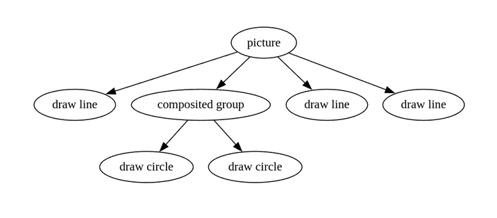
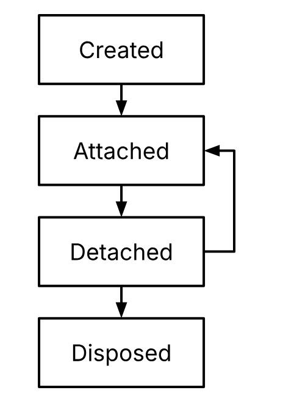
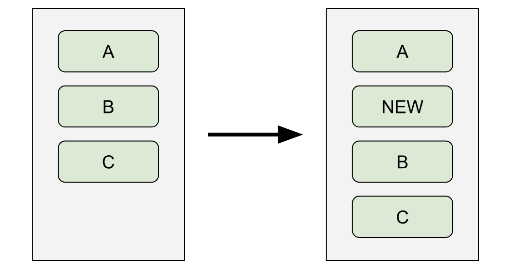
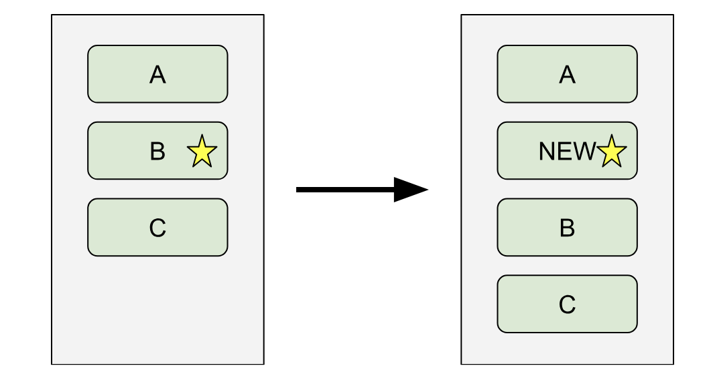
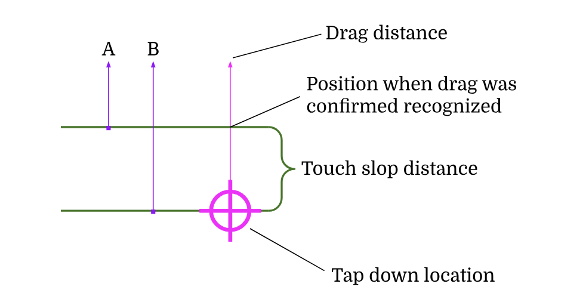
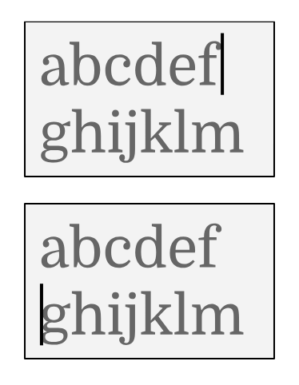
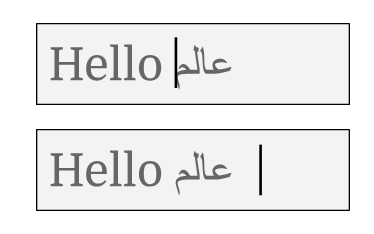
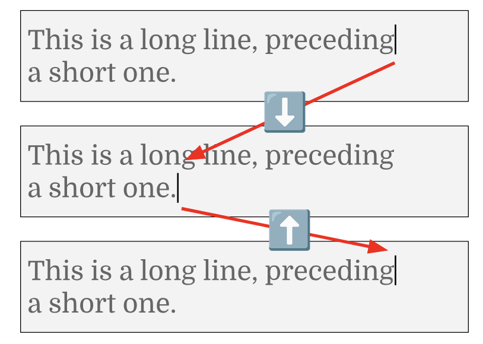
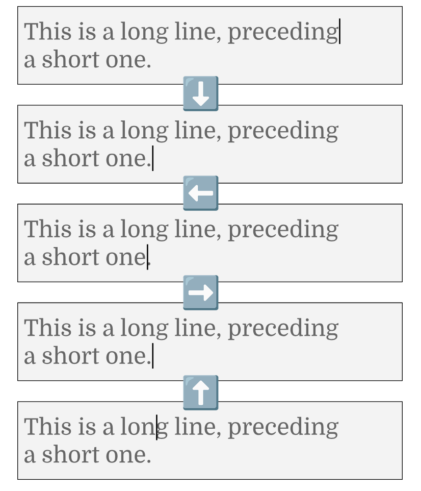

# Building a UI Framework

Русский перевод документа «Building a UI Framework» (Ian Hickson, 2025, первое издание).

- Оригинал: https://software.hixie.ch/ui-frameworks
- Анонс автора: https://ln.hixie.ch/?start=1761249101&count=1
- Автор оригинала: Ian Hickson. Документ написан при финансировании Futurewei Technologies.

Неофициальный любительский перевод. Автор оригинала к нему отношения не имеет и не проверял его.
Все права на исходный текст принадлежат автору.

Это сборка всех глав в один файл. Главы по отдельности лежат в каталоге `ru/`.

## Содержание

**Building a UI Framework**

- [Введение](#введение)

**Вводная часть**

- [Приложения](#приложения)
- [Архитектуры приложений](#архитектуры-приложений)
- [Что такое UI-фреймворк?](#что-такое-ui-фреймворк)
- [Пространство проектирования](#пространство-проектирования)
- [Требования](#требования)

**Цели**

- [Цель: максимизировать developer adoption](#цель-максимизировать-developer-adoption)
- [Цель: максимизировать производительность](#цель-максимизировать-производительность)
- [Цель: максимизировать диапазон возможных визуальных эффектов](#цель-максимизировать-диапазон-возможных-визуальных-эффектов)
- [Цель: минимизировать энергопотребление](#цель-минимизировать-энергопотребление)

**Проектные решения**

- [Юзабилити-тестирование](#юзабилити-тестирование)
- [Composition](#composition)
- [Immediate-mode UI vs retained-mode UI](#immediate-mode-ui-vs-retained-mode-ui)
- [Деревья](#деревья)
- [Как соответствовать соглашениям платформы](#как-соответствовать-соглашениям-платформы)
- [Theming](#theming)
- [Platform integration](#platform-integration)
- [Ориентация на веб](#ориентация-на-веб)
- [Языки программирования](#языки-программирования)
- [Система сборки](#система-сборки)
- [Сообщения об ошибках](#сообщения-об-ошибках)
- [Открытость](#открытость)
- [Опыт «из коробки»](#опыт-из-коробки)
- [State-of-the-art возможности](#state-of-the-art-возможности)
- [Graphics backend](#graphics-backend)
- [Render objects](#render-objects)
- [IDE](#ide)
- [Проектирование API](#проектирование-api)
- [Язык программирования](#язык-программирования)

**Внутреннее устройство фреймворка**

- [Компоновка (layout)](#компоновка-layout)
- [Painting](#painting)
- [Описание UI](#описание-ui)
- [Accessibility](#accessibility)
- [Ввод](#ввод)
- [Фокус](#фокус)
- [Текстовый ввод](#текстовый-ввод)
- [Tooling](#tooling)
- [Анимация](#анимация)
- [Документация](#документация)
- [Безопасность цепочки поставок (supply chain security)](#безопасность-цепочки-поставок-supply-chain-security)
- [Обновление SDK](#обновление-sdk)
- [Аналитика](#аналитика)

**Операционная стратегия**

- [Культура команды](#культура-команды)
- [Коммуникации](#коммуникации)
- [Финансирование](#финансирование)
- [Политика](#политика)
- [Давление](#давление)
- [Начальная стратегия](#начальная-стратегия)
- [Безопасность](#безопасность)
- [Тестовая инфраструктура](#тестовая-инфраструктура)

**Заключение**

- [Фреймворк на Python](#фреймворк-на-python)
- [Новый фреймворк на основе юзабилити-исследований](#новый-фреймворк-на-основе-юзабилити-исследований)
- [Заключительные мысли](#заключительные-мысли)

**Благодарности**


---

# Building a UI Framework

Ian Hickson (ian@hixie.ch) — 2025 — Первое издание — https://software.hixie.ch/ui-frameworks

## Введение

Этот документ рассматривает ключевые проектные решения при создании нового графического UI-фреймворка.

Он был написан по заказу, чтобы ответить на вопрос: как создать UI-фреймворк, если рассматривать четыре возможные цели проектирования — принятие разработчиками (developer adoption), производительность, визуальные эффекты и энергопотребление.

Документ состоит из трёх частей. В первой части мы разберём вводный материал, задающий контекст обсуждения. Во второй части рассмотрим каждую из заявленных целей — они задают ограничения, в рамках которых мы будем думать о проектировании UI-фреймворка. В третьей части обсудим проектные решения, разберём возможные реализации и затронем ряд нетехнических вопросов в контексте указанных целей.

См. также приложение «Оглавление».

### Об авторе

Карьера Иэна Хиксона началась примерно в 1999 году с тестирования и разработки веб-стандартов. Его ранняя работа была сосредоточена на CSS: он участвовал в рабочей группе CSS как приглашённый эксперт и был соредактором CSS 2.1. В 2004 году он стал сооснователем организации по стандартизации WHATWG и около десяти лет был редактором стандарта HTML, введя многие базовые веб-технологии, такие как `<video>`, `<canvas>` и Web Sockets, а также впервые дав точные определения парсинга HTML и ключевых возможностей DOM Level 0, на которых держится веб. В это время он работал в Netscape, Opera и Google.

В 2014 году он присоединился к команде, которая впоследствии создала Flutter — самый популярный кроссплатформенный фреймворк. Он спроектировал новаторскую систему компоновки (layout) Flutter и ряд других ключевых компонентов, а также развивал open-source-сообщество Flutter.

Сейчас он независимый консультант.

# Вводная часть

Этот раздел знакомит с базовыми понятиями проектирования приложений и UI-фреймворков. Те, кто знаком с разработкой приложений и фреймворков для них, вряд ли найдут здесь что-то новое или интересное, но читатели, которым какие-то места в последующих разделах покажутся непонятными, могут найти здесь полезные пояснения.

## Приложения

В рамках этого документа приложение — это самостоятельный программный продукт, с которым взаимодействует пользователь. Приложение выполняется в среде выполнения (runtime environment), например в операционной системе или веб-браузере. Взаимодействие происходит через устройства ввода (сенсорные экраны, мыши, клавиатуры и т. д.) и устройства вывода (экраны, динамики, вибромоторы и т. д.); кроме того, приложения в той или иной мере умеют выполнять вычисления и общаться с другими процессами и сервисами (файловыми системами, сетью, часами и т. п.).

Пользователи взаимодействуют с приложениями через пользовательский интерфейс (User Interface, UI). Разработчики используют программные интерфейсы (Application Programming Interfaces, API) для взаимодействия своего ПО со средой выполнения и другими библиотеками.

## Архитектуры приложений

За годы в моду входили разные подходы к построению приложений. Им давали названия вроде «Model – View – Controller» (MVC), «Model – View – Presenter» (MVP) и «Model – View – ViewModel» (MVVM). На практике существует очень, очень, очень много вариаций этих схем — куда больше, чем названий, — и за годы названия MVC, MVP и прочие применялись настолько вольно к такому множеству вариаций, что сейчас они практически ничего не значат.

Давайте изучим некоторые из этих подходов.

### Без данных, только UI

Самое простое приложение — то, у которого нет состояния. Например, «hello world». UI приложения («представление», view) создаётся и затем остаётся статичным до завершения приложения.

Такое приложение — по сути документ. Поскольку оно состоит только из UI, проектировать в нём нечего.

### Данные и UI вперемешку, без абстракций

Приложению с состоянием нужен какой-то способ это состояние менять и отражать изменения в UI. Простейшим приложениям с состоянием сложная абстракция не нужна, поэтому разработчики обычно её и не вводят: данные и логика UI могут быть перемешаны.

Например, рассмотрим приложение, которое просто показывает счётчик с возможностью его увеличить. Его можно реализовать так: есть переменная (например, глобальная), хранящая текущее значение; UI-компоненты читают её при запуске и показывают; когда пользователь нажимает кнопку, код кнопки напрямую увеличивает переменную и затем обновляет отображение, показывая новое значение.

### Разделение данных и UI (Model – View)

Когда состояние приложения становится существенным, смешивать данные и UI становится неудобно. Например, чтобы показать один и тот же фрагмент данных в нескольких местах интерфейса (скажем, заголовок документа), элементам интерфейса нужно ссылаться друг на друга; если их времена жизни не совпадают, требуется дополнительная логика координации. В этот момент напрашивается очевидная абстракция: отделить модель данных («модель», model) от UI («представление», view).

Например, рассмотрим калькулятор. Его модель содержит текущее значение и сохранённые в памяти значения, возможно, историю. Представление состоит из кнопок и дисплея.

Когда пользователь нажимает кнопку, та может обновить модель и затем сказать остальному UI обновиться, чтобы дисплей отразил новое значение, прочитав его из модели.

Преимущество разделения данных и UI — помимо удобства построения самого интерфейса — в том, что данные проще сохранять. Например, появляется единое место, откуда данные можно записать в локальную базу или передать на сервер и обратно. Организовать такую синхронизацию, когда данные перемешаны с логикой интерфейса, куда менее удобно.

### Логика в модели (разделение логики и UI)

Одна из вариаций: модель содержит и данные, и бизнес-логику. Когда в UI нажимают кнопку «добавить», представление не меняет число в модели напрямую, а сообщает модели «пользователь нажал „добавить“», и модель сама обновляет число.

Преимущество этого подхода в том, что бизнес-логику можно описать отдельно от UI и переиспользовать с другими интерфейсами. (В крайних случаях модель может быть написана вообще на другом языке программирования.) Это также означает, что бизнес-логику можно тестировать в юнит-тестах, не задействуя UI.

Именно эту модель данный документ рекомендует как вариант по умолчанию для шаблонов фреймворка и первых примеров.

### Событийная модель

Раз уж логика перенесена в модель данных, разумно привести API её обновления к единообразной событийной архитектуре: каждое обновление — это событие, и модель данных обрабатывает события неким единым образом. (Иногда это называют паттерном Business Logic Component, BLoC.)

Это открывает интересную возможность: события можно хранить, а состояние модели данных определить как результат свёртки (reduce) по списку событий. Отмена действия становится тривиальной операцией удаления последнего события из списка.

### Модель уведомляет слушателей (pub/sub)

Когда модель отделена от отображения, вместо того чтобы компоненты отображения уведомляли друг друга о необходимости отразить изменение, сама модель может уведомлять слушателей (компоненты представления) об изменениях в ней. При таком подходе кнопке не нужно сообщать дисплею, что что-то изменилось; кнопка лишь уведомляет модель («публикует» изменение определённого типа), а модель уведомляет компоненты отображения (которые «подписаны» на определённые типы изменений).

Уведомления могут быть детальными. Например, если модель отслеживает и текущее число, и сохранённые в памяти значения, то метка со счётчиком памяти калькулятора может слушать уведомления об изменении размера памяти, а дисплей — обновления текущего числа. Это сокращает число избыточных обновлений UI.

### Изолированные данные и UI (Model – View – Controller)

В подходе Model – View представление всё ещё знает о модели. Это можно абстрагировать дальше, введя отдельный объект — контроллер, — который опосредует все взаимодействия между моделью и представлением. Когда модель обновляется, она может уведомить контроллер, а контроллер обновит UI; когда пользователь взаимодействует с UI, тот уведомляет контроллер, а контроллер превращает это в команды для модели.

Ценность отдельного контроллера сильно зависит от сложности модели данных и UI, от того, насколько модель похожа на UI, который её показывает, и от того, насколько сильно они, как ожидается, будут меняться со временем. Если модель данных близко повторяет представление, посредник почти ничего не даёт. С другой стороны, если структура данных мало похожа на то, как данные показываются, отдельный компонент, способный предобработать данные перед отображением, может сильно упростить слой UI и улучшить тестируемость.

### Представление уведомляет слушателей

Представление может уведомлять контроллер об изменениях напрямую, а может быть иначе: контроллер слушает события представления. Во втором варианте модель и представление предоставляют API, но ничего не знают ни друг о друге, ни о контроллере, что делает тестирование модели и представления ещё проще. В такой архитектуре контроллер переводит уведомления от модели и уведомления от представления в обновления представления и обновления модели соответственно, конвертируя между их соглашениями.

### Привязка данных (Model – View – View Model/Binder)

Вариант подхода с контроллером: посредник (в этом случае называемый View Model) предоставляет данные, которые нужно показать в представлении, а представление привязывается (binds) напрямую к View Model (вместо того чтобы контроллер проталкивал обновления в представление). Механизм, которым представление привязывается к View Model, называется Binder.

### Двусторонняя привязка

Внешне привлекательный вариант этого подхода — двусторонняя привязка (two-way binding), при которой взаимодействие пользователя с элементом управления напрямую влияет на нижележащую модель данных (а не через API, как описано выше).

Этот подход часто подают как минимизирующий работу разработчика, но у него ряд недостатков: он усложняет валидацию данных; несёт риск циклов обновления (представление напрямую обновляет данные, данные сохраняются в чуть иной форме, модель заставляет представление обновиться, но представление показывает данные в чуть иной форме, что запускает новое обновление данных, и т. д.); и требует, чтобы данные были ровно в той форме, что нужна представлению.

### Entity – Component – System

Совершенно иной способ подойти к архитектуре приложения — подход Entity – Component – System (ECS), применяемый в основном в играх.

В этой архитектуре каждый элемент управления мог бы быть представлен как сущность (entity) с компонентами (components) — позиция, эффекты наведения, значения и т. д. Различные системы (systems) — позиционирование, rendering, обработка мыши и т. п. — регулярно проходят по всем сущностям и применяют своё поведение.

Главное преимущество ECS в том, что он поощряет хранение данных способом, повышающим локальность данных для компонентов. Система, проверяющая обработку мыши, может пройти по всем нужным данным всех UI-сущностей без отдельных выборок для каждой сущности. Это контрастирует с большинством UI-подходов, где данные хранятся в древовидной структуре, что обычно ведёт к множеству промахов кэша на уровне CPU.

На практике ECS плохо подходит для UI. ECS-архитектуры лучше всего работают, когда сущности в значительной степени независимы; в UI же между сущностями, как правило, тесная связь, например для целей компоновки. Хотя технически дерево через ECS представить можно, это не сильная сторона ECS-архитектур.

### Клиент – сервер

У приложений часто есть удалённая часть и часть на устройстве пользователя. Часть на устройстве пользователя обычно считают клиентом, а удалённую — сервером. (Один сервер обычно обслуживает несколько клиентов одновременно.) Способ их общения может варьироваться — например, протоколы HTTP, Web Socket, «сырые» TCP-сокеты или UDP, — но такие детали вне рамок этого документа.

### Установленные приложения

Традиционная модель развёртывания приложения: код и сопутствующие ресурсы каким-то образом копируются на устройство пользователя — например, на заводе или, чаще, когда пользователь скачивает пакет из интернета через другое приложение (магазин приложений или веб-браузер).

После этого приложения часто скачивают обновления автоматически либо делегируют эту обязанность операционной системе или вспомогательным библиотекам (например, упомянутому магазину приложений).

### Эфемерные приложения

Некоторые приложения рассчитаны на работу в среде выполнения, которая загружает приложение динамически по требованию. Так, например, работает просмотр веба. Браузер на устройстве пользователя загружает данные, код и ресурсы веб-страницы (для наших целей мы называем эту страницу «приложением»), а затем отрисовывает и выполняет страницу на устройстве. В принципе, другие системы могли бы использовать похожий подход, но на практике это крайне редко. В Android есть похожая модель «instant apps» (хотя она редко используется), а в iOS — App Clips, технически похожая модель, но не предназначенная для замены приложений.

### Server-side rendering

Поскольку эфемерные приложения требуют, чтобы пользователь скачал приложение до того, как сможет с ним взаимодействовать, возникает проблема производительности: чем больше приложение, тем дольше пользователь ждёт результата. Чтобы этого избежать, в вебе (и в принципе на любой платформе с эфемерными приложениями, но сейчас это только веб) принято проектировать приложение так, чтобы браузер получал достаточно информации на раннем этапе загрузки для первоначального rendering и интерактивности, а остальной контент догружался в фоне (если вообще).

Одна из техник для этого — server-side rendering, при котором логика приложения выполняется на сервере, создавая статическую, готовую к показу форму приложения. Это противоположность client-side rendering, где логика приложения выполняется на клиенте, строя UI, который затем отрисовывается. Поскольку client-side rendering может требовать существенного объёма логики (например, UI-фреймворка), тогда как server-side rendering опирается только на встроенную логику клиентской платформы (браузера), последний может выдавать первый кадр значительно быстрее. Конечно, когда приложение целиком доступно локально, генерация следующего экрана на клиенте занимает считаные миллисекунды, тогда как получение следующего экрана с сервера требует как минимум одного сетевого обхода — десятки, а то и сотни миллисекунд. Поэтому веб-фреймворки часто используют гибридный подход: разработчик пишет код для client-side rendering, а фреймворк использует этот код для предварительной генерации server-side-rendered экранов.

### Разделение стиля и семантики

В принципе веб спроектирован так, чтобы способ представления содержимого веб-страницы мог динамически меняться под разные характеристики устройств: разные размеры экрана, глубину цвета или — куда радикальнее — разные носители (media), например rendering страницы для экрана, для брайлевского дисплея, для аудио через синтез речи и т. д.

Для этого HTML устроен так, что семантику (смысл) содержимого можно закодировать независимо от инструкций стиля (представления). Вместо того чтобы помечать блок текста как имеющий больший размер шрифта, его помечают как заголовок. Разделы текста с заголовками можно выделить, и эти разделы могут быть вложенными, неявно определяя отношения между частями документа. Разделы можно пометить как врезки, подвалы и т. д. Внутри абзацев фрагменты текста можно пометить как выделение, цитату, ввод с клавиатуры и т. д. Это позволяет отдельной части документа, написанной в формате Cascading Style Sheets (CSS), указать, как документ должен отображаться, связывая конкретные стили с конкретной семантикой. Заголовок может быть помечен как синий для экранного носителя и как громкий — для аудио. Фрагмент текста, обозначающий ввод с клавиатуры, может быть моноширинным на экране и озвучиваться роботизированным голосом в аудио.

Это также позволяет быстро переключаться между разными видами представления на одном и том же носителе. Раздел навигации может показываться слева, если экран достаточно широк, или сверху, если нет. Цветовую схему и шрифты веб-страницы можно поменять в любой момент, просто заменив таблицу стилей.

В теории это делает веб уникально пригодным в качестве мультимедийного, независимого от устройства фреймворка приложений. Это же позволило бы компьютерам семантически анализировать веб-страницы для поиска (и не только).

На практике конечная цель — независимость от устройства — достигнута не была. Контент пишется либо для экранов компьютеров, либо для экранов телефонов, а аннотации accessibility (если пользователю повезёт) накладываются сверху, чтобы accessibility-инструменты могли с этим контентом работать. Вместо того чтобы веб был нативно «аудийным», пользователи воспринимают веб как визуальный носитель, адаптированный под аудио. Цвета и шрифты часто глубоко зашиты в контент, а не чисто отделены. Семантические элементы HTML используются больше для удобства разработчика, чем пользователя, а там, где это удобство заканчивается, вовсю применяются лишённые семантики элементы HTML (вроде `<div>`).

По сути, большинство людей, похоже, не очень приспособлены думать о разработке приложений на том уровне абстракции, который нужен для написания кода со строгим разделением стиля и семантики. Поэтому статус-кво — когда разработчики целятся в конкретные размеры экранов, а поверх этого накладывают accessibility-функции — оказывается наиболее прагматичным подходом с точки зрения максимальной полезности приложений.

## Что такое UI-фреймворк?

Многие аспекты написания интерактивных приложений общи для множества приложений; UI-фреймворк — это библиотека, собирающая эти общие элементы вместе, чтобы разработчикам приложений не приходилось изобретать велосипед в каждом проекте.

### Составные части UI-фреймворка

Вот некоторые типичные составные части UI-фреймворка.

#### Библиотеки виджетов

UI-фреймворки обычно поддерживают механизм обращения к готовым компонентам (кнопки, флажки, текстовые поля, прокручиваемые списки и т. д.). Их также иногда называют элементами управления (controls) или элементами. Как правило, фреймворки позволяют разработчикам компоновать эти компоненты в переиспользуемые блоки.

#### Описание UI

Разработчик приложения должен описать, как виджеты складываются в приложение. Это может быть предметно-ориентированный язык (DSL), такой как HTML, либо серия императивных вызовов, создающих структуру данных, либо гибрид в функциональном духе. У некоторых фреймворков есть инструменты (визуальные редакторы интерфейсов), генерирующие код или файлы данных с описанием UI.

#### Компоновка (layout)

По описанию UI фреймворк должен определить позиции различных компонентов. В одних фреймворках это тривиально (каждому компоненту назначается абсолютная позиция и размер на сетке), в других фаза компоновки может быть весьма нетривиальной (обеспечивая адаптивный дизайн, когда одно описание интерфейса работает для широкого спектра форм-факторов — телефонов, планшетов и экранов компьютеров).

Насколько сложной должна быть система компоновки UI-фреймворка, зависит от сценариев, под которые он проектируется. Фреймворку для встраиваемых систем с экранами фиксированного размера и вводом кнопками (например, киоски) сложная компоновка не нужна. С другой стороны, фреймворк для настольных ОС с изменяемым размером окон или для мобильных устройств, где экран можно повернуть, требует более богатого, динамичного подхода.

#### Rendering

Когда позиция каждого виджета известна, фреймворк должен сгенерировать пиксели, образующие сцену с этими виджетами. Эта фаза сама может состоять из многих частей: painting (виджеты превращаются в векторы, display lists, битмапы или другие конкретные представления), compositing (изображения, образующие виджеты, каким-то образом объединяются, например для разрешения прозрачности, теней или эффектов смешивания) и rasterizing (векторные изображения превращаются в пиксели).

Современные фреймворки активно используют GPU-шейдеры для rendering UI-сцен. Например, вместо вычисления пикселей градиента на CPU их вычисляет GPU с помощью шейдера.

Типографика — важная и зачастую большая часть rendering-конвейера. Фреймворкам обычно приходится поддерживать Unicode, шрифты, двунаправленный текст, шейпинг текста (например, для арабского), измерение текста, выравнивание по ширине, эмодзи и множество других возможностей, которые сегодня считаются обязательным минимумом.

#### Hit testing

Чтобы быть интерактивными в средах с сенсорными экранами, мышами или тачпадами, фреймворки имеют механизм определения, какие виджеты соответствуют каким пиксельным позициям в сцене. Он используется для реализации тапов и кликов, эффектов наведения (например, подсказок) и перетаскивания.

#### Фокус и focus traversal

Поддержка клавиатуры требует, чтобы фреймворк отслеживал, какой виджет в данный момент получает ввод с клавиатуры, а также как виджеты соотносятся друг с другом — для пространственной focus traversal и навигации по Tab.

#### Accessibility

Весь фреймворк пронизан решениями и функциями, призванными помогать пользователям тем или иным образом. Например, зоны нажатия (hit targets, чувствительные к касанию области) должны иметь такой размер, чтобы пользователям не приходилось с трудом попадать в нужные части приложения. Текст должен отрисовываться в размерах, согласующихся с предпочтениями пользователя. Элементы управления должны быть доступны через accessibility API ОС, чтобы пользователи могли работать с ними через вспомогательное ПО. Цвета должны подбираться с достаточным контрастом, чтобы оставаться читаемыми даже в неидеальных условиях. Список accessibility-функций и адаптаций, которые фреймворк должен учитывать, длинный.

#### Интеграция с операционной системой

Приложения работают в контексте операционной системы (ОС, также называемой платформой), с графическим интерфейсом которой приложение должно интегрироваться. Например, ОС нужно сообщить иконку и имя приложения; через ОС приложение узнаёт о событиях ввода (клавиатура, касания, мышь и т. д.); ОС обычно предоставляет accessibility API, который приложение должно поддерживать, и так далее.

Список точек интеграции с операционной системой огромен. Тесная интеграция с ОС обычно даёт лучший пользовательский опыт. Например, приложение, которое плавно реагирует на переключение ОС из светлой темы в тёмную, раздражает меньше, чем приложение, которое при смене темы мигает, перезапускает воспроизведение видео и теряет несохранённый пользовательский ввод.

#### Локализация и интернационализация

Когда приложения пишутся для пользователей более чем одной локали, требуется ряд функций.

Локализацией называют API, поддерживающие перевод приложения на несколько языков. Помимо динамического выбора строк, сюда может входить объединение строк или принятие иных решений в зависимости от конкретных отображаемых сообщений. Например, рассмотрим сообщение со строкой «Found 5 files». Если найден один файл, то в английском сообщение должно быть «Found 1 file» (единственное число). В других языках могут быть разные строки для случаев 0, 1, 2 или более.

Интернационализация — это поддержка различий в соглашениях об отображении и представлении: начало недели с понедельника, а не с воскресенья; 12-часовой формат времени вместо 24-часового; разная пунктуация в записи больших чисел или дробей.

Некоторые локальные различия могут требовать обширной поддержки в UI-фреймворке. Например, некоторые языки (арабский, иврит) пишутся справа налево, тогда как другие (английский, французский) — слева направо. Это влияет на всю ориентацию UI (например, полосы прокрутки обычно располагаются с дальней стороны относительно направления письма).

Может быть желательна поддержка и других ориентаций: например, письмо сверху вниз (вертикальный текст) иногда используется в Японии. Поддержка вертикальной компоновки текста намного сложнее простого разворота системы координат.

### Общие понятия

#### Элементы управления (controls)

Термином элемент управления (control) обычно называют элемент пользовательского интерфейса, который пользователь воспринимает как отдельный компонент, с которым можно взаимодействовать: кнопка, текстовое поле, флажок, окно, ползунок. Некоторые элементы составные, например spinner — это текстовое поле с кнопками «вверх» и «вниз».

#### Render objects

Термином render object мы будем называть базовый примитив дерева компоновки. Это узел, содержащий логику определения как минимум геометрии UI-сцены; обычно он же используется для painting и hit testing. Это понятие есть в большинстве UI-фреймворков; альтернатива — пересчитывать потенциально дорогую компоновку всего интерфейса каждый кадр. Стандартного отраслевого термина для этого примитива нет; используются также layout nodes, render elements, visual objects.

Во многих фреймворках эти же объекты используются для представления элементов управления (кнопок, текстовых полей). В таких контекстах термин может быть более общим: view, control, element или component.

#### Деревья

UI-фреймворки буквально кишат деревьями. UI часто представляется деревом виджетов, компоновка — деревом render objects, результат rendering — деревом display lists. Информация accessibility обычно тоже представлена деревом. Узлы этих деревьев часто реализованы объектами из иерархии классов — ещё одного дерева. В некоторых фреймворках есть и внутренние структуры данных, которые сами являются деревьями, например virtual DOM в React или дерево слоёв во Flutter.

#### Дочерние узлы

Узлы деревьев обычно могут иметь дочерние узлы (те, у которых их нет, по определению являются листьями), представленные списком узлов.

Некоторые примитивы компоновки не идеально ложатся на список детей. Например, двумерная сетка или таблица данных. Некоторые фреймворки решают это, всё равно сводя всё к спискам: таблица может быть списком строк, содержащих списки ячеек (так делает HTML). Это становится немного неуклюжим, когда есть ячейки, охватывающие несколько строк или столбцов (или и то и другое), но проблема решаемая. Другой подход — один список, который затем отображается на таблицу (например, конкатенация всех ячеек каждой строки в один длинный список). Так часто делают внутри. Некоторые фреймворки менее категоричны в том, как представлять детей, и могут использовать разные структуры данных в разных ситуациях, по обстоятельствам.

#### Межъязыковое взаимодействие

Кроссплатформенные фреймворки часто имеют дело с несколькими языками или средами выполнения. (Как минимум Android требует взаимодействия с Java-подобной средой, а iOS — со Swift-подобной, так что даже если фреймворк использует тот же язык, что и одна из этих платформ, на другой ему не избежать работы между языками.)

Термин Foreign Function Interface (FFI) обозначает именно механизмы синхронного вызова кода, написанного на одном языке или в одной среде, из кода на другом (напрямую или через некий thunk). Есть и другие механизмы межъязыкового взаимодействия, например передача сообщений.

#### Compositing и composition

Термин compositing обозначает то, как слои инструкций рисования объединяются в итоговую сцену. Это похоже на наложение стеклянных пластин.

Термин composition обозначает возможность объединять строительные блоки для создания более сложных конструкций. Это похоже на постройку домиков из кубиков Lego.

Эти термины и понятия никак не связаны.

#### Встраиваемые системы (embedded)

Термин «embedded» обозначает использование ПО в специализированном оборудовании, в противоположность компьютерам общего назначения. Например, носимые устройства (часы), бытовая техника (посудомоечная машина), автомобили (приборная панель) или сервисы для пассажиров (бортовая развлекательная система современного лайнера). UI-фреймворки применяются во всех этих сценариях, но обычно такие платформы не поддерживаются «из коробки» и требуют от конечного разработчика некоторой работы по портированию.

#### Immediate-mode и retained-mode API

API бывают разных форм, и некоторые можно классифицировать по способу работы. API, предоставляющий модель данных, которую можно изменять, — это «retained-mode» API. Например, библиотека может хранить текущее состояние картинки, а клиент (вызывающий код) — мутировать картинку: двигать её части со временем или менять атрибуты вроде цвета. Напротив, API без внутреннего состояния, используемый для вычислений по требованию, — это «immediate-mode» API. Например, библиотека может иметь команды для построения картинки с нуля, где полученный объект картинки принадлежит клиенту.

## Пространство проектирования

Как и в любом инженерном проекте, важно заранее решить, какой должна быть основная цель. Разные цели ведут к разным проектным решениям, и разные цели часто взаимоисключающи. В программной инженерии, например, часто приходится выбирать между потреблением памяти и пропускной способностью (компромисс «пространство/время»).

Дополнительно эти цели ограничивают требования — функции, не подлежащие обсуждению.

Грубо говоря, требования можно рассматривать как функции, которые либо адекватно реализованы, либо нет, тогда как цели — это, как правило, метрики, где успех относителен.

## Требования

### Графический пользовательский интерфейс

Пользовательские интерфейсы бывают разных форм: интерфейсы командной строки, диалоговые (например, в голосовых ассистентах), физические панели с кнопками, жестовые (как в Microsoft Kinect или Apple Vision Pro).

Здесь мы сосредоточимся на графическом пользовательском интерфейсе (GUI), используемом на плоских экранах. Это в основном 2D-системы. Большинство приложений для настольных компьютеров, мобильных устройств, «откинувшись в кресле» форм-факторов (телевизоров) и носимых устройств используют такой интерфейс. Даже 3D-игры обычно используют GUI в меню и экранах настроек.

На момент написания ожидания в отношении 2D GUI формировались 57 лет. Некоторые возможности существуют давно, например кнопки (фигуры, активируемые каким-либо указывающим устройством или касанием для запуска действия) или текстовые поля (области, где можно ввести или отредактировать строку текста). Другие сильно менялись с годами, например полосы прокрутки (которые, в целом сохраняя тему «ползунок и дорожка», то имели стрелки с одной или обеих сторон дорожки, то не имели их вовсе; то делали дорожку интерактивной, то нет; то делали ползунок пропорциональным прокручиваемому контенту, то фиксированной высоты; то экспериментировали с тем, видна ли полоса вообще, когда контент не прокручивается или не прокручивается прямо сейчас). Точный набор решений, принятых в графическом интерфейсе, называется design language. Операционные системы (или окружения рабочего стола) обычно принимают единый design language, которому ожидают следования от приложений (иногда это называют «соглашениями платформы»).

С точки зрения ожиданий от UI-фреймворка разработчики, как правило, хотят, чтобы фреймворк следовал этим соглашениям платформы. Для кроссплатформенных фреймворков это может означать реализацию нескольких design languages либо интеграцию с собственной реализацией design language операционной системы или окружения рабочего стола.

Приложения иногда намеренно отходят от этих соглашений, например пытаясь сформировать собственную идентичность бренда. Для поддержки этого UI-фреймворк должен давать возможность создавать кастомные элементы управления с собственным design language.

### Поддержка нескольких платформ

В рамках этого документа мы будем в первую очередь рассматривать решения, позволяющие из одной кодовой базы собирать приложения для всех этих платформ:

- iOS (телефоны и планшеты)
- Android (телефоны и планшеты)
- Windows
- macOS
- Desktop Linux (X, Wayland)
- Веб-браузеры (через JS или Wasm)
- Новые потребительские платформы, такие как OpenHarmony (стандартные системы)

Для практических целей эти требования позволяют предполагать 64-битную архитектуру, как минимум сотни мегабайт доступной оперативной памяти и хранилища, а также наличие GPU. У каждой из этих сред есть и некий уровень абстракции оборудования; например, фреймворк может полагаться на хост-среду в переводе аппаратного ввода в чётко определённую структуру.

Мобильные платформы (iOS, Android и OpenHarmony) также поддерживают периферию: часы (например, Linwear), автомобильные информационно-развлекательные системы (например, CarPlay) и телевизоры (например, Android TV). В одних случаях это полное портирование фреймворка и приложений (например, приложения Android Automotive OS — полноценные Android-приложения, работающие прямо на автомобильной системе); в других приложение работает на хост-устройстве (телефоне) и через API управляет периферией (например, ПО для Android Auto не выполняется непосредственно на автомобильном оборудовании). UI-фреймворки также используются для создания интерфейсов «умной» бытовой техники, медицинских устройств и других устройств интернета вещей (IoT).

Поддержка этой периферии и IoT-устройств, в целом известных как «встраиваемые устройства», считается выходящей за рамки этого документа. При этом, хотя возможность использовать фреймворк во встраиваемых сценариях не является требованием, на практике фреймворк, поддерживающий перечисленные выше платформы модульным образом, скорее всего, будет портируем на такие системы без существенной переработки архитектуры.

### Платформенные соглашения

Как отмечено выше, у разных платформ разные соглашения. Из-за этого UI-фреймворк, поддерживающий несколько платформ, должен реализовывать rendering и поведение, специфичные для некоторых из поддерживаемых платформ. Часть этих соглашений устоялась прочно, и они будут явно упомянуты в этом документе. Большинство же — вопрос моды, и соглашения меняются из года в год, поскольку операционные системы стараются поддерживать ощущение свежести. Поэтому подобные детали в документе в основном опускаются; разработчики фреймворка должны изучать целевые платформы при реализации функций, чтобы соответствовать текущим соглашениям, и обновлять фреймворк по мере их изменения.

### Ввод и вывод

Чтобы быть конкурентоспособным вариантом для приложений на указанных платформах, фреймворк должен поддерживать, среди прочего:

- Ввод с сенсорного экрана (мультитач), включая жесты.
- Ввод с физической клавиатуры, мыши, трекпада и стилуса.
- Ввод через IME (Input Method Editor).
- Дисплеи с разной плотностью пикселей — от 96 ppi до 500+ ppi.
- Приложение, растянутое на несколько мониторов.
- Несколько окон.
- Платформенные accessibility-слои (VoiceOver, TalkBack, JAWS и т. д.).
- Тактильную отдачу (haptic feedback).
- Расширенный динамический диапазон и широкий цветовой охват (больше цветов).
- Встраивание других приложений в интерфейс (например, внешнего просмотрщика PDF, 3D-сцены или рекламы, отрисованной отдельной библиотекой), включая проброс событий указателя и клавиш во встроенное приложение.

### Возможности компоновки

От фреймворков ожидается поддержка многих возможностей, в произвольном порядке:

- Прокрутка (включая полосы прокрутки, закреплённые заголовки, бесконечную прокрутку, перемотку).
- Theming.
- Редактирование текста.
- Локализация и интернационализация.
- Компоновка текста справа налево.
- Вертикальная компоновка текста.
- Анимация.

# Цели

Как упомянуто во введении, в рамках этого обсуждения мы будем рассматривать в первую очередь четыре возможные цели проектирования: developer adoption (принятие разработчиками), производительность, визуальные эффекты и энергопотребление. Каждая разбирается в своём разделе ниже.

UI-фреймворки можно оптимизировать и под другие цели.

Одна из целей, привлёкшая много внимания в последние годы, — совместимость с AI. Многие команды в индустрии экспериментируют с генеративным AI, создающим UI по запросу; фреймворк может подходить для этого лучше или хуже.

Ещё одна смежная цель — пригодность для server-driven dynamic UI. Веб с его полностью управляемой в runtime динамической архитектурой хорошо для этого подходит, и многие сайты на деле являются разновидностью приложения, целиком построенного из server-driven UI. Например, поисковые системы выбирают UI-компоненты в ответ на запросы пользователя: страница результатов по запросу [SJC to LAX] может содержать форму выбора рейсов, а страница по запросу [vamp lyrics] — медиаплеер. Фреймворк, спроектированный под server-driven UI, может существенно отличаться от фреймворка, спроектированного для показа UI, который поставляется вместе с приложением и работает офлайн.

У фреймворков, создаваемых с прицелом на веб, целью может быть поисковая оптимизация (SEO): возможность для поисковых систем обходить приложение и находить его содержимое, чтобы оно появлялось в результатах поиска. Это ключевая функция для социальных сетей (где значительная часть вовлечённости идёт от того, что пользователи находят существующие обсуждения по своим интересам) и интернет-магазинов (где продажи идут от того, что пользователи находят нужные товары).

## Цель: максимизировать developer adoption

Одна из возможных целей — создать фреймворк, который используется в большем числе приложений или принят большим числом разработчиков, чем существующие фреймворки.

### Определение конкурентного ландшафта

Прежде чем проектировать фреймворк, который превзойдёт существующие, нужно сначала установить масштаб распространённости существующих фреймворков.

Определить общую распространённость существующих UI-фреймворков нетривиально. Мы рассмотрим два подхода: объективный подсчёт распространённости по развёрнутым приложениям и опросы разработчиков.

#### Распространённость по развёрнутым приложениям

##### Подход

Один из способов измерить распространённость — подсчитать, сколько приложений используют те или иные фреймворки. Это сопряжено с рядом трудностей.

Первая проблема — как определить «приложение» и какие приложения следует считать входящими в рамки такого анализа. Корпоративное ПО составляет значительную долю всего программного обеспечения, но при этом не является общедоступным. Много ПО доступно только за деньги, что увеличивает потенциальную стоимость анализа. У платформ, как правило, есть несколько платформо-специфичных фреймворков; открытый вопрос, стоит ли считать их релевантными при обсуждении проектирования кроссплатформенных фреймворков. Кроме того, много ПО устарело или больше не поддерживается: следует ли считать выбор, сделанный разработчиками в прошлые десятилетия, релевантным сегодняшнему обсуждению? Аналогично, может возникнуть желание отфильтровать приложения, созданные как игрушки, proofs of concept или заброшенные на ранней стадии разработки; или анализировать приложения отдельно от игр; или классифицировать приложения по целевой аудитории либо по какому-то другому признаку. Если рассматривать конкретно веб-приложения, нужно решить, считать ли отдельные страницы, хосты, домены или использовать какой-то более тонкий подход. Например, является ли каждая страница на amazon.com отдельным приложением? Является ли amazon.co.uk тем же приложением, что и amazon.com? А read.amazon.com?

Вторая проблема — как считать распространённость. Следует ли взвешивать приложения по числу пользователей? По текущим темпам установок? По выпущенным версиям? По числу разработчиков? Следует ли ограничить анализ только приложениями с числом активных пользователей больше некоторого порога? Или, наоборот, меньше — на том основании, что у самых популярных приложений могут быть другие потребности, и потому они представляют другой, гораздо меньший рынок?

Третья проблема — как определить «фреймворк». Следует ли считать, что любое приложение, работающее в браузере, использует «веб» (то есть HTML, JavaScript, CSS, DOM и т. д.), или такие приложения нужно группировать по веб-фреймворку (например, React, vue.js и т. д.)? Релевантны ли серверные веб-UI-фреймворки? Следует ли считать, что любое Android-приложение с Webview использует «веб» в качестве UI-фреймворка? Следует ли считать, что все приложения, работающие на Android, используют JVM? Когда приложение использует несколько фреймворков (частая ситуация, особенно в старых, крупных приложениях), как их считать?

На практике такой анализ пришлось бы проводить отдельно для каждой платформы: приложения на этой платформе нужно было бы каким-то образом выявить и собрать, а затем проанализировать каждое, чтобы определить используемый фреймворк (или фреймворки). Такой анализ нетривиален для каждой платформы, причём по разным причинам. В вебе триллионы веб-страниц. У iOS и Android проприетарные магазины приложений, и полного индекса своего ассортимента они не предоставляют. Многие десктопные приложения распространяются по самодельным или проприетарным каналам, которые непросто обнаружить.

##### Догадки

В отсутствие настоящего анализа мы подставим вместо него некоторые догадки, основанные на опыте и маркетинговых заявлениях.

На самом верхнем уровне, судя по всему, «веб» (то есть HTML и т. д.) — самый широко используемый UI-фреймворк в пересчёте на приложения.

Многие, если не большинство, приложений, использующих «веб», на самом деле используют один или (очень часто) несколько веб-специфичных фреймворков, таких как React. Какие веб-фреймворки самые популярные, со временем значительно менялось. Похоже, не существует свежего общедоступного анализа веб-контента, который прямо ответил бы на вопрос, какой фреймворк используется шире всего. Такой анализ требует значительной инфраструктуры для обхода веба.

Конкретно на iOS, по данным Google и Apptopia, три самых используемых фреймворка — Flutter, UIKit и SwiftUI.

Конкретно на Android самые широко используемые фреймворки — вероятно, фреймворк по умолчанию, Flutter и React Native (в этом порядке).

Другие платформы анализировать ещё сложнее, и трудно делать какие-либо твёрдые утверждения, но, вероятно, шире всего используются нативные фреймворки — при некотором определении «нативного фреймворка». (Особенно запутанно это на Windows, где Microsoft за годы рекомендовала больше десятка фреймворков, зачастую одновременно; и на Linux, где официального фреймворка по умолчанию нет вовсе.)

##### Вывод

Подход к проблеме со стороны приложений потребовал бы значительных вложений для получения объективных результатов. В пересчёте на приложения по всем платформам, основываясь главным образом на догадках, выведенных из опыта автора, фреймворки, которые с наибольшей вероятностью имеют самую широкую распространённость, — это веб, Flutter, React, React Native и фреймворки «по умолчанию» в целом.

#### Developer adoption

Вместо того чтобы смотреть на распространённость в развёрнутых приложениях, можно посмотреть, что разработчики заявляют об использовании в опросах.

У опросов есть ряд важных ограничений. Они экстраполируют по тем разработчикам, которые на опрос отвечают; систематическая ошибка отбора среди респондентов неизбежна (например, отвечать будут только те, кто знает об опросе и у кого есть время его заполнить). Это чревато значительными слепыми пятнами: например, если существует большое сообщество разработчиков, которое никогда не сталкивается с опросом, и предпочтения этого сообщества значительно отличаются от предпочтений отвечающих на опрос разработчиков, это, естественно, не будет зафиксировано. Опросы зависят от самоотчётов. Люди печально известны тем, что плохо умеют точно описывать собственное поведение. Эти и другие проблемы приводят к тому, что результаты опросов со временем колеблются настолько, что предполагать погрешность в ±10% вполне разумно.

##### Stack Overflow Developer Survey

Один из таких опросов с опубликованными данными — Stack Overflow Developer Survey, хотя интерпретировать его результаты с точки зрения определения самого популярного UI-фреймворка не вполне удобно: опрос разбивает релевантные результаты на «языки», «веб-технологии» и «прочие библиотеки», а не, например, на «библиотеки машинного обучения» и «библиотеки пользовательского интерфейса», что было бы полезнее для наших целей. Тем не менее, рассмотрев все три категории и объединив результаты, мы получаем следующие показатели распространённости среди разработчиков, ответивших на этот опрос в 2024 году:

| Framework | Adoption | Примечания | Target |
|---|---|---|---|
| HTML/CSS | 52.9% | Веб. | Web |
| React | 39.5% | Веб-библиотека. | Web |
| .NET | up to 25.2% | Кроссплатформенный. Помимо UI-кода включает серверный код. | n/a |
| Next.js | 17.9% | Библиотека для React (веб). | Web |
| Angular | 17.1% | Веб-библиотека. | Web |
| Vue.js | 15.4% | Веб-библиотека. | Web |
| ASP.NET | 12.9% | Веб-библиотека в экосистеме .NET. | Web |
| Dart/Flutter | 6% to 9.4% | Кроссплатформенный фреймворк. | Many |
| React Native | 8.4% | Мобильный фреймворк. | Mobile |
| Qt | 7.3% | Кроссплатформенный фреймворк (в основном десктоп). | Many |
| Svelte | 6.5% | Веб-библиотека. | Web |
| Electron | 6.5% | Десктопный фреймворк (использует веб-технологии). | Desktop |
| Blazor | 4.9% | Веб-библиотека в экосистеме .NET. | Web |
| SwiftUI | 4.3% | Библиотека для iOS. | iOS |
| Visual Basic | up to 4.2% | Библиотека .NET (десктоп; также пригодна для серверного кода без UI). | Desktop |
| .NET MAUI | 3.1% | Библиотека .NET. Кроссплатформенный фреймворк. | Many |
| GTK | 2.6% | Десктопный фреймворк (в основном Linux; также macOS, Windows, веб). | Desktop |
| Delphi | up to 1.8% | Кроссплатформенный фреймворк. Может включать серверный код. | Many |

Таблица выше — попытка включить репрезентативную выборку самых популярных UI-фреймворков и некоторых других исторически значимых фреймворков, которые до сих пор используются и поддерживаются.

Какие именно фреймворки следует включать в этот список — вопрос весьма спорный.

Во-первых, как отмечалось ранее, опрос не всегда чётко отделяет UI-фреймворки от не-UI-фреймворков. Например, опрос не различает jQuery (не UI-фреймворк) и jQuery UI (UI-фреймворк на основе jQuery). Некоторые фреймворки размывают границу: например, Next.js используется для построения UI, но на самом деле это библиотека для React, предназначенная для server-side rendering, а UI-компоненты транспилируются в HTML/CSS. Blazor (веб-UI-фреймворк) является компонентом ASP.NET Core (не UI-фреймворка), но может использоваться и независимо от него; ASP.NET Core использует .NET на сервере, но не входит в ASP.NET (который содержит UI-фреймворк) и не связан с .NET Framework (который содержит UI-фреймворки, включая ASP.NET) и с .NET MAUI (UI-фреймворком, который входит в .NET, но не в .NET Framework, и используется на клиенте).

Кроме того, само понятие «UI-фреймворк» определено не особенно чётко. Многие библиотеки, называющие себя веб-UI-библиотеками, например, во многом опираются на HTML/CSS и не привносят собственно UI-виджетов или возможностей компоновки, сосредотачиваясь на таких вещах, как маршрутизация и server-side rendering. Некоторые из фреймворков (особенно те, что представлены в опросе как языки, например Visual Basic и Delphi), хотя изначально и проектировались для клиентских приложений, используются также на сервере для бизнес-логики.

##### Другие опросы

SlashData и Evans Data Corporation (EDC) выпускают платные отчёты, охватывающие такие темы, связанные с разработчиками, как распространённость фреймворков. Их результаты, как правило, в целом согласуются с опросами Stack Overflow (в пределах упомянутых выше ограничений, присущих любому сбору данных на основе опросов).

Более точную информацию можно было бы получить — за деньги, — наняв должным образом квалифицированных исследователей или социологов. Детали такого исследования выходят за рамки этого документа.

##### Анализ

Эти результаты согласуются с прозвучавшим ранее утверждением, что веб — самый широко используемый фреймворк, за которым следуют Flutter и React Native. Они позволяют предположить, что среди веб-фреймворков самые популярные — React, Angular и vue.js, а среди кроссплатформенных не-веб-фреймворков к числу серьёзных претендентов добавляется Qt.

### Обзор популярных фреймворков

#### Веб и веб-технологии

##### HTML, CSS, JavaScript и прочие

В своей основе веб-стек состоит из HTML — языка разметки документов; CSS — декларативного языка для настройки стиля HTML-элементов; JavaScript — языка программирования; и обширного API (иногда называемого DOM). Этот базовый стек поддерживает масса других форматов и технологий: разнообразные форматы изображений, форматы шрифтов, сетевые протоколы и серверный инструментарий. Приложения, написанные с использованием этих технологий, показываются клиентами, известными как веб-браузеры. Большая часть веб-контента передаётся в нескомпилированном виде и обрабатывается на клиенте в процессе rendering.

Веб невероятно успешен; вебом пользуются более или менее все, у кого есть компьютер, а значит, пользователи веба — это надмножество пользователей любой другой платформы. Это делает его очень привлекательной платформой для разработчиков. По утверждению EDC, в мире 27 миллионов разработчиков; если более 50% разработчиков — веб-разработчики (согласно результатам опроса Stack Overflow), получается почти 15 миллионов веб-разработчиков.

Помимо веб-страниц, отображаемых в браузерах, веб-технологии используются и в других контекстах. Electron, описанный ниже, — один из примеров, но далеко не единственный; веб-технологии применяются во встраиваемых сценариях, корпоративных киосках и web view внутри «нативных» приложений. Для простоты любое использование веб-runtime (т. е. браузерного движка) мы будем называть использованием «веба». Сюда входит использование JavaScript и DOM, HTML и CSS для rendering, а также широкого спектра веб-API.

В принципе, веб уникален тем, что определяется не конкретной реализацией, а спецификациями. Насколько это верно на самом деле — вопрос спорный, но сам принцип наверняка сыграл какую-то роль в успехе веба. Однако существование нескольких браузеров, каждый из которых реализует эти спецификации немного по-своему, породило потребность в библиотеках, сглаживающих различия. Это сделало нормой идею писать для веба через библиотеки, а не напрямую под веб-API.

Возможно, ещё больший вклад в ранний успех веба внёс чрезвычайно низкий порог входа для разработчиков. Не требовалось никакого SDK — вообще никакого инструментария, кроме текстового редактора и браузера, — и любой желающий мог создать веб-страницу. Развёртывание тоже было на удивление простым: нужен был лишь подключённый к интернету сервер, который на заре веба часто предоставляло учебное заведение или работодатель, а позже его легко можно было получить за скромные деньги. Со временем технологии веба, к сожалению, превратились в мешанину благонамеренных, но по большей части нескоординированных усилий; отсутствие единого видения, которое объединяло бы разработку с начала 1990-х до наших дней, отчётливо видно по дико различающимся стилям форматов и API веба. Некоторые возможности — буквально результат проектирования через компромисс, другие — результат ошибок, уроки которых были усвоены слишком поздно. Это, в сочетании с ростом ожиданий от веб-приложений, повысило сложность разработки для веба, что создало благодатную почву для новых библиотек, пытающихся упростить веб-разработку.

Так веб — сам по себе кроссплатформенный фреймворк для приложений и UI — стал площадкой для других фреймворков для приложений и UI.

##### React

Вероятно, самый популярный такой фреймворк — React, библиотека, разработанная в Facebook (ныне Meta). React популяризировал парадигму программирования, которую иногда называют «программированием в стиле React» (не путать с «reactive programming»), также известную как «immediate-mode GUI»: разработчик пишет функции, описывающие состояние UI на основе состояния приложения, а фреймворк использует их для построения и поддержания модели приложения. Это противоположность стилю, популярному до React, когда разработчик сначала строит начальную модель, а затем на протяжении жизни приложения изменяет её в ответ на изменения состояния приложения. Стиль immediate-mode GUI с тех пор переняли многие другие фреймворки, такие как Flutter, SwiftUI и Compose.

Изначально на React писали либо на JavaScript, либо на JSX — надмножестве JavaScript (похожем на устаревший E4X), добавляющем литеральный синтаксис для XML-подобных структур данных, которым можно описывать компоненты вместо императивного кода. Сегодня поддерживаются и типизированные варианты того и другого — TypeScript и TSX.

React, будучи веб-фреймворком, использует для компоновки и стилизации CSS, а не собственные компоненты компоновки и стилизации.

##### Next.js

Этот фреймворк добавляет server-side rendering в приложения на основе React. По данным опроса Stack Overflow, им пользуется более трети React-разработчиков.

##### Angular

Angular — веб-фреймворк на основе TypeScript с некоторым инструментарием для server-side rendering.

##### Vue.js

Vue — веб-фреймворк, спроектированный так, чтобы нейтрально интегрироваться с другими веб-технологиями. На верхнем уровне он предоставляет систему компонентов и расширяет HTML привязкой данных (data binding). Однако Vue предоставляет и много других возможностей, нужных веб-разработчикам, например server-side rendering.

##### ASP.NET

ASP.NET — серверный фреймворк для генерации веб-сайтов. Поскольку он в основном серверный, он несколько выходит за рамки тех фреймворков, о которых идёт речь в этом документе.

##### Svelte

Svelte — веб-фреймворк, который, на верхнем уровне, расширяет HTML привязкой данных и предоставляет механизм для создания переиспользуемых компонентов.

##### Electron

В то время как у многих кроссплатформенных фреймворков есть механизм, позволяющий собирать и развёртывать приложения для веба, чтобы к ним обращались через браузеры, Electron берёт приложения, созданные для веба (или с помощью веб-технологий), и позволяет собирать и развёртывать их как исполняемые файлы для настольных операционных систем. Это позволяет командам, написавшим сложные веб-приложения, например Slack или Discord, переупаковать их в настольные приложения, не переписывая с использованием фреймворков настольных платформ.

По сути, Electron поставляет копию Chrome вместе с кодом приложения (HTML, JS и т. д.).

Похожий подход использует Tauri, хотя Tauri также поддерживает мобильные платформы и снижает накладные расходы, переиспользуя встроенный в платформу веб-renderer вместо того, чтобы поставлять с приложением целый веб-runtime.

##### Blazor

Blazor — клиент-серверный веб-фреймворк на основе экосистемы .NET. Он работает поверх HTML. Клиентский код компилируется в Wasm.

#### Qt

Qt — кроссплатформенный SDK для приложений, изначально спроектированный для настольных приложений, но теперь поддерживающий все основные мобильные и настольные операционные системы, а также веб, широкий набор встраиваемых платформ и множество нишевых операционных систем. Википедия описывает поддерживаемые платформы и некоторые известные приложения на Qt, а также рассказывает о его коммерческой истории и некоторых аспектах истории его open-source-сообщества. Вкратце: основные части Qt лицензированы под GPL и LGPL для свободного использования, а весь код и многие инструменты доступны по коммерческой лицензии. Проект, судя по всему, коммерчески успешен, и главное его преимущество, пожалуй, — доступность обширной (платной) технической поддержки.

Маркетинговые материалы утверждают, что у Qt более 1,5 миллиона разработчиков. Цифры Stack Overflow, умноженные на приведённое выше общее число разработчиков от EDC, дают оценку в 2 миллиона.

Помимо поддержки широкого набора целевых платформ, Qt также предоставляет привязки (bindings) для большинства основных языков программирования (и многих нишевых). В результате это более или менее единственный практичный выбор, если конкретный язык программирования уже выбран и нужна гибкость в выборе целевой платформы. Все остальные крупные кроссплатформенные фреймворки либо требуют конкретного языка (Flutter требует Dart; Electron и React Native требуют JavaScript) или экосистемы (.NET), либо ограничены определёнными целевыми платформами (например, React Native официально поддерживает только Android и iOS; Visual Basic и Electron официально поддерживают только десктоп). Qt также, по-видимому, единственный серьёзный вариант для многих встраиваемых сценариев. Вероятно, именно его повсеместная доступность — ключ к его популярности.

Qt напрямую управляет rendering элементов управления. На платформах, которые это поддерживают, элементы управления рисуются средствами платформы, чтобы соответствовать нативному виду. На некоторых платформах (например, KDE) собственный rendering Qt по определению и есть нативный rendering платформы.

#### Flutter

Flutter — кроссплатформенный SDK для приложений, изначально спроектированный для мобильных приложений, но теперь поддерживающий все основные мобильные и настольные операционные системы, а также веб.

Маркетинговые материалы утверждают, что у Flutter более 1 миллиона разработчиков. Это ставит его ниже заявленных цифр Qt, хотя по опросу Stack Overflow всё наоборот. С другой стороны, цифры Stack Overflow, умноженные на упомянутое выше общее число разработчиков от EDC, дают от 1,6 до 2,5 миллиона Flutter-разработчиков — куда больше, чем команда Flutter когда-либо заявляла.

В отличие от Qt, Flutter требует использовать Dart для UI-элементов, и большинство Flutter-приложений используют Dart и для бизнес-логики. Дизайн API Flutter, использование Dart и его инструментарий — всё это специально спроектировано так, чтобы разработка Flutter-приложений была приятной (новый код зачастую легко писать, и фреймворк часто помогает разработчикам быстро находить баги). Вероятно, это и есть главный фактор его популярности. Одна конкретная возможность, редко встречающаяся в других продуктах для разработчиков — или редко реализованная столь же эффективно, — это stateful hot reload во Flutter: разработчик может изменить код приложения и обновить его запущенный экземпляр, не теряя состояния в памяти. Благодаря этому цикл «правка — проверка» для многих аспектов разработки приложения становится чрезвычайно коротким (иногда он измеряется миллисекундами).

Flutter рисует каждый пиксель напрямую. Элементы управления реализованы заново на Dart. Основная UI-библиотека Flutter реализует design language Google согласно его спецификации — в некоторых случаях точнее, чем собственная реализация Android.

#### React Native

React Native — кроссплатформенный SDK для приложений, изначально спроектированный для мобильных приложений, хотя существует сторонняя поддержка ряда других платформ, включая macOS, Windows и веб. React Native, как следует из названия, основан на React.

React Native требует использовать JavaScript, что одновременно и слабость (потому что JavaScript), и сила (потому что это позволяет большинству разработчиков применить имеющиеся навыки JavaScript для создания приложений для платформ, до которых они иначе не дотянулись бы). Использование JavaScript — вероятно, главный фактор популярности React Native.

React Native использует непрямой подход к управлению UI. Код на JavaScript опосредованно управляет экземплярами нативных элементов управления. В принципе, это позволяет приложениям в точности соответствовать внешнему виду и поведению платформы, но снижает степень контроля разработчиков над точным rendering.

React Native основан на React, который использует CSS для компоновки и стилизации. Поскольку React Native не нацелен на браузеры, он заменяет CSS собственной системой стилизации на основе JavaScript, сильно вдохновлённой CSS. Этим React Native отличается от других immediate-mode UI-систем, которые, как правило, встраивают компоновку в дерево компонентов.

#### SwiftUI

SwiftUI — фреймворк с закрытым исходным кодом, построенный на Swift специально для iOS и macOS. Он использует парадигму в стиле React, но с большим количеством «магии», скрытой закрытостью библиотеки.

Главное преимущество SwiftUI — тесная интеграция в экосистему Apple: у него есть прямой доступ к API iOS и macOS без слоя трансляции, он нативно поддерживается Xcode, важные возможности, которые Apple хочет видеть в ПО, обычно появляются в SwiftUI раньше, чем в любом другом фреймворке, и т. д. Как фреймворк он относительно лаконичен и избегает части шаблонного многословия Flutter. Например, у него есть синтаксис для создания свойств, объединяющих getter и setter в единый объект, похожий на замыкание, который синтаксически эквивалентен переменной, но обладает выразительностью объекта с getter и setter. Варианты этой идеи также можно использовать, чтобы автоматически помечать представления как «грязные» при изменении свойства или наблюдать за моделью данных и обновлять представления при изменении модели.

К сожалению, из-за закрытости исходного кода и активного использования средств метапрограммирования Swift значительная часть поведения SwiftUI непрозрачна. Это означает, что, хотя поначалу опыт разработки превосходен, разработчики могут столкнуться с трудностями, дойдя до края «золотого пути» SwiftUI. Нет способа заглянуть внутрь фреймворка, чтобы понять, как всё работает, отладить странные проблемы или создать варианты конструкций SwiftUI, работающие немного иначе. Официальная документация SwiftUI тоже довольно скудна и малоинформативна.

#### Visual Basic

Термин Visual Basic сегодня обозначает язык .NET и связанную с ним среду разработки, предназначенные в первую очередь для создания Windows-приложений, хотя в принципе инструментарий .NET позволяет нацеливаться на большинство других настольных и мобильных платформ. Интерфейсы строятся с помощью визуального конструктора интерфейсов в Visual Studio. Язык — потомок BASIC, и, хотя родство узнаваемо, он давно ушёл далеко вперёд: в нём есть типы, модули, обработка исключений и классы. Компилятор написан на самом языке (self-hosted) и открыт.

Visual Basic появился в 1990-х. Язык задуман как лёгкий в освоении (как BASIC). Основная целевая аудитория — корпоративное ПО.

#### .NET MAUI

.NET Multi-platform App UI (.NET MAUI) — фреймворк, использующий экосистему .NET, чтобы из единой кодовой базы нацеливаться на Android, iOS, macOS и Windows. Фреймворк в основном построен на декларативной разметке и императивном коде (а не на immediate-mode UI-коде). Он поддерживает hot reload.

#### GTK

GTK, UI-фреймворк проекта GNOME, — библиотека на C с привязками для многих языков. Он поддерживает основные настольные платформы, хотя приоритеты проекта, как правило, ставят Linux на первое место. В качестве графического backend он использует Cairo.

Языки программирования Vala и Genie были созданы, чтобы сделать работу с GTK приятнее.

#### Delphi

Delphi — один из старейших фреймворков, представленных в опросе Stack Overflow. Изначально это был продукт для разработчиков под Windows 3.1 на основе ObjectPascal, созданный в 1990-х; затем его объединили с родственным продуктом для C++ (C++ Builder), и теперь он продаётся как пакет, позволяющий использовать C++ и ObjectPascal для разработки под Windows, macOS, Linux, iOS и Android. Как и в случае Qt, интеллектуальная собственность Delphi несколько раз меняла владельцев, и он предлагает обширную (платную) техническую поддержку.

В отличие от других фреймворков, разработка поддерживается только на Windows-машинах, а остальные целевые платформы поддерживаются через инструмент-прокси, позволяющий запускать и отлаживать ПО на удалённой машине с Windows-машины.

Конструктор UI в Delphi построен вокруг drag and drop, и диалоги создаются в основном из абсолютно позиционированных виджетов. Виджеты настраиваются через интерактивный инспектор объектов, а обработчики событий легко привязываются к конкретным виджетам прямо в процессе создания UI, причём среда разработки позволяет очень легко переключаться между исходным кодом и представлениями UI. Благодаря этому интерфейс — особенно для настольных приложений — создаётся очень легко. Это, в сочетании с доступным языком, встроенным интерактивным отладчиком и длинным списком встроенных виджетов, вероятно, и объясняет его стабильное использование на протяжении последних десятилетий.

Одна из самых примечательных особенностей Delphi — скорость его компилятора, которая на порядки выше, чем у компиляторов большинства других языков. Компилятор вместе с интерактивным конструктором UI, который позволяет разработчикам видеть в точности, как их интерфейс будет выглядеть в production (редактор UI буквально выполняет настоящий код элементов управления внутри IDE), делает цикл «правка — проверка» очень коротким (несколько секунд), несмотря на отсутствие какого-либо hot reload.

На самом деле у Delphi несколько фреймворков: VCL (Visual Component Library) для Windows и FMX (Firemonkey) для кроссплатформенной разработки.

#### Другие фреймворки, упомянутые в этом документе

##### wxWidgets

Это библиотека на C++ с привязками для множества языков и поддержкой основных настольных платформ.

##### Tk

Это библиотека на C, предназначенная в первую очередь для использования с Tcl, популярность которого достигла пика в конце XX века. Она поддерживает основные настольные платформы.

##### Clay

Clay — относительно новая минималистичная библиотека компоновки на C от Nic Barker со встроенными привязками для C++, C#, Odin, Rust и Zig и backend-ами для различных графических библиотек (например, SDL и Cairo), веба (через Wasm) и Win32. Хотя её набор возможностей ограничен (например, в ней нет встроенных текстовых полей), она представляет собой интересный пример создания immediate-mode («в стиле React») фреймворка в среде без сборщика мусора. Clay поддерживает динамическую компоновку.

##### NativeScript

В своей основе это JavaScript-runtime для мобильных и носимых устройств, предоставляющий TypeScript-обёртку над API iOS и Android, что позволяет коду на TypeScript или JavaScript напрямую работать с нативными API этих платформ.

##### Dear ImGui

Библиотека на C++, предназначенная в первую очередь для создания отладочных интерфейсов в играх; Dear ImGui использует императивный API для генерации draw calls, описывающих интерфейс. Dear ImGui не поддерживает динамическую компоновку, поскольку компоновка вычисляется инкрементально по мере её описания.

#### Некоторые наблюдения о популярных фреймворках

Некоторые из наиболее популярных фреймворков (включая, более или менее по определению, все веб-фреймворки) — это лоскутное одеяло из разных технологий, либо собранных вместе и представленных как единый пакет (например, .NET MAUI), либо намеренно спроектированных так, чтобы разработчик сам выбирал набор технологий и складывал их вместе (например, Vue). Это контрастирует с некоторыми другими фреймворками, спроектированными как единый целостный самодостаточный пакет (например, Delphi и Flutter).

В целом самодостаточное решение даёт большое преимущество, хотя и ложится значительно большим бременем на создателя фреймворка. Единый фреймворк может предложить целостные и согласованные API и инструменты, вместо того чтобы заставлять разработчиков разбираться в разных стилях API, инструментарии, не задуманном как единое решение, множестве источников документации и разрозненных экосистемах.

Этот документ сосредоточится в первую очередь на создании единого целостного фреймворка, а не на сборке из существующих технологий.

### Факторы, влияющие на developer adoption

Когда разработчик думает, как написать приложение, ответ по умолчанию — использовать одобренный платформой фреймворк для своей целевой платформы (или платформ). Например, при написании iOS-приложения самый очевидный выбор — SwiftUI. Это фреймворк, который рекомендует Apple, и он решит задачу.

Сторонние фреймворки не пользуются статусом «выбора по умолчанию». Поэтому, чтобы их вообще рассматривали, они должны быть лучше выбора по умолчанию в том, что важно разработчику; а чтобы их выбрали, они должны быть настолько лучше, чтобы разработчик поверил: риск выбора неодобренного платформой фреймворка, не являющегося выбором по умолчанию, меньше, чем выгода от его выбора.

Просто быть кроссплатформенным фреймворком здесь недостаточно. Разработчики должны поверить, что издержки схода с пути, проложенного для них вендорами платформ, перевешиваются экономией от того, что приложение нужно написать лишь один раз. Приложение с простым UI и сложной бизнес-логикой, упакованной в самодостаточную библиотеку на C, может оказаться настолько лёгким для многократного написания, что стоимость использования стороннего UI-фреймворка всё равно окажется выше стоимости переписывания приложения. Ситуация усугубляется, если UI-фреймворк требует дополнительной работы на каждой платформе (например, если соглашения об управлении памятью на разных платформах различаются).

В этом разделе мы обсудим общие способы, которыми UI-фреймворк может снизить стоимость своего внедрения и повысить свои преимущества относительно других вариантов, становясь тем самым привлекательным выбором для разработчиков.

Конечной целью стороннего фреймворка, претендующего на массовый developer adoption, должно быть стать настолько лучше альтернатив на каждой платформе, чтобы даже разработчики, нацеленные лишь на одну платформу, считали его более удачным решением, чем решения «по умолчанию». Разработчики готовы на многое ради фреймворков, которые им нравятся. Выбирая между работой с мучительным фреймворком и работой с фреймворком, который они любят, они часто выберут второе. Это поднимает зарплаты на позициях, связанных с мучительными фреймворками, и снижает зарплаты разработчиков, работающих с более популярными фреймворками. Это также означает, что компании, выбирающие фреймворк исходя из стоимости разработчиков, будут склоняться к фреймворкам, которые разработчики любят, ещё больше подстёгивая популярность фреймворка.

Итого: создать фреймворк, который люди любят, — самый чистый путь к созданию самого популярного фреймворка.

#### Решение реальных задач

Одно из важнейших свойств любого программного проекта, претендующего на пользователей, — действительно решать реальные задачи этих пользователей. Цель тех, кто сегодня создаёт приложения, — доставить свои приложения в руки пользователей, и, следовательно, инструменты, которыми они создают и развёртывают эти приложения, должны обеспечивать достижение этой цели. Для этого UI-фреймворк должен либо интегрироваться с существующим SDK для приложений, либо разрабатываться как часть такого SDK. UI-фреймворк сам по себе не решает задачу «как написать приложение».

##### Бизнес-логика

На практике разработчики не пишут пользовательский интерфейс в вакууме; они создают ПО, у которого, так уж вышло, есть пользовательский интерфейс. Если этот UI ничего не умеет делать, приложение — не более чем демо.

Поэтому важно, чтобы у UI-фреймворка был чёткий путь интеграции с бизнес-логикой. Вызывать бизнес-логику из UI-логики и наоборот должно быть просто. Это может достигаться тем, что UI и бизнес-логика используют один язык и написаны как один компонент, либо через Foreign Function Interface (FFI) или механизм передачи сообщений.

Кроме того, разработчикам следует давать чёткие, категоричные рекомендации о том, как соединять UI и бизнес-логику. Упомянутый выше подход «модель содержит логику» проще всего объяснить, и при этом он даёт достаточную абстракцию, полезную для большинства малых и средних приложений.

##### Интеграция с платформой

Приложения обычно так или иначе взаимодействуют с API платформы. Некоторые из этих API общие для многих платформ, и их удобнее всего абстрагировать непосредственно в самом фреймворке: определение размера области rendering приложения (например, размера окна для настольных приложений), работа с устройствами ввода — клавиатурами, мышами и сенсорным вводом, реакция на события жизненного цикла приложения — уход в фон, приостановку или закрытие, — а также работа с файловой системой.

Однако у каждой операционной системы есть длинный хвост API, и пытаться предоставить их все в фреймворке непрактично. Значит, должен существовать механизм, позволяющий разработчикам напрямую работать с этими API. (В идеале такой механизм должен допускать упаковку, чтобы разработчик мог обернуть API платформы и распространять этот код как библиотеку для других разработчиков.)

API платформ принимают разные формы. Например, в Windows API — это C-функции, экспортируемые системными DLL, с которыми приложение может линковаться. В Linux они предоставляются как системные вызовы. В Android они в основном имеют форму Java-API, к которым нужно обращаться из кода на Java или Kotlin.

Как и в случае взаимодействия с бизнес-логикой, написанной на другом языке, это можно сделать через средство языка для общения с API ОС (Foreign Function Interface, FFI) или через некий механизм передачи сообщений в сочетании с написанием кода на языке, поддерживаемом API платформы.

Преимущество первого варианта в том, что разработчику нужно выучить только один язык (плюс API платформ), так что, например, не надо изучать особенности Java на Android, C на Linux и JS в вебе только ради вызова API платформ. С другой стороны, это нетривиально и может потребовать отдельных языковых возможностей для каждого целевого языка (один синтаксис для интеграции с Java-API на Android, другой для JS-API в вебе, третий для C-API в Windows и т. д.), что может восприниматься как загрязнение чистоты языка.

Альтернатива — писать код на языке платформы — внешне проще для старта и, что примечательно, не требует никакой поддержки со стороны runtime языка. Она также, казалось бы, выигрывает от того, что не нужно совмещать ожидаемую платформой семантику языка с семантикой языка фреймворка. Однако эти два преимущества меркнут по сравнению с практическими трудностями, с которыми столкнутся разработчики. Изучение нового языка и всей сопутствующей инфраструктуры (систем сборки и т. д.) — значительное бремя для разработчика, не говоря уже об одном новом языке на каждую платформу (в конце концов, одно из главных ожидаемых преимуществ кроссплатформенного фреймворка — как раз избавление от этой необходимости). Помимо написания кода для взаимодействия с API платформы, разработчик должен ещё и передавать (marshal) данные туда и обратно между этим кодом и кодом на языке фреймворка. Это добавляет лишнюю проблему, которая не является той проблемой, которую разработчик решал. Разработчики в целом не мотивированы решать проблемы, которые, как им кажется, фреймворк подсовывает им в виде некой бессмысленной домашней работы.

Более того, проблемы с marshalling существенно усугубляются, если требуется какая-то форма асинхронного взаимодействия. Многие API платформ рассчитаны на синхронное использование. Особенно это касается API с обратными вызовами (callbacks) со стороны платформы. Хотя в общем случае все такие API можно реализовать так, чтобы перекинуть мост между асинхронным и синхронным, это непросто и часто сопряжено с неприятными издержками (например, ростом потребления памяти).

В результате на практике оптимальное решение с точки зрения разработчиков (а значит, популярности) — найти способ предоставить API всех поддерживаемых платформ в синхронном виде, несмотря на то что это требует от поставщика фреймворка больших суммарных вложений.

#### Ceremony

Многие фреймворки требуют от разработчиков включать шаблонный код (boilerplate), идентичный или почти идентичный для каждого приложения. Иногда это потому, что у фреймворка нет мнения по некоторым базовым вопросам начальной загрузки, и приложению приходится, например, самому обеспечивать канал передачи событий ввода от операционной системы к фреймворку. В других случаях — потому что фреймворк или используемый им язык программирования крайне многословен.

Требование включать этот почти одинаковый код в каждое приложение — точка трения, снижающая простоту освоения фреймворка.

Один из способов измерить серьёзность этой проблемы для фреймворка — посмотреть на размер минимального приложения «Hello World». Дюжина строк кода — разумно. Сотни строк — нет.

Можно спроектировать фреймворк специально вокруг того, чтобы сделать «Hello World» как можно короче. (Например, в HTML буквальная строка «Hello World» — работающее минимальное приложение.) Однако полезно, чтобы приложение «Hello World» хоть как-то ссылалось на API: это даёт новым разработчикам отправную точку для поиска по документации и учебникам. Более того, канонический короткий «стартовый пример», показывающий базовое использование API фреймворка, может сделать начало работы увлекательным.

#### Сборка

Настройка системы сборки решает реальную задачу лишь для двух категорий разработчиков: тех, кому конкретно поручено настроить систему сборки, и тех, кто реализует системы сборки. Для всех остальных настройка системы (или систем) сборки — рутина, которая в лучшем случае воспринимается как шаг в сторону от реально решаемой задачи. Она становится частным случаем «ceremony».

В результате идеальный фреймворк, если ставить во главу угла популярность среди разработчиков, свёл бы необходимость иметь дело с системами сборки к абсолютному минимуму, в идеале — к нулю. Там, где система сборки нужна, она должна обслуживать потребности разработчиков за пределами UI-фреймворка, например интеграцию с бизнес-логикой, которую нужно компилировать другим toolchain, или какую-то предобработку, которую разработчик хочет выполнить до того, как компилятор фреймворка возьмётся за работу.

#### Развёртывание

Пожалуй, самый важный аспект SDK для приложений — возможность доставить код пользователям. Это означает сборку приложения в оптимизированном виде (release-сборка), упаковку приложения способом, одобренным вендором платформы, и поддержку любых требований платформы к распространению.

Например, на iOS для этого нужно подписать пакет приложения и загрузить его в системы Apple.

#### Продуктивность разработчика

##### Простота освоения

Qt, Flutter и React Native популярны, потому что каждый из них прост в освоении — но по-разному. React Native прост в освоении, потому что опирается на существующий широко распространённый набор навыков (JavaScript). Qt прост в освоении, потому что его привязки делают его независимым от языка, что позволяет использовать его во множестве разных контекстов, где другого жизнеспособного выбора нет. Flutter прост в освоении, потому что был спроектирован так, чтобы его было чрезвычайно легко выучить и использовать.

Любопытно, что эти три подхода к простоте освоения в некоторой степени взаимоисключающи. Все самые популярные языки страдают от проблем, которые делают их непригодными, если отвлечься от самой их популярности (например, JavaScript слишком снисходителен, а JavaScript и Python недостаточно строго типизированы, и всё это уменьшает их способность помогать разработчику не писать баги; JavaScript, Java и C++ — языки, страдающие от долгой истории технических решений, которые делают их причудливыми и трудными в отладке; C# привязан к экосистеме .NET). С другой стороны, языки, максимизирующие удобство использования и продуктивность разработчика, недостаточно популярны (например, Dart и ObjectPascal, используемые во Flutter и Delphi, оба находятся за пределами первой десятки практически во всех опросах по языкам). С практической точки зрения поддержка широкого набора языковых привязок более или менее вынуждает выбрать в качестве основного языка C — но C и не безумно популярен, и не прост в использовании.

Однако из этих трёх подходов один имеет больший потенциал, чем остальные. Использование популярного, но причудливого языка, непригодного для языковых привязок, никогда не приведёт к тому, что язык станет продуктивным и пригодным для привязок. Использование языка, пригодного для привязок, принципиально не сделает этот язык более популярным со временем (весь смысл этого подхода в том, что ему это и не нужно). А вот использование нишевого языка — или создание нового, — спроектированного ради продуктивности, в принципе может в долгосрочной перспективе привести к тому, что этот язык станет популярным.

Это аргумент в пользу разработки фреймворка с использованием (или созданием) языка, оптимизированного под продуктивность разработчика — как в смысле лёгкости освоения, так и в том смысле, что язык и инструментарий напрямую помогают разработчикам рано ловить баги и уводят их от ошибок. В идеале должна быть возможность менять язык по результатам юзабилити-тестирования, проводимого с фреймворком, а значит, команда языка должна тесно и с энтузиазмом сотрудничать с командой фреймворка.

##### Минимизация числа языков

Как кратко говорилось выше в разделе о решении реальных задач, разработчикам будет комфортнее, если на протяжении всей разработки они смогут придерживаться одного языка, вместо того чтобы переключаться между разными языками общего назначения (например, между Kotlin и Swift) или между разными DSL (например, между HTML, CSS и JavaScript).

Выбранное решение для интеграции с платформой (см. выше) может сильно влиять на возможность минимизировать число используемых языков. Архитектура Flutter, например, даёт разработчикам платформенно-специфичный код (Kotlin для Android-сборки, Swift для iOS-сборки, C++ для Windows-сборки и т. д.), с которым разработчику, возможно, придётся иметь дело для решения некоторых задач (например, чтобы напрямую обращаться к API платформы). Это, естественно, ложится на разработчиков большим бременем, чем если бы они могли каким-то образом добиться всех тех же результатов с одним-единственным языком.

#### Юзабилити-тестирование

Золотой стандарт оценки решений, влияющих на факторы developer adoption, — юзабилити-исследования. Чтобы создать продукт, который по-настоящему любят, нужно постоянно смотреть, как разработчики взаимодействуют с продуктом, и исправлять то, что им не нравится.

Это сложнее эмоционально, чем технически. Для создателей фреймворков нормально влюбиться в своё творение и считать его хорошим. Нужно быть готовым объективно наблюдать за разработчиками, использующими продукт, и менять своё творение, даже когда это означает менять то, что раньше считалось хорошим.

Юзабилити-исследования лучше всего начинать рано, проводить часто и непрерывно на протяжении всей жизни продукта. Мы обсудим это подробнее позже.

### Расширение общего множества разработчиков

Вместо того чтобы конкурировать за разработчиков с другими UI-фреймворками, другой путь к созданию самого популярного UI-фреймворка — создать такой, которым смогут пользоваться люди, которых сегодня не обслуживает ни один существующий UI-фреймворк. Если неохваченный рынок больше текущего, новый фреймворк потенциально мог бы нацелиться на этот рынок и стать самым популярным.

Рынок, который обсуждавшиеся выше фреймворки по большей части игнорируют, — это рынок «не-разработчиков», то есть людей, которые хотят создавать ПО, но не умеют программировать. Идея нацелиться на этот рынок не нова; она известна как «zero code development». На практике, однако, рынок не выглядит особенно большим; по-видимому, большинство пользователей на самом деле не хотят писать ПО. Кроме того, даже с нынешним поколением LLM, пишущих код, технология ещё не достигла того уровня, когда компьютеры могут генерировать нетривиальное, адекватно работающее ПО без помощи людей, разбирающихся в программировании.

Остаётся, таким образом, путь увеличения числа людей, разбирающихся в программировании, — предоставив очень удобный и простой в освоении фреймворк с очень удобным и простым в освоении языком. Это опирается на адаптацию существующего или создание нового языка — тему, которую мы рассмотрим в одном из следующих разделов.

### Потенциал

#### При полном финансировании

С учётом всех обстоятельств, конкуренция в этой области на удивление невелика, и у всех существующих решений есть существенные ограничения. Команда, посвятившая себя созданию по-настоящему привлекательного UI-фреймворка (точнее, SDK для приложений), готовая принимать смелые технические и проектные решения, продиктованные потребностями клиентов (выявленными в юзабилити-исследованиях), и располагающая ресурсами на десятилетие стабильных инвестиций до того, как ожидать сколько-нибудь значимой отдачи, была бы в отличном положении, чтобы создать продукт, который затмит все существующие кроссплатформенные фреймворки.

#### При скромном финансировании

При более скромных вложениях, меньшем сроке или большем числе ограничений на технические решения (например, если приходится строить фреймворк на конкретном языке независимо от того, лучший ли это выбор для максимизации популярности) всё равно, скорее всего, удастся создать фреймворк на уровне существующих решений, хотя достичь цели стать самым популярным вряд ли получится. (Для сравнения: все нынешние фреймворки попадают в категорию, которую автор назвал бы в лучшем случае «скромно финансируемыми», а многие — хронически недофинансированы.)

Есть также риск создать Ещё Один Фреймворк. Разработчики сталкиваются со множеством «достаточно хороших» решений, у каждого из которых свои сильные и слабые стороны. Добавление новых вариантов для рассмотрения не облегчает им жизнь. Сегодня реакция сообщества на анонсы начала работы над новыми фреймворками и близкими к фреймворкам библиотеками часто неоднозначна — не из-за каких-либо аспектов дизайна нового продукта, а просто из-за самого факта его существования.

### Оценка успеха

Опережающий индикатор популярности — использование, которое можно измерить без особого труда, если использование фреймворка требует инструмента, способного отправлять аналитику. Для сравнения с отраслевыми стандартами обычная метрика — месячная активная аудитория (на самом деле активные за 28 дней, чтобы дневные тренды не добавляли шума к месячным), то есть уникальные экземпляры, обнаруженные за каждый отчётный период. Следует позаботиться о том, чтобы отличать экземпляры инструмента, соответствующие живым пользователям, от автоматики, иначе использование инструмента в CI/CD быстро сделает цифры бесполезными (не говоря уже о резком росте нагрузки на инфраструктуру сбора отчётов).

Запаздывающий индикатор — число развёрнутых приложений, которое, как обсуждалось выше, измерить гораздо сложнее.

## Цель: максимизировать производительность

Другая цель, которую можно рассматривать, — производительность. В контексте графического UI-фреймворка производительность — это, как правило, мера того, насколько быстро фреймворк может сгенерировать пиксели для экрана. На практике это сводится к двум задачам: как быстро можно отрисовать первый frame и как быстро можно отрисовывать последующие frames (например, во время анимации).

В вычислительной технике производительность часто воспринимают как сложную проблему, где нужно находить трюки, позволяющие делать больше за меньшее время. Например, использовать несколько ядер для распараллеливания работы, выстраивать последовательность загрузок так, чтобы железо никогда не простаивало, или создавать эффективные структуры данных, оптимально использующие строки кэша. Все эти техники очень ценны и важны, но самый эффективный способ сделать код быстрее — просто делать меньше. В общем случае меньшее число инструкций выполняется быстрее большего, какими бы хитроумными ни были инструкции. Меньше слоёв абстракции — меньше выполняющегося кода, а значит, выше производительность. Меньше возможностей — меньше выполняющегося кода, а значит, выше производительность.

Это означает, что для сохранения производительности критически важно минимизировать влияние на ядро фреймворка. Любой код, который должен выполняться для каждой сущности независимо от того, использует ли эта сущность возможность, которую этот код поддерживает, замедляет всё.

Стоит также учитывать, что, хотя преждевременная оптимизация обычно ухудшает сопровождаемость, это не должно служить оправданием для добавления большего объёма кода, чем необходимо. Писать меньше кода — не оптимизация, это просто написание быстрого кода. Стоит привыкнуть к аргументу «ну, это всего лишь одна лишняя инструкция», как быстро скатываешься по наклонной и обнаруживаешь миллионы «всего лишь одних лишних инструкций», неизбежным следствием чего становится снижение общей производительности.

### Time to first frame

Время запуска приложения, или time to first frame, определяется в основном одноразовыми затратами. Например, загрузкой приложения с накопителя, инициализацией структур данных в памяти, подготовкой железа и вычислением начальной компоновки. Существуют различные техники, позволяющие минимизировать эти затраты, но все они сводятся к «делать меньше».

#### Time to first paint

Один из подходов, используемых многими веб-фреймворками, — заранее вычислить структуры данных, представляющие UI приложения, и сериализовать их в форму, которую можно быстро превратить в изображение (в случае веб-фреймворков это обычно HTML, который можно распарсить в структуры DOM быстрее, чем JavaScript-код смог бы эти структуры DOM сгенерировать). Такой подход часто приводит к тому, что начальный UI оказывается неинтерактивным (поскольку в сериализованной форме нет привязок к логике UI, и их приходится дозаполнять как можно скорее после rendering первого frame), что может раздражать пользователей.

#### Time to interactive

Поэтому золотым стандартом измерения времени запуска является «time to interactive», т. е. время от момента, когда пользователь запросил приложение, до момента, когда пользователь может и видеть приложение, и взаимодействовать с ним.

В конечном счёте достижение низкого time to interactive — это вопрос того, чтобы не делать абсолютно ничего, что напрямую не служит rendering первого frame и настройке конвейера ввода для обработки взаимодействия с пользователем. На большинстве платформ базовый акт запуска приложения, надлежащей инициализации графических драйверов, вычисления начальной компоновки приложения, её rasterizing и rendering этого frame можно выполнить менее чем за 500 мс, и именно это следует считать целевым показателем. Чтобы этого добиться, разработчикам фреймворка нужно оставаться дисциплинированными и откладывать любую работу, которую можно отложить.

#### Затраты приложения и затраты фреймворка

Производительность в целом — одна из тех характеристик фреймворка, которые разработчики приложений могут подорвать легче всего. Если разработчик приложения отправляет сообщение в сеть и ждёт ответа (например, для аутентификации при входе), прежде чем позволить фреймворку отрисовать первый frame, то вся работа, которую разработчики фреймворка вложили в оптимизацию времени запуска, окажется совершенно напрасной, поскольку один сетевой round-trip может занимать секунды.

Фреймворк можно спроектировать так, чтобы уменьшить соблазн разработчиков задерживать первый frame, но мало что можно сделать, чтобы остановить решительно настроенного инженера, который не сосредоточен на оптимизации времени запуска.

В том же духе, разработчик мало что может сделать, чтобы сгладить затраты, привносимые фреймворком. Фреймворк, который всегда запускается одну секунду, никогда не будет использован для создания приложения, запускающегося за 100 мс, каким бы ни был уровень мастерства разработчика.

### Interframe performance

Время, необходимое для генерации одного frame, напрямую влияет на частоту кадров, которая проявляется как плавность анимаций и отзывчивость на ввод.

На практике абсолютный минимум приемлемой частоты кадров — около 60 Гц. Однако современные устройства, как правило, способны на гораздо более высокие частоты. Мобильные устройства высокого класса обычно поддерживают 120 Гц, мониторы высокого класса для настольных компьютеров доходят до 240 Гц, а нишевые дисплеи поддерживают частоты обновления вплоть до 540 Гц.

При 540 Гц у приложения есть менее 2 мс на обновление своего rendering, и это без учёта того, что операционной системе и железу тоже потребуется какое-то время на выполнение их работы (например, на compositing приложения в сцену экрана или на обработку пользовательского ввода), и что бизнес-логике приложения тоже, возможно, придётся поработать, чтобы вычислить данные, необходимые для обновления экрана. Это создаёт сильное давление на дизайн фреймворка.

#### Накладные расходы

Один из способов делать меньше при rendering frame — перенести вычисления на более поздний этап, когда приложение простаивает. Например, использование bump-аллокатора вместе со сборщиком мусора резко снижает накладные расходы на выделение памяти, но требует более тщательной работы с блоками памяти позже (чтобы отличить долгоживущие блоки памяти от блоков, которые больше не нужны, переместить память для слияния свободных блоков, обновить указатели на перемещённые области и т. д.). Это позволяет уменьшить время генерации одного frame в обмен на более высокую цену позже, когда (будем надеяться) система простаивает.

Как и в случае конвейеризации (обсуждается ниже), эта цена не всегда бесплатна. В частности, если приложение никогда не простаивает, то в конце концов накладные расходы придётся оплатить, пока приложение занято, что обычно заметно как jank (пропущенные frames).

#### Компоновка

Компоновка обычно включает обход tree для вычисления геометрии. Различные подходы к этой задаче мы обсудим в одном из следующих разделов. Однако с точки зрения максимизации производительности есть определённые свойства, которых хотелось бы от общего алгоритма компоновки, и все они сводятся к «уменьшить объём работы».

##### Обход tree

Фреймворку следует по возможности избегать алгоритмов, которые обходят одно и то же tree несколько раз. Такие алгоритмы распространены; например, нет ничего необычного в том, что алгоритм компоновки сначала обходит tree, чтобы вычислить размеры элементов, а затем обходит tree, чтобы их расположить. Избежать большинства многопроходных алгоритмов относительно легко, но для некоторых компоновок (например, таблиц с колонками shrink-to-fit) это требует компромисса между простотой и производительностью.

Избегание таких алгоритмов избавляет от накладных расходов на многократный обход tree, но, что ещё важнее, исключает возможность случайно внести в компоновку алгоритмы сложности O(N²). Такое может случиться, если, например, каждый элемент геометрии сначала требует от всего своего поддерева выполнить гипотетическую компоновку (скажем, чтобы найти свой внутренний, или «предпочтительный», размер), а затем использует информацию, собранную в этом процессе, чтобы настроить поддерево для «настоящей» компоновки. Если каждый node делает это, алгоритм фактически становится квадратичным.

##### Сокращение объёма компоновки текста

Измерение текста — одна из самых дорогих операций в UI-фреймворке. В той мере, в какой UI-фреймворк может избежать предоставления возможностей, требующих измерения текста, или снизить стоимость измерения текста (например, ограничив набор доступных шрифтов или не поддерживая такие возможности, как лигатуры или text shaping), эту стоимость можно уменьшить. Компромисс, естественно, — в выразительности и в поддержке локалей, которым эти возможности необходимы. Например, отказ от поддержки двунаправленного текста и text shaping делает поддержку арабского языка по сути невозможной; это высокая цена, учитывая, что арабская письменность — третья по распространённости в мире.

##### Простые nodes

В веб-стеке каждый node в tree компоновки поддерживает полный набор примитивов компоновки CSS. Каждый node должен знать, как у него могут быть отступы (padding), как у него может быть цвет фона, как у него могут быть полосы прокрутки и т. д. Это означает, что у каждого node в tree компоновки сложный набор семантик, и есть множество сложных правил того, как эти семантики должны взаимодействовать.

Более простой подход, например используемый во фреймворке Flutter, — иметь специализированные nodes компоновки, каждый из которых поддерживает одну возможность, и координировать их с помощью простого протокола. Например, padding во Flutter — это возможность, реализованная node компоновки RenderPadding, который ничего не знает о семантике цветов фона или полос прокрутки. Nodes координируются через относительно простой протокол, не зависящий от понятий прокрутки, padding и т. д. (Предложение такого протокола описано далее.)

С точки зрения производительности более простой подход с выделенными специализированными nodes и простым механизмом их координации позволяет изменениям в tree запускать только те части алгоритма, которые необходимы для обработки этих изменений. Это уменьшает объём работы между frames.

#### Rendering

Аналогичным образом rendering в retained-mode подходе, при котором части сцены, не изменившиеся от одного frame к следующему, переиспользуются как есть, позволяет избежать большого объёма работы между frames. Например, если часть сцены плавно исчезает, само содержимое сцены не нужно заново рисовать (repaint) каждый frame; scene graph всего frame или отрисованный bitmap (в зависимости от архитектуры фреймворка) можно переиспользовать без изменений, лишь выполнив compositing с другой прозрачностью.

##### Поиск эквивалентных способов решения одной и той же задачи

Иногда есть несколько эффектов, дающих одни и те же пиксели, но один из них дорого вычислять, а другой — дёшево. Например, отсечение (clipping) сложной геометрии по path — нетривиальная задача; а вот маскирование одного изображения другим сравнительно дёшево. Точно так же применить перенос к декартовой точке сложением двух двумерных векторов — меньше работы, чем выразить перенос в виде матрицы 4×4 и затем умножить вектор на матрицу.

При построении примитивов замечать случаи, когда значительной работы можно избежать без изменения результирующего эффекта, — полезный способ повысить производительность. Однако такие оптимизации всегда следует измерять benchmark-ами, чтобы избежать ситуаций, когда оптимизация сама оказывается дороже, чем якобы «дорогое» полное решение.

##### Just-In-Time оптимизации

Чтобы снизить затраты между frames, фреймворк может тратить такты на подготовку эффективных решений в runtime. Например, фреймворки, использующие интерпретируемый в runtime код, могут применять just-in-time компиляцию к горячим путям кода, чтобы снизить стоимость их выполнения. Аналогично графические backend-ы могут готовить специализированные shaders, оптимизированные конкретно под те сцены, которые встретились в runtime: вместо одного shader для рисования всех кругов, например, фреймворк мог бы заметить, что определённые фигуры часто встречаются в UI, и сгенерировать shader, оптимизированный, скажем, под синие круги радиусом 24 пикселя.

У этого подхода есть цена: сам шаг компиляции дорог и может задерживать frames. Это означает, что такой подход напрямую ухудшает time to first frame. Если приложение должно компилироваться при запуске, оно не может ничего делать, пока не скомпилируется. Если shaders должны быть скомпилированы до rendering первого frame, приложение не может ничего показать, пока они не скомпилируются.

Поэтому везде, где это возможно, вычисления следует переносить на этап сборки (т. е. на время разработки, а не в runtime). К сожалению, это означает, что при компиляции недостаёт части информации о том, подо что оптимизировать; но, с другой стороны, поскольку на этап оптимизации можно потратить на порядки больше времени и вычислений, получившийся код вполне может оказаться быстрее just-in-time скомпилированного кода во всех отношениях.

#### Затраты приложения и затраты фреймворка

Как и в случае затрат на запуск, для хорошей interframe performance приложения производительный код должны писать и разработчики приложения, и разработчики фреймворка. Даже самый поджарый фреймворк будет пропускать frames, если разработчик приложения выполняет дорогие вычисления в том же потоке, что и фреймворк, а даже самый эффективный разработчик с трудом сделает шелковисто-плавное приложение, если фреймворк не способен отрисовать хоть что-нибудь при 60 Гц.

Предоставляя разработчикам понятные affordances для дорогих вычислений (например, тривиальные однострочные API для выгрузки работы в другой поток), фреймворк может направлять разработчиков в правильную сторону.

### Pipeline latency

Один из подходов к сокращению interframe performance — разделить работу и выполнять её параллельно. Типичный вариант — разделить вычисление компоновки и rasterizing (это удобно, потому что компоновка часто проектируется однопоточной и легко выполняется на одном ядре CPU, тогда как rasterizing сегодня часто можно выразить через пиксельные shaders, что естественно ложится на модель GPU). В принципе, можно поддерживать частоту обновления 120 Гц, тратя при этом 8 мс на компоновку и 8 мс на rasterizing, выполняя компоновку frame N+1 на CPU, пока rasterizing frame N выполняется на GPU. На rendering каждого frame уходит 16 мс, но при этом каждые 8 мс всё равно отрисовывается по одному frame.

Однако это приводит к другой проблеме: высокой задержке (latency). Пользователь замечает её в первую очередь при взаимодействии с приложением. Пользователь, перетаскивающий UI-компонент по экрану, заметит, что задержка составляет 16 мс, даже если реальная частота обновления — 8 мс. Если элемент управления спроектирован так, что взаимодействие с ним немедленно меняет его rendering (например, щелчок правой кнопкой по UI-элементу, чтобы показать его контекстное меню, или щелчок по текстовому полю, чтобы установить курсор), пользователь ожидает, что изменение произойдёт в frame, непосредственно следующем за взаимодействием, а не одним или несколькими frames позже.

В результате конвейеризация или распараллеливание работы UI-фреймворка, хоть и лучше, чем ничего, для борьбы с высокими нагрузками, не является решением, на которое фреймворк может разумно полагаться в нормальной работе.

### Проектирование с учётом производительности

#### Ограничение области

Более высокой производительности часто можно достичь, пожертвовав гибкостью (сравните со следующим разделом, где обсуждается максимизация диапазона возможных визуальных эффектов). Фреймворк, предоставляющий конечный набор примитивов компоновки или rendering, можно оптимизировать под эти конкретные возможности в ущерб всему остальному. Этот подход остаётся верным, даже когда набор поддерживаемых возможностей велик.

Например, у веб-стека конечный (хотя теперь уже весьма большой) набор примитивов компоновки (в основном сосредоточенных вокруг свойства 'display' в CSS). Альтернативным подходом могло бы быть предоставление JavaScript API, через который веб-страницы могли бы достичь любой компоновки, помещая JavaScript-код разработчика в цикл компоновки. Однако это сделало бы компоновку в вебе в целом намного медленнее, потому что переключение из внутренностей браузера на C++ в JavaScript и обратно для компоновки каждого элемента было бы намного затратнее с вычислительной точки зрения, чем оставаться целиком внутри C++ с конечным набором примитивов компоновки.

Другой пример этого подхода — CoreAnimation от Apple, предоставляющий примитивы, из которых можно строить анимации. Предоставленные анимации могут выполняться очень эффективно, но если разработчику нужна анимация, которой нет в наборе, ему придётся строить её самому из менее эффективных примитивов.

Дизайн вроде Flutter, напротив, меняет пиковую производительность на максимальную гибкость. Например, все анимации во Flutter используют одни и те же базовые примитивы, будь то анимации, поставляемые вместе с фреймворком, или собственные анимации, созданные разработчиком. Хотя эти примитивы спроектированы как высокопроизводительные, в принципе фреймворк, поддерживающий лишь подмножество этих анимаций, мог бы достичь ещё более высокой производительности.

#### Инструментарий

Инструменты могут помочь разработчикам оптимизировать их приложения. Без инструментария даже диагностировать проблемы с производительностью может быть очень трудно (гораздо труднее, чем проблемы с логикой, для которых может хватить простейшей отладки через «print»). Ключевых инструмента два. На практике эти инструменты нужны всем фреймворкам, но они ещё критичнее, если основная цель фреймворка — сделать возможными высокопроизводительные приложения. Это также главные инструменты, которыми разработчики фреймворка будут пользоваться для поиска проблем с производительностью в самом фреймворке.

##### Profiler

Во многих toolchain-ах есть profiler. Profiler отслеживает выполнение программы (либо буквально подсчитывая каждую выполненную инструкцию, либо периодически делая выборки выполнения) и сообщает, какие строки кода вызываются чаще всего или занимают больше всего времени, а также граф вызовов, ведущий к этим строкам. Это позволяет разработчику сосредоточить внимание на тех частях программы, которые занимают больше всего времени.

Это в первую очередь полезно для выяснения причин, по которым вычислительно интенсивные алгоритмы работают медленно. Например, если разработчик ожидает, что алгоритм посетит каждый node большого tree по одному разу, но случайно использовал вместо этого алгоритм сложности O(N³), то вывод profiler-а сделает это очевидным, поскольку будет видно, что ключевые функции вызывались явно намного больше раз, чем ожидалось.

##### Timeline inspector

Чтобы получить более широкую картину производительности приложения, лучше подходит timeline inspector. Timeline создаётся инструментированием кода, чтобы он сообщал, когда начинаются и заканчиваются определённые фазы логики; timeline inspector затем позволяет разработчику изучить вывод этого инструментирования и определить, что делает приложение.

Например, инструментировав начало и конец фазы «layout» фреймворка, а затем отдельно начало и конец фазы «paint» фреймворка, разработчик может быстро определить, какая фаза занимает больше всего времени. Аналогично, если логика каждого виджета измеряется по отдельности, разработчик может посмотреть на timeline и определить, не занимает ли какой-то конкретный виджет больше времени, чем ожидалось.

Это полезно, в отличие от profiler-а, при сравнении разных конфигураций вызовов одного и того же API. Например, каждый виджет, скорее всего, использует одни и те же ключевые части фреймворка, так что profiler скажет, что эти ключевые части самые дорогие, но при этом не обязательно позволит легко определить, что один конкретный виджет всегда выполняет те же самые ключевые части дольше, чем любой другой. Timeline же, напротив, ясно покажет относительное время для каждого виджета.

### Потенциал

Сделать чрезвычайно быстрый UI-фреймворк проще всего, если набор возможностей держать небольшим. Самые производительные UI-фреймворки, вероятно, малоизвестны: скорее всего, это небольшие фреймворки, созданные под одну конкретную задачу, — может быть, для интерфейса какого-нибудь встраиваемого устройства.

Сделать самый быстрый UI-фреймворк, который при этом поддерживает те виды интерфейсов, которых ожидают пользователи и разработчики, — задача намного сложнее. Тем не менее, если действительно хочется создать фреймворк, минимизирующий time to interactive и максимизирующий потенциальную частоту обновления, в рамках чётко определённого набора требуемых возможностей и в условиях, где удобство разработчика не является приоритетом, создать конкурентоспособный фреймворк, достигающий этих целей, должно быть возможно.

### Оценка успеха

Во многих отношениях эту цель проще всего оценивать. Нужно создать benchmarks, затем запускать их в контролируемых условиях на тестовом железе и строить графики результатов во времени.

На практике есть несколько трудностей.

#### Выбор того, какие benchmarks писать и запускать

Запуск benchmarks дорог: он занимает буквально время (чтобы получить достоверные результаты, benchmarks должны выполняться достаточно долго, чтобы избежать краевых эффектов в производительности железа, что обычно означает несколько секунд на тест) и буквально место (чтобы получить достоверные результаты, benchmarks должны выполняться на настоящем железе, эквивалентном тому, с которым столкнутся пользователи, что обычно означает не менее 8000 кубических сантиметров на устройство с учётом требований к охлаждению).

Из-за этого к выбору benchmarks нужно подходить гораздо разборчивее, чем к написанию unit-тестов (где один тест может выполняться меньше миллисекунды и где, следовательно, тысячи плохих тестов впустую тратят лишь секунду-другую на каждый прогон).

Лучшие тесты — те, что измеряют производительность фреймворка при rendering интерфейсов, с которыми пользователи действительно сталкиваются, в более-менее реалистичных условиях, и при этом чувствительны к тем частям кодовой базы, где регрессии случаются чаще всего.

#### Шум

Тесты, которые реалистичны и при этом дают стабильные числа (то есть запуск одного и того же теста на одном и том же железе возвращает одни и те же данные), может быть трудно создать. Очевидно, прочее ПО, работающее на тестовом железе (особенно фоновые процессы операционной системы), нужно свести к абсолютному минимуму, но это не единственный источник шума. Тесты могут быть чувствительны к малейшим различиям. Тест, который случайно включает в свой rendering дату и при этом заставляет строку текста переноситься на «Wednesday», но не на более коротком «Friday», может показывать заметно худшую производительность, когда срабатывает код переноса текста, но это вряд ли будет воспринято иначе, чем шум в результатах. Поэтому дисциплина при создании тестов производительности критически важна.

#### Обслуживание лаборатории

Другая большая трудность в том, что железо ненадёжно, и работа с любым полезным количеством устройств потребует обслуживания на полную ставку. Проблемы, с которыми сталкиваешься, имея дело с сотнями физических телефонов, удивительны, порой трудны в отладке и часто требуют непосредственного физического вмешательства.

#### Долгосрочная стабильность

В идеале числа benchmarks должны быть сопоставимы на протяжении лет. На практике этой цели трудно достичь. Отдельные устройства имеют разные характеристики производительности, даже если куплены одной партией, так что числа могут быть строго сопоставимы только при запуске на одном и том же устройстве. Характеристики производительности устройств меняются со временем, так что то, что выглядит как регрессия, может оказаться всего лишь деградацией железа. Производительность устройства зависит от работающей на нём операционной системы. Производительность может зависеть от атмосферных условий (например, температуры, влажности, давления).

Дозаполнение данных (backfilling — прогон тестов на старых версиях фреймворка вперемежку с прогоном последнего кода) может сгладить некоторые из этих проблем, но обычно непрактично из-за стоимости (как правило, получить достаточно мощностей, чтобы просто поспевать за скоростью разработки, — уже непростая задача).

## Цель: максимизировать диапазон возможных визуальных эффектов

Библиотеки графических пользовательских интерфейсов используются для четырёх видов приложений: серьёзного ПО для решения задач, ПО, цель которого — побудить людей делать что-то иначе (геймифицированные инструменты), игр и демонстраций того, насколько крута библиотека. Три из этих категорий существенно выигрывают от возможности показывать красивые картинки, анимации и прочие эффектные вещи.

UI-фреймворк можно спроектировать так, чтобы он предоставлял каталог готовых эффектов. Этот приём особенно полезен для фреймворков, устроенных так, что основной способ их использования плохо подходит для вычислений с высокой пропускной способностью или низкой задержкой. Например, хотя современное оборудование и позволило использовать JavaScript для некоторых впечатляющих эффектов, он в принципе не очень подходит для реализации сложных графических эффектов и анимаций. Это побудило разработчиков веб-стандартов предоставить широкий набор графических эффектов в декларативном слое CSS.

Однако у такого подхода есть фундаментальное ограничение. Стоит выйти за пределы каталога заготовленных эффектов, как всё остальное приходится реализовывать тем самым «основным способом», так что фактически остаются две категории эффектов: встроенные во фреймворк и достижимые даже в среде с низкой пропускной способностью или высокой задержкой.

Поэтому, чтобы максимизировать диапазон достижимых эффектов, нужно предоставить среду с высокой пропускной способностью и низкой задержкой, в которой эти эффекты и будут реализовываться. Если спроектировать фреймворк так, чтобы используемый для этого механизм был тем же самым механизмом, с помощью которого фреймворк реализует собственные встроенные эффекты, это даёт два важных преимущества: во-первых, любые улучшения производительности в архитектуре фреймворка улучшат и эффекты, написанные пользователями фреймворка; во-вторых, когда обнаружится ограничение, мешающее реализовать некий эффект во фреймворке, его устранение точно так же разблокирует и пользователей фреймворка.

### Типы эффектов

#### Компоновка

Некоторые из наиболее практичных визуальных эффектов (display effects) на самом деле являются компоновкой. Центрирование чего-либо посередине экрана, распределение элементов управления вдоль строки или столбца, закрепление заголовка при прокрутке списка, размещение элементов управления в сетке, показ всплывающей подсказки или меню поверх других элементов управления, но с позиционированием относительно конкретного элемента, размещение элементов управления на панели инструментов с кнопкой переполнения (overflow), чтобы не поместившиеся на панель элементы попадали в меню… все эти эффекты требуют контроля над компоновкой.

#### Типографика

Text rendering — область, полная потенциальных эффектов. Например, выбор шрифта, изменение цвета текста, обводка текста другим цветом или анимация текста вдоль осей OpenType Font Variations. Эти эффекты должны также сочетаться с базовыми требованиями к text rendering, такими как реализация двунаправленного алгоритма Unicode, rendering цветных эмодзи, выравнивание текста по ширине и text shaping, о чём говорилось во вводной части.

#### 2D-эффекты

Распространённые эффекты для двумерных пользовательских интерфейсов включают скруглённые края, полупрозрачность, просвечивание (эффекты матового стекла) и тени. Также элементы часто тем или иным образом трансформируют, например поворачивают или масштабируют. Реализация этих эффектов обычно включает ту или иную форму antialiasing, нелинейный clipping и размытие. Другие эффекты той же природы включают применение операторов compositing Портера — Даффа и других blend modes, а также градиенты (линейные, конические, радиальные).

Хотя традиционно эти эффекты рисовались на CPU, на практике с современным оборудованием большинство из них, если не все, эффективнее всего реализуются непосредственно на GPU с помощью shaders. Предоставив удобный способ применять shaders к частям сцены, можно открыть абсурдно широкий диапазон применимых эффектов.

#### 3D-эффекты

Наконец, есть 3D-эффекты. Они бывают двух видов. Первый — применение 3D-преобразований к 2D-поверхностям, например возможность перевернуть UI-карточку. Это всего лишь расширение поворота и масштабирования в том смысле, что 2D-преобразования выражаются матрицами 3×3, а 3D-преобразования — матрицами 4×4.

Вторая категория 3D-эффектов, полезных в UI-фреймворках, — возможность вставлять 3D-ассеты в 2D-сцену, например 3D-аватары или 3D-модели товаров, которые пользователь может рассмотреть с разных сторон.

В принципе, есть и третья категория — встраивание в интерфейс полноценной 3D-сцены, как в игре или геопространственном приложении. Такие интерфейсы считаются выходящими за рамки этого документа.

### Потенциал

Фреймворк, позволяющий разработчикам строить примитивы компоновки и rendering тем же способом, что и встроенные возможности самого фреймворка, и предоставляющий средства для работы с shaders, должен быть способен достичь более или менее любого 2D-визуального эффекта, возможного на современном оборудовании. При таком дизайне главным ограничивающим фактором должно быть удобство использования фреймворка, а не производительность или набор возможностей.

### Оценка успеха

Оценить, насколько успешно удалось максимизировать диапазон возможных визуальных эффектов, сложнее, чем измерить успех остальных обсуждаемых целей. Нельзя создать бенчмарк или провести исследование удобства использования, чтобы посчитать число возможных эффектов. Нельзя даже устроить соревнование, чтобы посмотреть, какие эффекты люди смогут создать, потому что разработчики из demoscene процветают, создавая невероятные эффекты в абсурдно стеснённых условиях, и то, что может сделать demoscene-разработчик, мало говорит о том, что обычный разработчик сочтёт практичным.

Одну метрику можно было бы получить, изучая сообщения о проблемах и запросы новых возможностей, но даже она легко может ввести в заблуждение: более популярные проекты получают больше сообщений об ошибках, а значит, на практике количество issues может коррелировать как с успехом (больше пользователей — больше сообщений), так и с неудачей (больше проблем — больше сообщений).

## Цель: минимизировать энергопотребление

Во многих отношениях энергопотребление эквивалентно производительности: меньше работы — меньше энергии и быстрее, больше работы — больше энергии и медленнее. Однако цель минимизации энергопотребления ещё менее снисходительна, чем производительность. Приёмы вроде конвейеризации (pipelining) или откладывания работы на время после frame в некоторых случаях могут помочь производительности, но никак не помогают снизить энергопотребление (и даже могут в целом ухудшить положение, если в отложенном режиме суммарной работы становится больше). Такие техники, как использование нескольких ядер, аналогично могут в целом ухудшить энергопотребление.

Потребление энергии также приводит к нагреву (энергия, затраченная на вычисления, должна куда-то деваться). На небольших устройствах (например, ноутбуках, телефонах) рост температуры может вызвать thermal throttling, когда устройство принудительно снижает собственное энергопотребление за счёт снижения скорости (например, понижая частоту ядер CPU). Поэтому избегание чрезмерного энергопотребления коррелирует с максимизацией производительности сразу по нескольким направлениям.

Энергопотребление ухудшают любые визуальные эффекты (display effects), увеличивающие объём работы: в первую очередь анимации, но также и графические эффекты, требующие больше вычислений или больше оборудования. Например, экран, содержащий только текст и кнопки, можно отрисовать программно, используя один лишь CPU при выключенном оборудовании графического ускорения, тогда как сцена, требующая вычисления 3D-геометрии на GPU, обычно требует питания и CPU, и GPU. (На некотором оборудовании на энергопотребление может влиять даже выбор цвета UI.)

В целом многие способы улучшить визуальные эффекты напрямую потребляют больше энергии. Например, повышение частоты кадров анимации за счёт работы устройства на 120 Гц вместо 60 Гц потребует вдвое больше вычислений.

Поэтому во многих отношениях эта цель довольно плохо согласуется с некоторыми из обсуждавшихся выше. Пытаясь минимизировать энергопотребление, приходится принимать решения, которые, скорее всего, сузят диапазон возможных визуальных эффектов, уменьшат объём работы, которую можно выполнить за frame, и исключат удобства для разработчика вроде сборки мусора (garbage collection).

### Проектирование

#### Крайний вариант

Создать UI-фреймворк без каких-либо ограничений, кроме минимизации энергопотребления, относительно просто: нужно лишь свести к минимуму энергоёмкие возможности. По сути, это любая возможность, требующая дополнительных циклов CPU (или GPU), например:

- Анимации или любая логика, требующая painting более одного frame на одно действие пользователя.
- Возможности языка вроде сборки мусора (garbage collection), выполняющие в runtime работу, которую разработчик мог бы сделать на этапе разработки.
- Immediate-mode UI API, которые обычно требуют больше накладных расходов, чем retained-mode API, особенно в среде без анимаций.
- Графические возможности, требующие compositing (что подразумевает копирование больших блоков памяти).
- Графические возможности, требующие обширных вычислений, такие как размытия (включая тени и эффекты стекла), скруглённые края, clips, не выровненные по осям, или что угодно, требующее antialiasing.

Аналогично, простота возможностей экономит циклы CPU. Поддержка только одного шрифта означает, что декодировать нужно только один шрифт. Отказ от изображений означает, что изображения не нужно декодировать.

В крайнем случае можно ограничиться поддержкой только консоли (текстового режима).

#### Умеренный вариант

Если предположить, что UI-фреймворк должен по меньшей мере позволять создавать модные интерфейсы, сохраняя при этом низкое энергопотребление, от этих ограничений, возможно, придётся частично отступить. Например, поддерживать несколько шрифтов, изображения, криволинейные фигуры и эффекты с размытием или эффекты, использующие shaders и compositing. Проектирование такого фреймворка требует тщательной инвентаризации конкретных желаемых возможностей; эти ограничения затем определяют всё в дизайне. Например, если требуется поддержать конкретные анимации, фреймворк можно спроектировать вокруг именно этих анимаций, избегая накладных расходов универсального дизайна, способного анимировать что угодно.

### Потенциал

Существующие фреймворки в целом не ставят минимизацию энергопотребления выше других целей проектирования. В результате есть огромный потенциал для создания современного UI-фреймворка, который сделает это приоритетом (в том смысле, что стать де-факто ведущим фреймворком с такой целью было бы относительно легко).

Однако рынок такого продукта, вероятно, довольно ограничен. Хотя он мог бы быть полезен разработчикам небольших встраиваемых систем с батарейным питанием, в большинстве других сред минимизация энергопотребления UI-фреймворка не считается целью, ради которой стоит жертвовать производительностью, современными визуальными эффектами или даже продуктивностью разработчика.

### Оценка успеха

Чтобы отслеживать прогресс в достижении цели по энергопотреблению, единственное действенное решение — измерять фактическое энергопотребление на реальном оборудовании и строить графики его изменения во времени. Это требует создания бенчмарков по мере появления возможностей и либо содержания физической лаборатории с тестовыми устройствами и измерителями мощности (либо привлечения сторонней организации для этой задачи). По сути, это та же работа, что нужна для оценки цели по производительности, как обсуждалось ранее (с теми же сложностями), но с дополнительной сложностью физического подключения измерительных щупов к оборудованию для измерения энергопотребления.

# Проектные решения

Существует ряд решений, влияющих на базовую архитектуру UI-фреймворка. Некоторые из них связаны с объективными компромиссами — например, выбор между производительностью и простотой использования. Другие более субъективны. В этом разделе мы рассмотрим некоторые из этих решений, в произвольном порядке.

Всё является проектируемой поверхностью. Неявные решения — это всё равно решения, и каждое решение влияет на опыт разработчика (developer experience). Одними из самых значимых могут оказаться те, которые никому прежде не приходило в голову подвергнуть сомнению. Поэтому важно не впадать в привычку делать что-то потому, что так делалось всегда. У всех остальных UI-фреймворков есть система сборки, но это не значит, что система сборки необходима. Точно так же важно не считать, что «иначе» значит «лучше». У всех UI-фреймворков есть система сборки, но это не значит, что система сборки — это плохо. Ключ к качественному продукту — сознательные и обдуманные решения.

Размышляя над обсуждаемыми здесь компромиссами, читателю важно помнить, что каждый компромисс — это выбор между двумя группами пользователей: решение о том, какая группа будет довольна, а какая — расстроена. Последствия этого обсуждаются далее, в разделе о культуре команды.

## Юзабилити-тестирование

Заманчиво думать о проектировании API и языков как об искусстве, и действительно, исторически во многом именно так к обоим и подходили. Однако такой подход отбрасывает единственный самый ценный инструмент, который инженер может применить к проектированию: тестирование. А именно — юзабилити-тестирование.

Каждое решение можно оценить. Методики для этого весьма разнообразны, и для разных видов решений подходят разные методологии. Ценность такого тестирования (в сочетании с проектировщиком API или языка, обладающим отличным предвидением и вкусом и, самое главное, готовностью раз за разом получать от тестирования доказательства собственной неправоты) невозможно переоценить.

Юзабилити-тестирование относительно дёшево: один юзабилити-инженер, работающий полный день, может обеспечивать потребности дюжины инженеров. Однако оно требует искренней поддержки (buy-in) со стороны команды разработки и руководства. Юзабилити-тестирование бессмысленно, если к нему не относятся всерьёз.

Серьёзные вложения в юзабилити-тестирование при проектировании API и языка — пример «смелого» решения: такого, которое, по мнению автора, принесло бы высокую отдачу, но столкнётся с сильным сопротивлением и даже насмешками со стороны широкого индустриального сообщества. Ясно, однако, что больше информации, больше данных могут лишь помочь проектировщикам принимать более удачные решения. Даже один юзабилити-тест с одним участником сдвигает стрелку с нуля данных до каких-то данных.

### Методологии юзабилити-тестирования

#### Модерируемое очное практическое использование живого прототипа

Исследователь садится рядом с участником и знакомит его с прототипом программы. Он даёт участнику задание, а затем внимательно наблюдает, как тот пытается выполнить его с помощью прототипа, побуждая проговаривать вслух свои мысли и впечатления по ходу дела. Тем временем инженерная команда наблюдает удалённо (или из-за одностороннего зеркала), фиксируя камни преткновения, моменты замешательства или баги, с которыми сталкивается участник. При необходимости инженерная команда может в реальном времени приватно связаться с исследователем, чтобы предложить другие вопросы или направления для изучения. Интервью после эксперимента можно использовать для сбора итоговых впечатлений и более глубокого изучения интересующих областей.

Это самая непосредственная и остро переживаемая форма пользовательской обратной связи из возможных, и такие исследования следует проводить непрерывно на протяжении всего процесса разработки любого ПО, особенно инструментов разработки. Очень трудно обманывать себя относительно качества своего продукта, когда буквально наблюдаешь, как пользователь не может понять то, что ты создал.

Один протокол тестирования можно использовать с дюжиной участников в течение месяца, собирая практически значимые проблемы, на решение которых инженерной команде может потребоваться несколько кварталов. (На практике большинство типичных проблем становятся очевидны уже на первых примерно 5 участниках, использующих любой конкретный протокол тестирования.)

Поскольку инженерам нужно выделять время на наблюдение за юзабилити-исследованием в реальном времени, чтобы извлечь из сессии максимум, это может мешать работе, если культура команды не ставит тестирование в приоритет или если тесты проходят слишком часто. Идеальная организация — регулярный слот для исследований, не чаще раза в неделю, при этом инженерная команда следит за исследованием вместе. Как только команда чувствует, что конкретный протокол тестирования себя исчерпал (то есть каждый прогон приносит всё меньше новых открытий), команде следует перейти к новому протоколу. Критически важно убедиться, что все находят в этих тестах ценность, иначе впустую тратятся и возможность, и добрая воля команды.

#### Удалённое использование прототипа

Аналогично очной практической работе с прототипом, пользователь может участвовать удалённо — либо с исследователем в роли фасилитатора (участник показывает свой экран, и это записывается), либо самостоятельно (записывая свой экран и локальное видео). Это практичная альтернатива очным интервью для получения более разнообразного состава участников.

#### Наблюдение за разработчиками, создающими реальные приложения

Как только UI-фреймворк становится хоть сколько-нибудь пригодным к использованию, окончательная проверка — дать разработчикам использовать его для реального production-ПО. Внедрение (embed) членов команды разработки фреймворка в команду разработки такого приложения может быть очень хорошим способом дать команде фреймворка понимание реальных потребностей аудитории. Это особенно ценно, когда приложения и фреймворк могут развиваться вместе, так что разработчики фреймворка, внедрённые в команду приложения, могут менять и то и другое одновременно и испытывать свои новые API практически в реальном времени (или ещё лучше — например, запуская приложение на своей рабочей станции с версией фреймворка, находящейся у них в разработке).

Юзабилити-исследователи также могут дать ценные наблюдения, следя за тем, как разработчики используют продукт «в дикой природе», и сообщая команде свои обобщённые выводы.

#### Миграция клиентов фреймворка

Как только фреймворком пользуется много разработчиков, некоторые изменения API становятся неподъёмными, даже если доказана их огромная польза, потому что стоимость миграции для каждого разработчика настолько высока, что возникает риск потерять пользователей и заработать репутацию «нестабильного» фреймворка, что ещё больше отпугнёт новых пользователей.

Эту стоимость можно снизить, возложив ответственность за проведение таких миграций на команду фреймворка. Это осуществимо, когда клиентов немного и команда фреймворка может вручную мигрировать каждого клиента напрямую.

Это также может быть возможно в некоторых ситуациях, когда миграция механическая (например, переименование API). Однако легко забыть, что даже изменения, на вид тривиально автоматизируемые, столкнутся с трудностями. Например, может оказаться, что рассматриваемый API используется сторонней зависимостью, которая ещё не мигрировала или чья миграция несовместима с какой-то другой сторонней зависимостью. Может быть, этот API находится в коде, который генерируется каким-то другим инструментом. Могут быть ситуации, когда миграция применяется нечисто (например, новый API использует имя, конфликтующее с кодом в одном из приложений).

#### Опросы разработчиков (количественные и качественные)

Разрабатывается опрос для изучения конкретного вопроса, и для получения результатов опрашивается большое число потенциальных пользователей. Затем эти данные можно проанализировать, чтобы найти ответы на конкретные вопросы и отслеживать метрики во времени (например, общую удовлетворённость продуктом). Таким же образом можно проводить и исследования рынка.

Тестировать особенности дизайна языка с помощью опросов возможно, хотя это очень непросто. Трудность в том, чтобы разработать протоколы тестирования, не подверженные предвзятости подтверждения (confirmation bias). Как проектировщики языков мы обычно имеем собственный предпочтительный ответ на любой проектный вопрос. Искусство состоит в том, чтобы найти такие способы задавать вопросы, при которых есть уверенность, что разные ответы приведут к разным выводам.

Например, предположим, что мы пытаемся решить, использовать ли сокращения для ключевых слов или писать их полностью (например, `fn` против `function`). Можно спросить пользователей существующего языка с короткими ключевыми словами, делают ли короткие ключевые слова их более продуктивными. Проблема такого вопроса в том, что, независимо от ответа, его можно истолковать в любую сторону. Если 75% пользователей ответят «да», то либо «очевидно, они предвзяты из-за своего опыта, а 25% пользователей знают, что настоящий ответ — нет», либо «очевидно, нам следует сокращать, раз 75% пользователей так продуктивнее». Если 75% пользователей ответят «нет», то «очевидно, они не осознают собственный прирост продуктивности; то, что они продолжают пользоваться этим языком, означает, что настоящий ответ — да» или «очевидно, нам следует избегать сокращений, раз 75% пользователей с сокращениями менее продуктивны».

Чтобы избежать этих проблем, во-первых, следует до распространения опроса определить, как мы отреагируем на разные результаты. Во-вторых, следует использовать вопросы менее субъективные и более практические. Например, можно предоставить разные примеры кода с различными возможными вариантами синтаксиса и задать участникам опроса вопросы. Сочетание точности (сколько участников правильно интерпретируют код) и скорости (как быстро они отвечают на эти вопросы) может дать реальные данные о том, является ли каждый стиль вводящим в заблуждение (много неверных ответов), понятным (в основном верные ответы), запутывающим (ответы поступают долго) и т. д.

В целом, быть по-настоящему открытым к решениям, которые расходятся с собственными предубеждениями, очень трудно, но это критически важно, если мы хотим создать по-настоящему хороший продукт. Критически важно активно искать вопросы, возможные ответы на которые действительно способны изменить наше мнение.

#### Бумажные прототипы

Похоже на онлайн-опросы, но с практическим подходом; эта техника особенно полезна на ранних этапах проектирования. В применении к языкам программирования она может принимать форму складывания фрагментов кода наподобие магнитной поэзии или изучения фрагментов кода с ответами на вопросы интервью (но где цель — проверить код, а не интервьюируемого). Как и в случае опросов, хороший дизайн теста критически важен для избежания предвзятости подтверждения. Эту форму тестирования удобно брать с собой «в поле», например на конференцию.

#### Исследования рынка

Это не юзабилити-тестирование, но оно может его дополнять: пользователей напрямую спрашивают об их мнении — например, каких возможностей, по их личному ощущению, больше всего не хватает; просят расставить приоритеты среди болевых точек (pain points); или изучают демографию пользователей и потенциальных пользователей. Такие исследования затем могут помочь команде юзабилити-исследований сфокусировать усилия — например, на оценке возможных подходов к удовлетворению запросов пользователей.

Чтобы спрашивать мнение пользователей таким образом, нужно тщательно формулировать вопросы и пропорционально выбирать (sample) популяцию. Делать это строго важно для получения точной картины. (По той же причине просто спрашивать мнение участников юзабилити-исследований — неподходящий способ сбора этой информации; юзабилити-тестирование предназначено для тестирования юзабилити, а не для исследований рынка.)

### Риски

#### Опасность переобучения (overfitting)

При проектировании продуктов для разработчиков на основе юзабилити-исследований есть риск чрезмерно интерпретировать отдельные события и упустить из виду общую картину. Например, если один испытуемый особенно опытен в Lisp и хорошо откликается на те части дизайна фреймворка, которые напоминают ему Lisp, стоит привлечь ещё несколько участников исследования, прежде чем разворачивать весь фреймворк вокруг Lisp-подобной системы.

Всегда учитывайте, как API или возможность вписывается в общую архитектуру и каким будет общий опыт разработчиков, использующих фреймворк. Фреймворк может вводить новые паттерны, которые разработчики выучат и которые помогут им понять фреймворк лучше, чем опора на существующие паттерны; исследования следует проектировать с учётом возможной начальной кривой обучения и искать способы отделить сложность, которая помогает разработчикам быть продуктивнее, от сложности, к которой разработчики просто приспосабливаются.

#### Опасность некритичного применения

Важно вдумчиво интерпретировать результаты. Когда участник действует неожиданным образом или использует API удивительным способом, команде следует потратить время на попытку понять, почему он мог так поступить. Обсуждения после исследования, на которых юзабилити-исследователи, руководители фреймворка и соответствующие члены команды разбирают результаты и пытаются прийти к правдоподобным объяснениям поведения участников (на основе как их собственных рассказов о ходе мысли, так и наблюдений и других данных, собранных в других исследованиях), важно проводить до проектирования улучшений.

Именно это — главный источник ценности таких исследований, и это гораздо важнее сводных метрик вроде того, насколько быстро участники выполняют заданные задачи, общей доли успешных выполнений и агрегированных оценок удовлетворённости. Команде следует избегать скатывания в рутину: проводить юзабилити-тесты, сводить данные и отчитываться о них как о квартальных результатах, игнорируя человеческий фактор и теряя главную цель, ради которой такие исследования вообще проводятся.

#### Опасность предвзятости подтверждения (confirmation bias)

При проектировании API у нас часто есть личные предпочтения, направляющие дизайн. Часто эти предпочтения основаны на интуиции и прошлом опыте относительно того, что эффективно и каких видов сложности следует избегать. При тестировании этих API важно найти способы зафиксировать, верны эти предпочтения или нет. Очень легко увидеть, как участник теста мучается с одной возможностью и легко справляется с другой, и заключить, что общая для обеих особенность дизайна хороша, потому что со второй возможностью у участника проблем не возникло.

Явный поиск способов опровергнуть собственные предпочтения помогает наилучшим образом использовать такой бесценный ресурс, как команда юзабилити-исследований.

#### Опасность самоуспокоенности

Команде очень легко начать верить, что она понимает потребности своих клиентов (то есть всех, кто использует фреймворк) лучше самих клиентов, или что она достаточно осведомлена об их потребностях и больше не нуждается в тесной работе с этими клиентами.

Особенно по мере роста команды её членам легко начать чувствовать себя винтиками в машине, которым не нужно самим пользоваться продуктом, чтобы над ним работать. Точно так же руководители продукта для разработчиков могут начать ощущать свою интуицию непогрешимой.

Dogfooding продукта (то есть написание собственных приложений) должен быть стандартной практикой для каждого, кто работает над продуктом для разработчиков. Юзабилити-исследования должны быть стандартной практикой в начале проекта и оставаться стандартной практикой, когда проект уже создал прочно устоявшийся продукт.

### Формирование культуры тестирования проектных решений

Руководителям команд, которым номинально платят за их опыт и мнения, легко воспринимать юзабилити-тестирование как угрозу: в конце концов, оно может показать, что их идеи были ошибочны.

Поэтому критически важно формировать культуру, в которой ошибаться допустимо, в которой нет ничего постыдного в том, что твой опыт и мнения ставят под сомнение, и в которой изменение своего мнения перед лицом новых данных не просто допускается, а считается нормой. Чем раньше удастся установить такую культуру (если возможно, с первого дня), тем больше ценности можно извлечь из исследований.

Это должно включать ограждение команды юзабилити-исследований от последствий результатов, о которых она сообщает, чтобы она никогда — сознательно или бессознательно — не подгоняла свои результаты под заявленные мнения инженерных руководителей. Это также должно включать искреннее и подлинное желание и обязательство команды, и особенно её руководителей, использовать результаты исследований объективно, даже когда они ведут в неожиданном направлении.

## Composition

UI-фреймворки предоставляют примитивы, из которых разработчики создают UI. Например, в Qt есть класс `QPushButton`, в Delphi — класс `TButton`, в HTML — элемент `<button>`. Все они представляют базовое понятие кликабельной кнопки — элемента управления.

Некоторые UI-фреймворки дополнительно предоставляют механизм composition, при котором такие примитивы объединяются в переиспользуемые компоненты, которые сами ведут себя как примитивы. В HTML есть Custom Elements, во Flutter — Stateless- и Stateful-виджеты, в React — Components. Для Flutter и React в особенности они фундаментальны для самого способа использования фреймворка (разработчик должен создать как минимум виджет или компонент, представляющий само приложение).

Поверхностная польза composition в том, что она позволяет легко создавать переиспользуемые компоненты и тем самым упрощает повторное использование кода. Интересно, однако, что если composition реализована хорошо, она позволяет радикально упростить сами примитивы.

Например, вместо примитива «кнопка» кнопки во Flutter сами скомпонованы из более простых примитивов: примитива, отвечающего за обработку жестов (чтобы обрабатывать нажатия на кнопку), набора примитивов, отвечающих за rendering кнопки, примитива, отвечающего за управление фокусом, и т. д.

Поэтому при рассмотрении composition есть два важных вопроса: во-первых, предлагать ли composition как возможность вообще, и во-вторых, стоит ли делать ставку на этот механизм, сводя примитивы к очень простым компонентам и строя сами распространённые виджеты с помощью composition.

Главное преимущество простых примитивов в том, что разнесение возможностей по отдельным компонентам снижает сложность, а значит, и вероятность ошибок. Однако при прочих равных composition, как правило, потребляет больше памяти, чем выделенные примитивы высокой сложности.

Простые примитивы, на которых затем строится библиотека элементов управления, также помогают обеспечить высокое качество самих примитивов и позволяют разработчикам создавать новые виды элементов управления проще, чем если бы их приходилось строить с нуля.

В целом, если только потребление памяти не является высшим приоритетом, автор рекомендовал бы принять composition и активно использовать её при создании элементов управления, поставляемых с фреймворком. Преимущества гибкости и выразительности, а также склонность таких систем иметь меньше ошибок — и более управляемых, — чем при альтернативном подходе «тяжёлых примитивов», работают на простоту освоения фреймворка.

### Type-agnosticism in composition

Может возникнуть соблазн создавать компоненты, специализированные под конкретные дочерние компоненты. Например, у кнопки может быть дочерний узел «icon», и она может ожидать, что этот дочерний узел будет именно типа «компонент иконки». Аналогично, у диалогового окна может быть список кнопок, и оно может требовать, чтобы они были именно этого типа.

Это ошибка. Фреймворк — и каждый компонент в нём — будет бесконечно гибче и мощнее, если любой компонент можно использовать в любом месте, где ожидается дочерний узел. Например, это позволяет кнопке показывать иконку… или анимированный индикатор прогресса, или изображение, или символ Unicode, или любой из множества других возможных компонентов, которые были бы искусственно исключены, если бы компонент ожидал дочерний узел конкретного типа.

Аналогично, любой компонент, который обычно ожидал бы строку, можно сделать мощнее, если он будет принимать в качестве дочернего узла компонент произвольного типа, а для rendering текста рекомендовать использовать общий текстовый компонент. По сути, кроме конкретных компонентов, предназначенных исключительно для rendering текста, ни у какого другого компонента никогда не должно быть параметра, допускающего только текст там, где сработал бы любой компонент.

Аналогично, компоненты никогда не должны проверять тип дочернего виджета. Правило такое: всегда должна быть возможность подменить компонент другим, который не делает ничего, кроме как оборачивает этот компонент.

## Immediate-mode UI vs retained-mode UI

(Не путать с immediate-mode и retained-mode графикой, которые будут обсуждаться позже.)

### Pure retained-mode UI

Традиционная модель построения UI приложения такова: приложение создаёт дерево элементов управления, сконфигурированное так, чтобы представлять начальное состояние интерфейса, а затем приложение мутирует конфигурацию этого дерева, чтобы отражать изменения в данных по мере того, как пользователь ими манипулирует.

Подходов к этому много. В HTML есть декларативный язык разметки, описывающий начальное дерево и его конфигурацию, и скриптовый язык с API (JS и DOM) для манипуляций с ним. Как вариант, дерево можно целиком создавать в коде. Манипулировать состоянием можно через объектно-ориентированный API или через «патчи», динамически применяемые к дереву.

Ключевое, однако, в том, что в этой модели есть два совершенно отдельных пути задания UI: первоначальное создание и последующие модификации.

В целом этот подход минимизирует объём работы, необходимой для обновления UI, особенно в части оперативной памяти. Для обновления интерфейса не нужно создавать никаких структур данных — существующие структуры можно менять на месте. Он также относительно упрощает реализацию анимаций и других возможностей, требующих состояния. Текстовое поле с курсором, показывающим текущее место ввода, может тривиально мигать курсором, обновляя своё внутреннее состояние по таймеру. Индикатором прогресса можно напрямую управлять, чтобы показывать состояние некоторого вычисления.

Сложность этого подхода, однако, в том, что он чреват ошибками. При изменении кода, написанного в такой форме, очень легко обновить один путь и забыть обновить другой, что приводит к ситуациям, когда интерфейс показывает разную информацию в зависимости от того, присутствовали ли некие данные при первоначальном создании UI или были добавлены, когда UI уже виден. Также легко внести ошибки, при которых UI обновляется в ответ на одни действия пользователя, но не на другие.

### Pure immediate-mode UI

Чтобы избавиться от опасности двух путей кода для создания UI, можно вместо этого оставить только один путь — путь создания. Каждый раз, когда данные меняются так, что интерфейс нужно обновить, весь UI пересоздаётся с нуля, чтобы представить новые данные.

Это тривиально устраняет любой риск того, что разные способы взаимодействия с UI дадут разные результаты. Если способ описать UI только один, он всегда будет согласованным.

Этот подход особенно уместен для неинтерактивных пользовательских интерфейсов, где никакое состояние UI не нужно сохранять между frames. Сложнее, когда UI должен быть интерактивным, например если фреймворк должен поддерживать какое-то представление о компоновке для обработки ввода с указателя или сенсорного экрана (геометрия нужна для hit testing). Он также не идеален с точки зрения производительности, если ожидается, что какая-то малая часть UI будет анимироваться, пока остальной UI остаётся статичным. Например, пользователи обычно ожидают, что суммарные накладные расходы на мигание курсора в текстовом поле будут de minimis.

### Immediate-mode UI API with a retained-mode layout backend

Для интерактивных UI уместен гибридный подход. В этой конструкции API для описания UI остаётся immediate-mode, то есть существует единый механизм описания UI, который используется и при первоначальном создании, и впоследствии для обновлений. Фреймворк, однако, создаёт и поддерживает модель интерфейса. Концептуально модель, описанную через immediate-mode API, фреймворк сравнивает с retained-моделью, и retained-модель динамически обновляется, чтобы ей соответствовать.

Эта конструкция обладает преимуществами чистого immediate-mode UI, сохраняя при этом возможность для интерфейса иметь долгоживущее внутреннее состояние.

Один из недостатков в том, что immediate-mode API требователен к памяти по сравнению с чистой retained-mode моделью. Это можно отчасти смягчить, используя аллокатор памяти, оптимизированный для более дешёвого выделения (в обмен на большую фрагментацию или необходимость в сборщике мусора, который умеет перемещать долгоживущие аллокации для дефрагментации памяти), либо используя arena специально для элементов, применяемых в API, но это никогда не будет так же дёшево, как не делать ничего.

Другой потенциальный недостаток в том, что обходить всё дерево при каждом обновлении чего бы то ни было неоптимально. Это можно смягчить, спроектировав фреймворк так, чтобы фрагменты можно было обновлять изолированно.

В сочетании с архитектурой, имеющей полноценный (first-class) механизм composition, каждый составной элемент управления можно описывать через immediate-mode API. Это, вместе с механизмом изолированного обновления фрагментов, позволяет выполнять анимации (такие как мигание текстового курсора) со сравнительно небольшими накладными расходами по сравнению с полностью чистым immediate-mode UI.

Эту модель иногда называют «парадигмой в стиле React», поскольку впервые её популяризировал React. Популярные современные UI-фреймворки, такие как Flutter, React Native, SwiftUI и Compose, а также многие меньшие и более новые библиотеки, например Clay, и многие веб-фреймворки — все используют ту или иную версию этой модели.

У этого подхода есть несколько вариантов.

### Separate approaches for layout and UI

Подход React и React Native — отделить логику компоновки от логики UI. UI является immediate-mode, но сама компоновка описывается декларативной стилизацией (CSS или CSS-подобной).

Автор не рекомендовал бы эту стратегию, поскольку она увеличивает число технологий, которые разработчик должен выучить, чтобы пользоваться системой. Она также, как правило, требует системы render objects с более сложными примитивами, что сложнее и потому более чревато ошибками.

### Uniform approach for layout and UI, layered over a separate render object backend

В простейшей версии этой модели в слое UI один и тот же механизм используется для описания и компонентов компоновки, и высокоуровневых элементов управления UI. Это очень хорошо сочетается со стратегией composition-first и с простыми render objects.

В целом при оптимизации под популярность (а значит, под опыт разработчика) этот подход — state of the art. Некоторые подробности возможного подхода к реализации обсуждаются далее.

### Merged immediate-mode UI and retained-mode layout backend

Недостаток разделения слоёв компоновки и immediate-mode UI в том, что UI-решения, зависящие от компоновки, можно принимать только во время компоновки (например, панель инструментов с кнопками, где не помещающиеся кнопки переполняются в выпадающее меню, требует знать размер кнопок и панели при построении UI).

Если слои разделены, это можно решить, определив на уровне UI некоторые render objects, которые знают о системе UI и потому могут чередовать immediate-mode логику и логику компоновки.

Альтернативой было бы слить два слоя, чтобы компоновка и «build» (immediate-mode логика) происходили как один скоординированный обход. Преимущество в том, что геометрия более естественно открывается immediate-mode логике, ценой чуть более сложного общего алгоритма (из-за меньшего разделения ответственностей).

Этот подход заслуживает дальнейшего изучения.

## Деревья

Как обсуждалось ранее, деревья — распространённая структура данных в UI-фреймворке. Есть разные способы представления деревьев, с разными компромиссами.

### Modeling trees

Самый распространённый подход — указатели или ссылки, когда экземпляры узлов дерева указывают на другие узлы дерева.

Есть и другие модели. Деревья, представляющие графические операции, часто используют стиль, похожий на обратную польскую запись; это особенно полезно, когда backend использует стековый подход к rendering:

- Начать picture.
- Нарисовать линию.
- Начать группу.
- Нарисовать окружность.
- Нарисовать окружность.
- Выполнить compositing и нарисовать группу.
- Нарисовать линию.
- Нарисовать линию.
- Закончить picture.



В рамках этого документа мы сосредоточимся на деревьях, хранимых как узлы с указателями на другие узлы.

### Managing children

Распространённый подход — каждый узел является экземпляром типа данных со списком дочерних узлов того же типа. По опыту автора, это недостаточно гибко. Во многих деревьях узлы различаются в подходе к дочерним узлам. Например, при построении дерева из разнородных простых узлов очень часто встречается множество типов узлов ровно с одним дочерним узлом (иногда их называют «proxy nodes»). Столь же часто есть несколько видов узлов для листьев, у которых по определению ноль дочерних узлов. Остаётся несколько типов узлов с переменным числом дочерних узлов, но организованы они могут быть по-разному: например, это может быть список, двумерная сетка или упорядоченное отображение (ordered map). Есть и более продвинутые случаи, когда дочерние узлы может требоваться генерировать по требованию.

#### Examples of leaf nodes

Прототипический пример leaf node — изображение в дереве компоновки или описании UI. Изображения обычно считаются атомарными непрозрачными данными в контексте родительского дерева; например, данными могут быть сырые пиксели. Иногда данные изображения, в особенности векторного, сами представлены в виде дерева другого типа, например display list (команды для GPU backend). У такого дерева тоже есть leaf nodes, например рисование линии или окружности.

#### Examples of proxy nodes

Простые примитивы компоновки часто имеют один дочерний узел. Хороший пример — padding; назначение узла padding в дереве компоновки — взять геометрию дочернего узла, добавить отступ с каждой стороны, а во всём остальном передать все обязанности дочернему узлу. В ядре Flutter более 75 различных узлов компоновки, использующих этот стиль, — в основном узлы, применяющие одну возможность, например изменение прозрачности поддерева, задание размера поддерева или рисование декораций вокруг поддерева.

#### Examples of nodes with child lists

Позиционируются ли узлы горизонтально, вертикально или друг поверх друга, список часто оказывается простейшим способом хранить дочерние узлы. Это может быть связный список или какая-то форма массива, в зависимости от требований к производительности и памяти; при принятии таких решений рекомендуется бенчмаркинг.

#### Examples of nodes with named slots

Очень распространённый паттерн — компонент с определённым набором дочерних узлов. Например, у приложения обычно есть панель инструментов, левая боковая панель, правая боковая панель, нижняя панель навигации, overlay для временных сообщений, кнопка навигации и основное содержимое приложения. Это можно представить именованными slots вместо списка, где slot может быть пустым или содержать один дочерний узел.

#### Examples of nodes with child grids

Разных структур данных для хранения дочерних узлов в виде сеток мы касались ранее. Хотя модель данных для хранения дочерних узлов можно специализировать под примитивы сеток, чтобы оптимизировать их производительность, на практике характеристики производительности решений для хранения дочерних узлов обычно составляют малую часть затрат на реализацию компоновки сеток, как мы обсудим ниже. По этой причине сетки часто просто используют списки или списки списков и переиспользуют инфраструктуру фреймворка, спроектированную вокруг таких child lists, вместо того чтобы вводить потенциально сложные новые механизмы.

#### Examples of nodes with on-demand child generation

Иногда дочерних узлов слишком много, чтобы их инстанцировать. Самый очевидный пример — буквально бесконечно прокручиваемый список. Поскольку, по определению, нет ни времени, ни памяти, чтобы инстанцировать все дочерние узлы, их приходится волей-неволей инстанцировать по требованию. Когда такая возможность появляется, её можно использовать и для конечных, но больших наборов дочерних узлов.

В целом этот подход следует использовать, чтобы избегать любой работы для содержимого за пределами экрана (например, даже не инстанцировать объекты, представляющие это содержимое, и уж точно не выполнять никакой работы по его компоновке или painting).

#### Examples of even more esoteric child arrangements

Изредка логичным выбором оказывается другая форма хранения. Скажем, quadtree, или отображение (map), где дочерние узлы индексированы неким семантически значимым значением, потому что к ним часто обращаются по этому значению, а не по позиции. Возможность организовывать дочерние узлы произвольно позволяет держать эти варианты открытыми. Впрочем, преимущества этих более экзотических механизмов хранения часто перевешиваются необходимой для них специальной инфраструктурой; зачастую удобство использования одного из более распространённых способов хранения — и общий инструментарий для управления ими, который будет доступен во фреймворке, — ценнее.

### Storing child-specific data

В UI-фреймворке очень часто узлу нужно хранить данные по каждому дочернему узлу, например информацию о позиции, состояние анимации или состояние некоей логики распознавания жестов. Такие данные можно было бы хранить в параллельном массиве, но если child list управляется каким-то общим вспомогательным кодом, поддерживать их синхронность может быть нетривиально. Можно также использовать словарь, хранящий отображение «дочерний узел → данные о нём», но у этого весьма немалые накладные расходы.

Вместо этого паттерн, который, как показала практика, работает вполне хорошо, — резервировать в каждом дочернем узле место для использования родителем. Это называют по-разному: «parent data» (данные, принадлежащие родителю; такое именование осмысленно с точки зрения дочернего узла) или «child data» (данные о дочернем узле; такое именование осмысленно с точки зрения родителя). Накладные расходы — один указатель на узел плюс стоимость самих данных. Стоимость доступа — O(1): несколько разыменований указателей и приведений типов. Этот паттерн обычно не слишком хорош в плане локальности (поскольку данные выделяются в куче и потому не лежат рядом с собственными полями дочернего узла), но, откровенно говоря, древовидные структуры в целом и так страдают от нехватки локальности, так что этот поезд, скорее всего, уже ушёл.

В случае, если child list хранится как связный список, а не массив, parent data — также удобное место для хранения указателей связного списка.

### Managing parents

При создании древовидных структур данных очень соблазнительно опустить обратную ссылку от дочернего узла к родителю. Это сэкономило бы указатель на узел и избавило бы от необходимости поддерживать указатель на родителя.

Это гиблое дело. Для деревьев в UI-фреймворках неизменно оказывается, что рано или поздно какому-нибудь алгоритму понадобится уметь подниматься вверх по дереву, более или менее независимо от типа дерева. По этой причине указатель на родителя должен входить в узлы дерева как нечто само собой разумеющееся.

Когда узел добавляется к другому, его нужно уведомить, чтобы он мог обновить свой указатель на родителя. Аналогично, при detach узла его нужно уведомить, чтобы указатель на родителя можно было очистить.

### Node lifetimes

Любое дерево, содержащее изменяемое состояние, должно иметь определённое время жизни и чётко определённый lifecycle.

Обычно lifecycle узлов в деревьях UI-фреймворка выглядит так:



При создании узел обычно выделяет требовательные к памяти ресурсы (например, загружает графические ассеты), необходимые для его нормальной работы. При attach узла активируются требовательные к CPU ресурсы (например, таймеры), скажем, для выполнения анимаций. Узел может быть временно detached, с кратковременной приостановкой требовательных к CPU ресурсов, например когда компонент UI перемещается из одного места дерева UI в другое или когда элемент управления UI перекрыт другим окном. Наконец, когда узел больше не нужен, он проходит dispose, и требовательные к памяти ресурсы освобождаются.

Есть соблазн отказаться от состояния «disposed», особенно в средах с GC, где предполагается, что сборщик мусора справится с требовательными к памяти нуждами. Однако на практике этого недостаточно, потому что у сборщиков мусора нет достаточной информации. Например, «требовательный к памяти ресурс» может быть всего лишь handle на ресурс изображения в кэше с ручным подсчётом ссылок (само изображение при этом управляется кодом, никак не связанным со сборщиком мусора); нужен какой-то механизм, уменьшающий счётчик ссылок, когда узел больше не используется. (Менять счётчик ссылок при переходах attach/detach неуместно, потому что есть риск, что кэш освободит само изображение, когда узел detached лишь временно.)

### Dirty tracking and depth sorting

Узлам в деревьях UI-фреймворка часто нужно помечать себя как dirty, чтобы последующий проход мог (например) обновить rendering.

Обход всего дерева дороже, чем хотелось бы (эти деревья могут быть большими, а число dirty-узлов — очень малым). Поэтому полезно уметь отслеживать, какие узлы dirty, и посещать только их. Это можно сделать так: узлы отслеживают, dirty ли они, внутренним флагом, и когда узел помечается как dirty, если его родитель ещё не dirty, он добавляет себя в общее для всего дерева dirty-множество. Затем, когда узел нужно «очистить» (обработать, поскольку он находится в dirty-списке), он может сбросить свой флаг и рекурсивно спуститься в любой дочерний узел с установленным флагом.

Чтобы делать это эффективно, dirty-множество нужно отсортировать в dirty-список. Нужный порядок — частичный порядок, при котором любой узел гарантированно идёт в дереве позже всех своих предков. (Для целей dirty-списка обычно нет нужды поддерживать порядок между узлами-соседями.)

Эффективный способ реализовать компаратор для такой сортировки — чтобы каждый узел отслеживал свою относительную глубину. Скажем, это значение отслеживает поле с именем `depth`, инициализированное нулём. Всякий раз при attach узла, если его `depth` ещё не больше родительской, он должен установить свою `depth` на единицу больше родительской, а затем уведомить дочерний узел о том, что для него был выполнен attach. (Если `depth` уже больше родительской, ничего делать не нужно.) Компаратор тогда может просто возвращать разность полей `depth` двух узлов.

Преимущество в том, что в типичном случае поддержание `depth` — O(1), поскольку деревья обычно строятся сверху вниз. Изредка, когда поддерево перемещается в более глубокую часть дерева, операция O(N) должна обновить поля `depth` всех узлов (где N — число узлов в пересаживаемом поддереве). Последующие перемещения поддерева между его новым и старым местом — O(1), поскольку `depth` узла, являющегося корнем поддерева, уже больше, чем у родителей в обоих местах.

### Tree context

Некоторое состояние специфично для дерева. Например, dirty-список.

Хранить это состояние в корневом узле и требовать от каждого узла подниматься по цепочке родителей, чтобы получить специфичное для дерева состояние, экономно по памяти, но дорого по CPU. Практичное решение — хранить в каждом узле указатель на корень. Это крайне избыточно и потребляет больше памяти, но эффективно по CPU.

Механизм, который может быть эффективным и по памяти, и по CPU, — использовать страничную (page-oriented) arena для выделения узлов дерева и хранить общие для дерева данные (например, указатель на корневой узел) в начале каждой страницы. Тогда узел может получить доступ к корневому узлу, просто наложив маску на собственный указатель. Это стоит указатель на страницу, а не указатель на узел. Однако такой механизм практичен, только если язык программирования позволяет предоставлять собственные аллокаторы памяти.

## Как соответствовать соглашениям платформы

Соглашения платформы для элементов управления UI делятся на две категории: внешний вид (look) и поведение (feel). Внешний вид — это конкретные пиксели, выводимые на экран, а поведение — это сочетание обработки жестов и клавиатуры, кривых анимации, тактильного отклика (haptic feedback) и других интерактивных аспектов.

Говоря в общем, есть три подхода к соответствию платформам в том, что касается отрисовки пикселей.

### Rendering через системные API

Первый — задействовать код платформы и буквально поручить платформе рисовать виджеты. Это возможно лишь на некоторых платформах. Например, в Windows есть несколько API (например, UXTheme в Win32) для отрисовки элементов управления. Преимущество в том, что если платформа позволяет пользователю настраивать тему (или если элементы управления по-разному выглядят в разных версиях ОС), элементы управления будут соответствовать соглашениям платформы. Недостаток в том, что код rendering во фреймворке должен уметь напрямую взаимодействовать с API уровня ОС, перемежая отрисовку и compositing на уровне фреймворка с отрисовкой средствами ОС. Сделать это кроссплатформенным образом нетривиально.

Этот подход также оставляет нерешённым вопрос поведения, так что фреймворку всё равно приходится реализовывать логику взаимодействия для каждого элемента управления.

Этот подход используют HTML/CSS, Delphi и Qt.

### Использование настоящих элементов управления ОС

Чтобы точно воспроизвести и поведение, можно буквально использовать элементы управления платформы. Для этого UI-фреймворк по сути должен быть прослойкой над фреймворками платформ. Хотя это и даёт очень точное соответствие элементов управления UI, пользователям становится очень трудно настраивать используемые элементы управления сверх того, что платформы уже поддерживают (а это может сильно различаться от платформы к платформе). В целом это вынуждает фреймворки к подходу «наименьшего общего знаменателя», при котором всё, что не поддерживается на всех платформах, становится либо недоступным, либо непрактичным. Визуальные эффекты, которые платформа не поддерживает для своих элементов управления, тоже становятся непрактичными (например, применить перспективное преобразование к элементу управления не получится, если платформа не поддерживает rendering своих элементов управления в закадровый буфер (off-screen buffer) и трансформацию событий ввода приложением).

Этот подход ещё сильнее ограничивает архитектуру, чем просто использование API платформы для rendering пикселей. Фреймворк должен уметь взаимодействовать с API ОС на очень тонком уровне детализации из самого ядра фреймворка.

Этот подход используют некоторые веб-фреймворки (те, что предоставляют прослойку поверх элементов управления HTML). React Native и NativeScript используют этот подход, чтобы код, выполняющийся в JavaScript runtime, мог использовать элементы управления, определённые мобильными платформами.

### Имитация

Третий подход — просто целиком реализовать элементы управления платформы заново. Этот подход требует больше всего работы по сопровождению (например, каждый раз, когда платформа меняет свои соглашения, библиотеку нужно обновлять; это не всегда предсказуемое событие, поэтому планировать его бывает неудобно, и оно может влиять на другие сроки). Он же даёт наименьшую точность соответствия платформе. «Мелкие» ошибки в повторной реализации будут бросаться в глаза одним пользователям и подсознательно отвлекать других. Приложения, работающие на версии ОС, отличной от той, элементы управления которой эмулируются, будут выглядеть чужеродно. Пользовательские настройки (на платформах, позволяющих полностью заменить тему) не будут учитываться.

Этот подход не так безнадёжен, как может показаться на первый взгляд. Элементы управления, по большому счёту, не так уж трудно реализовать заново. Требуется внимательно изучить эмулируемые элементы управления, но это выполнимо. Однако это требует значительных и постоянных вложений, а у некоторых элементов управления (в особенности у текстовых полей) есть длинный хвост возможностей, которых пользователи ожидают от элементов управления, и на их реализацию уйдёт много времени. С этим подходом есть и некоторые трудности, поскольку некоторые операционные системы не полностью открывают API, необходимые для полной реализации каждого элемента управления. Этот подход также будет привлекать базовый уровень ненависти со стороны некоторых разработчиков, для которых отказ от прямого использования виджетов платформы — немедленный повод отвергнуть фреймворк.

На практике главный недостаток этого подхода — а именно то, что он не будет идеально соответствовать платформе, — наша индустрия в значительной мере сделала несущественным. Большинство современных операционных систем прямо «из коробки» имеют несогласованные соглашения UI внутри собственных интерфейсов. UI приложений разнятся ещё сильнее. Во многом наличие у приложения собственного «брендированного» UI считается отличительным преимуществом; UI-фреймворк, способный заново реализовать элементы управления платформы, естественным образом хорошо подойдёт и для реализации собственных (custom) элементов управления.

Главное преимущество этого подхода — полный контроль, который он даёт фреймворку и разработчикам, использующим фреймворк. В конечном счёте каждый пиксель находится под контролем приложения.

Этот подход использует Flutter. Его использует любой фреймворк, который пытается воспроизвести внешний вид и поведение (look and feel) платформы, отличной от той, на которой выполняется приложение (например, любой веб-фреймворк, реализующий look and feel Material Design от Google или design language Fluent UI от Microsoft). Это также подход, используемый всеми UI-фреймворками, у которых есть собственный design language.

### Вывод

В целом наиболее практичный подход, если учитывать цели максимизации производительности и визуальных эффектов, — реализовать элементы управления платформ заново.

В сочетании с архитектурой, где composition — механизм первого класса, лучший подход — создать примитивы, которые могут лежать в основе платформенно-специфичных элементов управления для многих платформ, а также набор элементов управления, легко настраиваемых под брендированный UI. Следует позаботиться о том, чтобы не встраивать возможности, специфичные для платформенных элементов управления, в базовые примитивы таким образом, что их нельзя будет переиспользовать и при создании брендированного UI.

## Theming

Хотя строгое разделение семантики и стиля непопулярно, возможность быстро менять темы тем не менее — частый запрос. Иначе говоря, вместо того чтобы разработчик выражал «это меню, меню красные» (разделение семантики и стиля), и вместо того чтобы просто говорить «это красное» (чистое оформление), разработчикам нравится возможность сказать «это использует мой основной цвет, мой основной цвет — красный» (theming).

Эта задача принципиально не имеет границ. Рассмотрим кнопку:


Вот некоторые аспекты кнопки, которые разработчики могли бы захотеть контролировать через механизм theming:

- Цвет кнопки («сделай её синей»). Это должно менять и цвет фона, и цвет контура, и цвет текста, и цвет иконки, а также соответствующим образом цвета для режимов фокуса, нажатия, активного, сфокусированного и отключённого состояния.
- Каждый из этих цветов по отдельности, в каждом состоянии (фокус, нажатие и т. д.).
- Размер кнопки («сделай её больше»). Это должно менять размер текста, отступы (padding), размер иконки, радиусы скругления углов и разброс тени; и всё это должно соответствующим образом обновляться в каждом из вышеупомянутых состояний.
- Каждый из этих размеров по отдельности, в каждом состоянии.
- Шрифт («сделай его жирным»). Это должно соответствующим образом обновлять шрифт в каждом состоянии.
- Каждый из шрифтов для каждого состояния по отдельности, включая такие опции, как оформление текста (подчёркивание), font features и вариации шрифта и т. д.
- Тайминг, длительность и кривая анимаций при переходе между каждым из состояний.
- Высота (elevation) кнопки («сделай её выше»), с соответствующим обновлением настроек тени (цвет, разброс и т. д.) для каждого состояния.
- Индивидуальные настройки тени для каждого состояния по отдельности.
- Регистр текста («сделай его строчными буквами»).
- Семейство иконок («сделай иконки более скруглёнными»).
- Форма кнопки («сделай её остроконечной!»).
- Форма кнопки в каждом состоянии, с соответствующими анимациями («когда я на неё нажимаю, я хочу, чтобы она становилась остроконечной!»).
- Тактильный отклик (haptic feedback) кнопки при взаимодействии с ней пользователя. Или звуковой отклик!
- Выравнивание текста и его положение относительно иконки («помести иконку справа... но не в арабской версии»).
- Shader, анимирующий текстуру кнопки при её активации.
- Настройки этого shader.
- Стиль рамки вокруг кнопки («сделай ей пунктирный контур») — как в виде единой настройки, соответствующим образом влияющей на все состояния, так и в виде отдельных настроек контура (например, длина штриха, узор штрихов, ширина рамки) для каждого состояния независимо.
- Поведение при переполнении (overflow), когда подпись не помещается в доступное пространство (многоточие, перенос, обрезка, ...).
- Фон кнопки (в виде повторяющихся или масштабируемых изображений, nine-patch-изображений, различных видов градиентов).
- Курсор мыши (в целом и отдельно для каждого состояния).
- Все эти настройки (цвет, шрифт, форма и т. д.) для всплывающей подсказки (tooltip), показываемой для кнопки, если такая есть.

В этом списке почти наверняка не хватает какой-нибудь ключевой возможности, которая какому-нибудь разработчику будет отчаянно нужна. И этот список — всего лишь для одной кнопки, простейшего из существующих интерактивных элементов UI. Аналогичный список для, скажем, виджета древовидного представления (tree view) был бы на порядок больше. К тому же этот список — для одного конкретного представления о кнопке: кнопку можно реализовать совершенно иным способом, и тогда ей понадобится другой набор themable-свойств (например, «кнопкой» может быть команда, активируемая в основном голосом, которая показывает свою подпись в полосе виртуальной клавиатуры, когда та доступна; или только иконка; или гиперссылка в абзаце текста).

Очевидно, таким образом, что предоставить все эти возможности в системе theming совершенно непрактично.

Следует также подчеркнуть, что, как отмечено в списке выше, самые очевидные оси theming, например «цвет», на самом деле весьма нетривиальны. «Зелёная» кнопка в отключённом состоянии обычно серая (или, может быть, приглушённо-зелёная), а при активации тем или иным способом — какого-то более яркого зелёного оттенка. Цвета текста, иконки и рамки у кнопки выше должны были бы все измениться, если бы цвет поменяли на «жёлтый». Однако разработчики, как правило, не хотят думать об этих деталях. Кнопка выше просто «зелёная»; разработчики обычно хотят, чтобы остальные цвета выводились автоматически... кроме некоторых случаев, когда нужен дополнительный контроль!

У этой проблемы есть несколько подходов к решению (хотя, по мнению автора, ни один из них не идеален, так что это область, где инновации были бы особенно интересны).

### Определить подмножество свойств как themeable

### Property bags

Вместо того чтобы пытаться сделать настраиваемым всё, каждый виджет может определить набор свойств, которые он будет поддерживать, и предоставить некий API (например, объект типа property bag — «мешок свойств»), который можно задать на некотором высоком уровне, чтобы все экземпляры этого виджета использовали эти свойства.

Разработчик мог бы определить несколько вариаций и затем выбирать их для каждого виджета по отдельности (подобно тому, как разработчики на HTML+CSS используют атрибут `class`). Альтернативно или дополнительно вариации можно было бы настраивать на уровне поддеревьев, чтобы разные части UI были сконфигурированы по-разному.

Этот подход создаёт «обрыв API» (API cliff): разработчики, желающие настроить что-то ещё не поддерживаемое, либо будут разочарованы, либо будут вынуждены потратить намного больше усилий на изменение этой возможности. Разрастание объёма (scope creep) неизбежно, по мере того как в список свойств каждого виджета добавляется всё больше и больше свойств; поздние добавления будет труднее реализовать, поскольку они не учитывались в исходном дизайне.

### Styling language

Вариант этого подхода — сделать так, чтобы property bag состоял из графических примитивов, использовать их для формирования внешнего вида виджета, а затем иметь язык, позволяющий динамически переопределять этот внешний вид.

По сути, это подход, принятый веб-фреймворками на основе CSS (и теми, на кого они повлияли, например React Native). Виджет будет состоять из нескольких обобщённых элементов (например, `<div>`), управляемых JavaScript, а стили будут применяться с помощью правил стилей в CSS. Разработчики могут переопределять стандартные правила стилей своими собственными, которые каскадируются и тем самым переопределяют стандартный внешний вид.

Этот подход тоже страдает от обрыва API: если структура обобщённых элементов не соответствует амбициям разработчика, разработчик не сможет достичь своих целей. Аналогично, настройка поведения виджета ограничена тем, что может сделать JavaScript; CSS не позволяет её переопределить.

### Composition

Разработчикам можно предложить создавать собственные виджеты — либо из набора строительных блоков, либо буквально копируя и вставляя некие шаблонные виджеты и подправляя их.

Этот подход очень мощный, но неудобный для разработчиков. Он также страдает от того, что ошибки в шаблонах или внесённые разработчиками при комбинировании строительных блоков будут сохраняться, и потому приложения, написанные на фреймворке с таким подходом, будут содержать ошибки — каждое свои. Создание простых виджетов вроде кнопок может быть посильной задачей — хотя разработчики будут забывать учесть или протестировать реже используемые возможности вроде accessibility и фокуса, — но просить разработчиков создавать собственные варианты более сложных виджетов, таких как текстовые поля, скорее всего, находится далеко за пределами разумного.

На практике этот подход не находит широкого признания.

### Extension

Альтернатива composition — extension. Можно создать виджет кнопки, а разработчики могут расширять его, подключаясь к различным предоставленным точкам расширения (extension points), чтобы менять внешний вид и поведение.

В зависимости от уровня предоставляемых точек расширения это может варьироваться от ограниченной гибкости до чрезмерной обременительности. Например, если кнопка вроде описанной выше предоставляет единственную точку расширения, задающую единственный цвет, то цвет кнопки поменять легко, а форму — невозможно. С другой стороны, если точка расширения — это canvas API, разработчик должен выбрать не только цвет, но и каждый производный цвет, и форму, и настройки текста, и т. д.

Найти правильный уровень — вопрос баланса, и принципиально это никогда не сможет удовлетворить потребности каждого разработчика.

### Смешанный подход

Современное состояние дел — предоставлять все три варианта. Это определённо не идеальный вариант, но за неимением лучшего он удовлетворяет потребности большинства разработчиков. Можно предоставить базовые интерактивные виджеты с различными точками расширения, позволяющие разработчикам относительно легко создавать собственные варианты этих виджетов без необходимости помнить о реализации accessibility, фокуса, управления с клавиатуры и т. д. Можно предоставить высокоуровневые виджеты с определённым property bag, и у этих property bags могут быть удобные конструкторы, например, для преобразования одного цвета во все необходимые производные цвета. Наконец, эти высокоуровневые виджеты можно построить на тех же механизмах, что доступны разработчикам, чтобы в крайнем случае разработчики могли сделать их форк и реализовать совершенно новые виджеты, составленные из тех же низкоуровневых примитивов, что и встроенные высокоуровневые виджеты, но с собственным особым внешним видом и поведением.

## Platform integration

Как обсуждалось ранее, если приоритет — популярность UI-фреймворка среди разработчиков, автор рекомендует открывать API платформ таким способом, который использует возможность языка для привязки (binding) к этим API (вместо того чтобы требовать от разработчиков писать код на различных «нативных» языках платформ), причём синхронно (а не, например, требуя перехода в другой поток (thread hop)). Влияние на дизайн языка обсуждается ниже.

Это позволяет разработчикам писать платформенно-специфичный код, не изучая API платформ и платформенно-специфичные языки.

### Поддержка «из коробки»

Предоставить механизмы прямого взаимодействия с API платформ — необходимый минимум для того, чтобы открыть возможности платформы, но опыт разработчика будет намного приятнее, если фреймворк сам предоставляет идиоматичные API для этих возможностей. Например, хотя доступ к камере обычно не считается частью UI-фреймворка, сегодня он неотъемлем для многих приложений. Если у UI-фреймворка есть отличная (кроссплатформенная) поддержка доступа к камере «из коробки», опыт разработчиков, которым нужен доступ к камере, будет намного приятнее, чем если бы им пришлось изучать API на iOS, Android, вебе, OpenHarmony и т. д. и писать отдельный код для каждой платформы.

Отсюда возникает вопрос, как открывать эти API, когда у разных платформ разные возможности. Есть два распространённых подхода: наименьший общий знаменатель и надмножество (superset). В подходе наименьшего общего знаменателя возможности, присутствующие только на одной платформе, игнорируются, и открытый разработчику API поддерживает только те возможности, которые могут работать везде. Чуть менее агрессивная версия этого подхода может включать возможности, не имеющие эффекта на некоторых платформах, без потери ключевой функциональности. Подход надмножества, напротив, открывает API, который на вид поддерживает каждую возможность, существующую на любой платформе, полагаясь на то, что разработчик знает: некоторые возможности не будут работать на всех платформах (или даже на большинстве). Такой API может, например, выбрасывать исключение при использовании на платформе, где возможность не поддерживается.

Это одно из решений, где выбор различается в зависимости от того, пытаются ли создать «лучший кроссплатформенный UI-фреймворк» или «лучший UI-фреймворк для каждой платформы». Лучший кроссплатформенный UI-фреймворк — тот, где разработчик может уверенно написать приложение один раз и доверять тому, что оно надёжно работает везде совершенно одинаково. Лучший UI-фреймворк для конкретной платформы, напротив, — тот, где разработчик может оптимально использовать возможности этой платформы, чтобы обеспечить пользователю наилучший опыт на этой платформе.

В целом лучший кроссплатформенный UI-фреймворк — менее амбициозная цель, чем лучший UI-фреймворк для каждой платформы. Первый принципиально менее способная система, чем второй (поскольку по определению имеет лишь подмножество возможностей).

На практике идеальный дизайн — тот, который ясно показывает, какие возможности надёжно поддерживаются везде, и при этом поддерживает возможности, доступные только на подмножестве целевых платформ. Проектирование API, остающихся согласованными при таких ограничениях, может быть нетривиальным, но при грамотном исполнении это даёт разработчикам как возможность создать основной продукт, который будет надёжно работать на всех платформах, так и возможность писать специализированный код для каждой платформы отдельно, чтобы ещё больше улучшить пользовательский опыт.

## Ориентация на веб

Из всех платформ, на которые может нацеливаться кроссплатформенный UI-фреймворк, у веба меньше всего общего с остальными. Поэтому поддержка веба требует дополнительной неочевидной работы. Значительная часть работы, связанной с компиляцией (и поддержкой hot reload), rendering, поддержкой в языке привязок (bindings) к API платформы и самими привязками к платформе, при ориентации на веб устроена иначе, чем на других платформах.

С точки зрения базового подхода нужно рассмотреть две основные оси: целевой язык компиляции и архитектуру rendering. Эти два решения затем задают ясное направление для всей остальной работы.

Выбор целевого языка — между JavaScript и Wasm. Расхожее мнение гласит, что JS компилируется just-in-time, а Wasm — ahead-of-time, и поэтому ради более стабильно высокой производительности выбирают Wasm, но ни одно из этих утверждений не является строго верным. На практике движки JavaScript настолько сильно оптимизированы, что код, скомпилированный в JavaScript (и остающийся в пределах быстрых путей JavaScript, избегая известных ловушек производительности), может работать примерно так же быстро, как код, скомпилированный в Wasm, — возможно, с более быстрым запуском и меньшими накладными расходами при общении с API платформы. Кроме того, при ориентации на JS опыт отладки может быть лучше (у него было гораздо больше времени на созревание), хотя для проекта, смотрящего в будущее, это менее важно.

Причина выбрать Wasm — скорее вопрос практичности. Эта цель, в отличие от JS, спроектирована для того, чтобы в неё компилировали. При компиляции в Wasm проще чисто сохранить семантику языка, чем при компиляции в JavaScript. Кроме того, Wasm представляет более вероятное направление развития веба в целом, так что ориентация на Wasm даёт UI-фреймворку более прочные позиции на будущее.

Вторая ось — цель rendering для backend-а. По сути, есть три возможных варианта:

- Использовать, насколько это возможно, чистые HTML и CSS. Это самый сложный вариант с точки зрения точности воспроизведения (HTML и CSS не были спроектированы для точного rendering произвольных графических команд). Поначалу он кажется привлекательным, потому что можно представить, будто такой подход упростит достижение хороших характеристик accessibility, но на практике и это не оправдывается.
- Использовать возможности 2D Canvas веба. Поскольку большинство UI по сути двумерны (как обсуждалось ранее), это часто хорошо подходит. Однако в текущем состоянии у этого варианта есть ряд ограничений. Самое очевидное — он исключает любой 3D-контент. Менее очевидное — нынешние возможности 2D Canvas в HTML на самом деле не поддерживают многострочный текст, что может усложнить rendering текста. Также он не поддерживает весь спектр возможностей шрифтов, которые мог бы поддерживать UI-фреймворк.
- Использовать API 3D-графики веба (WebGPU). Это самое близкое к тому, чтобы веб предоставлял API того же рода, на который нацеливаются на других платформах, что максимизирует потенциал переиспользования кода между веб-платформой и другими платформами.

### Поисковая оптимизация (SEO)

Уникальное для веба требование — поисковые системы должны иметь возможность обходить (crawl) приложение в достаточной мере, чтобы URL, представляющие приложение, могли появляться в результатах поиска. Например, приложение, в котором размещаются обсуждения, должно открывать эти обсуждения поисковым системам, чтобы люди, ищущие обсуждаемые в приложении темы, получали от поисковых систем ссылки на приложение.

Хотя поисковые системы в какой-то мере выполняют JavaScript, этого недостаточно для индексации приложения, rendering которого целиком выполняется кодом в runtime. Поэтому чисто клиентскому фреймворку приложений будет трудно обеспечить здесь необходимое. Вместо этого фреймворк должен поддерживать ту или иную форму server-side rendering. Веб-специфичные фреймворки обычно поддерживают это ещё и как оптимизацию производительности: сервер генерирует контент, который затем отправляется в браузер и отображается до загрузки JavaScript; после этого JavaScript может добавить интерактивность, а последующие загрузки контента приложение выполняет динамически.

Столь сложный механизм не является строго необходимым для SEO. Вместо этого сервер может генерировать статический HTML, который используется поисковыми системами, а приложение может быть совершенно отдельным путём кода. Сделать это прозрачным для разработчиков нетривиально.

## Языки программирования

Относительно языка (или языков) программирования, задействованных в UI-фреймворке, нужно принять три решения, а именно — какой язык (или языки) использовать для каждого из:

- пользователей фреймворка;
- самого фреймворка;
- вспомогательной среды фреймворка.

Для некоторых фреймворков ответ везде один и тот же. Например, приложения на Delphi целиком пишутся на ObjectPascal, сам фреймворк написан на ObjectPascal, и IDE написана на ObjectPascal.

У других фреймворков ответы сложнее. Разработчики, ориентирующиеся на веб, используют HTML и JavaScript, но сам фреймворк (т. е. браузерная реализация HTML, CSS и DOM) и runtime JavaScript обычно написаны на C++. Приложения на Flutter пишутся на Dart, как и основная часть фреймворка, но сам runtime написан на C++.

С точки зрения разработчиков, использующих фреймворк, важен тот язык, на котором они будут писать свой кроссплатформенный код. (Это также кратко обсуждается в разделе о том, как простота освоения влияет на продуктивность разработчика и является одним из факторов, стимулирующих developer adoption.) Выбор языка здесь определяет выбор языка для самого фреймворка и для среды фреймворка.

Что касается выбора целевого языка, есть по сути три варианта: предоставить фреймворк, оптимизированный под популярный язык; предоставить фреймворк, способный поддерживать много языков, тем самым обойдя вопрос; либо создать или адаптировать язык, оптимизированный под новый фреймворк.

### Использование существующего популярного языка

Три самых популярных языка, согласно большинству источников, — Python, JavaScript и Java. Эта картина относительно стабильна уже много лет. C# и C++ также относительно популярны.

Построение UI-фреймворка под один из этих языков даёт немедленную выгоду множеству разработчиков, знакомых с этим языком. Это, например, было одним из главных двигателей популярности React Native.

#### JavaScript

У JavaScript уже есть ряд очень популярных UI-фреймворков, включая сам веб, React и React Native. Неясно, что новый фреймворк мог бы привнести такого, чего существующие фреймворки ещё не предоставляют.

#### Python

Существует много, очень много UI-фреймворков, которыми можно пользоваться из Python через привязки (bindings), например Qt, wxWidgets и Tk (через Tcl), но, по-видимому, нет широко используемого фреймворка, специально спроектированного для использования с Python, и ни один из популярных фреймворков с поддержкой Python, похоже, не поддерживает iOS, Android или другие платформы помимо основных десктопных сред.

Сам Python не особенно подходит для высокопроизводительных вычислений (например, компоновки UI) или низкоуровневого доступа к устройствам ввода-вывода (таким как рисование на GPU или получение сенсорного ввода). Он также напрямую не пригоден для использования на мобильных и встраиваемых устройствах (чтобы запустить Python на таких устройствах, предполагается встроить runtime Python в приложение, написанное на каком-то другом языке, например Kotlin или Swift). Поэтому Python-first фреймворк пришлось бы писать в какой-то другой среде, которая затем встраивает Python. Это отчасти похоже на подход, используемый React Native для JavaScript и Flutter для Dart (хотя в случае Dart исходный код компилируется в машинный код при развёртывании, а не на устройстве пользователя).

Открытые вопросы, ответить на которые, вероятно, можно только попытавшись создать фреймворк для Python, включают:

- Какой производительности можно достичь при вычислении компоновки UI на Python? Достаточно ли она высока, чтобы позволить анимации, управляемые из Python? Если нет, компоновку и другие вычисления для анимаций пришлось бы выгружать в backend. В какой-то момент чем меньше на самом деле реализовано на Python, тем больше это просто ещё один UI-фреймворк с привязками для Python.
- Каковы характеристики по памяти у immediate-mode фреймворка на Python? (Например, вносит ли он jank из-за garbage collection, требует ли слишком много памяти, чтобы быть разумно пригодным для типичных интерфейсов, есть ли риск, что memory thrashing ударит по производительности во время сложных анимаций?)
- Какой backend Python лучше всего подходит для этой задачи? (Вероятно, CPython или PyPy, хотя есть и другие варианты, вплоть до создания совершенно нового backend-а.)
- Насколько жизнеспособно строить графические сцены на Python и затем передавать их в backend? Эффективнее ли строить список графических команд на Python и затем передавать его в backend, или меньше накладных расходов даёт обращение к backend-у при каждом вызове?
- Какой механизм лучше всего подходит для интеграции кода backend-а с Python? (Например, CFFI, C-расширения Python.)

По мнению автора, создание Python-first кроссплатформенного UI-фреймворка — предприятие с высоким риском (в том смысле, что создать убедительный продукт может оказаться невозможно), но качественная реализация была бы в хорошем положении, чтобы охватить большое число разработчиков. Простой в использовании, достаточно производительный UI-фреймворк на идиоматичном Python открыл бы новые возможности для многих разработчиков, которые сейчас не в лучшем положении для создания приложений, особенно мобильных.

#### Java

Как и в случае JavaScript и Python, для Java существует много UI-фреймворков. Более того, второй по популярности UI-фреймворк в мире — стандартный UI-фреймворк Android — это UI-фреймворк для Java (хотя и не кроссплатформенный). Однако среди кроссплатформенных фреймворков нет явного лидера по популярности в области создания приложений. Существующие кроссплатформенные Java-фреймворки, как правило, страдают от недостатка современности — либо в стиле API (например, использование языка разметки или другого retained-mode API вместо immediate-mode API в стиле React), либо в стиле rendering (например, элементы управления с эстетикой GUI 1980-х или 1990-х), либо в том и другом.

Экосистема Java несколько запятнана склонностью её основного сопровождающего (Oracle) к судебным тяжбам. Автор не может рекомендовать кому-либо создавать UI-фреймворк для Java, каким бы популярным ни был язык, потому что всегда придётся исходить из того, что, если продукт окажется хоть сколько-нибудь успешным, Oracle попытается извлечь из него ту или иную компенсацию. Это распространяется и на любой язык, близкий к Java, например Kotlin.

#### C#

Существует множество UI-фреймворков на основе C# (например, ASP.NET для веба, .NET MAUI для кроссплатформенных приложений). Как и в случае JavaScript, неясно, что новый фреймворк мог бы привнести такого, что ещё не было опробовано.

При этом из топовых языков этот — самый многообещающий. Инструментарий экосистемы .NET обширен, а основной попечитель экосистемы, Microsoft, вероятно, приветствовал бы популярный UI-фреймворк, использующий их среду разработки.

#### C++

Хотя C++ — проверенный язык для разработки кроссплатформенных программ и действительно используется практически каждой платформой для значительной части основного кода платформы, для работы с GUI он далёк от идеала. Самая очевидная проблема — сложность ручного управления памятью для деревьев UI-виджетов и вспомогательных объектов.

Впрочем, C++ был бы разумным выбором в качестве языка, который используется, чтобы открыть фреймворк другим языкам через привязки, — наравне с C.

#### Dart

Хотя Dart сейчас и не входит в число топовых языков, многие его части очень просты в освоении, и у Dart есть преимущество: он уже был адаптирован под нужды UI-фреймворка, что делает его здесь особенно подходящим. У него есть ограничения, которых можно было бы избежать, разработав новый язык, но они могут оказаться достаточно незначительными, чтобы выгода от возможности переиспользовать существующий язык их перевесила.

Один из минусов опоры на Dart для нового фреймворка — то, что его разработка жёстко контролируется Google, и неясно, насколько радушно команда приняла бы новых участников с собственной, отдельной повесткой. Другой минус — UI-фреймворк на основе Dart уже существует, и не сразу ясно, какую пользу принесло бы создание ещё одного.

### Использование языка, позволяющего сделать фреймворк независимым от языка через привязки

Если цель — воспользоваться тем, что существующий язык людям уже привычен, что может быть лучше, чем нацелиться сразу на несколько языков? Такой подход используют UI-фреймворки вроде Qt, GTK и wxWidgets.

Как правило, этот подход подразумевает использование C, поскольку для большинства языков C — первый (если не единственный) поддерживаемый язык расширений, и потому использование C создаёт наименьшее трение при создании привязок. Другие языки, порождающие объектные файлы или компонуемые библиотеки, неотличимые от библиотек на C, тоже могут быть хорошим выбором (например, в некоторой степени C++, Rust или ObjectPascal).

Подход с минимальными усилиями при создании языковых привязок — напрямую открыть C API в целевом языке. Обычно это самый быстрый способ создать привязки, но он приводит к очень неидиоматичным API. То, что обычно для C, необычно, скажем, для Python или Java. Соглашения даже о самом базовом аспекте API, таком как именование, различаются от языка к языку. Там, где функция в C могла бы называться в стиле `lowercase_snake_case`, C# использовал бы `UpperCamelCase`, а JavaScript — `lowerCamelCase`. Когда API не согласуется с остальным языком и его стандартной библиотекой, это режет глаз.

Подход, дающий разработчикам более приятный опыт, — создавать индивидуальные привязки для каждого поддерживаемого языка. Это требует глубокого знания как реализации фреймворка, так и соглашений, идиом, экосистемы и сообщества целевого языка. (Обычно это означает, что каждую привязку должен сопровождать отдельный эксперт или команда экспертов.)

У этого подхода есть ряд недостатков:

- Для целевых языков, чьи идиомы плохо соответствуют нижележащему фреймворку и языку, либо привязка должна вводить дорогой слой абстракции, либо результирующий API будет неидиоматичным, что снижает вероятность его популярности у разработчиков. Типичные проявления этого impedance mismatch включают управление памятью (например, фреймворк написан на C и требует ручного управления памятью, тогда как в целевом языке есть garbage collection, и вручную освобождать ресурсы там неидиоматично), многопоточность (как потоки открываются и управляются в двух языках и их runtime), парадигмы программирования (например, фреймворк использует объектно-ориентированный подход, а целевой язык обычно нет, или наоборот) и типы коллекций (например, использовать ли нативные типы массивов языка или оборачивать нижележащие массивы C).
- Даже когда язык хорошо подходит, переключение контекста (переход из среды выполнения одного языка в среду другого) часто имеет ненулевые накладные расходы.
- Делить документацию между привязками сложно, что приводит либо к резкому росту стоимости создания документации, либо к плохой документации (если усилий приложено недостаточно), либо к запутанной документации (если привязка просто отсылает к документации основного фреймворка, в которой нет информации, специфичной для языка).
- Привязки легко рассинхронизируются с нижележащим фреймворком. Между появлением возможности в ядре и её поддержкой в целевых языках может быть задержка. Это становится особенно проблематичным, когда новая возможность — одна из тех, у которых высокий impedance mismatch, что требует непропорциональных (и, возможно, незапланированных) усилий от команды, сопровождающей привязку.
- Участие двух языков (или трёх, если язык платформы отличается от обоих других) повышает вероятность проблем. Например, если у каждого из языков своя предпочтительная система сборки или система управления зависимостями, то теперь их две (или три), что дополнительно повышает шанс, что разработчик столкнётся с запутанной проблемой.

Несмотря на эти недостатки, учитывая успех Qt, этот подход явно жизнеспособен.

### Создание или адаптация языка, хорошо подходящего для задачи

Третий и самый дорогой вариант — либо создать новый язык программирования, либо адаптировать существующий язык программирования специально для целей UI-фреймворка. Это, вероятно, подход с самым высоким риском, но и с наибольшим потенциалом.

Пять из UI-фреймворков, рассмотренных в предыдущих разделах, использовали этот подход. Язык программирования веба, JavaScript, был спроектирован специально для веба и сейчас по многим метрикам является самым популярным языком программирования, на котором работает самый популярный UI-фреймворк. Visual Basic адаптировал BASIC для использования со своим UI-фреймворком; Delphi адаптировал Pascal для использования со своим UI-фреймворком. Экосистема .NET, хотя больше и не привязана к одному UI-фреймворку, по сути начиналась так же. Наконец, Flutter адаптировал Dart для использования со своим UI-фреймворком. Кроме того, языки программирования Vala и Genie были разработаны специально для GTK (хотя сам GTK использует C и поддерживает много других языков через привязки).

Каждое сообщение об ошибке, каждый кусок boilerplate, каждый комментарий в каждом примере — всё вместе влияет на опыт разработчика. Возможность полностью контролировать стек — compiler, систему сборки, стандартные библиотеки, соглашения языка, управление пакетами, инструментарий IDE, фреймворк, документацию и т. д. — максимизирует число доступных проектных решений, что даёт больше всего возможностей создать продукт, популярный у разработчиков.

Тему создания или адаптации языка для UI-фреймворка мы подробнее обсудим ниже.

### Выбор языка реализации среды

С практической точки зрения ядро системы должно использовать язык, который можно компилировать напрямую в нативные наборы инструкций самого низкого уровня целевых платформ, который даёт разработчикам низкоуровневый контроль над управлением памятью и у которого есть значительное активное сообщество со зрелой стандартной библиотекой. Это оставляет немного серьёзных вариантов — в основном C/C++ и Rust. Как вариант, если фреймворк написан на новом языке, удовлетворяющем этим требованиям, этот язык можно использовать напрямую, сделав runtime self-hosted (такой подход, как отмечалось ранее, использует Delphi и, конечно, любой UI-фреймворк на C/C++, такой как Qt, GTK или Clay, поскольку runtime C/C++ сами написаны на C/C++).

## Система сборки

Система сборки — одна из самых критичных частей опыта разработки приложения. Как обсуждалось ранее, системы сборки, с точки зрения разработчика, не решают проблемы — они сами и есть проблемы. В идеальном мире (какого можно достичь при создании собственного, специально спроектированного (bespoke) языка) явная система сборки не нужна: исходные файлы полностью выражают как зависимости от других пакетов, так и взаимозависимости внутри текущего пакета.

На практике проектные решения вокруг системы сборки в первую очередь определяются выбором языка (что, пожалуй, само по себе может быть достаточным аргументом в пользу создания нового языка).

Назначение системы сборки — сконфигурировать compiler и linker так, чтобы они нашли нужные исходные файлы и должным образом их объединили. Это может распространяться на выявление зависимостей и, соответственно, конфигурирование package manager. Она также может использоваться для запуска шагов предобработки (например, перекодирования графических ассетов, фильтрации шрифтов для удаления неиспользуемых глифов или запуска генераторов кода) и постобработки (например, упаковки приложения для развёртывания).

Если уж проектировать систему сборки, вот некоторые решения, которые, возможно, придётся принять.

### Format

Как должны выражаться зависимости и прочие метаданные? Распространённые варианты: бинарный файл (подход Xcode; практически невозможно делать code review или править вручную), автоматически генерируемый текстовый файл (тоже иногда используется Xcode; трудно ревьюить и править вручную), декларативный файл (как в Dart; ограничен в выразительности), императивный скрипт на каком-то другом языке (как в Gradle; трудно ревьюить, трудно сопровождать, поскольку мало кто является экспертом в соответствующем языке) и гибрид декларативного и императивного (как в Make; обладает всеми недостатками и декларативных, и императивных решений и ни одним из их преимуществ).

Потребность в явной системе сборки уменьшается каждый раз, когда такие внешние (out-of-band) метаданные переносятся непосредственно в исходный файл.

Например, языки вроде C требуют, чтобы compiler был проинформирован о каждом исходном файле, а linker — о каждом объектном файле, чтобы объединить их вместе. Языки вроде Dart избегают этого за счёт того, что исходные файлы импортируют друг друга, что позволяет compiler обнаружить все необходимые файлы и слинковать их без каких-либо метаданных. Аналогично, compilers для C обычно требуют явных аргументов командной строки для настройки различных возможностей (например, включения или отключения предупреждений); в некоторых языках, например в Pascal, такие настройки задаются прямо в коде с помощью compiler pragmas, что устраняет потребность в явных аргументах командной строки в файле сборки.

Мы вернёмся к этому при рассмотрении требований к языку программирования.

### Scope

Система сборки UI-фреймворка могла бы ограничиваться только компиляцией и упаковкой конечного приложения, но более широкий охват мог бы включать возможность компилировать бизнес-логику (например, если она написана на другом языке) или интегрироваться с системой сборки сторонних библиотек.

Хотя идеальный дизайн свёл бы потребность в системе сборки к нулю, какой-то механизм для запуска систем сборки зависимостей (вроде бизнес-логики, написанной на другом языке) или для предобработки ассетов специфичным для проекта образом всё же представляется необходимым.

### Cross-compiling

Распространённое ограничение UI-фреймворков состоит в том, что они могут собирать под определённые платформы только с определённых платформ. Например, компиляция под iOS обычно требует хоста на macOS, поскольку Apple требует использовать для упаковки кода под iOS определённые инструменты, поставляемые с Xcode. Аналогично, компиляция под Windows часто требует хоста на Windows.

Однако возможность собирать под другие платформы очень востребована. У разработчиков-одиночек зачастую нет всего оборудования, чтобы компилировать под каждую платформу, на которую они могли бы нацелиться. Необходимость держать среды сборки на трёх машинах — куда более тяжкое бремя, чем одна машина, для того, кто только начинает свой путь в индустрии.

## Сообщения об ошибках

### Usefulness

На протяжении всего создания продукта для разработчиков придётся сообщать разработчику об ошибках. Это могут быть предупреждения, показываемые в IDE, ошибки, выдаваемые compiler, предупреждения и ошибки времени выполнения (runtime), перехваченные самим UI-фреймворком, проблемы при отправке приложений на тестовые устройства и т. д. Каждое без исключения предупреждение и сообщение об ошибке — это возможность порадовать разработчика.

Разработчиков не удивляет необходимость иметь дело с ошибками. Программирование по большей части состоит из исправления багов, и многие из них — баги, пойманные инструментарием и сообщённые разработчику. Во многих отношениях сообщения об ошибках — основной способ, которым разработчик воспринимает UI-фреймворк. Каждая такая ошибка способна либо отправить разработчика в нарастающую спираль фрустрации, либо вывести его на быстрый путь к решению. Второе предпочтительнее, и, что важнее, добиться этого не так уж трудно.

Ключевой момент: всякий раз, когда пишется код, который выдаст предупреждение или сообщение об ошибке, необходимо остановиться и подумать, как именно это будет воспринято разработчиком. Какая информация понадобится ему для решения проблемы? Какой контекст у него будет и какой контекст ему понадобится?

Более того, стоит остановиться и подумать о том, нужна ли эта ошибка вообще. Можно ли перепроектировать API так, чтобы полностью избежать этой ошибки? Можно ли перехватить ошибку каким-то более полезным способом?

В качестве искусственного примера рассмотрим некий runtime-код в backend фреймворка, который анализирует строку, чтобы выбрать какое-то графическое поведение. Строка задаёт один из конечного набора вариантов. Если строка не является одним из допустимых вариантов, фреймворк выбрасывает исключение. Каким должно быть сообщение? «Invalid opcode» — вероятно, не идеал; что разработчик мог бы понять из такого сообщения? Как насчёт «The graphics opcode 'foo' is not recognized»? Это позволило бы ему хотя бы поискать слово «foo» в своём коде. Ещё лучше было бы указать, что именно распознаётся, например: «The graphics opcode 'foo' is not recognized; valid options are 'bar', 'baz', and 'quux'». Но как разработчику это исправить? Он не вызывает этот backend-код; вероятно, он указывает эту строку в каком-то не связанном (с его точки зрения) frontend API. Если только строка по счастливой случайности не окажется уникальной и не будет передана дословно из его кода в backend, найти её может быть трудно. А что, если бы валидацию выполнял frontend-код? Тогда сообщение об ошибке могло бы указать, какой именно API был вызван неправильно: «The graphics opcode passed to the Blender widget, 'foo', is not recognized. Valid options are 'bar', 'baz', and 'quux'». Приложив некоторые усилия, можно даже отслеживать во время выполнения строку кода, вызвавшую конструктор виджета Blender, и сообщать её в сообщении об ошибке.

Однако ещё лучше было бы, если бы это была ошибка времени компиляции, а не времени выполнения. Например, нельзя ли вместо строки использовать enum? Тогда ошибка стала бы очевидной, как только разработчик набрал бы «foo», задолго до запуска runtime. Как побочный эффект, это, вероятно, ещё и чуть-чуть улучшило бы потребление памяти и производительность.

### Target audience

Очевидно, целевая аудитория сообщений об ошибках — разработчик, использующий фреймворк. При этом многие разработчики сегодня пользуются AI-инструментами, которые интерпретируют сообщения об ошибках и пытаются автоматически применять исправления. В принципе это не меняет ни одного из советов: сообщения об ошибках должны подсказывать конкретные действия (быть actionable), быть ясными, подкреплёнными документацией и т. д., — но стоит также тестировать сообщения об ошибках на LLM в дополнение к тестированию с людьми.

## Открытость

### Source availability

Программные продукты различаются тем, как можно получить их исходный код. На одном конце спектра код может храниться как коммерческая тайна и никогда не распространяться. На другом конце спектра исходный код может свободно распространяться под пермиссивной (permissive) open source лицензией. Между ними есть множество других вариантов.

Для UI-фреймворков в частности дополнительно встаёт вопрос о том, какие части исходного кода продукта делаются доступными, если вообще какие-то. Инструментарий (compilers, IDE, система сборки), backend-код (графика, интеграция с платформой, runtime языка) и frontend-код (API, элементы управления UI, логика компоновки) могут лицензироваться или распространяться каждый на своих условиях.

Доступность исходного кода очень помогает разработчикам отлаживать свои приложения. Frontend-код — то есть код, с которым напрямую линкуется и который напрямую вызывает собственный код разработчика, — полезнее всего иметь в доступе. Возможность пройти по этому коду в отладчике по шагам или посмотреть, как именно реализован API, может сэкономить разработчику массу времени. Backend-код и код инструментария менее критичны, но тоже временами полезны.

Большинство UI-фреймворков, обсуждавшихся ранее в этом документе, — open source, и весь их стек свободно доступен. Коммерческие предложения несколько различаются. У Qt есть несвободные компоненты. Frontend Delphi доступен по лицензии, backend и инструментарий остаются проприетарными. SwiftUI полностью закрыт.

На практике коммерческие продукты используют доступ к исходному коду как источник дохода, а open source продукты делают исходники доступными как нечто само собой разумеющееся. В некоторых случаях использование ограничительной open source лицензии (например, GPL) сочетается с коммерческой лицензией на иных условиях, чтобы попытаться взять лучшее из обоих миров (во всяком случае, с точки зрения поставщика фреймворка).

### Development processes

Более тонкий вопрос — как управлять проектом. Это снова спектр: на одном конце — типичная проприетарная разработка, когда компания ведёт всю разработку за закрытыми дверями, на другом — полностью независимая, демократически подотчётная модель открытого управления (open governance), в которой все продуктовые и инженерные решения принимаются публично.

Преимущества закрытой разработки:

- Легко иметь ясное видение и воплощать его, не отвлекаясь на членов команды с совершенно иными приоритетами и целями.
- Легко поддерживать качество продуктовой команды. Членам команды можно платить деньги, чтобы побудить их продолжать работать над проектом, что способствует долгосрочной инженерной преемственности.
- Сохранение всех прав означает, что с клиентов можно брать плату за разрешение пользоваться продуктом.
- Секретность разработки означает, что неловкие события тоже можно держать в секрете. Неудачные попытки можно похоронить, и клиентам никогда не нужно о них знать.

Преимущества открытой разработки:

- Сообщество ценит прозрачность, а клиентам она даёт уверенность.
- По мере роста популярности проекта у людей появляется мотивация вносить в него вклад, что потенциально расширяет команду далеко за пределы размера, которого она достигла бы как чисто коммерческое предприятие.
- Проект может пережить катастрофический провал основной организации.
- Проектом может пользоваться больше людей, поскольку деньги не ограничивают его использование.

Иногда утверждают, что сохранение планов в тайне (как при закрытой разработке) позволяет объявлять о новых возможностях с большой помпой, но на практике open source проекты тоже могут так делать, даже когда всё обсуждалось и разрабатывалось публично. Реальность такова, что широкая публика и СМИ не следят за внутренней политикой open source проектов.

Прагматичный компромисс — разрабатывать UI-фреймворк как публичный open source проект с невыборной, но независимой основной командой (core team). Это позволяет ясному видению единственного лидера (или группы лидеров) вести проект — а это очень важно для продукта для разработчиков, — не жертвуя прозрачностью open source и при этом всё же (со временем, потенциально) получая выгоду от широкого активного сообщества участников (contributors).

## Опыт «из коробки»

Первый опыт разработчика с фреймворком — обычно его установка и запуск первой демонстрационной программы. Если сделать этот процесс максимально простым и быстрым, по возможности отложив неизбежную сложность на потом, это улучшит опыт «из коробки» и тем самым поможет расположить разработчика к фреймворку.

Стоит отметить, что конкуренты здесь требуют для начала работы буквально нулевых усилий. На каждом компьютере уже есть текстовый редактор, на каждом компьютере уже есть браузер, а значит, барьер для создания новых HTML-веб-приложений буквально равен нулю. Можно набрать «Hello World» в файле, сохранить его как `myfirstapp.html`, открыть в браузере — и вот уже создан Hello World на базе веба. Каждая порция трения, которой требует другой фреймворк, отдаляет его от этого идеала.

Конкретно это требует нескольких возможностей, которые мы сейчас и обсудим.

### Installation

Установка фреймворка не должна требовать ничего, кроме распаковки архива или клонирования git-репозитория. Кроме того, у каждой платформы есть идиоматичный способ распространения ПО; предоставление фреймворка также и через этот механизм поможет пользователям, которым удобнее этот путь, чем самостоятельное скачивание фреймворка. (То есть программа установки для Windows, `.dmg` для macOS, файл `.deb` для Ubuntu и т. д.)

Это требует, чтобы фреймворк умел самостоятельно разворачиваться (bootstrap) после установки. Например, точка входа в инструментарий фреймворка может заметить, что находится на новом компьютере, и сама скачать зависимости, спросить пользователя об отказе от аналитики (opt-out), скомпилировать себя — всё, что необходимо.

Архивы фреймворка должны включать все зависимости, чтобы скачивания этого пакета было достаточно для начала работы перед долгой поездкой, где связь может быть недоступна: разработчики нередко пробуют новое, отправляясь в отпуск или на конференции, где доступ в Интернет может быть ненадёжным или отсутствовать вовсе — даже сегодня. Поэтому пакет должен содержать все зависимости, которые инструментарий затем сможет должным образом установить, не требуя дополнительного подключения.

### Dependencies

Минимизация сторонних зависимостей помогает снизить сложность начала работы. В частности, следует избегать зависимостей, установку которых инструментарий не может полностью абстрагировать.

Это означает, что, насколько возможно, поддержка iOS должна обходиться без Xcode, поддержка Android — без Android NDK и Java SDK, а поддержка Windows — без Visual Studio. (Как этого добиться, неясно, но это было бы идеально.)

Любое требование к пользователю установить сторонние зависимости вручную немедленно и резко ухудшит опыт разработчика, и винить он будет фреймворк, что бы там ни было.

### Deferment

Чтобы снизить начальную нагрузку на пользователя, прежде чем он сможет познакомиться с фреймворком на собственном опыте, использование зависимостей можно отложить до момента, когда эти зависимости станут неизбежны. Например, на Android Java SDK обычно нужен только для компиляции загрузочного (bootstrapping) кода приложения и кода, написанного на Java; он не нужен для подключения к Android-устройству и загрузки бинарника или запуска программы на устройстве. Поэтому, если оболочку (shell) можно предварительно скомпилировать и использовать всякий раз при компиляции приложения без дополнительного кода на Java, потребность в Java SDK можно отложить до момента, когда разработчик захочет слинковать своё приложение с каким-нибудь кодом на Java (например, сторонней библиотекой для Android).

Откладывание необходимости установки сторонних инструментов, как правило, успешно переносит вину за любую сложность установки на эти сторонние инструменты, потому что психологически разработчик уже успешно пользовался фреймворком, а затем сталкивается с требованием, которое исходит от платформы, а не от фреймворка.

### Templates

Наличие полностью работоспособных демонстрационных приложений, доступных сразу после первоначальной установки без какой-либо дополнительной работы, позволяет разработчику немедленно увидеть фреймворк в деле. Такой код должен быть тщательно прокомментирован (но с пользой — здесь ключевую роль играет юзабилити-тестирование), чтобы разработчик мог быстро понять базовые возможности и получить что-то, с чем можно поиграть и что немедленно даст приятные визуальные эффекты. Минимизация времени от установки до «дозы дофамина» — ключ к удержанию.

### First target platform

Должен ли фреймворк направлять пользователей к тому, чтобы их первым опытом было десктопное приложение (которое, вероятно, не требует зависимостей), симулятор (который требует некоторых зависимостей) или устройство (которое требует несколько иных зависимостей плюс дополнительное оборудование), — вопрос, на который лучше всего ответят юзабилити-исследования. У каждого варианта есть свой компромисс. Физическое устройство даёт более живое, непосредственное впечатление, но минимизация потребности в зависимостях тоже ценна, как отмечено выше. Симулятор обладает преимуществами и недостатками обоих других вариантов.

## State-of-the-art возможности

Это возможности, которые требуют дополнительных усилий, но которые намного труднее добавить задним числом из-за их влияния на самое ядро фреймворка. Не каждая из этих возможностей обязательно является хорошей идеей. Как правило, по каждой из них следует на раннем этапе принять решение о том, будет ли она поддерживаться, и затем проект должен жить с этим решением.

### Stateful hot reload

Flutter популяризовал stateful hot reload — возможность, которую некоторые другие проекты пытались реализовать с разной степенью успеха. Hot reload чрезвычайно ценен при разработке пользовательских интерфейсов.

Значительная часть разработки UI состоит из внесения небольших правок и проверки того, как они выглядят. Скорость итераций — огромный фактор, определяющий, насколько красивыми могут быть UI. Существует, по сути, четыре подхода, которые UI-фреймворки использовали для решения этой задачи:

- Интерактивный визуальный редактор интерфейса в стиле «что видишь, то и получишь» (what you see is what you get, WYSIWYG), также известный как visual builder, visual UI designer, visual design tools, graphical user interface builder (GUI builder), а иногда — RAD IDE. Во время разработки интерфейс показывается как статичное изображение, соответствующее отображению приложения по умолчанию, и редактор позволяет править UI напрямую (например, перетаскиванием). Это эффективно для интерфейсов, которые в основном статичны, но становится затруднительным, когда UI должен динамически меняться в runtime (например, с анимациями, эффектами прокрутки, переходами между экранами и т. д.), и плохо подходит для быстрого тестирования на реальных пользовательских данных.
- Очень быстрый компилятор (иногда это называют «hot restart»). Это сокращает время итерации и достаточно для тестирования стартового экрана приложения, но становится обременительным, когда тестируемый UI находится глубже в приложении, поскольку разработчику приходится каждый раз возвращаться к тестируемому UI (или менять приложение так, чтобы оно автоматически переходило к этому UI, что не всегда практично). Особенно неудобно это становится, когда тестируемый UI зависит от какого-то долгоживущего состояния, например активного сетевого соединения.
- Визуальные превью в IDE. Похоже на visual UI builder, но превью — не интерактивно редактируемая картинка, а живой интерфейс. Превью настраиваются кодом, который используется только во время разработки, для самих превью. Это тоже полагается на очень быстрый компилятор. Одно из преимуществ этого подхода в том, что он позволяет отображать несколько превью одновременно для разных режимов (например, тестировать варианты виджета в тёмной и светлой теме). Недостаток в том, что тестирование на реальных данных непрактично. По сути это то же самое, что и предыдущий вариант, но UI отображается в IDE, а не в виде живого приложения.
- Stateful hot reload. Приложение запускается один раз, а затем при редактировании кода запущенное приложение патчится так, чтобы вместо старого кода выполнялся новый. Это позволяет видеть изменения пользовательского интерфейса без перезапуска приложения. Это означает, что сохраняются даже живые сетевые соединения, что обеспечивает очень быстрые итерации даже в очень глубоких частях UI.

Hot reload — очевидно, самый сложный в реализации из перечисленных вариантов, поскольку требует возможности буквально патчить выполняющийся код. Чтобы быть полезным, он также должен быть очень быстрым (счёт идёт максимум на сотни миллисекунд), что требует быстрого компилятора.

У возможности перезагружать код есть врождённые ограничения. Например, код, который выполняется лишь однажды, уже выполнился, поэтому его hot reload бесполезен. Это означает, что retained-mode API непрактичны при hot reload: путь кода создания и путь кода мутации должны быть согласованы, но в сценарии hot reload приложение приходит в состояние, когда путь создания использовал старую версию кода, а путь мутации использует новую, то есть они больше не согласованы, и тестируемое приложение (если оно не падает и не отказывает иным катастрофическим образом) в лучшем случае выполняет сценарий, с которым ни один пользователь никогда не столкнётся.

Даже внутри immediate-mode API скрыты retained-mode API. Например, инициализация переменной константой — это «retained-mode». Если значение константы изменится, переменные, которым была присвоена эта константа, сохранят старое значение. Это можно смягчить в случаях, которые контролирует UI-фреймворк (например, повторно выполняя все конструкторы после hot reload), но разработчикам, использующим такую систему, очень легко попасть в подобные ловушки.

С hot reload есть и более тонкие сложности. Патчить код, который в данный момент выполняется, непрактично. Например, предположим, что три оператора, присваивающие значения локальным переменным, заменены пятью другими операторами, присваивающими другие значения другим локальным переменным, и hot reload приложения происходит в момент, когда указатель инструкций (instruction pointer) находится на втором из исходных трёх операторов. Как следует пропатчить код? Правильного ответа на этот вопрос нет (а большинство неправильных ответов, скорее всего, приведут к катастрофическим сбоям или как минимум к полностью бессвязному состоянию приложения).

Одним из решений была бы схема, в которой патчинг кода ждёт, пока приложение достигнет известного состояния простоя (например, ожидания события в event loop фреймворка), прежде чем заменять какой-либо код. Другим — чтобы патчинг кода вводил все изменённые методы как новые методы, перенаправляя все указатели на старые методы на новые, и оставлял старый код на месте, пока указатель инструкций не вернётся из этого кода. Оба решения страдают досадным изъяном: если приложение во время разработки когда-либо попадает в бесконечный цикл, оно перестаёт быть hot-reloadable и должно быть перезапущено.

Некоторые возможности языка особенно трудно обслуживать. Например, структуры (или записи, или объекты), размер которых определяется их членами, обычно выделяются с использованием определённого фиксированного объёма памяти. Если размер структуры данных меняется, все существующие экземпляры этой структуры данных должны быть перевыделены во время hot reload. Это разрешимо, только если язык использует модель managed memory.

Ещё одна возможность языка, требующая внимательного рассмотрения, — лямбды (анонимные функции). Поскольку они анонимны, у логики hot reload нет надёжного способа распознать, что разработчик, меняющий код в лямбде, попытался изменить код в ранее созданных экземплярах этой лямбды. Это означает, что ранее зарегистрированные callbacks могут продолжать существовать и вызываться.

Реализация hot reload требует тесной интеграции с runtime языка (и это возможность, которая, как правило, осуществима лишь при создании или адаптации языка специально под UI-фреймворк, — одна из причин, почему она так редко предоставляется, а в убедительном виде — ещё реже). Одно из следствий этого — hot reload бывает трудно интегрировать с платформенно-специфичным кодом. Например, если фреймворк поддерживает линковку с библиотеками на C, а разработчик добавляет зависимость от новой C-библиотеки и пытается сделать hot reload, он может ожидать, что новая C-библиотека будет полностью инициализирована и готова к вызовам из его кода. Это ожидание, вероятно, будет трудно оправдать на практике.

#### Добавление hot reload позже

Фреймворки, которые пытаются добавить hot reload задним числом, как правило, разочаровывают своих разработчиков из-за врождённых ограничений, которые накладывают на них более ранние архитектурные решения. Например, попытка прикрутить hot reload к фреймворку, основанному на retained-mode API, вероятно, окажется весьма неудовлетворительной.

### Over-the-air updates

Веб изменил ожидания в отношении обновлений приложений: каждый раз, когда вы заходите в веб-приложение, вы получаете самую свежую версию. Эту возможность многие разработчики ищут и в других UI-фреймворках.

Для приложений, распространяемых через магазины приложений (например, Apple iOS App Store), эта обязанность обычно делегируется магазину, но многие разработчики считают это недостаточным, и, конечно, этот вариант отсутствует для приложений, устанавливаемых напрямую, — особенно, например, в настольных или встраиваемых (embedded) средах.

С этой возможностью связаны сложности, касающиеся политик и безопасности.

Сложности с политиками — самые спорные. В некоторых средах, особенно в магазинах приложений Apple и Google, условия использования либо настойчиво не рекомендуют, либо прямо запрещают обновления в обход магазина (out-of-band). Поэтому использование такой возможности рискованно: приложение могут попросту забанить в магазине. Более того, если UI-фреймворк предоставляет эту возможность, даже если она не включена по умолчанию, есть риск, что забанят сам UI-фреймворк, а значит, и все приложения, его использующие. С некоторыми существующими фреймворками произошло следующее: поставщик UI-фреймворка воздержался от добавления такой возможности, а какой-то другой заметный участник сообщества предоставил стороннее решение. Это даёт возможность разработчикам, готовым пойти на риск, не подвергая риску всю экосистему.

Сложности с безопасностью сравнительно просты, хотя и по-прежнему серьёзны. Возможность удалённо обновлять код на устройстве пользователя — огромная мишень для любого разработчика вредоносного ПО, пытающегося развернуть свой код. Поэтому любой механизм обновления должен быть защищён от таких атак. (Номинально именно поэтому магазины пытаются его не поощрять.) Сделать это безопасно — задача не неразрешимая, но требующая большой осторожности. Сбой, которым злоумышленник воспользуется для распространения вредоносного кода на широкий круг приложений, использующих один и тот же UI-фреймворк, может фатально сказаться на репутации фреймворка и свести все прочие вложенные в него усилия к нулю.

#### Подходы

Существует, как правило, два подхода к обновлениям с сервера: замена бинарника целиком и механизм патчей. Замена целиком тривиальна, но на некоторых платформах может быть невозможна (или противоречить политикам вендора). Патчинг же требует глубокой интеграции с компилятором и runtime языка.

#### Добавление over-the-air updates позже

Добавить замену бинарника целиком должно быть относительно просто; добавление механизма патчей, вероятно, потребует довольно инвазивных изменений в компиляторе и runtime. Поэтому это то, что потребовало бы гораздо меньше усилий, если реализовать с самого начала.

### Server-driven UI

Возможность, родственная over-the-air updates, — способность отображать UI, динамически конфигурируемые по сети. Веб, по сути, — UI-фреймворк, целиком построенный вокруг этой концепции. Проектирование UI-фреймворка, поддерживающего эту возможность столь же глубоко, как веб, выходит за рамки этого документа (как кратко обсуждалось ранее). Однако реализация этого как слоя поверх библиотеки компоновки и элементов управления должна быть относительно простой, при условии что фреймворк поддерживает программное динамическое построение UI. (Безусловно, можно спроектировать UI-фреймворк, где это невозможно; например, если бы все интерфейсы должны были статически объявляться на этапе компиляции, а компилятор заранее строил бы структуры данных для использования в runtime.)

#### Добавление server-driven UI позже

Поскольку обсуждаемая здесь модель — всего лишь слой поверх UI-фреймворка, её можно тривиально реализовать в любой момент, при условии что фреймворк поддерживает базовые возможности динамического UI.

### Color spaces и различные color depths

Color space описывает диапазон адресуемых цветов. Существуют различные color spaces, например sRGB (более или менее наименьший общий знаменатель для оборудования рубежа веков), Display P3 (color space Apple для её современного оборудования) или Rec 2020 (color space, используемое в «UHD» 4K-видеоконтенте).

Color depth (в битах) описывает, сколько цветов в этом диапазоне адресуемо. Она может выражаться как значение на канал (например, 8 бит на канал) или как общее число бит для всех каналов, которое может включать или не включать альфа-канал.

Многие простые UI можно описать, используя только 24-битный sRGB (32 бита с альфа-каналом), но разработчики начинают ожидать от UI-фреймворков поддержки более широких color spaces и большей color depth, особенно при rendering изображений или видео.

Поддерживать несколько color spaces и color depths с самого начала относительно просто, хотя это может быть дорого (с точки зрения памяти и CPU — по крайней мере, по сравнению с поддержкой единственных color space и color depth) и может потребовать некоторых усилий, чтобы избежать неуклюжих API.

#### Добавление поддержки разных color spaces и color depths позже

Прикрутить произвольную точность к API, которые исходили из того, что 32-битное целое может выразить любые цвета, может оказаться нетривиально. Дисциплинированное использование непрозрачного (opaque) типа везде, где упоминаются цвета, сильно поможет, но трудно предотвратить просачивание предположений о color depth в API.

Даже если такой тип расширить, библиотеки и приложения в экосистеме, написанные в предположении, что существуют лишь одно color space и одна color depth, тоже потребуют миграции, из-за чего общая миграция экосистемы может занять значительно больше времени, чем хотелось бы.

### Vertical text

Как кратко обсуждалось ранее, в некоторых языках, в частности китайском, японском, корейском и вьетнамском, текст может записываться вертикально. В целом все эти языки сейчас также обычно записываются горизонтально, но некоторые регионы продолжают использовать и вертикальное письмо. (Полное обсуждение истории типографских соглашений выходит за рамки этого документа, но добавим лишь, что вертикальное письмо исторически использовалось и с рядом других письменностей, что может быть существенно, если UI-фреймворк оптимизируется под приложения научного характера.)

Поддерживать исключительно vertical text нежизнеспособно, потому что даже в локалях, всё ещё использующих vertical text, горизонтальный текст по-прежнему используется, например при встраивании текста на других языках (например, английском). Поддерживать же исключительно горизонтальный текст возможно.

Поддержка vertical text включает поддержку встраивания горизонтального текста внутрь вертикальных text runs, как прямого, так и повёрнутого; это становится особенно непросто в ситуациях с двунаправленным (bidirectional) текстом, text shaping или и тем и другим (например, с арабским). Она также требует глубокой поддержки в различных элементах управления; например, клавиши со стрелками в вертикальных текстовых полях ведут себя логически повёрнуто относительно клавиш со стрелками в горизонтальных текстовых полях (поскольку они работают в абсолютном физическом пространстве), выпадающие виджеты должны раскрываться горизонтально, а не вертикально, индикаторы прогресса должны быть вертикальными и т. д. Vertical text влияет и на чисто компоновочные возможности, такие как таблицы (где строки и столбцы в режиме вертикального текста логически меняются местами, подобно тому как направление роста меняется в контекстах right-to-left).

Веб сегодня поддерживает vertical text довольно полно. Большинство других фреймворков — нет.

#### Этическое измерение

Отсутствие поддержки vertical text делает невозможной с рассматриваемым UI-фреймворком целую категорию приложений для части человечества. Как соотнести это со стоимостью реализации vertical text, оставляется читателю в качестве упражнения.

#### Добавление поддержки vertical text позже

Хотя vertical text вряд ли окажется возможностью, добавленной в раннюю версию нового UI-фреймворка, решение с самого начала о том, будет ли фреймворк когда-либо поддерживать vertical text, может сэкономить значительные усилия — либо навсегда исключив из рассмотрения целую категорию возможностей, либо позволив вставить точки расширения (extension points) в подходящих местах, чтобы последующее добавление этих возможностей можно было сделать чисто, без масштабной переработки архитектуры.

Хотя в принципе нет причин, по которым vertical text нельзя было бы добавить во фреймворк, никак не готовившийся к этому (как, например, произошло с вебом), это может потребовать болезненной переработки связанных с текстом частей фреймворка, чтобы убрать случайные предположения. Некоторые схемы компоновки могут сделать это особенно трудным; например, если фреймворк исходит из алгоритма «ширина на входе — высота на выходе» (width-in-height-out), компоновка vertical text не сможет автоматически подстроить размер под размер экрана и затем прокручиваться горизонтально.

### Concurrency

Вынесение части работы в параллельное выполнение обеспечивает большую пропускную способность и, следовательно, более высокую частоту кадров. Например, выполнение логики компоновки в одном thread, пока compositing и rasterization предыдущего frame выполняются в другом, потенциально удваивает доступный бюджет, хотя и не улучшает общую задержку (latency). Такой уровень многопоточности довольно грубый.

Насколько известно автору, ни один широко успешный UI-фреймворк никогда не смог успешно и широко использовать параллелизм, доступный в современных CPU и GPU. Накладные расходы на переключение на другое ядро для выполнения работы зачастую существенны даже в системах с очень легковесной concurrency, а стоимость любой конкретной части rendering кадра, как правило, чрезвычайно мала; стоимость видна лишь в совокупности. Поэтому неочевидно, что агрессивная concurrency помогает.

Это область, где дальнейшие исследования могли бы выявить интересные выигрыши. Например, дерево render objects можно обойти, чтобы определить примерный размер различных ветвей дерева, и узел с несколькими дочерними узлами, у которого есть несколько достаточно больших ветвей, мог бы разветвить (fork) свои вычисления так, чтобы каждая ветвь выполняла свою логику параллельно, а главный thread блокировался до возврата дочерних threads. Настроить такую систему так, чтобы она была эффективна, — непростая задача; накладные расходы на координацию этих threads и определение того, когда это целесообразно, должны быть намного меньше выигранного времени, чтобы дополнительная сложность себя оправдала.

Вместо этого concurrency обычно используется для работы, которая наверняка займёт больше одного frame и где, следовательно, накладные расходы не ухудшат время кадра. Например: загрузка ассетов, управление сетевыми ресурсами и другой I/O; декодирование больших файлов данных (например, разбор больших JSON-файлов); или выполнение дорогой бизнес-логики приложения.

## Graphics backend

Существует множество готовых graphics backends, подходящих для UI-фреймворков, например Skia (используется, среди прочих, в Android и Chrome) и Cairo (используется в GTK). Некоторые UI-фреймворки нацелены на OpenGL, используя библиотеки вроде ANGLE для отображения OpenGL API на Vulkan, DirectX, Metal и т. д. Некоторые фреймворки нацелены напрямую на платформенно-специфичные графические API, со своим собственным graphics backend (например, Flutter).

Выбор backend — решение, которое можно до некоторой степени отложить, при условии что API самого низкого уровня достаточно независимы от backend (например, следует избегать закладывания особенностей backend в API самого низкого уровня UI-фреймворка, потому что это затруднит миграцию на другой backend). Если UI-фреймворк начинает лишь с базовых возможностей 2D-графики, подойдёт более или менее любой backend. По мере добавления более сложных возможностей, таких как полные матрицы трансформации 4×4, собственные shaders, видео, 3D-модели или встраивание textures из других библиотек или приложений, требования к backend будут расти, и в конце концов может наступить момент, когда окажется экономически оправданным построить специализированный graphics backend, заточенный под нужды фреймворка.

### Backend technologies

#### Immediate-mode vs retained-mode graphics

Графические API часто пытаются классифицировать как «immediate-mode» или «retained-mode». Концептуально в immediate-mode API клиент (UI-фреймворк) хранит описание сцены, а graphics backend генерирует пиксели непосредственно в ответ на вызовы API. Тривиальный пример: UI-фреймворк может сделать вызовы, чтобы очистить прямоугольник, нарисовать текст в этом прямоугольнике, нарисовать рамку, затем нарисовать ещё текст. Если в последующем frame текст изменился, клиент должен отправить все команды заново, но с другими значениями.

В предполагаемую противоположность этому, в retained-mode API сам API хранит описание сцены, а клиент вместо этого мутирует это описание, например меняет текст в scene graph, принадлежащем API. Затем клиент говорит graphics backend отрисовать (render) его сцену.

На практике графические библиотеки используют смесь этих стилей, и потому это в некоторой степени ложная дихотомия. Чистая immediate-mode графика неразумна при современных аппаратных архитектурах; было бы непрактично загружать в GPU всю геометрию, все textures (изображения, данные fonts), все программы shaders и т. д. каждый frame. Поскольку graphics backend управляет GPU, то если какие-либо данные кэшируются на GPU, у graphics backend должна быть некоторая форма retained-mode API для управления этим кэшированным состоянием. Аналогично, независимо от того, насколько API «retained», обычно есть некоторая форма canvas API, в которой фреймворк может делать вызовы рисования (draw calls), описывающие части сцены («pictures»), и часто непрактично мутировать эти pictures каждый frame вместо того, чтобы просто перерисовать всю picture целиком, когда она меняется.

#### Low-level graphics APIs (Vulkan, Metal, Direct3D, OpenGL, etc)

При проектировании специализированного backend для UI-фреймворка можно задуматься, нацеливаться ли на Vulkan, OpenGL или какой-то другой низкоуровневый API. На практике у каждой платформы (программной и аппаратной) есть предпочтительный ответ, и правильный ответ для backend фреймворка — нацеливаться на предпочтительный ответ платформы. Например, сегодня на iOS фреймворку придётся нацеливаться на Metal, а на Android — на Vulkan с откатом на OpenGL для более старых устройств. Конкретика меняется со временем и от платформы к платформе, поэтому давать здесь конкретные рекомендации бесполезно.

#### Fonts

Rendering текста, вообще говоря, потребует использования библиотеки HarfBuzz Бехдада Эсфахбода (в сочетании с ICU для форматирования двунаправленного текста); серьёзных кроссплатформенных альтернатив нет. Единственный другой подход — использовать платформенно-специфичные API на iOS, macOS и Windows, а HarfBuzz на всех остальных платформах, но выгода от этого минимальна.

### Приоритеты производительности

Несколько лет Flutter использовал Skia, во многом из соображений удобства (код, из которого был выведен Flutter, — Chromium — уже использовал Skia). Skia спроектирована для оптимальной производительности: она компилирует собственные shaders по требованию и кэширует их для последующего использования. Этот подход хорошо работает для Chrome, где graphics backend живёт долго, а shaders разделяются между многими веб-страницами, так что компилировать новый shader требуется лишь изредка.

У этого подхода есть недостаток, который команда Flutter изначально не оценила в полной мере: при первом запуске, когда shaders ещё не закэшированы, рисование самого первого frame приложения займёт ощутимое время, потому что все нужные shaders должны быть скомпилированы прежде, чем сцену можно будет отрисовать. Часто приложения начинаются с анимации; если какому-либо frame этой анимации тоже требуются новые shaders, все эти shaders тоже придётся скомпилировать прежде, чем этот frame анимации можно будет показать.

Компиляция shaders может занимать сотни миллисекунд (для контекста: в идеале приложение должно отрисовывать frames примерно каждые 8 миллисекунд). Это означает, что первым впечатлением пользователей от многих приложений на Flutter была дёргающаяся анимация.

Для Chrome этой проблемы не возникает, потому что, откровенно говоря, пользователи привыкли к тому, что веб-страницы плохо ведут себя при запуске, и потому что shaders разделяются между веб-страницами.

Первое решение, которое попробовала команда Flutter, — позволить разработчикам создать сцену, использующую все необходимые shaders, и заставить Flutter отрисовать эту сцену первой (за кадром), чтобы запустить все требуемые компиляции shaders. Позже это было дополнено некоторой автоматизацией, помогающей разработчикам в этом процессе. Ни одно из решений не было особенно удовлетворительным с точки зрения опыта разработчика, и ни одно не решало фундаментальной проблемы: любые shaders, пропущенные в этой «прогревочной» сцене, всё равно вызывали jank, а запуск приложения по-прежнему тормозился выполнением этой компиляции.

Команда давно признавала эту проблему, но не удавалось найти решения, кроме полной замены Skia, что является колоссальным предприятием. В конечном счёте именно этот путь и был выбран; новая библиотека называется Impeller. Как и предсказывалось, это оказалось значительным многолетним усилием, которое на момент написания этого документа ещё не завершено для всех платформ (iOS и Android в основном поддерживаются).

Impeller в принципе может использоваться и другими проектами; он не привязан глубоко к остальной части движка Flutter.

#### Vector graphics

State of the art для обмена vector graphics — неопределённое подмножество SVG. (Сам SVG — по сути редко используемый заменитель HTML в роли UI-фреймворка, реализованный веб-браузерами параллельно с HTML.)

SVG плохо подходит на роль формата vector graphics для UI-фреймворков, во многом по причинам производительности. К сожалению, по-настоящему подходящей стандартной альтернативы сейчас нет. Вместо этого распространённое решение — реализовать собственный бинарный формат и соответствующий renderer с хорошими характеристиками производительности в контексте UI-фреймворка и конвертировать SVG-изображения в этот формат.

Подход, который стоило бы исследовать, — компилировать сами векторные изображения напрямую в специализированные shaders и отрисовывать их в кэшированные textures на устройстве пользователя в нужном размере. Это перенесло бы большую часть стоимости rendering с CPU на GPU.

#### 3D

Редко используемая сегодня возможность, которая, вероятно, наберёт популярность в ближайшем будущем, — встраивание 3D-ассетов в 2D-сцены. Например, у 3D-игры может быть 2D-интерфейс создания персонажа, но при этом хочется показывать в этом интерфейсе 3D-аватар пользователя, например чтобы предварительно посмотреть, как персонаж будет выглядеть в игре. Аналогично, приложение по продаже автомобилей может позволять пользователю конфигурировать свою машину, и ему пригодился бы встроенный 3D-предпросмотр автомобиля в текущей конфигурации.

Это требует на удивление мало гибкости в плане 3D-возможностей. Возможности расположить ассет (или несколько ассетов друг относительно друга) в сцене с некоторой базовой настройкой освещения, вероятно, достаточно, если asset можно динамически вращать и обновлять (например, менять шляпу персонажа или texture и shader кузова автомобиля).

#### Assets

У приложений обычно есть сопутствующие изображения, fonts, звуковые эффекты и другие файлы. Они называются ассетами. Точный механизм упаковки ассетов отличается от платформы к платформе, поэтому следует предоставить некоторый кроссплатформенный API для определения того, какие ассеты упаковывать, и для получения их во время выполнения.

Обычно механизм указания ассетов для поставки является частью системы сборки. В случае, если UI-фреймворк строится вместе с новым специально созданным языком программирования, или если используемый язык можно адаптировать для этой цели, возможным решением, обходящим некоторые проблемы существующих систем, было бы интегрировать спецификацию ассетов с исходными файлами, возможно, в рамках более широкого переосмысления системы сборки.

Важная возможность, которую стоит рассмотреть, — предварительная обработка исходных ассетов перед включением их в приложение. (Точно так же, как исходный код компилируется перед включением в приложение.) Например, SVG-файлы могут конвертироваться в более эффективный формат, а файлы fonts — обрабатываться для удаления glyphs, которые приложение не использует.

#### Fonts

В части поддержки fonts проектных решений немного: разработчики ожидают тех же возможностей, что доступны им на любой другой платформе. Новый API может принять некоторые решения с учётом более свежих веяний, например трактовать жирность как числовое значение (шкала в 1000 пунктов), а не как булево значение или десятибалльную шкалу, но в остальном разница между тем, что может поддерживать новый фреймворк, и тем, что уже поддерживают другие, будет невелика.

Одна из ключевых возможностей, которую graphics backend должен будет предоставить UI-фреймворку, и одна из немногих возможностей, которые должны быть спроектированы для эффективного двустороннего синхронного использования, — измерение текста. Компоновка UI часто требует подгонки под текст, что требует измерения текста, что требует выполнения почти всей работы по rendering текста. Кроме того, учитывая стоимость этих операций, кэширование их результатов критически важно для производительности. Здесь помогает проектирование API фреймворка так, чтобы оно поощряло отношение к тексту как к дорогому ресурсу. Например, вместо вызова canvas `drawText`, принимающего строку, Canvas API во Flutter имеет метод `drawParagraph`, принимающий объект, который сам должен быть заранее сконфигурирован текстом и явно скомпонован (что и измеряет текст). В результате стоимость текста овеществляется (reified) в API, что поощряет разработчиков кэшировать этот объект для использования в нескольких frames.

### Leveraging modern GPUs

Традиционные UI-фреймворки и graphics backends не могли надёжно полагаться на наличие GPU compute shaders, да и вообще GPU shaders любого рода. В последнее время ведутся работы по исследованию возможных выгод от более широкого использования современных GPU в graphics backends за счёт переосмысления того, как отрисовывается графика. До некоторой степени это можно считать деталью реализации фреймворка, но на практике у разных подходов такого рода разные компромиссы. Например, некоторые из этих экспериментов хорошо работают для заливок (fills), но менее эффективны для обводок (strokes); знать эти характеристики производительности важно при проектировании UI-фреймворка, потому что разработчиков в целом следует направлять на быстрые пути.

## Render objects

Большинство UI-фреймворков кэшируют вычисления компоновки с помощью дерева объектов, представляющих геометрию компоновки.

Это не обязательно. UI-фреймворк с очень быстрой (и, вероятно, упрощённой) системой компоновки может пересчитывать компоновку всякий раз, когда это необходимо. Например, такой подход выбран в Dear ImGui. Однако этот подход естественным образом ограничивает. Анимации становятся довольно дорогими (так как всё приложение должно перестраиваться, а компоновка — пересчитываться для каждого frame). Верхний предел сложности интерфейса намного ниже, чем у системы, кэширующей компоновку.

Высокоуровневое описание одного из способов реализации render objects мы обсудим ниже, в разделе о внутреннем устройстве фреймворка.

### Область охвата

Фреймворки, у которых есть render objects, обычно делятся на два лагеря с точки зрения сложности и мощности отдельных render objects в их библиотеке. Это уже кратко обсуждалось ранее в контексте производительности. Однако есть и другие компромиссы, которые стоит учесть.

Традиционный подход, используемый (например) в HTML и CSS, — иметь небольшое число чрезвычайно мощных крупных примитивов. Узел в render-дереве CSS поддерживает огромный диапазон возможностей. Возьмём примитив `display: block`: он поддерживает задание размера, padding, margins (включая схлопывание margins между соседними блоками), рамки (с раздельным управлением стилем и толщиной каждой стороны и радиусом каждого угла), фоны (несколько слоёв фонов, каждый из которых может быть цветом, градиентом или изображением, и у каждого может быть свой режим прокрутки, режим смешивания, режим clip — включая использование в качестве цвета любого текста-потомка, — выравнивание и точка отсчёта, управление повторением и управление масштабированием), многоколоночную компоновку с промежутками между колонками и разделительными линиями, внутреннюю прокрутку дочерних узлов и т. д.

Этот подход весьма мощный. Особенно после десятилетий добавления возможностей в такую систему он даёт разработчикам ошеломляющую степень контроля над результатом. Он также хорошо работает как основа для системы с визуальным конструктором интерфейсов, потому что к каждому узлу можно применить один и тот же набор свойств, что обеспечивает разработчику единообразный опыт.

Противоположный подход — держать эти возможности раздельно, в виде независимых компонентов, использующих общий протокол (такой, как описанный далее в этом документе). Так, например, может быть один render object, который задаёт своему поддереву конкретную ширину и высоту, другой — который задаёт размер поддерева так, чтобы обеспечить определённое соотношение сторон, и третий — который задаёт поддереву размер в долях от размера родителя.

У этого подхода есть свои преимущества. Он вынуждает фреймворк продумать, как сделать возможным построение таких возможностей. Это означает, что разработчики могут создавать собственные примитивы, что в конечном счёте даже мощнее подхода с крупными примитивами, хотя и ценой того, что разработчикам придётся учиться строить примитивы самостоятельно. Такие примитивы также можно распространять в библиотеках, что позволяет сообществу построить экосистему возможностей компоновки, о которых сопровождающие фреймворка никогда не задумывались.

Другое большое различие между подходом с крупными примитивами и подходом с мелкими примитивами в том, что при крупных примитивах разработчик фреймворка должен учитывать взаимодействия между каждой из своих возможностей. По мере роста числа возможностей это становится экспоненциально сложнее. Можно пытаться смягчить это, делая обобщающие утверждения о том, как возможности работают, но у этого есть предел. Например, CSS должен определять, как на рисование фоновых изображений влияют padding, рамка и margins блока; возможность внутренней прокрутки влияет и на padding (он внутри или снаружи области прокрутки), и на фон (прокручивается ли фон вместе с содержимым или вместе с внешним блоком), и т. д.

При подходе с мелкими примитивами определять нечего, кроме того, как каждый примитив взаимодействует с очень чётко определённым протоколом. Фоновым изображениям не нужно определять, как они взаимодействуют с padding, если примитив padding и примитив фонового изображения раздельны. Вместо этого разработчик может управлять их взаимодействием, управляя тем, как они скомпонованы (composed).

### Coordinate space

Большинство UI работают в очень ограниченном диапазоне coordinate space. В простейшем случае coordinate space — это буквально экран (или окно на экране). В более сложных случаях диапазон может быть в несколько раз больше, например в приложении социальной сети, где пользователь прокручивает ленту часами. Некоторые анимации могут играть в пределах нескольких порядков вокруг этого, например анимация масштабирования при переходе между экранами.

Все эти диапазоны легко обрабатываются арифметикой с плавающей точкой. Информацию о положении (например, для painting или hit testing) можно определять, накапливая смещения и применяя transforms при спуске по дереву.

Есть редкие случаи, когда этого недостаточно. Например, если приложение панорамирует в позиции дальше 10¹⁵ пикселей от начала координат, даже 64-битному числу с плавающей точкой не хватит точности, чтобы представить один пиксель, и пользователь будет ощущать дрожание. (Такая ситуация может возникнуть, например, в приложениях, которые наивно пытаются рисовать космические сцены, охватывающие световой год и более.) Есть два подхода к этому случаю использования: самый очевидный — использовать арифметику повышенной точности (например, 128-битные числа с плавающей точкой); менее очевидное, но более практичное решение — техника, обычно называемая floating origin. Она широко используется в играх с большими игровыми мирами и заключается в том, чтобы видимые части UI располагались около начала координат (где точности достаточно), а начало координат сдвигалось по мере необходимости при панорамировании сцены (вместо сдвига «камеры»). Поддержать это в контексте UI-фреймворка, основанного на дереве render objects, непросто, так как требуется начинать вычисления в середине дерева и двигаться одновременно вверх и вниз.

Реалистично говоря, маловероятно, что поддержка таких сцен достаточно важна, чтобы оправдать любую из этих техник.

### Painting и compositing

Painting, как обсуждалось ранее, — это действие по превращению render objects в конкретные инструкции рисования. Compositing — это процесс объединения изображений, описанных при painting, в визуальную картину, которая и является выходом UI-фреймворка. Например, может быть фоновое изображение и прокручиваемый компонент с текстом внутри. Текст прокручивается в нужную позицию, обрезается (clip) по размерам прокручиваемого компонента, а затем композитится (composited) поверх фона.

Как правило, повторно скомпозитить набор pictures, полученных при painting, дешевле, чем повторно их отрисовать (repaint). Так, например, в упомянутом выше примере с прокруткой, скорее всего, эффективнее отрисовать (paint) больше прокручиваемого содержимого, чем помещается на экране, а затем многократно повторно композитить его по мере движения (применяя clip и объединяя с фоновым изображением), чем перерисовывать содержимое каждый frame. (В случае конкретно прокрутки есть также компромисс между минимизацией стоимости painting невидимого содержимого и painting достаточного количества содержимого, чтобы эффект прокрутки можно было получить за счёт compositing, не перерисовывая каждый frame.)

Некоторые render objects являются атомарными единицами в процессе compositing. Например, render object, представляющий видео, должен будет вставить в дерево compositing узел, представляющий это видео. Чтобы рисовать и под такими узлами, и над ними, предки таких render objects должны иметь возможность добавлять узлы в дерево compositing как до, так и после (и между) своих дочерних узлов. Само видео может приходить из другой библиотеки или даже с другого оборудования; например, видео, зашифрованное для целей управления цифровыми правами (DRM), может расшифровываться на выделенном оборудовании, и результат может быть доступен только в GPU. В такой ситуации compositing необходим, потому что фреймворк никогда не получит доступ к нижележащим пикселям, чтобы их нарисовать.

Похожий случай, когда нужен compositing, — объединение содержимого нескольких приложений или независимых библиотек в одном приложении. Например, у игры может быть 3D-сцена, созданная в Unity, поверх которой наложена 2D-сцена UI, созданная с помощью UI-фреймворка. Чтобы объединить две сцены в итоговый результат, требуется compositor. Этот же процесс использовался бы для объединения карты из библиотеки вроде Google Maps или web view, показывающего HTML-содержимое, с содержимым фреймворка.

Compositing в некоторых случаях может делегироваться операционной системе или оконной системе. Это особенно вероятно в случаях, когда приложение не имеет доступа к соответствующему содержимому, как в случае упомянутого ранее DRM-видео, или когда приложение объединяется со сценой из другого приложения в другом домене безопасности.

### Интеграция со слоями composition или immediate-mode UI

Как отмечалось ранее, потенциально новым решением было бы объединить обход компоновки render objects с обходом immediate-mode UI. Хотя этот подход не тот, что описан в разделе о внутреннем устройстве фреймворка ниже, его, возможно, стоит исследовать.

## IDE

Некоторые UI-фреймворки тесно интегрируются со специализированной IDE, например чтобы графический конструктор UI мог работать с учётом исходного кода. Например, IDE Delphi позволяет разработчику разместить кнопку на форме (окне приложения), затем дважды щёлкнуть по кнопке, чтобы сгенерировать callback, вызываемый при нажатии кнопки, при этом IDE берёт на себя регистрацию кнопки и её положения и настройку callback.

Более простое решение — создать плагин к существующей IDE. Например, у Flutter есть плагин для VS Code, который позволяет разработчикам инспектировать дерево виджетов во время выполнения, чтобы лучше понимать, как компонуется их приложение.

В целом требование конкретной IDE рискует оттолкнуть разработчиков, которые уже много вложили в определённое решение, которое, по их ощущению, позволяет им быть высокопродуктивными. Поэтому важно обеспечить, чтобы инструментарий UI-фреймворка мог работать независимо от IDE, например целиком как приложения командной строки.

С другой стороны, полное отсутствие решения для IDE требует от новых разработчиков принять ещё одно решение при выборе фреймворка, и они вполне могут вместо этого выбрать другой, «более простой» (то есть требующий меньше предварительных решений).

По этой причине рекомендацию конкретной IDE, в идеале со специфичной для фреймворка поддержкой, следует считать необходимым условием полноценного решения. Поддержка других IDE (без низведения рекомендуемого пути до просто одного варианта из многих), естественно, ещё лучше, но нужно признать, что каждая поддерживаемая IDE представляет собой значительные дополнительные вложения.

В идеале код должен быть общим для инструментария командной строки и инструментария IDE. Этого можно добиться, если инструментарий IDE напрямую использует инструментарий командной строки, или если оба работают как разные front ends к общей библиотеке.

## Проектирование API

Конкретные предложения по API описаны далее, но есть и некоторые общие решения, которые можно принять при проектировании API, чтобы улучшить его удобство использования. См. также принципы проектирования языка программирования, где описаны другие принципы проектирования API, особенно применимые к стандартной библиотеке.

### Устранение ошибок

При рассмотрении дизайна API бывает полезно изучить всё пространство возможных входных данных, и в особенности «недопустимые» входные данные.

#### Подробный пример

Например, рассмотрим такой API, дающий доступ к списку строк в файле:

```
int openFile(String name);
String readKeyFromFile(int file, int index);
void closeFile(int file);
```

Это простой API. Потребитель вызывает `openFile()`, чтобы получить handle файла, затем вызывает `readKeyFromFile()`, чтобы получить значение из файла, передавая handle файла и индекс нужной строки (от нуля до N−1 для некоторого неуказанного значения N, специфичного для файла), и наконец, закончив работу с этим файлом, вызывает `closeFile()`.

Если перечислить возможные входные данные для этого API, обнаружится ряд случаев, которые возможны, но недопустимы: вызовы `openFile()` с недопустимыми, несуществующими или недоступными именами файлов (что весьма вероятно в ситуации, когда код, написанный для одной платформы, компилируется для другой), `readKeyFromFile()` с недопустимыми handle файлов или недопустимыми индексами (недопустимые handle файлов весьма вероятны, поскольку перепутать порядок аргументов очень легко, а type checker этого не отловит) и `closeFile()` с недопустимыми handle файлов.

Этот API можно перепроектировать, чтобы избежать некоторых из этих failure modes:

```
KeyFile openFile(File source);
class KeyFile {
  String readKeyFromFile(uint index);
  void closeFile();
}
```

В этом варианте API функция `openFile()` принимает объект `File` (который, как мы здесь предполагаем, является неким объектом из стандартной библиотеки), а не имя файла, что снижает вероятность передачи недопустимых имён файлов и переносит риск передачи недоступных файлов в другой API (который тоже может быть спроектирован так, чтобы уменьшить эту вероятность). Функция `readKeyFromFile()` теперь является методом значения, возвращаемого функцией `openFile()`, а значит, её нельзя вызвать с недопустимым целочисленным handle файла, и у неё только один аргумент, а значит, аргументы нельзя передать в неправильном порядке. Кроме того, теперь она принимает беззнаковое целое, что не позволяет передавать в качестве индексов отрицательные значения (которые гарантированно недопустимы). Наконец, `closeFile()` аналогично стал методом и потому не может получить недопустимый handle файла.

Однако случаи ошибок всё ещё остаются. Объект `File` может представлять некорректный ресурс, индекс в `readKeyFromFile()` может быть больше максимального допустимого значения, а оба метода могут быть вызваны на объекте `KeyFile`, который уже был закрыт. Чтобы избежать последней проблемы, вероятно, требуется язык, поддерживающий статический контроль времени жизни объектов (наподобие Rust). Будет ли это улучшением, зависит от того, насколько удобен такой механизм по сравнению с опасностью того, что разработчик вызовет `closeFile()` преждевременно. Проблему недопустимого объекта `File` можно частично смягчить тщательным проектированием API `File`, хотя ни один дизайн не может быть полностью защищён от ошибок (файловая система может динамически меняться во время работы программы, причём так, что это невозможно обнаружить, пока не будет предпринята попытка операции ввода-вывода), а удобство возможности указать жёстко закодированное имя файла может перевесить риск того, что это имя окажется неверным.

Последний оставшийся рискованный входной параметр — индекс. Его тоже можно смягчить. Например, индекс можно интерпретировать по модулю числа записей, так что, скажем, указание индекса 4 при наличии трёх строк вернуло бы ту же строку, что и индекс 1. Это уменьшает число случаев ошибок в API, но на практике было бы не лучшим выбором, поскольку достигается ценой сокрытия ошибок программирования, которые вместо этого проявляются перед пользователем как некорректные данные.

Вместо этого API можно изменить так, чтобы у него был affordance, позволяющий выразить, что индекс вне диапазона. Например, он мог бы возвращать строку при допустимом индексе и `null` — при недопустимом. В языке с null safety это потребовало бы от вызывающего кода проверять, было ли возвращённое значение допустимым (либо явно требовало бы от вызывающего кода указать, что он берёт ответственность за ошибку, если оно недопустимо).

#### Другие примеры

Использование types — распространённый способ сократить пространство потенциальных ошибок. Вместо заданного конечного набора целочисленных констант можно использовать enum. Вместо кодирования структурированных данных в строке можно использовать record type или другую структуру данных. Языки с особенно мощными системами types могут доходить до кодирования единиц измерения в types: например, чтобы время отличалось от количества, деление количества на время давало скорость, умножение скорости на время давало количество, а деление количества на скорость давало время (без каких-либо неявных преобразований).

#### Вывод

В целом API следует проектировать так, чтобы уменьшить площадь поверхности недопустимых входных данных. Иногда бывает трудно найти удобные, эргономичные способы это сделать. В других же случаях попытка устранить недопустимые входные данные может радикально упростить API. Взгляд на API через призму того, как его можно случайно использовать неправильно, — отличный способ двигаться в сторону более удобных API.

### Сохраняйте ортогональность концепций

Там, где это возможно, сохранение ортогональности концепций упрощает рассуждения о них. При проектировании API часто возникает соблазн попытаться решить все проблемы разом; результат зачастую оказывается сложнее, чем эквивалент, в котором ортогональные аспекты были бы разделены.

Крайний пример — модель rendering в CSS. У блоков есть margins, padding и borders. Блок может быть block или inline. Когда блок block, его margins ведут себя иначе, чем когда блок inline. Inline-блок может быть изображением («replaced element»). Когда это изображение, его padding игнорируется. Ширина и высота блока задают пространство между padding, но это можно изменить так, чтобы они задавали пространство между borders. Для replaced elements, у которых нет padding, это не имеет никакого эффекта. А для inline-блоков ширина и высота вообще не имеют эффекта: эти размеры определяются содержимым. И так далее. Если начать тянуть за ниточку, связанную с одним свойством в модели CSS, в конце концов обнаружится, что она связана со всем остальным.

На противоположном конце спектра можно спроектировать модель rendering наподобие модели Flutter (например, как в предложении ниже). Там padding и borders разделены на несвязанные возможности, которые говорят на одном протоколе, но не знают друг о друге. Концепция задания размеров выделена в ещё одну несвязанную концепцию. Блок не может превратиться из block в inline. Inline-блоки и изображения — отдельные концепции. Общий подход состоит в том, чтобы определить протокол (API, используемый для соединения множества разнородных возможностей), а затем создать множество примитивов на основе этого протокола.

Это позволяет разработчикам изучать концепции изолированно. Изучив протокол, они затем могут увидеть, как реализована каждая концепция, и могут строить собственные варианты.

#### Конкретные примеры

Сравните, например, то, как компоновка padding реализована для HTML, с тем, как padding реализован во Flutter.

Во Flutter код компоновки padding — это около 200 строк простого кода в одном файле, из которых лишь несколько десятков строк не являются boilerplate или документацией. Корректность кода почти можно установить чисто просмотром.

Напротив, в Firefox код padding разбросан по нескольким файлам, реализующим модель компоновки CSS: например, `nsContainerFrame.cpp`, `nsBlockFrame.cpp` и `nsInlineFrame.cpp` — все содержат код, ссылающийся на «padding» (это не единственные относящиеся к делу файлы, но для начала хватит). Просмотр кода выявляет сколько угодно на первый взгляд несвязанных концепций совсем рядом; например, код, относящийся к legend элементов `<fieldset>`, к определению размеров таблиц и к shrink-wrapping, — всё это неразрывно связано с тем, как работает padding.

Чтобы это не выглядело критикой Firefox: реализация в Chromium аналогична, см. `layout_box.cc` или `block_layout_algorithm.cc`.

### Единообразные naming conventions

Один из простейших способов сделать API удобным в использовании — строго придерживаться единообразных naming conventions.

Это может быть особенно трудно в больших командах, и это одна из причин намеренно медленно расширять команду, иметь детальный процесс onboarding и осмотрительно предоставлять привилегию делать review и вливать код в кодовую базу.

Некоторые предлагаемые naming conventions:

- Имена подклассов заканчиваются именем суперкласса (например, `FooWidget` — подкласс `Widget`), и, что важнее, избегается обратное (то есть никогда не бывает `FooWidget`, который не является подклассом `Widget`). Из этого есть следствия и исключения:
  - Когда класс, вероятно, будет использоваться очень часто, а его иерархия классов либо очевидна из контекста, либо не важна, краткое имя ценнее, чем имя, дающее подробное дерево наследования. Например, виджеты — как раз тот случай, когда, вероятно, лучше просто давать им понятные имена (`Button`, `CheckBox`, `Row`, `Stack`), а не дублировать слово «Widget» повсюду.
  - Имя класса, которое, вероятно, будет использоваться во множестве имён других классов, — опасный выбор, потому что из-за него множество классов будут выглядеть как подклассы. Например, избегайте класса `Controller`, потому что множество несвязанных классов, вероятно, будут названы `ThisController` или `ThatController`.
  - Этот паттерн плохо работает для глубоких иерархий.
  - Этот паттерн плохо работает, когда важный базовый класс не является непосредственным суперклассом.
- Различайте свойства-callback, handlers (реализации callback) и types callback. Распространённое соглашение для callbacks: `onFoo` для свойства, `handleFoo` для функции и `FooHandler` или `FooCallback` для type. Если такое соглашение используется, никогда не давайте свойству, не являющемуся callback, имя `onSomething` и никогда не заводите свойство-callback, не следующее этому паттерну.

Эти соглашения может быть особенно трудно поддерживать, когда сталкиваются два пространства имён. Например, когда фреймворку требуется предоставить доступ к системному API платформы.

### Следуйте другим фреймворкам

Там, где это разумно, переиспользуйте существующую терминологию популярных фреймворков, а не изобретайте новую. Это может помочь новым разработчикам быстрее стартовать, опираясь на их существующие знания. (Однако не делайте этого, если концепции не совпадают очень близко, поскольку это введёт разработчиков в заблуждение и помешает им освоить фреймворк.)

### Избегайте рекламы в API

При проектировании API возникает соблазн назвать его в честь причины, по которой он был создан, то есть назвать API по его преимуществу. Это часто вводит в заблуждение. Вместо этого называйте API либо объективно, либо явно по их недостаткам.

Например, если есть API `foo()`, который «фукает» список, и возникает потребность в варианте, который менее точен, но значительно быстрее, может возникнуть соблазн назвать новый API `fastFoo()`. Это было бы ошибкой, потому что это внушило бы разработчикам, что компромисс — между «делать быстро» и «делать не быстро», и в таком случае зачем вообще нужен небыстрый API? Вместо этого понятнее было бы имя вроде `approximateFoo()`. Документация `foo()` могла бы указывать на `approximateFoo()` как на вариант, когда важна скорость, и разработчики, читающие код, сразу могли бы понять, на какой компромисс идёт код.

Если переименование исходного API тоже возможно, может иметь смысл пара `approximateFoo()` и `slowFoo()`.

### Рассмотрите введение явного облегчённого процесса API review

Очень часто новые члены команды начинают писать код до того, как станут экспертами в UI-фреймворке. В UI-фреймворке, где почти весь код — это поверхность API, это может привести к случайному внесению непоследовательных имён. Если сами reviewers кода тоже не знакомы глубоко с naming conventions, такие ошибки могут проскользнуть незамеченными, а к тому моменту, когда их заметят, менять код может быть уже непрактично.

Этого легко избежать, потребовав, чтобы все изменения, затрагивающие какую бы то ни было поверхность API, проходили быстрый API review у старшего члена команды, глубоко знакомого с naming conventions. Это не должен быть полный code review (code review по-прежнему должен проводиться, но отдельно от API review), и это не должен быть углублённый review самого API (цель — сохранить соглашения API, а не обеспечить высокое качество; вопрос качества должен быть частью обычного процесса code review). Критически важно сохранять этот процесс облегчённым — как чтобы уменьшить нагрузку на старших членов команды, которые будут выполнять эти reviews, так и чтобы избежать любых непреднамеренных стимулов с негативными последствиями (например, поощрения разработчиков избегать изменений API, чтобы избежать API review).

### Основная аудитория API — не эксперт

Хотя больше всего пользоваться API будут те, у кого с ним обширный опыт, именно им его понимание даётся легче всего. С другой стороны, у новых разработчиков опыта работы с API нет, и чем проще начать, тем выше вероятность, что они станут экспертами и продолжат использовать API.

Это распространяется даже на относительно низкоуровневые или иным образом «продвинутые» API. Нередко разработчик, будучи экспертом, пишет код с использованием низкоуровневых или продвинутых API, затем месяцами или годами не смотрит на этот код, а потом возвращается к нему, и от него ожидают, что он будет владеть им свободно при минимальном времени на вхождение. Чем проще может быть API, независимо от того, насколько низкоуровневым или «продвинутым» он считается, тем больше он поддерживает разработчика, а значит, тем больше разработчик будет ценить API и даже полюбит его, что, как обсуждалось ранее, — лучший способ стать популярным у разработчиков.

### Делайте производительность очевидной

Характеристики производительности API не должны быть неожиданными. Разработчики в целом должны быть способны угадать производительность API по его имени или по тому, как он используется. (Иногда это достигается именованием, как в предложении `slowFoo()` из предыдущего раздела.)

Индикаторы производительности включают:

- От API, использующих индексацию (например, `foo[x]`), ожидается O(1).
- От getters свойств (которые выглядят как обращение к переменной) ожидается, что они быстрые (и O(1)). Когда что-то дорого, это должен быть вызов функции, а не getter свойства.
- От функций, применяемых к N объектам, в целом ожидается O(N) или лучше (например, отображение (mapping) по списку).
- От сортировки (при отсутствии уточнений, например когда она названа «sort») ожидается O(N log N) или лучше.
- API, использующие алгоритмы с известной сложностью, следует называть в соответствии с этим алгоритмом. Например, cocktail sort — алгоритм сортировки, который имеет сложность O(N) на отсортированных входных данных, но O(N²) на случайных. Функцию, сортирующую с помощью cocktail sort, следует называть `cocktailSort()`, а не `sort()` или `quickSort()`, чтобы осведомлённому читателю сразу было ясно, что происходит, а неосведомлённому читателю было ясно, что происходит нечто специфическое, что можно выяснить из документации.

Это важно, особенно в контексте UI-фреймворка, потому что очень многие операции сами по себе O(N), и потому очень легко случайно внести логику O(N²) (или хуже), которая потенциально может уничтожить производительность в реальных сценариях эксплуатации (где данных больше, чем ожидал разработчик).

## Язык программирования

В предыдущем разделе обсуждались три подхода к выбору языка программирования для UI-фреймворка: использование популярного языка, использование привязок (bindings) для поддержки многих языков и создание или адаптация собственного (custom) языка. В этом разделе мы рассмотрим характеристики, которые сделали бы собственный язык особенно хорошо подходящим для целей построения UI-фреймворка.

Некоторые принципы, применимые к проектированию языка для UI-фреймворка, совпадают с теми, что применимы к самому фреймворку. Там, где это уместно, этот раздел будет отсылать к более раннему разделу, а не повторять те же концепции.

### Стоимость

Создание нового языка программирования — абсурдно дорогое предприятие. Оно требует спроектировать язык, создать compiler для каждой поддерживаемой платформы, создать tooling для разработчиков под эти платформы, создать стандартную библиотеку, написать обширную документацию, создать учебные материалы и вырастить экосистему, которая позволяет разработчикам сосредоточиться на своём приложении вместо того, чтобы заново изобретать колесо каждый раз, когда им нужна структура данных или алгоритм, не встроенные в язык. Всё это требует лет и большой команды.

Остальная часть этого раздела в основном обходит эту стоимость стороной, но всякому, кто всерьёз рассматривает такой подход, стоит держать её в уме. Создание нового языка программирования — то, чем люди занимаются как хобби. Создание новой успешной экосистемы языка программирования — то, что случается сравнительно редко.

### Высокоуровневые цели

Исходная посылка — создать или адаптировать язык так, чтобы он был способен достичь высокой популярности у широкой аудитории, конкретно для целей построения GUI-приложений с помощью связанного с ним фреймворка.

#### Аудитория

Изначально целевая аудитория будет по большей части состоять из инженеров с опытом работы с существующими языками, в частности с одним или несколькими из: JavaScript, Python, Java, C# и C++.

В долгосрочной перспективе успех означал бы, что аудитория со временем может расшириться и включить также новых разработчиков, не имеющих сколько-нибудь значительной инженерной подготовки (так же, как Python и JavaScript сегодня часто оказываются первым языком, с которым сталкиваются разработчики).

#### Назначение

Основное назначение языка — поддерживать UI-фреймворк. Однако здесь есть две оговорки.

Во-первых, UI бесполезен без бизнес-логики, поэтому важно, чтобы язык был пригоден и для написания бизнес-части приложения (альтернатива — заставлять людей писать бизнес-часть на каком-то другом языке и затем объединять их — как подход более или менее повсеместно непопулярна и, насколько известно автору, никогда не была успешно применена в качестве стратегии для UI-фреймворка, стремящегося к широкой популярности).

Во-вторых, у языков потенциально более долгая жизнь, чем у UI-фреймворков. Поэтому нужно позаботиться о том, чтобы не переспециализировать язык под UI-фреймворк. Более того, если сделать язык привлекательным для тех, кто не ищет специально решения задач, решаемых UI-фреймворком, — например, сделать его подходящим для написания сетевых серверов, инструментов командной строки или игр, — это может сделать более привлекательным и сам UI-фреймворк, поскольку переход на новый язык станет для разработчиков менее рискованным.

### Общий подход

#### Строгое, основанное на данных и проверенное проектирование

Единственный самый ценный инструмент, доступный проектировщику языка, — юзабилити-тестирование. Всё в дизайне языка может и должно тестироваться. Многие решения при проектировании языка — постоянные решения, которые непрактично менять потом; стоимость ошибки на раннем этапе проектирования может поэтому оказаться разницей между языком, занимающим 30-е место в рейтингах, и языком, занимающим 1-е. Поэтому, если цель — популярность, выявлять такие проблемы рано абсолютно критично.

Это спорная позиция. У большинства проектировщиков языков есть чёткое представление о языке, который они хотят создать, и они ощетиниваются при намёке на то, что к проектированию языка можно подходить систематически и научно, строго тестируя идеи.

Важно также сочетать юзабилити-тестирование с проектировщиком языка, способным сохранять целостность всего дизайна. Легко попасть в ловушку, принимая каждое решение на основании изолированных тестов, не рассматривая общий дизайн целостно.

#### Привычность

Проектирование языка, который ощущается привычным для разработчиков, — ключ к привлечению существующих разработчиков. Это подталкивает дизайн либо к C-подобному языку (à la Java, C++, C#, Dart), либо к Python-подобному (à la Python, Nim, Mojo). Другие стили, например основанные на Lisp (скажем, Clojure), ALGOL (скажем, ObjectPascal в Delphi) или на языках массивов (array languages, таких как APL), сегодня используются гораздо реже и с меньшей вероятностью покажутся привычными большинству разработчиков, хотя такие языки, как Swift и Ruby (с небольшими, но всё же крепкими сообществами и стилями, лишь вдохновлёнными C или Python), несколько расширяют границы того, что можно считать привычным.

То, что ощущается привычным, не обязано быть идентичным существующим языкам. Ядро Dart, например, умудряется ощущаться привычным для Java-разработчиков, не переняв многословности Java. Ключевое здесь — тестировать. Показ прототипного кода с просьбой к разработчикам описать, что он делает (с измерением как правильности ответов, так и скорости получения правильных ответов), как описано выше, а также показ разработчикам примеров кода с просьбой написать новый код для решения конкретных задач на том же языке (снова с измерением правильности и скорости ответов) — ключ к определению того, что является привычным.

#### Простота освоения

В то время как существующие разработчики, мигрирующие на новый язык, выигрывают от возможности переиспользовать знания предыдущих языков, новые разработчики, впервые учащиеся программировать, не могут опереться на такие знания и должны учиться писать код с нуля.

Спроектировать язык так, чтобы он был прост в освоении для человека без предшествующего опыта, — нетривиальная задача, но и здесь ключ — тестирование. Участников, интересующихся программированием, но без значительного опыта, можно найти на первом курсе программ по computer science, а также на ролях, смежных с разработкой ПО (например, UX-дизайнеры, технические писатели или инженеры по обеспечению качества).

#### Принципы

В этом разделе описаны лучшие практики проектирования языка и, в особенности, его стандартной библиотеки. Определить, как применять эти принципы, может быть трудно, и конкретные предложения следует тестировать, как обсуждалось ранее, поскольку у всех этих правил могут быть исключения. (Многие из этих принципов применимы и к проектированию API UI-фреймворка, и потому мы вернёмся к ним позже.) Перечислены они без какого-либо особого порядка.

##### Решайте реальные проблемы

Очень легко отвлечься на гипотетические ситуации и теоретические головоломки, которые в реальности никогда или редко затрагивают разработчиков, пишущих приложения для реальных пользователей. Постоянное возвращение к конкретным проблемам (например, к конкретным приложениям, которые пытаются создать реальные разработчики, использующие фреймворк) будет удерживать проект на земле. Юзабилити-тестирование — тоже хороший способ сосредоточиться на реальных проблемах. Если что-то ни разу не всплывает во время юзабилити-теста или в опросах с обратной связью, это говорит о том, что оно менее важно, чем то, что всплыло, и ему следует уделять пропорциональное количество времени и усилий.

###### Следствие: избегайте реализации возможностей «для полноты»

Хотя в последовательности есть ценность (см. ниже), её не следует использовать как оправдание для добавления значительных возможностей, существующих лишь ради некой эстетической потребности в полноте. Если предоставить один частный случай проще, чем предоставить общее решение, и если единственная проблема, которую нужно решить в соответствующей области, решается этим частным случаем, то этого может быть достаточно.

##### Хороший путь должен быть лёгким

По большому счёту инженеры в основе своей ленивы и пойдут по лёгкому пути. Поэтому, если есть два способа что-то сделать и один из них считается лучшей практикой, он должен быть более лёгким. Живое юзабилити-тестирование может быть хорошим способом найти места, где разработчики считают хороший путь труднее какого-то другого, менее оптимального (осознанно или нет).

###### Следствие: плохой путь должен быть труднее, но не обязательно невозможен

Сделав хороший путь лёгким, можно поддаться искушению сделать плохой путь искусственно трудным или даже невозможным. Это было бы ошибкой. Могут существовать не учтённые вами обоснованные сценарии использования, для которых «плохой» путь разумен.

###### Следствие: плохой путь всё равно должен быть задокументирован

У некоторых программистов есть склонность, узнав о какой-нибудь недокументированной возможности, непременно ею воспользоваться — как малыш, которому запретили какую-то тайную конфету. Поэтому сокрытие возможности обычно хуже предотвращает её использование, чем документирование с чёткими предупреждениями. В целом следует доверять разработчикам: будучи полностью информированными, они, как правило, поступают правильно.

###### Следствие: избегайте API, поощряющих плохие паттерны

Существует много видов «плохих» API, но некоторые паттерны особенно распространены, и их можно избежать.

Один из них — алгоритмы O(N) в функциях, которые с большой вероятностью будут вызываться во время итерации по той же структуре данных. Например, алгоритм, обрабатывающий список, который, скорее всего, будет вызван во время обработки этого списка. Такие API поощряют случайное создание алгоритмов O(N²). Иногда это встречается в API для работы со строками, например API «length», которому нужно пройти по всей строке, чтобы определить длину, и который затем используется во время прохода по строке при её разборе.

Другая распространённая ситуация — проектирование API, использующих строки для описания параметризованных операций. Например, использование строк с SQL для описания запросов, строк с JSON для описания конфигурации или строк с именами файлов плюс несколько дополнительных символов для описания того, как открыть файл. Такие API с большой вероятностью будут неправильно использованы способами, ведущими к уязвимостям внедрения кода (code injection) или подобным.

##### Дорогие операции должны выглядеть дорогими

Разработчики должны быть способны получить интуитивное представление о том, сколько тактов CPU или сколько памяти использует некоторый код, просто взглянув на него.

Один из примеров применения этого принципа — сделать так, чтобы операции O(1) выглядели как переменные (например, property getters), а операции O(N) — как вызовы функций. Например, `foo.length` должно быть O(1), тогда как `bar.length()` может быть O(N).

Такие вещи можно эффективно тестировать с помощью опросов, показывая примеры предлагаемых API и прося разработчиков предсказать их характеристики производительности. Там, где разработчики стабильно предсказывают неверно, API вводит в заблуждение. Там, где разработчики не дают согласованных ответов, API запутан или неясен.

##### Возможностями языка должно быть разумно пользоваться

Иногда в языках есть возможности настолько дорогие (или проблематичные по иным причинам), что сообщество решает, что лучшая практика — избегать этих возможностей. В идеале следует избегать введения любых таких возможностей и никогда не вынуждать кого-либо писать руководство по стилю, не рекомендующее использование какой-либо базовой возможности языка.

Это один из случаев, когда юзабилити-тестирование — не лучшее решение. Вместо этого эффективнее регулярный обзор экспертами, не имеющими тесной связи с языком. (Это может принимать форму частных просьб или заказных рецензий; но также и форму публичных разносов от экспертов, связанных с конкурирующими языками. Полезно искать обратную связь из любого источника, независимо от формы.)

##### Будьте последовательны

Разработчики — существа капризные, и лёгкий способ лишиться их расположения — быть непредсказуемым или непоследовательным. Способов быть последовательным много: надёжный паттерн именования API, синтаксические паттерны, применяемые единообразно, ограничения, применяемые единообразно; всё пространство дизайна изобилует возможностями применять единообразные правила. Замечать паттерны рано и документировать их в руководстве по стилю может здесь очень помочь. Юзабилити-тестирование, что не удивит читателя, — бесценный инструмент для поддержания последовательности. В частности, наблюдение за разработчиками, использующими продукт, с прицелом именно на то, чтобы заметить, где их предположения не совпадают с текущим дизайном, — ключ к выслеживанию неожиданных несоответствий.

(При этом, как отмечено выше, следует избегать искушения реализовывать возможности только ради последовательности и полноты.)

##### Избегайте переплетения концепций

Там, где возможно, сохранение ортогональности концепций упрощает рассуждение о них. Например, если в языке есть и классы, и generics, вероятно, будет проще, если generics единообразно применяются ко всем типизированным объявлениям (например, к отдельным функциям, методам, классам и т. д.), а не являются возможностью, специфичной для классов, со специфичным для классов синтаксисом. Другой пример — требование, чтобы исключения были экземплярами классов, вместо того чтобы позволять бросать любое значение.

(При этом, если связывание двух концепций делает общий дизайн проще, это стоит рассмотреть.)

##### Избегайте обрывов API (API cliffs) и океанов API (API oceans)

Стандартная библиотека языка программирования обычно должна предоставлять обёртки над API платформы, например API файловой системы и сети.

При обёртывании таких API есть два failure modes, которых следует избегать; их можно рассматривать как противоположные концы спектра.

Первый, называемый обрывом API (API cliff), возникает, когда нижележащий API обёрнут не полностью. В этой ситуации разработчик может внезапно обнаружить, что не способен завершить свою задачу с помощью предоставленного API, и вынужден откатиться к какому-то более низкоуровневому API (например, к прямому взаимодействию с API ОС). Стандартная библиотека должна быть достаточно полной, чтобы разработчики редко оказывались неспособны завершить свои задачи.

Противоположный failure mode, иногда называемый «океаном API» (API ocean), возникает, когда предоставленные API настолько обширны, что разработчики теряются, не понимая, какой API использовать. Это часто случается, когда API спроектирован с недостаточным разделением на слои (layering). Например, стандартная библиотека, предоставляющая базовые арифметические и тригонометрические функции, комплексные числа, функции статистического анализа, матричные операции, численное интегрирование, анализ Фурье и высокоуровневую систему вычисления запросов на естественном языке — всё как один API, — была бы подавляющей. С другой стороны, такую библиотеку можно было бы разбить на слои, построенные друг на друге. Зависимости между этими библиотеками тогда сами по себе служили бы документацией того, как разработчики могут думать об этих API. (Это, возможно, также указывало бы на способ вынести некоторые из высокоуровневых функций в независимый пакет, отдельный от ядра языка и его стандартной библиотеки, не лишая разработчика никаких возможностей.)

##### Избегайте обрывов производительности (performance cliffs)

Разработчик должен быть способен правильно угадать, может ли конкретное изменение кода вызвать резкое изменение производительности. В частности, разработчик никогда не должен быть уверен, что изменение не вызовет значительной регрессии производительности, когда на самом деле вызовет.

Такого рода ожидание может нарушаться, когда у compiler есть произвольный предел, после которого он меняет свой подход к генерации кода. Например, compiler, использующий радикально иную структуру для функции с N аргументами по сравнению с функцией с N+1 аргументами (для некоторого большого значения N), может нарушать этот принцип.

Более вероятный повод для нарушения этого принципа — когда compiler обнаруживает паттерн, который может оптимизировать в функционально эквивалентный, но логически иной код. Например, замечая, что четыре числовые переменные обрабатываются одинаковым образом, и преобразуя этот код в использование SIMD-инструкций. Небольшие изменения кода могут сломать паттерн. Если разработчик не знает, что код оптимизируется таким образом или мог бы быть оптимизирован таким образом при небольших изменениях, он может внести эти изменения, не понимая в полной мере последствий.

В целом это может быть трудно гарантировать во всех случаях (если предположить, что compiler всегда пытается добиться наилучшей производительности). Например, обрыв производительности, возникающий, когда функция переходит от возможности компиляции с одним регистром на переменную к необходимости выгружать (spill) некоторые переменные на стек, неизбежен.

Compilers могли бы помочь дать разработчикам лучшую интуицию и лучшую ситуационную осведомлённость, имея режим, помечающий код, который оптимизируется таким образом. Например, IDE могли бы ненавязчиво подсвечивать участки кода, переписываемые таким образом, и давать краткое объяснение функции эквивалентного кода. Такая возможность позволила бы разработчикам замечать, если их изменения убирают эту пометку. Она также дала бы им ощущение того, когда ожидать такую пометку, что позволило бы им исследовать случаи, когда её нет.

Этот принцип тесно связан со следующим.

##### Избегайте магии

Код должен делать то, что он, судя по виду, делает. Когда compiler преобразует код значительно дальше ожиданий разработчика, отладка становится очень трудной. Предсказуемость успокаивает. Самая язвительная критика в адрес языка программирования — что он «захватывающий».

###### Следствие: если магия достаточно хороша, никто не будет возражать

На практике современные CPU выполняют код не по порядку и спекулятивно исполняют обе ветви условия, compilers преобразуют линейный код в векторизованные инструкции, операционные системы вытесняют исполнение и перемещают код в памяти… компьютеры вообще нарушают принцип «избегайте магии» постоянно! По большей части это нормально, потому что абстракции достаточно герметичны, чтобы никто ничего не замечал, а пользователи получали лучшую производительность. Разработчики начинают раздражаться тогда, когда абстракции протекают.

###### Следствие: объясняйте встроенные возможности через те же механизмы, которыми разработчики пользуются для своих возможностей

Стремление минимизировать число базовых возможностей, строго необходимых для объяснения остального языка, ведёт к более простому языку. Например, в языке может быть множество целочисленных типов: знаковые и беззнаковые, разной битовой ширины, например `int8`, `uint8`, `int16`, `uint16` и т. д. Язык мог бы определить их как встроенные типы. Альтернативно, он мог бы определить единый механизм для определения целочисленных типов как диапазона чисел, вроде `0..255`, `-128..127`, `0..65535`, `-32768..32767` и т. д. В последнем случае объяснить нужно лишь одну примитивную возможность: как объявить целочисленный тип как диапазон (и как compiler решает, как представлять этот тип данных). Сами встроенные типы тогда — просто случаи использования стандартной библиотекой этой одной встроенной возможности, вместо того чтобы каждый из них был отдельной встроенной возможностью.

При выборе того, какие возможности должны быть базовыми, ключ в том, чтобы найти минимум сложности. Базовая возможность, объясняющая другие, должна быть фундаментально проще того, что через неё объясняется. Например, можно было бы объяснить синтаксис языка как всего лишь проявление встроенной программируемой системы парсинга. Однако это увеличило бы сложность, а не уменьшило, потому что теперь вместо простого синтаксиса нужно понимать, как программировать целый метасинтаксис.

###### Следствие: если код неоднозначен для читателя, это должно быть ошибкой

Всегда можно спроектировать правила для устранения неоднозначности запутанного кода. Например, можно разрешить нескольким переменным с одним и тем же именем одновременно находиться в области видимости и определить правила, устанавливающие, на какую переменную ссылается это имя при использовании. Однако если это устранение неоднозначности не очевидно читателю, то некоторые читатели будут считать, что неоднозначность разрешается иначе, и это приведёт к багам. Поэтому со всех сторон проще, если compiler отказывается разрешать такие запутанные ситуации и вместо этого сообщает об ошибке. (Определение того, что действительно запутывает, а что на самом деле понимается всеми одинаково, хотя формально и неоднозначно, — задача, хорошо подходящая для юзабилити-тестирования.)

###### Следствие: «undefined behavior» в стиле C опасно

Стандарт C позволяет compilers делать определённые допущения (например, что разыменовываемые указатели не null) и позволяет compilers оптимизировать код на основании этих допущений. В крайних случаях это может привести к тому, что compiler выдаст код, который разработчик никоим образом никогда не имел в виду (есть много сообщений о серьёзных уязвимостях, внесённых в код на C и C++ из-за этого).

Тривиальный пример — следующая программа:

```c
#include <stdio.h>

int main(int argc, char** argv) {
  char* a = NULL;
  printf("argc=%d\n", argc);
  if (argc == 2) {
    printf("argc=%d\n", argc);
    return argc;
  }
  *a = 0; // UB; cannot dereference null pointer
}
```

Скомпилированная clang 13.0 и новее, эта программа при вызове без аргументов печатает следующее и возвращает 2:

```
argc=1
argc=2
```

Это потому, что последняя строка привела бы к разыменованию нулевого указателя, что считается undefined behavior; поэтому compiler предполагает, что код не может достичь этой точки, и заключает, что это должно означать, что более ранний `return` всегда должен достигаться, из чего следует, что `argc == 2` истинно.

Такое поведение очень сбивает с толку. Оно имеет ценность, когда программист может гарантировать корректность своего кода, поскольку допускает очень агрессивные оптимизации, но оно весьма обманчиво и, скорее всего, будет неожиданно подводить разработчиков. На практике настолько агрессивные оптимизации полезны только в очень чувствительном к производительности коде, таком как кодеки или «горячий цикл» (hot loop) UI-фреймворка. Лучшим решением для включения такого рода оптимизаций было бы наличие в языке явных возможностей для их включения. Это могло бы принимать форму варианта инструкции `assert`, позволяющего compiler считать, что assert не провалится, или специальных типов, кодирующих конкретные допущения (например, целочисленного типа, который по определению не поддерживает переполнение).

Подход с `assert` имеет то преимущество, что он самодокументируем. В сочетании с агрессивными предупреждениями compiler, указывающими на ситуации, где compiler не может доказать корректность кода (например, в примере выше — указание на то, что код, по-видимому, разыменовывает null), или на случаи, где compiler может доказать, что утверждение неверно, это позволяет compiler и программисту работать вместе над повышением качества кода, одновременно включая оптимизации.

##### Избегайте глобального состояния

Это относится в первую очередь к стандартной библиотеке, а не к самому языку: у API не должно быть глобального состояния, вместо этого они должны работать с данными экземпляра. Например, вместо глобальной функции «random», использующей глобально заданный seed, можно по требованию создавать структуру данных, представляющую текущее состояние генератора случайных чисел, и запрашивать у этой структуры случайное число. Такой подход значительно упрощает тестирование кода; например, тесты, использующие случайные числа, теперь могут инициализироваться конкретным состоянием генератора, а не мешать друг другу через общее глобальное состояние.

Другие примеры — получение текущего времени (которое вместо этого можно абстрагировать в API часов, один из вариантов которого может управляться реальным временем, но который для тестов можно заменить вариантом с фиксированным временем), доступ к файловой системе и доступ к сетевым API.

##### Вводить понятия через keywords

Например, иметь keyword вроде `function` для объявления функции, вместо того чтобы выводить факт объявления из синтаксиса (как в стиле C).

Это более спорный принцип; мода среди новых языков — избегать keywords ради краткости даже сильнее, чем это делает C. Однако у явных keywords есть несколько преимуществ:

- Это упрощает поиск по кодовой базе. Понятия легче найти, если есть явный keyword, который их вводит.
- Понятие проще ввести при обучении языку, если у него есть конкретный keyword.
- Keywords труднее замаскировать. Будь то из злого (или озорного) умысла или из-за случайного нарушения форматирования исходника, код, который опирается только на пунктуацию и контекст, может ввести читателя в заблуждение легче, чем если есть конкретные неустранимые keywords, служащие указателями.

###### Следствие: избегать неинтуитивной пунктуации

Многие языки программирования активно используют пунктуацию способами, которые не сразу очевидны. Хотя для определения того, что именно интуитивно на практике, следует использовать юзабилити-тестирование, в целом, если ставится задача создать язык, оптимизированный под привычность и простоту освоения, этой тенденции тоже следует избегать.

Один из способов определить, интуитивен ли конкретный вид пунктуации, — написать небольшую программу, которая его использует, а затем опросить разработчиков (например, с помощью анкеты) о конкретном значении каждого фрагмента пунктуации. Другой — попросить разработчиков написать код в том же стиле, решающий немного другую задачу, чтобы проверить, способны ли они интуитивно понять, когда нужна конкретная пунктуация и что она означает.

##### Избегать двойных отрицаний

Иногда легко думать о значениях как об изменении значения по умолчанию, так что, например, может понадобиться флаг, чтобы «отключить» некоторую возможность, которая обычно включена. Проблема таких API в том, что они приводят к двойным отрицаниям: когда нужно указать, что возможность включена, приходится писать код вроде `disabled=false`. Двойные отрицания труднее для понимания людьми. По этой причине лучше всего избегать отрицательных идентификаторов вроде `disabled`.

##### Строки — это последовательности extended grapheme clusters

Наивная реализация основного строкового типа данных — предоставить сырые байты или сырые Unicode scalar values. Тип данных, представляющий сырые байты, полезен, но это не текстовая строка, это бинарные данные. А вот предоставлять Unicode scalar values — полезно и разумно.

Поскольку базовые кодировки для данных Unicode (обычно UTF-8, иногда UTF-16) — кодировки переменной ширины, индексация в строку — потенциально дорогая операция (в худшем случае O(N) от длины строки для индексации до последнего Unicode scalar value). Чтобы отразить это и сделать правильный путь лёгким, строки должны быть итерируемыми, но не индексируемыми.

Однако Unicode scalar values не представляют то, что пользователи считают символами. Это лучше представляется extended grapheme clusters. Они сами по себе являются подстроками переменной длины из Unicode scalar values, и поэтому строки должны также быть итерируемыми как последовательности extended grapheme clusters.

##### Вывод tooling должен побуждать к действию (actionable)

Как обсуждалось ранее, каждое сообщение об ошибке — это возможность. Другой аспект этого — все сообщения в логе должны представлять проблему, которую разработчики захотят исправить. «Информационные» сообщения или предупреждения, которые разработчики могут безопасно игнорировать, но не могут отключить, — это шум, снижающий готовность разработчика вообще читать вывод. Чем больше шума видит разработчик, тем меньше он замечает действительно важные сообщения.

##### Всё должно быть пригодно для logging

По мере роста кодовых баз возможность осмысленно проходить код по шагам в отладчике снижается, а ценность logging данных при отладке возрастает. Чтобы поддержать возможность logging данных, каждое значение в языке должно быть полезно печатаемым. Полезное строковое представление (stringification) — то, что укладывается примерно в 80 символов или меньше (обычно намного меньше) и ясно излагает существенные факты о значении, включая при необходимости сам тип. Например, структура `Point` с координатами `x` и `y` могла бы преобразовываться в строку как `Point(10.0, 20.0)`.

##### Поддерживать маленькие программы

Новые пользователи начнут с очень маленьких приложений (например, «Hello World», приложение-счётчик или список дел). Они должны быть возможны без излишнего «ceremony». В идеале одного файла должно быть достаточно, чтобы представить простое приложение, и он должен компилироваться из любого места файловой системы.

##### Поддерживать большие программы

Если программисты примут язык, некоторые из них со временем напишут очень большие приложения, разбитые на множество файлов и разрабатываемые множеством людей при минимальном общении. Понадобится та или иная форма внутрипроектной пакетной организации (packaging) для управления кодом и его повторного использования в разных приложениях. Будут ожидаться обширное unit-тестирование, интеграция с системами CI/CD, репозиториями системы контроля версий и способы подключать собственный анализ исходного кода. Должен быть ясный путь от «маленькой программы» к «большой программе», по которому разработчики могут плавно пройти.

##### Минимизировать накладные расходы

Избегайте возможностей, которые требовали бы выделения дополнительной памяти для каждого экземпляра на случай, если он вдруг взаимодействует с этой возможностью. Затраты должны оплачиваться только тогда, когда возможность активно используется, и только в той мере, в какой она используется.

Например, механизм блокировки (для потокобезопасности) можно реализовать, добавив указатель в каждый выделенный экземпляр, на случай если этот объект когда-нибудь будет заблокирован. Альтернативно, можно завести отдельный объект блокировки, который выделяется только тогда, когда блокировка требуется. В первом случае однопоточная программа с большим числом объектов платит огромный объём памяти (и некоторое число тактов CPU из-за того, что данные располагаются дальше друг от друга и потому хуже кэшируются) за возможность, которую никогда не использует. Такого рода дизайна следует избегать.

Аналогично, избегайте возможностей или паттернов, которые требуют дополнительных тактов CPU, даже когда возможность не используется.

##### Документация критически важна

Принципы хорошей документации мы обсудим подробнее позже, в контексте документирования UI-фреймворка. Эти принципы в равной мере применимы к языку и его стандартной библиотеке. Коротко: документация должна быть полезной и должна исходить из базовой посылки, что если читатель читает документацию, то потому, что язык недостаточно ясен, и, следовательно, документация обязана компенсировать этот недостаток. Поэтому документация должна объяснять даже то, что автор языка считает очевидным (потому что по определению, если читатель это читает, это не очевидно), и должна объяснять, как использовать возможности (с примерами кода), как они работают, потенциальные подводные камни и т. д. Целью каждой строки документации должно быть расширение возможностей читателя.

##### Language reference тоже критически важен

Помимо обучения людей использованию языка, у языка также должен быть формальный reference, отвечающий на вопросы, для которых иначе потребовалось бы изучать исходный код compiler. Например, документирование точного синтаксиса языка, семантики каждой возможности и как можно больше подробностей о наблюдаемых внутренностях (например, приватных API, используемых стандартной библиотекой).

Такого рода документация необходима для роста качественной экосистемы. Например, tooling, основанному на разборе исходного кода, нужно точно знать, каков синтаксис. Заменам стандартной библиотеки для использования в экзотических сценариях встраивания нужно точно знать, какой контракт стандартная библиотека должна реализовать, чтобы работать с compiler. Reference также служит для окончательного ответа на вопросы, которые более доступная документация может обходить стороной, но которые могут иметь значение в граничных случаях, с которыми сталкиваются более опытные разработчики.

##### Компиляция кода в режиме разработки должна быть быстрой

Поскольку hot reload — одна из целей (а чтобы быть полезным, он требует латентности меньше секунды для всего цикла «сохранение — обновление»), компиляция должна быть чрезвычайно быстрой.

Есть несколько проектных решений, которые могут в этом помочь. Одно — спроектировать язык специально так, чтобы обеспечить однопроходную компиляцию. Практично ли это с учётом целей привычности и простоты освоения — интересный вопрос, заслуживающий исследования с помощью юзабилити-тестирования, но его стоит держать в уме как принцип там, где это возможно. Избегание возможностей, требующих глубокого анализа или большого объёма контекста, тоже может помочь; например, вывод типов (type inference) не должен требовать запуска решателя ограничений (constraint solver).

Всё это относится именно к контексту компиляции во время разработки. Здесь compiler должен быстро выдавать корректный код, но не обязательно должен выдавать особенно быстрый или экономный по памяти код.

Важно сохранять язык быстрым по мере добавления новых возможностей. Некоторые возможности языка трудно реализовать быстро. Легко попасть в ловушку, думая, что новые возможности настолько важны, что ради них стоит пожертвовать производительностью, но это рискует ухудшить весь опыт разработки — даже для разработчиков, которым новая возможность безразлична (потому что, даже если возможность медленна только при использовании, её может использовать одна из зависимостей разработчика). Эту дисциплину особенно трудно поддерживать, потому что самыми громкими членами сообщества будут те, кто считает, что с радостью пошёл бы на компромисс — потерять производительность в обмен на новые возможности!

Компиляция кода production-качества может быть намного медленнее, так как production-поток разработчики используют гораздо реже. Таким образом, если compiler в режиме разработки может пропускать большинство оптимизаций, то compiler в production-режиме может выполнять очень дорогие оптимизации на уровне всей программы: находить общие паттерны кода для дедупликации, анализировать оптимальные места для встраивания (inline) вызовов функций, заменять виртуальные вызовы прямыми там, где можно доказать, что типы никогда не потребуют виртуального вызова, и т. д.

##### Dogfooding языка

Поскольку исходная посылка здесь в том, что язык проектируется специально для UI-фреймворка, это должно быть просто, но скажем явно: создатели языка должны пользоваться этим языком ежедневно. (Это одна из причин рекомендовать self-hosting языка, если возможно; по определению это заставляет разработчиков языка использовать этот язык.)

Это ещё один способ тестировать язык, и он служит той же цели, что и живое юзабилити-тестирование. Он не может заменить живое тестирование, так как разработчики языка обычно не репрезентативны для более широкой аудитории, но всё же служит дополнительной проверкой на здравый смысл (sanity check) и, как правило, выявляет совсем тривиальные проблемы, которые могут быть упущены при юзабилити-тестировании и о которых разработчики, использующие язык, могут никогда не сообщить (например, опечатки в комментариях в стандартной библиотеке).

#### Memory management

Следует принять решение о том, является ли язык memory-managed или нет. Это влияет на ряд возможностей языка. Memory-managed язык не может:

- …допускать произвольные побитовые манипуляции над своими managed структурами данных или слепое приведение (blind-casting) между статически несовместимыми managed типами, поскольку это рисковало бы повредить данные, хранимые для целей memory management;
- …предоставлять собственные аллокаторы (custom allocators) для managed объектов, так как memory management обычно тесно связано с конкретными схемами выделения памяти;
- …иметь сырые указатели на managed объекты или такие возможности, как арифметика указателей над managed данными, поскольку managed данные могут потребоваться произвольно перемещать в памяти, что делает недействительными все указатели;
- …давать разработчикам контроль над решениями вроде выделения на стеке против выделения в куче.

Отсутствие этих возможностей означает, что memory-managed язык, вероятно, никогда не будет оптимальным языком для кода, крайне чувствительного к производительности, или для кода, которому нужно тесно интегрироваться с железом или низкоуровневыми API ОС.

С другой стороны, memory management силами языка освобождает разработчика, позволяя сосредоточиться на куда более высокоуровневых задачах без риска разыменования недействительных указателей и утечек памяти. Выражения в стиле React, строящие гигантские структуры данных произвольного размера, потребовали бы куда более многословного «ceremony», если бы от разработчика требовалось вручную освобождать каждое такое выражение, когда оно больше не нужно.

##### Влияние hot reload на решение о memory management

Проектирование языка с расчётом на hot reload, также обсуждавшееся ранее, критически важно, если фреймворк должен его поддерживать.

Это почти наверняка требует создания memory-managed языка, поскольку hot reload с сохранением состояния (stateful) требует возможности изменять размер живых объектов и, следовательно, обновлять указатели во время выполнения программы. Это требует, чтобы разработчик не мог «спрятать» указатели от runtime, например приведя их к целым числам или чему похуже.

##### Mixed mode

Один из вариантов — предоставить гибридный подход: вручную управляемая сырая память и отдельный managed мир. В строго типизированном языке язык может гарантировать, что нельзя взять указатель на managed объект, тем самым защищая кучу под garbage collection и позволяя compiler размещать объекты на стеке, но при этом позволяя приложениям напрямую взаимодействовать с API платформы вроде `mmap`, где требуется доступ к сырой памяти.

Это могло бы следовать паттерну, похожему на используемый в Rust, который различает «safe» и «unsafe» режимы, или в Dart, чей FFI API даёт доступ к сырым указателям, не раскрывая указатели на кучу под garbage collection. Ещё один подход обсуждается чуть подробнее ниже, в разделе о новых возможностях.

#### Минимизировать зависимость от внешней build system

Отражая потребность UI-фреймворка избегать сложной build system, сам язык принципиально не должен требовать build system для компиляции. Этого можно достичь, встроив в синтаксис возможности, которые обычно существуют в отдельных файлах, и возложив на compiler ответственность за процесс сборки.

Однако, чтобы язык мог вписываться и в проекты, где его использование не определяет весь проект, compiler всё же должен допускать управление из существующих build systems, например с помощью аргументов командной строки, указывающих ему выводить промежуточные продукты сборки.

#### Открытость

Преимущества сохранения всего toolchain открытым обсуждались ранее и в равной мере применимы к языку и его tooling, как и к фреймворку в целом.

Один из аспектов открытости, который можно рассмотреть, — стандартизация языка в органе вроде ISO или ANSI. На практике это, похоже, не даёт большой выгоды, если нет сильного желания иметь несколько независимых реализаций compiler. Ключевые сценарии использования, обсуждаемые в этом документе, не требуют нескольких реализаций, так что стандартизация не выглядит полезной.

#### Tooling

Язык должен включать библиотеки, решающие типовые задачи: разбор языка в AST, сериализацию AST обратно в код, распространённые виды изменений и интроспекции AST (например, переименование членов, изменение порядка параметров и т. д.).

Во-первых, это способствует размножению tooling в экосистеме языка, потому что упрощает написание таких инструментов.

Во-вторых, это делает такие инструменты надёжнее, потому что все они будут иметь согласованную интерпретацию языка. Это также позволяет tooling быстро эволюционировать вместе с языком, потому что новую синтаксическую возможность можно реализовать в библиотеке языка и перекомпилировать все инструменты с новой версией, вместо того чтобы ждать, пока каждый разработчик заново реализует синтаксис в каждом инструменте.

Эти библиотеки следует использовать для реализации самого compiler и любого другого first-party tooling для языка (включая форматтер), чтобы гарантировать согласованность и всего такого tooling.

#### Multiplatform

Идеальный compiler поддерживал бы сборку для каждой поддерживаемой (целевой) платформы с каждой поддерживаемой (хостовой) платформы. Это было бы необходимым шагом к тому, чтобы tooling фреймворка поддерживал сборку приложения одновременно для всех целевых платформ с одного хоста. Такую возможность часто запрашивают, особенно небольшие команды, у которых нет выделенных инженеров по сборке или выделенного оборудования для сборки. Для некоторых платформ, особенно iOS, это технически сложно из-за ограничений, налагаемых поставщиком платформы.

##### Веб

Заглядывая вперёд: нацеливание на веб, вероятно, удобнее и эффективнее всего реализуется через нацеливание на Wasm. Как и с другими платформами, это требует некоторого механизма привязки к API платформы (в данном случае — к DOM API, предоставляемым в runtime JavaScript, с которым может взаимодействовать runtime Wasm).

См. также более ранний раздел о нацеливании UI-фреймворка на веб, где обсуждается цель компиляции.

#### Безопасность

Хотя индустрия в целом это недооценивает, новый язык в идеале использовал бы лучшие практики поддержки систем целостности цепочки поставок (supply chain integrity). Например, сборки должны быть воспроизводимыми бит в бит, в идеале независимо от хост-устройства (например, сборка Windows-версии приложения из исходников должна давать в точности те же биты, скомпилирована ли она на MacBook Pro, рабочей станции Linux или машине с Windows, при условии, что в каждом случае используются одна и та же версия compiler и один и тот же исходный код). Compiler должен быть способен генерировать подписанные аттестации происхождения (provenance attestations).

### Парадигмы программирования

#### Strong static typing

Типы — бесценный инструмент, помогающий разработчикам находить ошибки в своём коде. Наличие строгой static-проверки типов отличало бы язык от JavaScript и Python и помогло бы разработчикам быть продуктивнее.

Strong typing здесь противопоставляется weak typing. В языке со weak typing использование значения одного типа там, где ожидается другой, молча преобразует значение к ожидаемому типу перед выполнением операции. Например, арифметика над строкой может сначала разобрать строку в целое число, или молча счесть строку нулём, или что-то подобное. В языке со strong typing использование значения одного типа там, где ожидается другой, — ошибка. Static typing означает, что такие ошибки отлавливаются компилятором (или раньше, например linter-ом, работающим в IDE).

##### Implicit types

Одна из областей, где понадобится тестирование, — поиск правильного баланса между требованием объявлять типы и отказом от объявлений типов там, где типы были бы избыточны. Разработчики выражают недовольство избыточными объявлениями типов, но не всегда могут согласиться с языком в том, какой тип следует вывести. Вывод (inference) более широкого типа, чем ожидалось, пропустит ошибки; вывод более узкого типа, чем ожидалось, вынудит разработчика быть многословнее, чем ему хотелось бы.

##### Ситуации, требующие неоднозначных типов

В языках, где есть только strong static typing, бывает трудно создавать дружелюбные API для разбора форматов данных со смешанными типами, таких как JSON, CSV, YAML и т. д. Создание библиотеки, реализующей разбор произвольных JSON-файлов и предоставляющей чистый API, — на самом языке и на раннем этапе его разработки — выводит потребности таких API на передний план.

Варианты включают один или несколько из следующих:

- Тип, нетипизированный на этапе компиляции и проверяемый во время выполнения, который может замещать другие типы, с той или иной формой dynamic dispatch.
- Какая-то разновидность variant record или tagged union с accessor-ами, выполняющими проверку типов во время выполнения.
- Multiple dispatch (перегрузка функций).
- Механизм для определения type coercions (приведений типов) между примитивными и пользовательскими типами.

У всех них есть достоинства и недостатки, и общее направление языка повлияет на то, какие варианты наиболее применимы.

##### Soundness

У некоторых языков системы типов не гарантируют корректность строго. Например, generics в Kotlin — unsound из-за type erasure в JVM. TypeScript точно так же unsound. Это приводит к потенциально трудному для понимания поведению во время выполнения (и к падениям), а кроме того ограничивает способность компилятора рассуждать о типах в языке, что закрывает несколько категорий оптимизаций.

Поэтому, проектируя систему типов с нуля, проектировщику языка следует сохранять систему типов sound.

#### Объектно-ориентированное программирование на классах

Объектно-ориентированное программирование (ООП) особенно хорошо подходит для GUI. Хотя мода в нашей отрасли — движение к полиморфизму на основе интерфейсов (например, traits в Rust или protocols в Swift; обсуждается ниже), именно GUI сильно выигрывают от возможности постепенно выстраивать реализацию вместе с интерфейсом. Например, определить логику rendering дерева независимо от системы координат, а затем наслоить сверху декартовы допущения.

Безопасный вариант — выбрать объектно-ориентированное программирование на классах (как во многих существующих популярных фреймворках, обсуждаемых здесь). Это область, где некоторое экспериментирование может выявить новую модель, ещё лучше подходящую для UI. Однако в создании чего-то слишком нового есть риск. Как отмечалось выше, привычность — один из лучших способов привлечь разработчиков. Новизна замедлит распространение.

##### Visibility

Как минимум язык должен поддерживать public-члены (видимые всем), private-члены (видимые только коду самого класса) и protected-члены (видимые только коду класса и его сабклассов).

Другие проектные решения могут влиять на точную семантику спецификаторов visibility и могут указывать на необходимость более тонкого контроля. Например, видит ли другой код в том же файле private-члены? Может ли код, выполняющийся для одного экземпляра класса, читать private-поля другого экземпляра того же класса? Только точная форма языка и уроки, извлечённые из его тестирования, могут ответить на эти вопросы с уверенностью.

Возможным нововведением здесь было бы определение visibility, контролирующей происхождение кода, которому разрешено использовать член. Например, protected-функция, которую можно переопределять, но вызывать — только из кода в другой (явно названной) иерархии классов, или некий механизм, позволяющий через систему типов помечать ссылки на экземпляр как имеющие право использовать тот или иной API. Это позволило бы описывать классы не только в терминах «public» и «private» (или «protected»), но и в терминах идентичности потребителей API и реализаторов API, что могло бы сократить категорию ошибок, вызванных неверным пониманием (или намеренным неправильным использованием) API.

##### Простые metaclasses

Большинство языков, поддерживающих классы, не предоставляют их как first-class значения внутри самого языка. Например, обычно нет способа передать класс в качестве аргумента, чтобы получатель мог затем сконструировать экземпляр этого класса. Эта возможность особенно полезна для сериализации и десериализации деревьев объектов, а это само по себе то, что UI-фреймворку часто полезно поддерживать. Например, это может обеспечить более простой механизм для динамического server-driven UI.

По сути, для этого нужны всего три возможности в дополнение к более распространённым возможностям классов: типы-ссылки на класс (class reference types), виртуальные конструкторы и виртуальные статические методы. Ссылки на класс — это значения, идентифицирующие реальные типы во время выполнения; виртуальные конструкторы — это конструкторы, которые можно вызывать на ссылках на класс, чтобы конструировать экземпляры этих классов; а виртуальные статические методы — это методы, которые аналогичным образом можно вызывать на ссылках на класс. Они виртуальные потому, что, как и для обычных виртуальных методов, компилятор использует dynamic dispatch, чтобы выбрать код, реально выполняемый во время выполнения.

Языку, который поддерживает объектно-ориентированное программирование на классах и стремится быть особенно полезным для UI-фреймворков, вероятно, стоит добавить поддержку этих возможностей.

##### Multiple inheritance

Для UI-фреймворков полезен какой-то механизм разделения кода между в остальном не связанными классами.

Multiple inheritance в стиле C++ редко оказывается тем, что нужно разработчикам при повторном использовании кода (в частности, дублирование полей суперкласса вряд ли то, чего хочется в контексте повторного использования кода в UI-фреймворке). Подход Python, хотя и менее запутанный, всё же довольно чреват ошибками. Какая-то форма mixin-ов, дающая более наглядную иерархию классов, скорее всего, будет меньше сбивать с толку. (Это область, где раннее юзабилити-тестирование на бумажных прототипах было бы чрезвычайно ценным: участники исследования могли бы описывать своё понимание кода при различных вариантах синтаксиса.)

##### Composition

В рамках этого обсуждения мы предполагаем, что UI-фреймворк будет использовать современную парадигму программирования в стиле React (immediate-mode), поскольку это state of the art в области проектирования API для UI. Это подразумевает использование composition, которая на практике требует какой-то формы полиморфной структуры данных и ссылок на неё, например объектов в объектно-ориентированном языке.

#### Imperative programming

Все самые популярные языки программирования — imperative, поэтому любой попытке создать язык, который ощущается привычным для существующих разработчиков, пойдёт на пользу поддержка и этой парадигмы.

#### Declarative и functional programming

Immediate-mode программирование в стиле React обычно подразумевает создание выражений, представляющих каждый компонент интерфейса (иногда довольно больших выражений). Язык и стандартная библиотека могут сильно влиять на удобство этого стиля. Для языка это сводится в основном к синтаксису (обсуждается ниже); для стандартной библиотеки это по большей части вопрос предоставления эффективных средств functional programming, таких как способы манипулировать списками и словарями (они же maps, хеш-таблицы).

##### Возможности для child lists

Например, в UI-фреймворках часто манипулируют списками дочерних узлов. Бизнес-данные в виде списка может понадобиться отфильтровать (убрав определённые значения), отсортировать, а затем отобразить (map) в список элементов управления (применив некую функцию к каждому элементу списка). Необходимость выполнять imperative-код на каждом из этих шагов может быть неудобной, если итоговый результат нужно вставить куда-то глубоко в некое вложенное выражение. Functional API вокруг примитива списка может обеспечить более приятный опыт разработчика.

##### Callbacks (ссылки на функции и методы)

Фреймворком в стиле React было бы трудно пользоваться без какого-то механизма запуска кода в ответ на события. Самая базовая его форма — возможность сослаться на некоторую функцию и передать эту ссылку в другие части кодовой базы. Для удобства такие ссылки должны уметь нести присоединённое состояние, например экземпляр объекта (указатель на метод).

##### Closures (ссылки на анонимные функции вместе с их scope)

Особенно удобный способ реализовать callbacks в контексте UI-фреймворка — использовать closures (анонимные функции, ссылки на которые включают handle на состояние, находившееся в scope в момент вычисления closure).

##### Closures в циклах

Казалось бы, мелкая деталь, но особенно важная в контексте UI-фреймворка: closure внутри конструкции цикла с переменной цикла должна захватывать значение переменной цикла на той итерации, на которой closure была вычислена, — как если бы scope переменной была сама итерация цикла, а не вся родительская функция. Например, цикл по массиву с некоторой переменной `foo`, создающий кнопку для каждого значения в массиве, причём у кнопки есть callback-closure, использующая значение `foo` — скажем, чтобы вывести его в консоль, — должен действовать со значением `foo` для той конкретной кнопки, которая была создана, а не с последним значением для всех кнопок.

Рассмотрим, например, такой JavaScript образца до 2015 года:

```
const callbacks = [];
for (var i = 0; i < 10; i++) { // after 2015, "let" solves this problem
  callbacks.push(function() {
    console.log(i);
  });
}
callbacks.forEach(function(c) {
  c();
});
```

Это печатает число «10» десять раз. Эквивалент с `let` вместо `var` печатает числа от 0 до 9. Последнее — то, чего ожидают разработчики.

#### Event-driven programming

GUI-приложения повсеместно используют event loop. Было бы трудно разработать практичный язык программирования, не поддерживающий создание event loop, но для полноты мы должны отметить, что его поддержка — требование, которое UI-фреймворк предъявляет к своему языку.

#### Generics

Возможность параметризовать типы и функции на сегодняшний день ожидается разработчиками, использующими типизированные языки.

### Возможности языка

Как отмечалось ранее, необходимость ощущаться привычно для разработчиков на Python, JavaScript, Java, C++ и/или C# подталкивает язык либо к C-стилю, либо к Python-стилю. Языков в C-стиле существует много. Это относительно безопасный выбор. Языки в Python-стиле встречаются реже; Nim и Mojo, возможно, единственные недавние примеры самостоятельных языков, напоминающих Python. Синтаксис GDScript, скриптового языка игрового движка Godot, тоже весьма похож на Python.

Оба варианта допустимы, как показывает популярность Python и JavaScript. Главный недостаток значимых пробелов в стиле Python в том, что некоторые среды не сохраняют пробельные символы, из-за чего копирование кода туда-сюда становится неудобнее. Впрочем, очевидно, что это не фатальный изъян, учитывая успех Python.

#### Обязательный минимум (table stakes)

Есть ряд синтаксических решений, общих для большинства основных языков, будь то Python-подобных или C-подобных; отклонение от этих норм дорого обойдётся с точки зрения привычности для существующих разработчиков, и его следует избегать, если только оно не приносит выгоды, действительно перевешивающей эту цену (в идеале — доказанной юзабилити-тестированием).

##### Character encoding

Что касается character encodings, поддерживаемых для исходных файлов, написанных на языке программирования, сегодня есть только один разумный выбор — требовать использования UTF-8 и не поддерживать никаких других кодировок. (Разумеется, сама стандартная библиотека должна поддерживать широкий спектр character encodings; речь только о самом исходном коде.)

##### Комментарии

Языки в C-стиле используют `/* ... */` для блочных комментариев и `//` для строчных. Python использует `#` для строчных комментариев. Что из этого использовать, должно определяться тем, следует ли язык в целом C-стилю или Python-стилю.

##### Присваивание через `=`

Подавляющее большинство языков программирования используют одиночный знак равенства для обозначения присваивания значения.

Среди самых популярных языков есть (очень) немногочисленные исключения, но в целом инициализация переменных, полей и констант, а также объявление значений по умолчанию для необязательных параметров — всё это делается одиночным знаком равенства.

В некоторых языках присваивание само по себе является выражением. Тестирование может показать обратное, но в целом кажется, что трактовка присваивания как инструкции с большей вероятностью отловит неожиданные ошибки (такие как использование `=` там, где имелся в виду похожий оператор сравнения `==`).

##### Операторы сравнения `==`, `!=`, `<`, `>`, `<=`, `>=`

Эти операторы опять-таки довольно единообразно используются в популярных сегодня языках.

##### Арифметические операторы `+`, `-`, `*`, `/`, `%`, `**`

Унарные и бинарные операторы `+` и `-`, а также бинарные операторы `*`, `/` и `%` широко используются в популярных языках программирования.

У оператора деления иногда есть вариант (например, в Python есть деление с округлением вниз `//`, в Dart — целочисленное деление `~/`, в Pascal — целочисленное деление `div`). Нужно ли это, зависит от точной семантики числовых типов в языке.

Оператор взятия остатка (`%`) имеет разную семантику в разных языках. В целом для UI-фреймворка truncated division (деление с усечением — наиболее распространённый вариант, к тому же реализованный в аппаратуре Intel) не идеально, поскольку приводит к разрывам при использовании в анимациях, где делитель меняет знак. Floored division (деление с округлением вниз), вероятно, наиболее гибко (и совпадает с Python), хотя евклидово деление — тоже вариант (используемый в Dart). Для разработчиков, которым нужна производительность и которым достаточно truncated division, рекомендуется предоставить некий механизм (например, в стандартной библиотеке), сводящийся к аппаратному определению.

Оператор возведения в степень `**` не критичен. Python и JavaScript его поддерживают, и он удобен в контексте UI-фреймворка (особенно для кривых и других выражений, связанных с анимацией). Если оператор возведения в степень включается, `**` предпочтительнее `^`, который обычно означает xor.

##### Логические операторы `!`, `&&`, `||`

Оператор `!` (not) — унарный, операторы `&&` (and) и `||` (or) — бинарные. Эти операторы широко используются и более или менее универсальны среди самых популярных языков (главное исключение — Python; он использует ключевые слова вроде `and` и `or`). От бинарных операторов ожидается short-circuiting (сначала вычисляется левая часть, а правая — только если логический результат ещё не предрешён).

##### Побитовые операторы `&`, `|`, `~`, `^`, `<<`, `>>`

Они столь же распространены. Оператор `~` (побитовое not) — унарный, остальные — `&` (побитовое and), `|` (побитовое or), `^` (побитовое xor), `<<` (сдвиг влево) и `>>` (арифметический сдвиг вправо) — бинарные.

В C# и Python есть также логические варианты операторов `&` и `|`, которые не являются short-circuiting (в отличие от `&&` и `||`). Это выглядит потенциальным источником ошибок (случайный пропуск одного символа, неочевидный при чтении кода, может существенно изменить семантику кода), так что, возможно, стоит от этого отказаться.

Дополнительная поддержка `^` для логического xor (работающего с булевыми значениями, а не целыми числами) — разумное и, вероятно, безобидное расширение (поддерживается в C# и Python).

Некоторые языки (например, Java, JavaScript) добавляют оператор `>>>` для логического сдвига вправо.

##### Скобки для группировки выражений

Языки повсеместно поддерживают заключение выражений в скобки, чтобы разработчик мог переопределить приоритет операторов.

##### Доступ к членам (`.`) и индексация (`[]`)

Языки в целом сошлись на использовании одиночной точки (`.`) для обозначения доступа к члену составной структуры данных, например к полям или методам объекта, полям record или struct и т. д.

Аналогично, многие языки используют квадратные скобки как унарный постфиксный оператор для индексации в структуру данных, такую как массив или map.

Некоторые языки (например, JavaScript) более или менее считают эти два оператора эквивалентными. Это кажется излишним; сохранение различия между этими операциями позволяет отделить доступ к коду (проверяемый на этапе компиляции и, возможно, даже разрешаемый статически) от доступа к данным (происходящего во время выполнения).

Тему перегрузки операторов мы обсудим ниже, но независимо от того, насколько язык поддерживает произвольную перегрузку операторов, имеет смысл дать определяемым разработчиком типам возможность поддерживать оператор индексации. Это также позволяет языку объяснить, как встроенные типы данных реализуют этот оператор, возможно, даже позволяя реализовать такие типы в стандартной библиотеке, а не в компиляторе.

##### Операторы для работы с null-значениями (например, `??`, `?.`, `!`)

C#, Swift и Dart сошлись на общем наборе операторов для работы с null-значениями. Оператор `??` — бинарный оператор, похожий на `&&`, который вычисляется в левую часть, если только она не null, — в этом случае он вычисляется в правую часть. Оператор `?.` — вариант оператора доступа к члену, который вычисляется в null, если левая часть — null, а иначе ведёт себя как оператор доступа к члену. Постфиксный оператор `!` вычисляется в свой операнд и имеет в качестве возвращаемого типа non-nullable версию типа операнда; но если операнд — null, выражение выбрасывает исключение.

В Kotlin есть достаточно похожие операторы, так что они, скорее всего, покажутся привычными и разработчикам на Kotlin (`?:`, `?.` и `!!` соответственно).

##### Операторы присваивания

Языки обычно поддерживают бинарные операторы из предыдущих разделов (кроме операторов сравнения) в сочетании с оператором присваивания, например `+=`, `-=`, `>>=`, `&&=`, `??=` и т. д. В целом, если это поддерживается, у всех бинарных операторов, кроме операторов сравнения, для единообразия должны быть эквиваленты с присваиванием.

##### Тернарный оператор (`... ? ... : ...`)

Наличие какого-то условного выражения важно, особенно для UI-фреймворка в стиле React, где части больших выражений должны меняться в зависимости от состояния. Например, цвет заливки кнопки может зависеть от того, нажата ли кнопка в данный момент.

Если для этого используется пунктуация, широко поддерживаемый трёхчастный тернарный оператор `?:` (в виде `condition ? trueValue : falseValue`), скорее всего, будет самым привычным. Однако этот оператор не лишён проблем, и, возможно, стоит рассмотреть другой синтаксис, например построенный вокруг ключевых слов `if` и `else`. Это особенно стоило бы изучить в контексте вложенных условий.

Условные выражения, возможно, стоит также объединить с какой-то формой синтаксиса switch-выражения. В этой форме между популярными языками гораздо меньше единообразия, что даёт проектировщику языка некоторую свободу.

##### Операторы типов (`is`, `as`)

Этот вопрос более спорный, но отрасль, похоже, сходится на `is` для проверки типа переменной и `as` для приведения с проверкой типа. C#, Dart, Swift, Kotlin и ObjectPascal используют `is`. Эти языки, а также ещё несколько (например, TypeScript) используют `as`.

При этом здесь есть риск с точки зрения цели привычности. Ключевое слово `is` в Python — разновидность оператора равенства; для проверки типа Python использует `isinstance`. Java и JavaScript используют `instanceof`. В C++ прямого эквивалента, по сути, нет; ближайшая идиома — проверить, является ли возвращаемое значение `dynamic_cast` null или нет.

Это, естественно, следует протестировать, но это хороший пример области, где важно тестировать дизайн языка целостно: конкретный оператор `instanceof`, может быть, и привычнее многим разработчикам, чем `is`, но будет ли язык в целом удобнее с `is` или с `instanceof`? Важно держать в уме общие цели языка при проведении тестирования и проектировать тесты так, чтобы они отвечали общим целям и дизайну языка. Легко упустить общую картину и вместо этого собирать данные по очень узким вопросам, которые не обобщаются.

##### Отрицание `is`

В Dart есть оператор `is!` (произносится «is not»), в Kotlin — оператор `!is`. Они избегают проблемы, присутствующей в большинстве других языков: проверка того, что объект не принадлежит некоторому типу, требует дополнительных скобок из-за правил приоритета операторов (без скобок отрицание применялось бы к самому значению, а не к результату проверки типа):

```
if (!(value instanceof Foo)) { ... }
```

В Python есть оператор `is not`, обратный его оператору идентичности `is`. Строго говоря, это не прецедент для оператора `is not` в значении «не является экземпляром типа», но тем не менее эту форму тоже можно было бы рассмотреть.

Согласованность с унарным префиксным оператором `!` для логического отрицания подсказывает, что `!is` в стиле Kotlin — наиболее идиоматически последовательный синтаксис, даже если он не читается напрямую как «is not».

##### Metaclasses и `is`

В языке, где типы сами являются значениями, стоит рассмотреть поддержку случая, когда правая часть оператора `is` — переменная, тип которой сам является типом. (В языке с generics это можно также записать как generic-функцию с одним параметром-типом и одним обычным параметром-значением произвольного типа, возвращаемое значение которой — результат проверки того, «является ли» (`is`) тип значения параметром-типом.)

##### Type inspection

Оператор `is` проверяет, принадлежит ли значение в левой части типу из правой части или его подтипу. Иногда важно проверить, что тип в точности равен другому; в частности, это возникает на фазе reconciliation во фреймворках в стиле React. Поэтому какой-то механизм для таких проверок тоже важен (как и его производительность).

##### Приоритет операторов

В целом приоритет операторов следует реализовать так, чтобы он соответствовал самым популярным языкам (то есть Python, Java, JavaScript, C#, C++), которые все более или менее согласованы.

##### Identifiers

В соглашениях об identifiers в экосистемах самых популярных языков разнообразия больше, чем во многих других аспектах синтаксиса.

Консенсус большинства, похоже, в том, что identifiers должны быть чувствительны к регистру, классы должны использовать UpperCamelCase, а методы, поля и переменные — lowerCamelCase. По константам консенсуса мало, хотя у lowerCamelCase есть преимущество: он снижает цену превращения identifier из константы в getter или переменную, или наоборот, что при написании кода для UI случается на удивление часто.

Экземпляры классов часто называют так же, как их класс, с точностью до регистра, — в языках, где identifiers чувствительны к регистру, а у типов и переменных разные соглашения, например `Game game` вводит переменную `game` типа `Game`.

Одна несогласованность, распространённая в популярных языках, — то, что имена пользовательских типов (например, классов) используют иной стиль, чем имена встроенных типов (например, типов для целых чисел и строк). Это область, где создание чистого и единообразного стиля может улучшить простоту освоения, несмотря на несовместимость с каждым существующим языком; это, возможно, стоит протестировать.

Хотя некоторые языки по-прежнему используют подчёркивания (например, Python, Dart), это, похоже, менее универсально популярно, и, возможно, стоит намеренно этого избегать. Некоторые языки или фреймворки используют соглашения об именовании с префиксами (например, начинают имена типов с `T`); как и подчёркивания, это не широко распространено, и, возможно, этого стоит избегать.

##### Scope

В некоторых языках несколько пространств имён, например одно для типов и одно для переменных (скажем, в C/C++ и TypeScript). (Это отдельно от концепции нескольких scopes имён, таких как вводимые ключевым словом `namespace` в C++.)

Люди склонны мыслить в терминах единого пространства имён. Когда разработчик видит `int` в языке, где `int` — имя целочисленного типа, он думает: «это целочисленный тип». Возможность того, что это может быть имя переменной, имя параметра, функция или что-то ещё, вряд ли придёт ему в голову. Аналогично, разработчики вряд ли намеренно используют для своих переменных то же имя (в том же регистре), что и для своих типов. Языки, в которых это легко сделать, поэтому рискуют облегчить появление ошибок.

Это говорит о том, что единое пространство имён для всех identifiers в пределах любого конкретного scope приведёт к меньшему числу ошибок. У этого есть и другие преимущества: отпадает необходимость в различии между операторами поиска членов `::` и `.`, как в C++, и типы можно использовать как значения (например, как предложено выше для metaclasses).

##### Инструкции против выражений

В некоторых языках есть только выражения, и выражению разрешается отбрасывать свой результат при использовании в качестве инструкции.

Если же вместо этого компилятор помечает любое использование выражения с отброшенным значением, или если язык разделяет инструкции и выражения (возможно, при помощи ключевого слова, превращающего выражение в инструкцию, которая игнорирует его значение, как в Nim), разработчик с гораздо большей вероятностью заметит ошибки, где опечатка вместо инструкции дала бесполезное выражение.

Например:

```
foo == bar; // oops, meant to assign bar to foo (using = rather than ==)
```

##### Ключевые слова control flow: `if`, `for`, `while`, `break`, `continue`, `return`

Все популярные языки используют ключевые слова `if`, `for`, `while`, `break`, `continue` и `return` с в целом схожей семантикой.

##### For loops

Семантика ключевого слова `for`, в частности, наименее согласована: оно используется для двух видов циклов — формы «инициализатор/условие/инкремент» в стиле C и формы for-in с итератором. Последняя форма со временем была добавлена во все популярные языки. Полезны обе формы.

Учитывая отсутствие согласованности в точной семантике, это может быть областью, где небольшая доля новшеств была бы уместна без ущерба для цели «привычности». Например, одна распространённая операция, которая встречается в контексте UI-фреймворков и напрямую не поддерживается популярными языками, — это цикл по параллельным массивам (что требует либо индексной переменной, либо нескольких переменных-элементов). Сейчас это обычно реализуется при помощи for loop по диапазону, используя диапазон одного из массивов, после того как проверено (assert), что массивы одинаковой длины.

Ещё одна возможная область для новшеств — поиск способа более эффективно реализовать форму с итератором, которая проходит по объекту-коллекции вроде массива. Большинство сегодняшних реализаций подразумевают несколько вызовов функций и выделение памяти. Для сравнения, итерация по диапазону требует лишь нескольких инструкций (инкремент, сравнение, переход).

##### Variable declarations

В обсуждении принципов языка мы говорили о преимуществах введения концепций при помощи ключевых слов. Одно из мест, где этот принцип можно применить, — variable declarations.

Variable declaration состоит из четырёх компонентов:

- Ключевое слово, вводящее объявление (если язык его требует; возможно, необязательное). Его можно использовать для задания семантики переменной (например, mutability).
- Имя переменной.
- Начальное значение переменной (возможно, необязательное).
- Тип переменной (возможно, необязательный).

###### Optional types

Разработчики, скорее всего, попросят сделать тип необязательным. Есть некоторое напряжение между тем, чтобы код содержал явную информацию о типах ради повышения шансов поймать ошибки, чтобы код был самодокументируемым, чтобы код было легко писать и чтобы код избегал избыточной информации.

Например, разработчики в целом вряд ли будут довольны кодом вроде:

```
var Map<int, String> table = Map<int, String>();
```

…который дважды повторяет длинный тип без какой-либо непосредственной пользы. Полное опускание типа открывает новую категорию ошибок: например, компилятор может не заметить, что в следующем случае `loadTable` возвращает целое число, а не ожидаемый `Map`:

```
var table = loadTable(); // what does this actually return? what is the type of table?
```

С другой стороны, правило, по которому тип необязателен (только) тогда, когда начальное значение делает его очевидным, ведёт к непоследовательному коду:

```
var table = Map<int, String>(); // initializer has obvious type
var Map<int, String> table = loadTable(); // initializer does not make type obvious
```

Такая непоследовательность может приводить к коду, который труднее просматривать. Предположим, что целочисленные литералы считаются «очевидно int», а выражения не считаются имеющими очевидный тип:

```
var a = 1;
var b = 1;
var int c = a + b;
var d = 1;
var e = 1;
```

Это более или менее читаемо, чем:

```
var int a = 1;
var int b = 1;
var int c = a + b;
var int d = 1;
var int e = 1;
```

Это тот вид вопроса, где юзабилити-тестирование (измерение реальной способности людей правильно интерпретировать код и того, сколько времени у людей уходит на интерпретацию кода) может действительно ответить на вопрос, что лучше, — точнее, чем интуиция или опрос мнений разработчиков.

###### Immutable variables по умолчанию

Удивительно, как часто переменные не меняются — то есть как часто переменной присваивается значение один раз, и она сохраняет это значение до конца области видимости. Более того, этот паттерн, вероятно, встречается чаще, чем переменная, меняющая значение несколько раз в пределах одной области видимости, — по крайней мере в контексте приложений, написанных с использованием UI-фреймворков.

По этой причине присваивание переменной нового значения зачастую на самом деле указывает на ошибку.

Поэтому, вероятно, переменные должны быть immutable по умолчанию или должны требовать явного указания их mutability.

##### Function declarations

Как и variable declarations, function declarations можно разбить на компоненты:

- Ключевое слово, вводящее объявление (если язык его требует).
- Имя функции (возможно, необязательное — для анонимных closures).
- Список параметров, где у каждого параметра есть:
  - Имя.
  - Тип (возможно, необязательный).
  - Значение по умолчанию (возможно, необязательное).
- Возвращаемый тип (возможно, необязательный).
- Тело (возможно, необязательное — в случае объявления абстрактных методов).
- Ноль или более аннотаций, в зависимости от потребностей языка.

###### Optional types

Как и в случае переменных, разработчики могут попросить сделать типы необязательными. Здесь снова есть напряжение между самодокументируемостью кода, предоставлением компилятору большего объёма информации для отлова ошибок и меньшей многословностью кода.

###### Named arguments

Большинство языков исторически использовали исключительно позиционные аргументы, т. е. у функции было определённое число параметров, и вызывающие должны были передавать аргументы в том же порядке. Это хорошо работает для некоторых функций, например для функции, принимающей единственный аргумент, или для математической функции с двумя очевидными операндами. В UI-фреймворке часто встречаются функции (или конструкторы) с нелепым числом аргументов (например, на момент написания у виджета `TextField` во Flutter 68 аргументов).

Решение — named arguments: позволить вызывающему указывать аргументы по имени, а не по позиции.

###### Infix notation

Некоторые языки (например, Objective C, Kotlin) используют ту или иную форму infix notation в дополнение к named arguments или вместо них. Похоже, это не получило широкого распространения и, по-видимому, является источником сложности, перевешивающей его преимущества, но может заслуживать некоторого тестирования, если обнаружится особенно убедительный подход.

##### Closures

В идеале closures просто использовали бы тот же синтаксис, что и function declarations (вероятно, без требования указывать имя).

Возможность (или обязанность) указывать возвращаемый тип может помочь отлавливать ошибки, но может оказаться слишком многословной.

##### Null safety

Некоторые типы представляют ссылки на экземпляры структур данных. Исторически эти типы могли также представлять ссылку «null», т. е. отсутствие экземпляра. В последнее время языки движутся к типам, которые не могут представлять «null», и к отдельному типу для случая ссылки, которая может быть null.

Наличие этой возможности в системе типов помогает разработчикам, устраняя целую категорию ошибок.

##### Exceptions

Разработчики ожидают какого-то механизма обработки ошибок. Хотя есть различные варианты, наиболее часто реализуемый и потому наиболее привычный разработчикам — традиционная обработка exceptions через try-catch.

##### Shared references

Природа GUI такова, что многим разным частям системы нужно взаимодействовать со многими другими частями системы. Например, размер компонента компоновки может зависеть от размеров окна, размеров дочерних узлов компонента, текущего размера шрифта, положения мыши или какой-нибудь системной настройки accessibility. Тот же компонент может нуждаться в уведомлениях от системы мыши, когда пользователь щёлкает по его области интерфейса; от системы фокуса, когда пользователь нажимает «Tab»; от системы клавиатуры, когда пользователь печатает, пока компонент находится в фокусе; и от системы наблюдения за системными настройками, когда пользователь меняет цветовую схему системы.

Всё это означает, что язык должен поддерживать ссылки на объекты, разделяемые несколькими другими объектами, и что мутации могут запускаться через множество путей в коде.

##### Удобные деревья

UI-фреймворки, как обсуждалось ранее, склонны активно работать в мире графов или, точнее, деревьев. Поэтому язык должен поддерживать создание структур данных, представляющих графы, без большого «ceremony» или boilerplate.

Примеры синтаксисов, представляющих деревья, включают XML-подобный синтаксис, как в HTML и в JSX из React:

```
<dialog>
  <heading>Trees</heading>
  <label> <checkbox value={treesEnabled}/> Enable trees </label>
</dialog>
```

…а также выражения в стиле C, как во Flutter:

```
Dialog(
  Heading('Trees'),
  Label(CheckBox(value: treesEnabled), 'Enable trees'),
)
```

Преимущество этих синтаксисов в том, что они синтаксически проверяются во время компиляции. Несовпадающий закрывающий тег или несогласованное число закрывающих скобок — это ошибка времени компиляции, которую разработчик, следовательно, сразу заметит.

Типичный синтаксис для представления деревьев, который не удобен и даже весьма подвержен ошибкам, — стиль push/pop, иногда встречающийся в C API:

```
OpenDialog();
  OpenHeading(); Text("Trees"); CloseHeader();
  OpenLabel(); Checkbox(treesEnabled); Text("Enable trees"); CloseLabel();
CloseDialog();
```

Несмотря на кажущуюся эквивалентность предыдущим примерам, этот стиль страдает от отсутствия поддержки со стороны компилятора. Пропущенный или несовпадающий «close» не обязательно будет замечен во время разработки и может привести к крайне запутанному поведению в runtime — от расплывчатой диагностики (если библиотека пытается обнаруживать такие ошибки) до сильно сломанного UI и, в худшем случае, зависаний или падений.

##### Modules (packages, libraries, units, partitions)

Обычно желательны два уровня разделения кода.

Первый — разбиение кода на несколько файлов ради организации кода.

Второй — разбиение групп таких файлов на переиспользуемые modules, которыми можно делиться с другими разработчиками или использовать в нескольких программах.

В обоих случаях встаёт вопрос, как отличить открытый интерфейс от внутренней реализации.

Во многих сегодняшних языках либо нет формального механизма, либо есть только понятие file-private членов и public (экспортируемых) членов. Некоторые языки поддерживают или требуют явного отделения интерфейса от реализации.

Разделение этих двух (например, как требуется в ObjectPascal и как поддерживается в C++) делает различие между тем, что открыто, и тем, что нет, вполне ясным. Однако это различие может обходиться слишком дорого: код, реализующий API, теперь отделён от кода, объявляющего API, что требует некоторого дублирования в коде (чтобы реализация могла указать, какой интерфейс она реализует) и затрудняет чтение кода (потому что, например, поля класса определены далеко от кода, который их использует). Это область, которая сильно выиграла бы от юзабилити-тестирования, направляющего проектирование.

##### Language server для IDE

У каждого современного языка должен быть LSP language server для использования из IDE — для подсветки синтаксиса, автодополнения, навигации и т. д. (Его следует реализовать с использованием общих библиотек, предложенных выше, — как способ убедиться, что эти библиотеки решают реальные задачи.)

#### Новые возможности

Создание нового языка несёт с собой возможность попытаться решить некоторые задачи совершенно новыми способами. В этом разделе мы обсуждаем возможности, которые либо отсутствуют в популярных языках, либо ещё не имеют устоявшихся паттернов.

##### Compiler directives и замена build system

Как обсуждалось ранее применительно к build systems, один из способов снизить потребность в явной build system с конфигурацией сборки — перенести всю конфигурацию сборки и компилятора inline в исходные файлы.

Несколько языков поддерживают это в малой версии. Компиляторы C++ используют синтаксис, производный от препроцессора C, например `#pragma pack(4)` для управления выравниванием при упаковке структур данных компилятором. C# использует похожий синтаксис. Pascal использует комментарии с префиксом `$`, например `{$PACKRECORDS 4}`. Такого рода возможность имеет давнюю историю: например, в Fortran есть `!DIR$ ATTRIBUTES ALIGN: 4 :: myvar` для управления выравниванием переменных. Другие языки тоже поддерживают способы управления компилятором: например, ключевые слова `use` и `no` в Perl могут динамически менять конфигурацию компилятора (например, `use integer`, чтобы принудительно использовать целочисленную арифметику вместо арифметики с плавающей точкой). `from __future__ import` в Python — похожая концепция.

Точный синтаксис, который следует использовать, неясен, поскольку существующие языки, имеющие какую-либо версию этого, сильно различаются по синтаксису. Были бы оправданы некоторые эксперименты (в сочетании с юзабилити-тестированием).

Конфигурация, которую можно было бы перенести из внешнего файла сборки или из командной строки inline при помощи compiler directives, включает:

- Всё, что связано с зависимостями: указание требуемых modules, конкретных версий, откуда их получать и т. д.
- Целевые платформы: для каких платформ и архитектур компилировать.
- Включение отладочной информации: включать ли символы, генерировать ли их inline или отдельным файлом, какую информацию включать, какой формат использовать и т. д.
- Ошибки и предупреждения: какие ошибки помечать, должны ли они быть фатальными.
- Генерация кода: включать или опускать проверки ошибок в runtime, включать ли различные оптимизации и т. д.
- Обработка ассетов: команды, которые нужно запустить для генерации исходных файлов (например, чтобы преобразовать CSV в исходный файл, который затем импортируется), файлы, которые нужно присоединить к результирующему исполняемому файлу (например, изображения, поставляемые вместе с приложением).
- Упаковка: как должны быть упакованы исполняемый файл и ассеты.

Чем сильнее эти возможности удастся интегрировать в сам язык (вместо того чтобы иметь два языка в одном исходном файле), тем больше разработчик будет избавлен от проблемы необходимости учить отдельный язык для конфигурирования build system.

###### Imports

Одна из составляющих этого — как указывать зависимости от локальных файлов или файлов в других (возможно, сторонних) modules. Разумно избегать явной зависимости от синтаксиса путей локальной файловой системы, поскольку соглашения файловых систем различаются, но синтаксис должен быть интуитивным и поддерживать import файлов относительно текущего файла, а также файлов в других modules (при условии, что они были объявлены зависимостью каким-то другим файлом в module).

###### Conditional compilation

Для поддержки нескольких платформ обычно нужен какой-то механизм, определяющий, какой код компилировать при сборке под конкретную платформу.

Во многих языках есть та или иная форма директив препроцессора компилятора для включения или отключения кода на уровне синтаксиса. Недостаток этого подхода в том, что он делает статический анализ кода непрактичным (любой анализ должен предполагать конкретную конфигурацию, чтобы увидеть код в этой конфигурации, и ему может потребоваться вычислить полный набор возможных конфигураций и попытаться скомпилировать код для каждого отдельного варианта, чтобы определить корректность во всех случаях).

Альтернативный вариант — вычисление кода на этапе компиляции с константами времени компиляции, задающими целевую платформу. Тогда анализ может анализировать все ветви — так же, как ветви, вычисляемые в runtime. Это, или какой-то иной механизм, при котором компилятор может эффективно проверять корректность кода, предоставленного для каждой конфигурации, было бы очень привлекательной возможностью, особенно в контексте создания кроссплатформенных приложений.

###### Inline assembler

Ещё одна возможность, которая была бы полезна для написания платформозависимого кода, — возможность встраивать ассемблер (inline assembler) в исходный код, подобно блокам `asm` в C или Pascal. Это особенно полезно при построении самых нижних уровней стандартной библиотеки (например, многопоточности) и для определённых форм оптимизации, когда известно, что конкретные инструкции аппаратной архитектуры оптимальны, но компилятор обычно их не генерирует.

##### Pattern matching

В некоторых современных языках есть синтаксис pattern matching, позволяющий разработчикам ветвиться на несколько путей в коде в одной инструкции (или выражении) на основании довольно сложных условий. По мнению автора, ни одно из разработанных на данный момент решений не убедительно, и это область, где нужно больше новшеств. Возможно, следует сократить набор допустимых паттернов, или можно найти новый, более ясный синтаксис.

##### Богатые выражения

Часто использование UI-фреймворка в стиле React подразумевает создание больших выражений для преобразования (потенциально сложной) структуры данных, представляющей данные пользователя, в другую (потенциально ещё более сложную) структуру данных, представляющую данные пользователя.

Такие выражения обычно включают создание коллекций (списков, множеств, map), вызов конструкторов со множеством аргументов и условную установку значений на основе входных данных.

Поэтому может быть крайне полезно, если выражения способны:

- условно включать один или несколько элементов в литерал списка или map;
- применять какую-то функцию (функции) к списку и вставлять результат в литерал списка или map;
- проходить циклом по какому-то списку и создавать новые значения для вставки в другой литерал списка или map;
- условно включать один или несколько named arguments в вызов какой-то функции или конструктора.

Наличие форм-выражений для инструкций control flow (`if`, `for`), которые можно использовать внутри литералов коллекций, возможность группировать аргументы и включать их условно (`if` в списках аргументов), возможность «распаковывать» (spread) коллекцию в литерал коллекции и т. д. сильно помогают в этом.

Синтаксисы `if` и `for` в литералах коллекций в Dart и различные языки с операторами spread (например, `...` в Dart или `**` в Python) могли бы послужить здесь источником вдохновения.

##### Передача ownership списков

Если списки mutable, но не observable, есть риск, что при передаче списка (например, списка дочерних узлов) новому объекту-владельцу (например, виджету) список будет впоследствии изменён без ведома нового владельца. Это, вероятно, приведёт к ошибкам и путанице. Возможность «заморозить» коллекцию или иным образом указать, что ownership списка изменился, позволила бы разработчикам ловить такие ошибки рано. Механизм copy-on-write для структур данных также позволил бы избежать таких ошибок, хотя и ценой более высоких накладных расходов в runtime.

##### Интеграция с другими языками (FFI)

Чтобы обеспечить такую поддержку в UI-фреймворке, требуется некоторая поддержка межъязыкового взаимодействия на уровне языка.

Форма, которую она принимает, неизбежно зависит от целевых поддерживаемых языков, но по сути сводится к следующему:

- Иметь способ объявить API, к которому код хочет построить мост, — конкретно в форме, дающей компилятору всю информацию, необходимую для корректной реализации ABI. Это может принимать форму избыточного преобразования API в какую-то новую форму или форму import целевого кода (например, соответствующих заголовочных файлов C++, если целью является C++).
- Определить, как семантика языка отображается на семантику целевого языка. Для большинства языков это должно быть относительно просто: например, вызов функции отображается на вызов функции. Когда семантики плохо совпадают, это сложнее. Например, отображение на JavaScript необходимо при ориентации на веб (в настоящее время даже при компиляции в Wasm, поскольку все API платформы — это API JavaScript), а объект JavaScript — это на самом деле скорее словарь, чем экземпляр класса, JavaScript поддерживает только double (а не, скажем, целые числа), и то, как передавать ссылки в JavaScript и из него из Wasm, может быть очевидно не во всех случаях.
- Реализовать это отображение для каждого поддерживаемого runtime.

Для некоторых языков это может потребовать взаимодействия с механизмами garbage collection целевого runtime. Например, на Android прямое взаимодействие с API Java требует участия в garbage collection виртуальной машины Dalvik. Один из способов реализовать это — чтобы компилятор выдавал байткод Dalvik вместо машинного кода ARM.

Для других целей может потребоваться предоставить механизмы для выделения памяти и манипуляции ею напрямую, без управления со стороны runtime языка.

##### Garbage collection в стандартной библиотеке

Традиционно языки с managed memory реализуют управление памятью в компиляторе и в коде, генерируемом компилятором, который не находится под контролем разработчика.

Одна из возможностей — открыть hooks, которые вызывает компилятор и которые можно конфигурировать из исходного кода (и которые конфигурировались бы стандартной библиотекой). Это можно сделать способом, похожим на то, как ObjectPascal позволяет заменять аллокатор памяти, или можно использовать систему compiler directives, описанную выше, чтобы получить механизм с лексической областью действия (потребовалась бы некоторая логика для обработки одновременного существования нескольких параллельных схем управления памятью).

В целом реализация runtime в стандартной библиотеке средствами самого языка была бы очень мощным и гибким механизмом (например, это открыло бы возможности для более эффективного управления данными в масштабах всего дерева, как обсуждалось ранее). Хотя это потребовало бы тщательного проектирования, это не обязательно потребовало бы значительно больше усилий, чем обычный механизм, при котором runtime — непрозрачная обёртка вокруг кода, выполняющегося на языке (в манере, напоминающей VM, хотя обычно и не реализованной буквально как VM).

##### Возможности работы с raw memory

Реализация garbage collection на самом языке потребовала бы также открыть некоторые возможности выделения raw memory (чтобы логике managed memory было куда складывать свои managed данные!). Если в языке есть различные типы для «ссылки на managed объект» и «указателя на raw memory» и он не позволяет приводить один к другому (кроме, например, случая размещения managed объекта в памяти), безопасность garbage collection и managed memory можно сохранить, при этом всё же имея raw pointers и арифметику указателей.

Было бы полезно, если бы raw memory можно было интерпретировать структурированным образом (например, приводить raw pointer к указателю на struct и затем разыменовывать его, как в языке вроде C++). Это может потребовать набора типов, представляющих сырые данные, и может означать, что такие типы, как целые числа, числа с плавающей точкой и булевы значения, отличаются от managed экземпляров объектов даже на уровне системы типов.

##### List-walking primitives языка

В UI-фреймворках часто встречается итерация по списку с выполнением операции над каждым элементом списка, где эта операция с высокой вероятностью попытается изменить список. Например, вызов списка подписанных callbacks при наступлении некоторого события, в результате чего callbacks отписываются.

Распространённая идиома для избежания этой проблемы — скопировать список и итерироваться по копии, что отлично работает для небольших списков, но может стать дорогим для списков побольше. Некоторый идиоматический механизм для избежания этих расходов (например, copy-on-write для списков) мог бы улучшить как ясность кода, так и, потенциально, его производительность.

##### Tree-walking primitives языка

Добавление совершенно новых возможностей рискованно для языка, который должен быть привычным существующим программистам, но, учитывая объём манипуляций с деревьями в UI-фреймворке, встроенная конструкция, подобная циклам `for` и `while`, но специально спроектированная для обхода деревьев, могла бы быть интересной.

От неё можно было бы ожидать двух главных выгод.

Первая — синтаксическая. Подобно тому как for loop для некоторых программистов может быть понятнее, чем эквивалентные функциональные API вроде `map` и `reduce`, конструкция цикла по дереву могла бы быть яснее, чем эквивалентные API. Примечательно, что выход из такой конструкции, вероятно, был бы намного яснее, чем распространённый паттерн возврата булева значения из функции обхода, указывающего, следует ли завершить цикл или продолжить.

Впрочем, всё это может оказаться неактуальным при хорошем дизайне API. Это нужно было бы проверять юзабилити-исследованиями.

Другая потенциальная выгода — производительность. Конструкция обхода дерева с поддержкой компилятора могла бы избежать выделения каких-либо итераторов или других структур данных (например, zippers), храня вместо этого всё состояние на стеке, и могла бы избежать любых вызовов функций, служащих исключительно поддержке обхода дерева. Наконец, досрочное завершение обхода могло бы быть столь же эффективным, как один переход (плюс тривиальная очистка стека). Насколько большая выгода здесь возможна, можно определить бенчмарками.

Альтернатива — заставить компилятор распознавать распространённые паттерны обхода деревьев (особенно те, что используются UI-фреймворком, для которого он в первую очередь создаётся) и оптимизировать их эквивалентным образом. Однако это более хрупко, поскольку разработчики могут вносить в код на первый взгляд тривиальные изменения, которые мешают такому обнаружению паттернов, из-за чего кажущиеся тривиальными изменения будут иметь непропорциональное влияние на производительность.

### Экосистема

Ключевая часть опыта использования языка — его экосистема. Она состоит из нескольких компонентов. Успех языка будет зависеть от того, чтобы процветали все эти части экосистемы. Зачастую это самая трудная часть создания нового языка.

#### Standard library

Standard library — это набор API, которые, строго говоря, не являются частью языка программирования, но представляют собой неотъемлемую часть его использования. Граница между языком и standard library временами бывает несколько размыта. Например, хотя литералы массивов — обычно возможность самого языка, API для работы с массивами обычно являются частью standard library.

В этом разделе по большей части предполагалось, что создание языка программирования идёт рука об руку с созданием его standard library. Хорошая standard library тесно интегрирована с языком, так что разработчику не нужно их различать.

#### Developer tooling

Помимо компилятора, язык должен интегрироваться с IDE (обычно посредством реализации language server, как обсуждалось выше) и с отладчиками (например, за счёт того, что компилятор выдаёт отладочную информацию в широко поддерживаемом формате, таком как DWARF). В идеале язык должен предоставлять базовые библиотеки, которые люди могут использовать для создания дополнительных инструментов для языка.

#### Алгоритмы и структуры данных

За годы было изобретено множество структур данных и алгоритмов, и если сообщество делится их реализациями, это позволяет другим людям, использующим этот язык, быстро задействовать эти структуры данных и алгоритмы. По мере взросления языков число доступных разработчикам библиотек такого рода растёт; у совсем нового языка таких библиотек, естественно, очень мало. Поиск способов либо быстро нарастить этот аспект экосистемы (например, засеяв её реализациями, созданными командой языка), либо снизить трение при обмене кодом таким способом (например, предоставив package manager) может помочь распространению нового языка.

#### Third-party библиотеки

Есть множество библиотек, которые считаются основой основ (staples); важно обеспечить, чтобы разработчики, использующие новый язык, по-прежнему могли ими пользоваться. Например, было бы намного лучше, если бы язык позволял разработчикам напрямую использовать библиотеки OpenSSL или BoringSSL, вместо того чтобы требовать от разработчиков создания новой криптографической библиотеки. Аналогично, возможность для разработчиков напрямую использовать такие библиотеки, как SQLite, cURL или HarfBuzz, помогла бы запустить (bootstrap) экосистему языка.

По большей части для этого требуется та или иная форма интеграции с C (т. е. C FFI).

#### Platform integration

По определению новый язык — не тот язык, который использует какая-либо существующая платформа, и поэтому сразу же возникает потребность в библиотеках, открывающих доступ к API платформы. Чем проще этот процесс, тем полезнее может быть язык.

Вероятно, лучше всего это делается через ту или иную форму интеграции с языком платформы (т. е. platform FFI).

#### Services integration

Ещё один важный набор API-поверхностей, которые новому языку нужно будет открыть, — API онлайн-сервисов. OAuth2, API аутентификации Google, Facebook и Apple. Платёжные процессоры. AWS и другие облачные провайдеры.

Bootstrapping этой части экосистемы можно выполнить за деньги (например, заплатив провайдерам за поддержку нового языка или наняв по контракту разработчика для реализации обёрток над API) или за время (т. е. поручив реализацию обёрток членам команды языка).

#### UI-фреймворк

Наконец, учитывая контекст этого нового языка программирования, нужно также учесть потребность в библиотеках, напрямую относящихся к самому UI-фреймворку. Например, новые design languages, специализированные элементы управления, не входящие в ядро фреймворка, новые анимации и т. д. Хотя развитие этой части экосистемы — естественным образом проблема самого UI-фреймворка, она тем не менее тоже входит в число того, что определит успех языка.

### Чего в языке не будет

Самое трудное в проектировании языка — не проектировать.

Добавление возможности в язык — не всегда выигрыш. Некоторые возможности усложняют язык так, что в сумме это чистый проигрыш для языка: добавленная когнитивная нагрузка или издержки производительности могут перевесить любые выгоды, которые принесла возможность.

К сожалению, у каждой возможности всегда есть сторонник. У сторонников того, чтобы возможность не добавлять, психологически меньше мотивации, чем у тех, кто выступает за её добавление. По мере того как добавляется всё больше и больше возможностей, сторонники возможностей с отрицательным итогом в конце концов измотают тех, кто выступает за то, чтобы эти возможности не пускать, и возможность будет добавлена.

Есть способы попытаться это смягчить. Ни один не особенно надёжен. Можно очень ясно заявить, какие возможности добавлены не будут, с подробным обоснованием. Это может помочь последующим поколениям сопровождающих языка сохранять последовательность и понимать исходное видение. Другой вариант — проектировать язык специально с оглядкой на возможности с отрицательным итогом, тщательно выстраивая дизайн так, чтобы добавить эти возможности было непропорционально трудно. В некоторых случаях это может сработать, но обычно требует слишком много других компромиссов, чтобы того стоить. Единственное другое смягчение, которое приходит на ум, — иметь одного-единственного проектировщика языка, который никогда не умирает и навечно сохраняет полный контроль над языком, хотя исторически даже это не приносило успеха (в крайних случаях сообщество просто делает форк языка, оставляя исходного проектировщика за бортом процесса принятия решений).

Тем не менее рассмотрим некоторые возможности, которые могли бы быть кандидатами в категорию «это никогда не следует добавлять».

#### Special dispatching

##### Перегрузка операторов

Языки часто позволяют разработчикам определять, как операторы работают с пользовательскими типами. Канонический пример того, почему это хорошая идея, — комплексные числа; разумно, чтобы в языке не было встроенного типа комплексных чисел, но так же разумно, чтобы разработчик ожидал возможности складывать два комплексных числа оператором `+` и чтобы комплексные числа и вещественные (использующие встроенный тип) бесшовно работали вместе.

Аргумент против перегрузки операторов в том, что почти во всех остальных случаях разработчики не смогут угадать, что делает код, использующий перегруженные операторы.

Возможно, существует какая-то жизнеспособная золотая середина, где, например, оператор индексирования (`[]`) можно перегружать, чтобы пользовательские типы коллекций могли работать как встроенные типы коллекций или типы коллекций из standard library, или где все операторы сравнения определяются одной функцией-компаратором, что гарантирует их согласованность друг с другом.

Вероятность того, что операторы будут перегружены сбивающим с толку образом, не мала; во многих случаях даже люди, которым, откровенно говоря, следовало бы знать лучше, даже не распознают проблему. Например, C++ перегружает операторы битового сдвига для ввода-вывода, что имеет некоторую оправдывающую ценность, но в конечном счёте всё же сбивает с толку сильнее, чем простые методы. Flutter перегружает оператор `&` между `Offset` и `Size` как удобный способ создать `Rect`, что в своё время казалось хорошей идеей и довольно широко используется внутри самого фреймворка, но в целом используется недостаточно часто, чтобы быть лучше явного метода или конструктора.

Даже «разумные» перегрузки во Flutter сомнительны; например, объект `Offset` можно сравнить с объектом `Size` оператором `<`, но всегда ли это интуитивно — неясно (в частности, это частичный порядок, так что два значения могут быть ни меньше, ни больше, ни равны друг другу).

##### Function overloads

Java, C++ и C# — все реализуют function overloading, при котором конкретный выбранный метод зависит от типов аргументов.

Как и в случае перегрузки операторов, бывают моменты, когда это удобно. Например, API сериализации, поддерживающий много разных типов, может иметь один метод с версией для каждого типа, так что вызывающая сторона может просто вызвать этот метод, не беспокоясь о типах.

Однако на практике это приводит к ещё большей путанице, чем перегрузка операторов, и открывает разработчика для большего числа ошибок, поскольку перегрузка расширяет пространство допустимых программ. Например, рассмотрим функцию, принимающую и целое число, и пользовательский тип. Разработчик пытается вызвать эту функцию с экземпляром этого пользовательского типа, вызывая другую функцию, которая такой экземпляр получает. К несчастью, он случайно вызывает не ту функцию и вместо этого вызывает функцию, возвращающую целое число (например, код ошибки). Поскольку первый метод перегружен, у компилятора нет способа заметить, что вызываются не те методы. Итак, гипотетически:

```
auth.authorizeUser(message.arguments.parseUserData());
// Oops, authorizeUser accepts either a User or an
// integer giving the user ID.
// The parseUserData method returns an integer representing
// how many fields were parsed, the actual User object is
// put in the message.arguments.user field.
// We just authorized some random user.
```

В целом function overloading — почти наверняка ошибка.

Function overloading может также, в зависимости от дизайна, приводить к долгой компиляции.

#### Implicit coercion

Избегание магии, насколько это возможно (как обсуждалось ранее), повышает предсказуемость языка, что делает его проще в освоении и легче в отладке. Один из примеров магии — приведение (coercion) значений одного типа к другому, например преобразование double в целые числа, строк в булевы значения и т. д. Некоторые языки идут в этом до конца, другие стараются быть сдержаннее.

Альтернатива coercion, которая может резко снизить потребность в нём, — применить function overloading к перегрузкам операторов для базовых типов, например иметь операторы `+` для int-int, int-double, double-int и double-double. Интуитивнее ли это для разработчиков, чем требование явных преобразований из int в double и из double в int (и лучше ли неявные преобразования любого из двух других вариантов), — интересный вопрос, заслуживающий юзабилити-исследований.

Есть, однако, два места, где та или иная форма coercion почти наверняка требуется в любом случае.

Первое — числовые литералы, используемые в целочисленных контекстах и в контекстах с плавающей точкой. Разработчики ожидают, что обе эти инструкции будут работать:

```
var double x = 0;
var int count = 0;
```

Если в языке нет implicit coercion, этого можно добиться, меняя тип литерала в зависимости от контекста.

Второе — если язык поддерживает несколько целочисленных типов, например беззнаковые и знаковые, разной ширины или с произвольными диапазонами. Разработчики будут ожидать возможности складывать беззнаковые целые со знаковыми, будут ожидать, что целочисленные литералы работают со всеми целыми типами, и т. д. Аналогично, разработчики будут ожидать возможности сравнивать 64-битное значение с плавающей точкой с 32-битным значением с плавающей точкой, если язык поддерживает разную ширину чисел с плавающей точкой.

Implicit coercion может также, в зависимости от дизайна, приводить к долгой компиляции.

#### Добавление членов к существующему типу

Некоторые языки позволяют добавлять члены к существующим типам. Это может крайне сбивать с толку при чтении кода, особенно без помощи IDE (например, при просмотре исходного кода или при просмотре видео). Когда код использует оператор доступа к члену, перехода к определению типа операнда слева должно быть достаточно, чтобы найти член, названный справа. Если в языке есть наследование, возможно, придётся пройти по цепочке наследования, но это и всё, что должно требоваться.

Когда произвольный код может добавлять поля к типу — будь то в другом месте файла, использующего этот член, или дальше в файле, объявляющем тип, или, что ещё хуже, в совершенно другом файле, — у разработчика мало шансов найти, какой код выполняется. (Сочетание этого с function overloading может быть откровенно враждебным к разработчикам, которые могут в самом деле полагать, что нашли нужную функцию, хотя это не та, которую выберет компилятор!)

#### Traits, protocols, interfaces

Эти возможности более или менее одно и то же: различным (потенциально не связанным) конкретным типам можно дать одинаковые группы членов, и код может взаимодействовать со всеми этими типами одинаково, используя только члены из этой группы.

Такая возможность может быть очень полезной при умеренном использовании. Однако при широком использовании следить за кодом становится очень трудно, поскольку у объектов больше нет ясной «первичной» идентичности — вместо этого они всегда лишь сумма своих различных traits. Разработчику, впервые изучающему кодовую базу, становится трудно определить, разумна ли какая-то конкретная комбинация traits или абсурдна. Это контрастирует с подходом на основе классов, где иерархия классов даёт каждому объекту «первичную» идентичность, а interfaces, реализуемые каждым классом, — явно «вторичные» идентичности.

#### Type inference

Продолжая тенденцию отвергать возможности на том основании, что они ведут к ошибкам и путанице: следует избегать введения в язык любой нетривиальной формы type inference.

Разработчикам нужно понимать, что делает их код. Это означает, что им нужна ясная интуиция относительно того, как компилятор будет интерпретировать их код.

Сложные алгоритмы или, что ещё хуже, эвристики — антитеза лёгкой предсказуемости.

Так, например, следующие гипотетические примеры — вероятно, разумные случаи type inference:

```
var food = Apple(); // food is an Apple
var foods = <Fruit>[]; // foods is a List<Fruit>
```

Далее — примеры, где разработчик может прийти не к тому выводу, что компилятор, и потому такие случаи следует считать ошибками, вместо того чтобы компилятор пытался вывести типы:

```
var food = vegetarian ? Potato() : Burger();
var foods = [Apple(), Potato(), Burger()];
```

Наибольший вред от type inference — когда просто неверный код, который был бы пойман при явных аннотациях типов, компилируется, потому что компилятор вывел очень широкий тип (например, корень иерархии типов). Рассмотрим, например, случай, когда `Apple` обозначает компанию, а не фрукт, в ситуации, где компилятор выводит для литерала `List` самый узкий тип, достаточно широкий, чтобы охватить все заданные элементы:

```
var foods = [Apple(), Potato(), Burger()]; // error will be hard to spot
var foods = <Food>[Apple(), Potato(), Burger()]; // error caught by compiler
```

Type inference может также, в зависимости от дизайна, приводить к долгой компиляции.

#### Операторы, изменяющие значения внутри выражений

Унарные префиксные и постфиксные операторы `++` и `--` в различных языках увеличивают или уменьшают переменную и возвращают её значение (до или после изменения, в зависимости от положения оператора).

В целом это несколько чревато ошибками. Яснее писать код без побочных эффектов; эти операторы целиком предназначены для того, чтобы вызывать побочные эффекты. Кроме того, дополнительная путаница может возникать, когда переменная используется в выражении или инструкции несколько раз и изменяется в одном или нескольких из этих мест, поскольку точный порядок вычисления выражения редко очевиден читателю.

Поощрение разработчиков к использованию явных инструкций (например, `+=` и `-=`) устраняет проблему побочных эффектов и тем самым делает код яснее.

#### Reflection

Мощная возможность, которую поддерживают некоторые языки, — reflection.

Интроспекция типов (type introspection), или runtime type information, — это способность кода рассуждать о собственных структурах данных. В некоторой степени это необходимо для реализации таких возможностей, как `is` и безопасные приведения типов, и, вероятно, требуется для простой реализации фазы reconciliation в immediate-mode UI-фреймворке. Простые метаклассы, упомянутые в этом документе уже несколько раз, также выиграли бы от поддержки языком той или иной формы runtime type information.

В рамках этих сценариев использования это ценные возможности. Однако возникает искушение пойти дальше. Например, позволить коду изменять собственные типы или создавать новые. Такие возможности, которые обычно и называют reflection, не имеют хорошего соотношения затрат и выгоды. Они дороги: они препятствуют многим возможным оптимизациям и обычно требуют большого количества косвенности (indirection) и аннотирования данных (увеличивая затраты как CPU, так и памяти). Хотя они иногда полезны для прототипирования и исследований, они не решают production-проблем, которые нельзя было бы решить эффективнее другими способами.

### Долгосрочная стратегия

#### Долгосрочная обратная совместимость (или её отсутствие)

Как только язык станет популярным, будут обнаружены проблемы, которые можно полностью исправить, лишь изменив синтаксис или семантику языка так, что ранее допустимый код становится либо недопустимым, либо получает другую семантику.

Есть два допустимых подхода.

Один — объявить политику совместимости, согласно которой такие изменения будут вноситься, но только после ясных объявлений, с предупреждениями компилятора в версиях на протяжении достаточного периода времени (например, года), в идеале с той или иной формой tooling для автоматической миграции.

Другой — никогда не делать таких изменений.

Преимущество готовности вносить изменения в том, что язык может развиваться со временем и продолжать улучшаться. Dart, например, использовал этот подход, чтобы радикально изменить свою семантику, пройдя путь от слабо типизированного языка к строго типизированному, а затем введя null safety.

Недостаток в том, что такой подход стоит разработчикам значительных усилий.

Если усилия, необходимые для миграции, меньше прироста продуктивности от изменений, то можно утверждать, что в целом изменения ценны. С другой стороны, разработчики с миллионами строк кода и минимальным финансированием сочтут почти любую такую миграцию практически невозможной. Если учесть, что существуют кодовые базы со сроком жизни, измеряемым десятилетиями, и с интервалами между циклами сопровождения, измеряемыми годами, быстро становится очевидно, что никакое breaking change никогда не будет приемлемо для всех разработчиков.

Язык должен ясно заявить, какой подход он собирается использовать, а затем неукоснительно ему следовать.

#### Использование в других областях

Создание фреймворков для использования языка в совершенно не связанных областях — например, как серверного языка, для управления AI-моделями или для статистического моделирования — помогло бы языку обособиться от UI-фреймворка и тем самым укрепило бы ценность языка (что впоследствии сделало бы его ещё привлекательнее при использовании для UI, помогая тем самым популярности UI-фреймворка).

#### Использование в образовании

В долгосрочной перспективе, чтобы поддержать популярность UI-фреймворка, популярным должен быть сам язык. У всех популярных языков сегодня есть одна общая черта: их преподают в университетах и школах. Вытеснить Java и Python в пользу нового языка было бы очень трудно, но не невозможно при достаточных инвестициях. Язык, специально спроектированный простым в освоении и полезным для создания UI, чрезвычайно хорошо подошёл бы на роль языка для обучения.

Это потребовало бы создания учебных программ и других учебных материалов, а также значительной пропаганды (advocacy), ничто из чего не было бы по-настоящему возможно, пока язык и фреймворк не утвердятся как следует, но это открыло бы вторую волну популярности.

Чего следует избегать — так это того, чтобы язык стал ассоциироваться именно с ролью «Того Самого Учебного Языка». Такую ошибку совершили с Pascal в его ранние дни, что, вероятно, способствовало тому, что «серьёзные» разработчики им не пользовались, позволив C++ занять место, которое мог бы занять ObjectPascal.

# Внутреннее устройство фреймворка

В этом разделе мы обсудим некоторые конкретные проектные решения для различных частей UI-фреймворков. Этот раздел призван дать некоторое представление о том, как могли бы быть спроектированы различные компоненты, и не задуман как руководство по созданию полного фреймворка. Решения, представленные в этом разделе, основаны на близком знакомстве автора с Flutter и вебом, а также на исследовании других UI-фреймворков. Однако они не проверены в реальном мире.

Разрабатывать UI-фреймворк легко до тех пор, пока с помощью этого фреймворка не будет построено реальное приложение, — в этот момент реальность внезапно и решительно опускается на проект и заявляет о себе. Решения в этом разделе следует воспринимать как источник вдохновения, а не как последнее слово в проектировании UI-фреймворков. Там, где реальность, представленная опытом настоящих программистов, пишущих настоящие приложения с помощью фреймворка, противоречит рекомендации из этого раздела, права реальность.

Как отмечалось в других разделах, один из лучших способов исследовать потребности разработчиков реальных приложений при разработке UI-фреймворка с описанными ранее целями — глубокое вовлечение юзабилити-исследований и частое юзабилити-тестирование.

## Компоновка (layout)

Назначение компонента компоновки в UI-фреймворке — эффективно располагать компоненты на экране: как при их первоначальном создании, так и впоследствии, когда интерфейс сдвигается из-за анимаций, прокрутки, изменения размера окна, поворота устройства и т. д.

В этом проекте каждый компонент компоновки должен выполнять одну простую задачу, а не объединять возможности в мега-компоненты. (Это был один из вариантов проектирования, упомянутых ранее.)

### Вводная часть

#### Logical pixels

Выходные поверхности — например, экраны и принтеры — различаются плотностью пикселей, или разрешением. Из-за этого разработчикам трудно добиться единообразного пользовательского опыта, описывая свои UI в пикселях: квадратное изображение размером 32 пикселя на экране с плотностью 120 dpi будет выглядеть совсем иначе, чем то же квадратное изображение в 32 пикселя, напечатанное на лазерном принтере с 1200 dpi (dpi — единица «точек на дюйм»). Эта проблема стала ещё острее, когда экраны, которые раньше все придерживались более или менее единого соглашения о примерно 100 точках на дюйм, стали выпускаться с намного более высокими разрешениями, такими как 300 или 500 точек на дюйм. Кроме того, поскольку телефоны и телевизоры всё шире используются как устройства вывода для программ, одна и та же плотность пикселей может давать очень разные результаты просто из-за расстояния от пользователя до экрана.

Это заставляет разработчиков стремиться к независимости от разрешения. Как концепция независимость от разрешения существует уже много десятилетий, но именно CSS кристаллизовал понятие «logical pixel» в форме, которая теперь прочно устоялась (иногда его также называют «device independent pixel»). Logical pixel — это 1/96 дюйма при взгляде примерно с расстояния вытянутой руки. Он соответствует одному физическому пикселю на дисплеях, современных появлению CSS в 1996 году. Отношение физических пикселей к logical pixels для конкретного устройства — это его device pixel ratio (или device pixel density). Например, у первого iPhone с дисплеем Retina device pixel ratio был равен 2.0, то есть каждому logical pixel по ширине соответствовали два физических пикселя по ширине.

Пользовательские интерфейсы теперь обычно описываются в logical pixels, а не в физических пикселях. Даже растровые изображения (bitmaps) часто описываются через их логические размеры плюс масштаб (также известный как плотность пикселей или разрешение), а не через буквальное число пикселей изображения. Это позволяет при необходимости подменять изображение изображением более высокого разрешения. Например, иконка 32×32 (в logical pixels), отображаемая на экране с 96 dpi, будет использовать bitmap 32×32, но на экране с device pixel ratio 2.0 будет использовать bitmap 64×64, который можно описать как bitmap 32×32 с масштабом 2.0.

#### Несколько мониторов

Приложение может занимать несколько мониторов, а у мониторов могут быть разные device pixel ratio. Окна, охватывающие несколько мониторов с разными device pixel ratio, — достаточно редкий крайний случай, так что UI-фреймворки обычно не пытаются обрабатывать его сколько-нибудь изощрённо. Вместо этого обычно считается достаточным выбрать один device pixel ratio для всего окна — например, того монитора, на котором отображается левый верхний угол окна, или монитора с наибольшим device pixel ratio — и соответственно масштабировать rendering.

Однако когда окон несколько, каждое из них должно определять свой device pixel ratio независимо.

#### Width-in-height-out

Распространённый подход к компоновке — задать ширину блока (box), скомпоновать его дочерние узлы с этой шириной, измерить получившуюся высоту и использовать её как высоту блока. Это называется width-in-height-out («ширина на входе — высота на выходе»).

Этот подход очень хорошо работает в ситуациях, когда контекст — это преимущественно текст, и он отображается на выходной носитель произвольной высоты с фиксированной шириной, такой как бумага или окно с вертикальной прокруткой. Текст может течь до произвольной ширины, прежде чем переноситься, и это определит высоту, до которой он вырастет.

Строго width-in-height-out модель компоновки можно реализовать за один проход, спускаясь по дереву в глубину. Листья в такой модели особые: их нужно измерять, чтобы определить высоту, в отличие от всех прочих узлов, которые получают высоту от своих дочерних узлов и используют её, чтобы напрямую вычислить собственную высоту.

Хотя с этим подходом можно продвинуться довольно далеко, на практике строго width-in-height-out модели недостаточно для большинства потребностей UI. Она лучше всего подходит для простых документов, таких как письма, или для систем, где функциональность важнее эстетики (например, корпоративное ПО для работы с формами).

#### Intrinsics

Во время компоновки бывает полезно иметь способ установить «естественные» размеры содержимого, вместо того чтобы их задавать. Intrinsic size (внутренне присущий размер) иногда называют preferred size (предпочтительным размером). Он представляет размер, который содержимое естественным образом приняло бы, будь оно предоставлено само себе.

Например, у растровых изображений есть intrinsic-размеры, определяемые их шириной и высотой в пикселях и их разрешением (числом пикселей bitmap на один logical pixel). Когда изображение компонуется, UI может быть спроектирован так, чтобы подстраивать свой размер под изображение. Для этого во время компоновки нужно найти intrinsic-размеры изображения. Аналогично, если вокруг заголовка нужно нарисовать рамку, необходимо определить размеры текста, чтобы нарисовать рамку.

Обычно есть два случая, когда intrinsic-размеры имеют значение.

Первый — когда лист измеряется, чтобы задать размер его родителю, как в описанном выше алгоритме width-in-height-out. Это обычная операция, и определение размера — естественный результат компоновки элемента.

Второй — когда размеры одного поддерева влияют на размеры другого. Например, когда нужно сделать колонку такой же широкой, как самый широкий элемент в ней, а затем задать всем элементам этой колонки эту ширину, чтобы они могли располагать содержимое по всей ширине ячейки:

```
+----------------------------------------+
| Фрукт                           Яблоко |
+----------------------------------------+
| Эта ячейка намеренно оставлена пустой. |
+----------------------------------------+
| Цвет                           Зелёный |
+----------------------------------------+
```

Запрашивать размер поддеревьев таким образом дорого, потому что это требует вдвое больше работы: поддерево фактически должно быть скомпоновано дважды — один раз, чтобы определить intrinsic-размер, и один раз, чтобы получить фактическую компоновку. (Например, в случае выше ячейку «Фрукт — Яблоко» нужно измерить, чтобы найти её intrinsic-размер, который затем отбрасывается, когда intrinsic-размер второй ячейки оказывается больше; затем ячейку «Фрукт — Яблоко» нужно скомпоновать заново, с учётом размера второй ячейки.)

В большинстве случаев можно скомпоновать интерфейс в определённом порядке, так что потребуется только одна компоновка. Например, когда есть два дочерних узла и первый должен располагаться под вторым, используя размер второго, то вместо того, чтобы сначала вычислять intrinsic-размер второго дочернего узла, затем компоновать первый, а затем компоновать второй, более эффективное решение — сначала скомпоновать второй дочерний узел, а затем скомпоновать первый, используя размеры, полученные от второго. Такая возможность есть не всегда; например, пример с колонкой выше — случай, когда это невозможно.

#### Виды intrinsic-размеров

Есть несколько intrinsic-размеров, полезных в разных контекстах.

- **Minimum intrinsic width** (минимальная intrinsic-ширина): наименьшая ширина, при уменьшении элемента ниже которой возникнут проблемы компоновки, например переполнение текста. Например, это ширина самого широкого слова в абзаце, где текст может переноситься. Для изображения это ноль, потому что изображение можно ужать сколь угодно сильно.
- **Maximum intrinsic width** (максимальная intrinsic-ширина): наименьшая ширина, которую можно дать элементу без увеличения высоты. Это имеет смысл для элементов компоновки width-in-height-out. Для абзаца она представляет ширину текста, когда он вовсе не перенесён. Для изображения это снова ноль, потому что уменьшение ширины не увеличивает высоту.
- **Preferred intrinsic width** (предпочтительная intrinsic-ширина): «естественная» ширина содержимого. Для изображения это его ширина в пикселях. Для текста она обычно совпадает с maximum intrinsic width.

Те же виды размеров можно определить для высоты.

- **Intrinsic aspect ratio** (intrinsic-соотношение сторон): если у некоторого элемента есть естественно предпочтительная высота для любой заданной ширины или наоборот, это их отношение. Обычно это относится к изображениям, а не к тексту, хотя в принципе текст, у которого minimum и maximum intrinsic width совпадают (например, одно слово или текст, стилизованный так, чтобы никогда не переноситься), мог бы иметь intrinsic aspect ratio.

#### Двумерные компоновки

Большинство примитивов компоновки работают в одном направлении за раз — например, гибкие (flexible) строки, гибкие колонки, прокручиваемые списки. Даже примитивы с переносом, например абзацы текста или строки элементов с переносом, работают только в одном направлении за раз: содержимое сначала компонуется по горизонтали, пока не потребуется больше места, затем определяется новая вертикальная позиция, затем содержимое компонуется по горизонтали и т. д.

Когда компоновка требует одновременного учёта обоих измерений, её часто называют «сеткой» (grid). Термин «grid» используется для самых разных концепций компоновки. В CSS это механизм, с помощью которого дочерние узлы можно располагать относительно друг друга вдоль линий сетки. Во Flutter это один из примитивов прокрутки, который позволяет располагать дочерние узлы вдоль линий сетки при прокрутке. В Windows это тип элемента управления, напоминающий электронную таблицу.

Самый распространённый тип компоновки, похожей на сетку, — таблица.

Табличная компоновка, вероятно, самый хитрый из распространённых примитивов компоновки, которых ожидают разработчики.

Определяющая черта табличной компоновки в том, что дочерние узлы располагаются вдоль линий сетки независимо от их размера:

| A | B | C | D |
|---|---|---|---|
| E | F | G | H |
| I | J | K | L |

Обычно размер строк подбирается под их содержимое. С колонками по-разному: им могут быть заданы фиксированные размеры, либо их размер может подбираться под содержимое, либо их размеры могут задаваться относительно друг друга так, чтобы заполнить доступную ширину (гибкая компоновка). Там, где размер колонок подбирается под содержимое, используется понятие intrinsic-размеров, обсуждавшееся в предыдущем разделе; из-за этого компоновка становится дорогой.

Затем содержимое каждой ячейки должно быть расположено внутри своей ячейки, по вертикали и по горизонтали.

Трудная часть табличной компоновки в том, что часто хочется, чтобы некоторые ячейки охватывали несколько строк или колонок:

```
+-----------------+-----+
|      A/B/C      | D/H |
+-----+-----+-----+     |
|  E  |  F  | G/K |     |
+-----+-----+     +-----+
|    I/J    |     |  L  |
+-----------+-----+-----+
```

Нет однозначного ответа на вопрос, как должна работать табличная компоновка с объединёнными ячейками, особенно когда размер строк, колонок или и тех и других подбирается под содержимое. Хорошая отправная точка — считать вклад объединённой ячейки разделённым между колонками (или строками, или и теми и другими), которые она охватывает.

#### Pop

Пользователи находят интерфейсы, которые внезапно сдвигаются, весьма раздражающими и сбивающими с толку. Примеры: изображения, которые «выскакивают» (pop in) и меняют компоновку, когда загружаются из сети; реклама, сдвигающая содержимое при загрузке; элементы UI, меняющиеся при наведении на них курсора; элементы UI, перемещающиеся при изменении состояния приложения (например, при обрыве сетевого соединения или когда другой пользователь присылает сообщение), и т. д.

По этой причине поведением по умолчанию для изображений должно быть требование задать фиксированный размер, даже при отсутствии байтов изображения. Тогда, когда изображение загрузится, оно не нарушит компоновку. Это также позволяет фреймворку выбирать изображения исходя из плотности пикселей выходного дисплея. Например, если изображение 32×32, а device pixel ratio равен 2.0, фреймворк может явно запросить (с диска или из сети) версию изображения 64×64, но если device pixel ratio равен 1.0, он может сэкономить память и такты CPU, просто напрямую запросив версию 32×32.

#### Инкрементальная (или прерываемая) компоновка

Иногда, столкнувшись с низкой производительностью компоновки, разработчики предлагают сделать систему компоновки прерываемой или инкрементальной. Фреймворк останавливался бы посреди вычисления компоновки, отображал то, что есть на данный момент, а затем возобновлял работу в следующем frame. К сожалению, из-за нарушений, вызываемых pop, это редко желательно для пользователя. На практике обычно предпочтительнее просто отложить rendering до тех пор, пока всю компоновку нельзя будет показать разом, чем показывать данные инкрементально.

### Ограничения и геометрия

Ограничение в этом контексте — это способ, которым render object влияет на rendering своих дочерних узлов.

Например, ограничение может быть таким: «будь не шире этого и будь выше этого».

Вместо того чтобы жёстко зашивать систему координат, эта система в своей основе безразлична к используемой геометрии. Это позволяет использовать одну и ту же систему компоновки для нескольких стилей компоновки. Это проектное решение впервые применил Flutter. На практике оно не нашло широкого применения в сообществе Flutter, за одним исключением: прокручиваемые представления (scrolling views) сильно полагаются на этот механизм.

#### Основной layout loop

Базовый подход в этом проекте состоит в том, что каждый узел компоновки (render object) отправляет ограничения своим дочерним узлам, а затем возвращает геометрию своему родителю. Конкретно, для каждого render object алгоритм компоновки работает следующим образом:

1. Родитель предоставляет render object набор ограничений.
2. Render object перебирает свои дочерние узлы (в некотором порядке, определяемом render object); для каждого из них:
   - Render object создаёт новый набор ограничений на основе ограничений, полученных от родителя, и своей конфигурации.
   - Render object передаёт дочернему узлу эти ограничения.
   - (Весь этот алгоритм рекурсивно выполняется для этого дочернего узла.)
   - Дочерний узел возвращает свою геометрию.
3. Render object снова перебирает свои дочерние узлы (в том же или другом порядке), и для каждого из них render object использует свою конфигурацию, ограничения от родителя и информацию о геометрии дочерних узлов, чтобы определить позицию дочернего узла.
4. Render object использует геометрию и позиции своих дочерних узлов, ограничения, полученные от родителя, и свою конфигурацию, чтобы определить собственную геометрию.
5. Render object возвращает эту геометрию своему родителю.

Во время первого frame компонуется корневой узел (с ограничениями, выведенными из окружения, например из размера окна), и это рекурсивно компонует всё дерево.

Узлы помечают себя как dirty, когда меняется их конфигурация, в том числе когда каким-либо образом меняются их дочерние узлы (например, добавляются или удаляются дочерние узлы). Когда узел помечен как dirty, он добавляется в общий для всего дерева dirty-список.

В каждом последующем frame фреймворк компонует узлы из списка dirty-узлов. Этот список обходится в порядке глубины. Узлы компонуют свои дочерние узлы, когда компонуются сами; эти дочерние узлы также могут независимо находиться в dirty-списке. Это означает, что узлы в списке могут быть уже скомпонованы к моменту, когда до них доходит обход списка. Такие узлы пропускаются, чтобы избежать лишней работы.

(Если бы список не был отсортирован, более глубокий узел мог бы быть скомпонован с ограничениями из предыдущего frame до того, как скомпонован его родитель; когда затем родитель компонуется позже, он может захотеть скомпоновать более глубокий узел с новыми ограничениями, которые обесценивают ранее проделанную работу по компоновке. В худшем случае, когда каждый узел при компоновке меняет ограничения, которые он применяет к своим дочерним узлам, при списке, отсортированном в обратном порядке глубины, это превращает алгоритм O(N log N) в O(N²).)

#### Сокращения для повышения производительности

##### Dirtying

Когда узел становится dirty (то есть ему нужно заново выполнить свой алгоритм компоновки в ближайшем frame, чтобы обновить свой rendering), он должен также уведомить свой родительский узел, если в результате может измениться его геометрия, — на случай, если родитель выводит свою геометрию из геометрии дочернего узла.

Это открывает несколько возможностей для повышения производительности:

- Если ограничения, предоставленные дочернему узлу, таковы, что возможна только одна геометрия («tight» constraint), то уведомлять родителя не нужно, потому что по определению геометрия не может измениться, даже несмотря на то, что render object является dirty.
- Если родитель объявил, что не учитывает геометрию дочернего узла, то уведомлять родителя опять же не нужно, потому что, даже если геометрия изменится, родитель её не использует.
- Если ограничения, заданные дочернему узлу, не изменились и дочерний узел не dirty, то его не нужно компоновать заново, когда dirty его родитель, даже если родитель в результате меняет его позицию.

Эффект от этих оптимизаций производительности различается. В целом, чем больше работы можно пропустить, тем больше выигрыш.

##### Cleaning

Если узел компонуется заново с теми же ограничениями, что его родитель использовал в прошлый раз, и дочерний узел не dirty, то по определению ничего делать не нужно; результат будет тем же. Поэтому система может пропускать такие узлы и сразу использовать ранее вычисленную геометрию.

#### Box constraints и геометрия

Более или менее повсеместно фреймворки используют декартовы координаты как основной механизм описания компоновки. Ограничения для декартовых координат известны в экосистеме Flutter как «box constraints», а соответствующая геометрия называется «size» (размер).

Box constraint — это минимальная ширина и максимальная ширина, а также минимальная высота и максимальная высота. Максимумы могут быть бесконечными, чтобы обозначить неограниченное окружение. Size — это конкретные конечные ширина и высота.

Например, render object «padding» получал бы ограничение от своего родителя, «сжимал» (deflate) бы это ограничение на величину, необходимую для учёта padding, и передавал бы новое ограничение своему дочернему узлу. Дочерний узел затем возвращал бы size, укладывающийся в это ограничение, а render object padding расширял (inflate) бы этот size на величину, необходимую для учёта padding, и затем возвращал бы его в качестве своей геометрии. Render object, который пытается обеспечить конкретную ширину, создавал бы новое ограничение, у которого минимальная и максимальная ширина установлены в эту фиксированную ширину (как правило, с ограничением минимальной и максимальной шириной, предоставленными родителем), а минимальная и максимальная высота установлены в те же значения, которые он получил от родителя. Этот же паттерн продолжается для всех разнообразных примитивов компоновки, которые нужно поддержать.

Строго говоря, этого недостаточно для всех примитивов, которых ожидают разработчики. Например, примитив, который принимает список дочерних узлов и пытается задать им размеры так, чтобы все они были такой же высоты, как дочерний узел с наибольшей «естественной» высотой, нельзя реализовать только с помощью описанных до сих пор возможностей. Такая возможность требует некоторой поддержки многопроходной компоновки (multipass layout), которая, как обсуждалось ранее, по своей природе дорога.

Один из вариантов — иметь способ запрашивать у box render objects их «предпочтительные» метрики. Главный недостаток этого подхода в том, что теперь каждый render object должен поддерживать такую возможность запроса. Этот подход используется во Flutter. Другой вариант — спроектировать протокол компоновки так, чтобы boxes могли ожидать многократных вызовов с разными ограничениями, пока некий предок пытается прощупать дерево, чтобы найти нужную ему информацию. У этого подхода есть небольшая дополнительная сложность, поскольку некоторые render objects должны выполнять очень дорогие вычисления, как только их геометрия определена. Например, изменение размера render object, представляющего web view, несколько раз за frame было бы катастрофически дорогим.

Вместо этого данная модель отделяет фазу компоновки от фазы «финализации» (finalization) после компоновки, на которую render objects могут подписаться (opt in) во время компоновки. Это позволяет фазе компоновки ограничиться вычислениями, не затрагивающими внешние ресурсы, что даёт предку возможность запускать несколько компоновок за frame в тех немногих случаях, когда это необходимо.

В дополнение к этому опыт подсказывает, что если дать box constraints возможность явно запросить, чтобы render object предпочёл минимизировать свою ширину или высоту, максимизировать свою ширину или высоту либо подобрать «наилучшую» ширину или высоту, это могло бы закрыть ряд важных случаев использования, которые иначе требуют этого более дорогого механизма.

Поэтому в данной конструкции box constraints описываются следующими параметрами:

- минимальная ширина.
- минимальная высота.
- максимальная ширина, или бесконечность, если у родителя нет ограничения по ширине (например, он может прокручиваться по горизонтали).
- максимальная высота, или бесконечность, если у родителя нет ограничения по высоте (например, он может прокручиваться по вертикали).
- горизонтальный режим и вертикальный режим, каждый из которых является одним из:
  - default (дочерний узел должен задать себе размер, используя свою обычную семантику).
  - минимальный размер (дочерний узел должен сделать себя настолько малым по этой оси, насколько возможно, но не меньше, чем нужно для корректного rendering содержимого).
  - предпочтительный размер (типичный «предпочтительный размер» — это наименьший размер, который может иметь данное измерение без увеличения другого измерения, но на практике строго определять это большого смысла нет).

Когда режим для направления, в котором максимальное измерение бесконечно, равен «default», его следует трактовать как «предпочтительный».

Геометрия (size) всегда должна быть конечной и всегда должна находиться в пределах, заданных минимумами и максимумами. Также может быть полезно, чтобы геометрия включала информацию помимо одних лишь ширины и высоты. Например, геометрия могла бы включать такую информацию, как положения различных baselines, чтобы сделать возможным выравнивание по baseline.

Поэтому в данной конструкции геометрия box описывается следующими метриками:

- ширина.
- высота.
- расстояние от верха box до alphabetic baseline.
- расстояние от верха box до ideographic baseline.

Когда нет baseline, о которой можно сообщить, расстояние совпадает с высотой, так что выровненные по baseline boxes без baselines выравниваются по нижнему краю.

Положение box считается делом родителя этого box и не является частью геометрии самого box.

##### Ограничения этого подхода

Поскольку ограничения и геометрия не включают информацию о положении, некоторые компоновки недостижимы. Например, эта система не позволяет дочернему box сигнализировать родителю, что его нужно сдвинуть к краю box, как это позволяют CSS-свойства `float`. Чтобы поддержать такие компоновки с данным набором типов ограничений и геометрии, конфигурация, касающаяся позиционирования дочернего узла, должна задаваться родителю, а не дочернему узлу. Эта система box constraints и геометрии также не поддерживает обтекание текстом фигур, как это позволяет `float` в CSS.

Проектирование отдельного набора ограничений и геометрии, специально предназначенного для такого рода компоновки документов, могло бы стать интересным упражнением.

#### Ограничения и геометрия компонентов прокрутки

Чтобы эффективно выполнять rendering содержимого в scroll views, видимые компоненты должны генерироваться по требованию, исходя из позиции прокрутки пользователя. Это означает, что в scroll views есть два вида компонентов: те, что представляют реальное содержимое на экране (как правило, используя геометрию box), которые создаются по требованию и существуют только пока видимы, и те, что управляют этим процессом. Чтобы выполнить rendering полос прокрутки, scroll view должен узнать от своего содержимого, сколько содержимого могло бы быть отрисовано.

Компоненты второго вида зависят от позиции прокрутки scroll view, размеров scroll view и того, сколько содержимого уже было отрисовано в scroll view. Поэтому ограничения очень сильно отличаются от ограничений для boxes:

- направление прокрутки (вверх, вниз, влево, вправо).
- scroll offset от начала прокрутки (scroll origin).
- размер scroll view по оси прокрутки.
- размер scroll view по поперечной оси (cross-axis).
- расстояние от начала scroll view до начала дочернего узла, для которого выполняется painting.

Аналогично, геометрия очень сильно отличается от геометрии для boxes: она должна описывать, за какую часть scroll offset может отвечать render object и сколько места занимает rendering при текущих ограничениях:

- scroll dimension.
- layout dimension.

В данной конструкции ограничения для компонентов прокрутки никогда не бывают tight. В самом деле, строго говоря, в ограничениях нет ничего, что фактически хоть как-то стесняло бы геометрию.

Эту модель можно расширить для поддержки таких возможностей, как закрепление заголовков (header pinning), плавающие панели инструментов, появляющиеся, когда пользователь прокручивает в обратном направлении, интерфейсы pull-to-refresh и т. д.

#### Представление alignment

Компоненты компоновки, как правило, конфигурируемы; например, компонент компоновки, управляющий размером своего дочернего узла, принимал бы аргумент size.

У некоторых компонентов компоновки одним из конфигурируемых свойств является alignment. Например, компонент мог бы позволить дочернему узлу задать себе размер согласно loose constraints (не больше самого компонента, но, возможно, меньше), а затем, если дочерний узел выбирает для себя геометрию меньше максимально возможной по ограничениям, компонент может выбрать для себя максимальный размер и затем расположить дочерний узел внутри себя.

Для представления alignment в декартовом пространстве автор рекомендует использовать структуру данных, принимающую два вещественных числа (alignment по x и alignment по y), где 0,0 представляет отцентрированный дочерний узел, −1,−1 — дочерний узел, расположенный в левом верхнем углу, а 1,1 — дочерний узел, расположенный в правом нижнем углу.

У этого представления несколько преимуществ, самое большое из которых в том, что легко иметь вариант этой структуры данных, не зависящий от направления, где alignment по x — это вместо этого −1.0..1.0 от start до end, а не слева направо; в тексте справа налево −1,−1 тогда означает правый верхний угол. Переключение между двумя вариантами, таким образом, становится таким же простым, как смена знака у alignment по x.

Другое преимущество в том, что это представление легко масштабировать: умножение значений прямолинейно сдвигает alignment в выбранном направлении.

#### Поддержка bidirectional-текста

Система компоновки сама по себе не зависит от направления текста; она описывается в терминах ширины, высоты и смещений от левого верхнего начала координат, но не имеет направленного уклона помимо этого. Сами render objects, однако, могут принимать параметры в терминах «start» и «end» (а не «left» и «right») в сочетании с явным направлением текста (слева направо или справа налево) и затем соответствующим образом переводить эти значения в смещения. Последовательное определение всего в этих терминах во всём API гарантирует, что поддержка RTL-локалей будет работать из коробки, хотя, разумеется, на протяжении всего процесса проектирования следует внимательно продумывать, как будут поддерживаться RTL-локали, чтобы не вкрались другие неявные допущения. Большую помощь в избегании таких уклонов оказывает то, чтобы у API никогда не было направления текста LTR по умолчанию.

Один из примеров того, как избежать уклона, — всегда по умолчанию задавать alignments для не учитывающих bidi (bidi-unaware) свойств центрирование, а не выравнивание влево или вправо. В учитывающих bidi (bidi-aware) API значением по умолчанию может быть также «start», то есть оно зависит от направления текста.

### API

Данная конструкция подразумевает следующие характеристики:

- Объект, представляющий render-дерево, у которого есть:
  - dirty-список для компоновки (на самом деле множество).
  - метод для запуска компоновки, который
    - сортирует dirty-список компоновки.
    - для каждого render object в списке компоновки:
      - если узел всё ещё dirty для компоновки, вызывает private-метод компоновки, определённый ниже.
    - очищает dirty-список компоновки.
  - dirty-список для финализации (тоже на самом деле множество).
  - метод для финализации компоновки, который
    - сортирует dirty-список финализации.
    - для каждого render object в dirty-списке финализации:
      - вызывает private-метод финализации, определённый ниже.
    - очищает dirty-список финализации.
- Абстрактный класс для ограничений. Единственное свойство этого класса — признак того, являются ли ограничения tight.
- Абстрактный класс для геометрии. Этот класс пуст.
- Абстрактный класс для render objects, который является generic по типу ограничений и типу геометрии (которые в большинстве случаев наследуются от соответствующих базовых классов). У этого класса есть разнообразные public-, private- и protected-члены.
  - Render-дерево (private).
  - Глубина (private).
  - Родитель (private-поле с public-свойством только для чтения).
  - Public-метод для attach render object к новому родителю, который:
    - обновляет поле родителя.
    - при необходимости обновляет поле дерева, чтобы оно совпадало с полем родителя. Если это было необходимо, он должен также обновить поле дерева у всех своих потомков.
    - обходит поддерево с корнем в этом render object, обеспечивая для каждого узла, что поле глубины глубже, чем у его родителя. (Любое поддерево с корнем в узле, которому не нужно обновлять глубину, можно пропустить.)
    - вызывает определённый ниже метод, чтобы пометить узел как нуждающийся в обновлении компоновки.
  - Последние ограничения (private).
  - Последняя геометрия (private).
  - Флаги, отслеживающие, является ли render object dirty для компоновки или финализации и использует ли родитель его геометрию (все private).
  - Public-метод, помечающий узел как нуждающийся в обновлении компоновки, который:
    - завершается досрочно, если узел уже dirty для компоновки.
    - добавляет узел в dirty-список компоновки дерева.
    - помечает себя как dirty для компоновки.
    - если для узла ни разу не выполнялась компоновка, или если последние ограничения узла не были tight и родитель использует его геометрию, то, если у него есть родитель, рекурсивно вызывает этот метод на родителе.
  - Невиртуальный public-метод для выполнения компоновки и возврата геометрии, принимающий набор ограничений, который:
    - если ранее родитель не использовал его геометрию, помечает узел как dirty для компоновки и устанавливает флаг, отслеживающий, что родитель использует геометрию узла.
    - вызывает определённый ниже private-метод компоновки, передавая ему предоставленные ограничения.
    - возвращает последнюю геометрию.
  - Невиртуальный public-метод для выполнения компоновки, принимающий набор ограничений и ничего не возвращающий, который:
    - если ранее родитель использовал его геометрию, помечает узел как dirty для компоновки и сбрасывает флаг, отслеживающий, что родитель использует геометрию узла.
    - вызывает определённый ниже private-метод компоновки, передавая ему предоставленные ограничения.
  - Private-метод компоновки, опционально принимающий набор ограничений, который:
    - если узел не dirty для компоновки и при этом либо ограничения не были предоставлены, либо предоставленные ограничения совпадают с последними ограничениями, завершается досрочно.
    - устанавливает новые ограничения в качестве последних ограничений, если новые ограничения были предоставлены.
    - устанавливает новую геометрию как результат вызова определённого ниже protected-метода для вычисления геометрии, передавая ему последние ограничения (которые теперь являются новыми ограничениями, если таковые были предоставлены).
    - сбрасывает флаг dirty для компоновки.
  - Абстрактный protected-метод для вычисления геометрии, принимающий набор ограничений.
  - Public-метод, помечающий узел как нуждающийся в финализации компоновки, который:
    - завершается досрочно, если узел уже dirty для финализации.
    - добавляет узел в dirty-список финализации дерева.
    - помечает себя как dirty для финализации.
  - Private-метод финализации компоновки, который:
    - вызывает определённый ниже protected-метод для финализации геометрии.
    - сбрасывает флаг dirty для финализации.
  - Protected-метод для финализации компоновки, который ничего не делает.

Ограничения и геометрия для boxes и компонентов прокрутки строятся на этой конструкции, как описано выше. Render objects для координатной системы boxes являются подклассами класса render object с аргументами типов, задающими типы box constraints и геометрии, и аналогично для render objects компонентов прокрутки.

### Автоматическая генерация компонентов компоновки

Поскольку концепции компоновки хорошо изучены в литературе, если протокол очень чётко определён и достаточно прост, для создания многих базовых компонентов компоновки фреймворка можно было бы использовать генеративный AI. Наличие некоторого механизма для автоматической проверки того, что компонент компоновки корректно соблюдает протокол (например, подстановка различных ограничений и наблюдение, является ли результирующая геометрия допустимой), также помогло бы в этом, так как генеративные AI могут итеративно дорабатывать свою конструкцию, пока тесты не пройдут.

## Painting

Многие UI-сцены в основном статичны, и лишь небольшая часть сцены меняется каждый frame (например, мигающий курсор, индикатор прогресса, видео). Исторически дорогой частью обновления экрана было перемещение пикселей, и UI-фреймворки определяли «dirty rectangles» (грязные прямоугольники), а их дизайн строился вокруг обновления только dirty-пикселей.

С современным оборудованием это меньшая проблема. Сегодня более эффективный подход — разделить сцену на логически обособленные компоненты, чтобы части сцены, требующие обновления, можно было заново скомпозитить с заранее вычисленными статичными частями. Это удобно и довольно близко соответствует нарезке дерева render objects на вложенные поддеревья display lists. Каждый frame изменившиеся части render-дерева перестраиваются, а затем полная сцена собирается заново путём grafting изменённого поддерева.

Инфраструктура painting, таким образом, — это сочетание immediate-mode API painting для описания поддеревьев в виде pictures и retained-mode API для объединения этих pictures.

### Обзор

Этот дизайн предполагает нижележащий графический API, который принимает инструкции по объединению и трансформации textures, которые мы будем называть layers. Есть разные виды layers, например pictures (списки векторных команд), textures для воспроизведения видео или textures для встраивания другого приложения вроде webview. Этот дизайн также предполагает наличие API для создания pictures путём выдачи векторных команд.

Для простоты мы сведём render objects к двум формам: те, что создают layer (composition roots), и те, что рисуют части pictures и вставляют дочерние узлы в некоторый layer предка, но не управляют собственным layer. Как кратко отмечалось ранее, render object может перемежать pictures со своими дочерними узлами. Это означает, что render-узел, рисующий части pictures, на самом деле может соответствовать нескольким layers. Такое упрощающее допущение устраняет ряд сложностей, которые в противном случае могли бы возникнуть.

В целом число layers следует держать небольшим. Части UI, которые меняются часто, должны иметь собственные layers; части экрана, которые в основном статичны, должны разделять один layer.

### API

Этот дизайн — расширение дизайна компоновки, описанного выше, со следующими характеристиками:

Абстрактный класс, представляющий layers, у которого есть:

- абстрактный public-метод для обновления дочернего layer, который принимает старый layer и новый layer.

Конкретный класс, представляющий группу layers, у которого есть:

- структура данных, которая хранит дочерние layers и поддерживает их порядок; она должна обеспечивать вставку за O(1) и поиск за O(1) (для эффективной замены).
- public getter, возвращающий API для создания pictures, который:
  - проверяет, является ли последний элемент в списке дочерних узлов layer, представляющим picture, и если нет — добавляет такой.
  - возвращает последний элемент списка дочерних узлов.
- public-метод, который принимает layer и добавляет его в список дочерних узлов.
- реализация объявленного в суперклассе public-метода для обновления дочернего layer, которая заменяет заданный старый layer в списке дочерних узлов заданным новым layer.

Объект render-дерева имеет, в дополнение к описанным выше членам:

- dirty-список для painting (опять же, на самом деле это множество).
- метод для painting, который:
  - сортирует dirty-список paint.
  - для каждого render object в dirty-списке paint (каждый из которых по определению должен быть composition root):
    - запоминает текущий layer этого render object (старый layer).
    - вызывает метод render object для создания нового layer.
    - сообщает layer ближайшего предка узла, являющегося compositing root render object, обновить его дочерний layer, передавая ему старый layer и новый layer.
  - очищает dirty-список финализации.

Render object имеет, в дополнение к описанным выше членам:

- Абстрактный public getter, возвращающий boolean, который сообщает, является ли узел compositing root.
- Флаг, отслеживающий, является ли render object dirty для paint.
- Поле, опционально хранящее layer; оно всегда должно быть null, если render object не является compositing root.
- Public getter, возвращающий layer ближайшего предка-render object, являющегося compositing root.
- Public-метод, помечающий узел как нуждающийся в painting, который:
  - сразу возвращает управление, если узел уже dirty для paint.
  - если узел — compositing root, добавляет узел в dirty-список paint дерева.
  - помечает себя как dirty для paint.
  - если узел не compositing root и у него есть родитель, рекурсивно вызывает этот метод на родителе.
- Public-метод для painting render object в группу layers, который принимает в качестве аргумента экземпляр класса, представляющего группу layers, и который:
  - если это compositing root:
    - если узел dirty для painting, вызывает метод для создания layer и сохраняет возвращённое значение как layer этого render object.
    - добавляет layer render object в список дочерних узлов группы layers.
  - иначе:
    - вызывает метод для рисования render object, передавая ему группу layers.
  - сбрасывает флаг dirty для paint.
- Protected-метод для создания layer, который возвращает layer и чья реализация по умолчанию:
  - создаёт layer того типа, который представляет группу layers.
  - вызывает метод для рисования render object, передавая ему этот новый layer.
  - возвращает новый layer.
- Абстрактный protected-метод для рисования render object.

Конкретные render objects переопределяли бы один из двух последних protected-методов (и getter, сообщающий, является ли узел compositing root), чтобы определить, как render object рисуется (paint). Render objects с дочерними узлами вызывали бы public-метод для painting render object у каждого дочернего узла.

Этот дизайн не обрабатывает возможность того, что render object меняет, является ли он compositing root. Такая возможность может быть полезна и потребовала бы отдельной фазы и dirty-флага для обработки этого случая путём более агрессивного обновления дерева layers.

## Описание UI

Различные модели описания UI обсуждались ранее. В этом разделе мы рассмотрим детали реализации модели, предложенной в том разделе.

Напомним: базовый подход — иметь immediate-mode API, который отображается на retained-mode render-дерево, построенное из компонентов, описанных в двух предыдущих разделах.

### Выражение UI

В этом immediate-mode UI API каждая часть пользовательского интерфейса описывается с помощью вложенных выражений, которые сами компонуются друг с другом с помощью вложенных выражений.

Поскольку этот API — главное лицо фреймворка, важно, если популярность является целью, чтобы он выглядел как можно чище. Для этого некоторые фреймворки используют DSL, часто вдохновлённый HTML. Однако при достаточно выразительном языке вызовов функций (или вызовов конструкторов) достаточно, и они избавляют от необходимости в специальном (bespoke) синтаксисе.

Для удобства эти выражения должны быть переиспользуемыми — как в смысле многократного использования в одном frame, так и в смысле использования в нескольких разных frames. Например, должна быть возможность описать часть пользовательского интерфейса, представляющую вертикальный разделитель, а затем ссылаться на это выражение многократно при построении списка; аналогично, элементы списка должны генерироваться лишь один раз, а затем использоваться по мере необходимости при прокрутке списка. Отсюда следует, что эти выражения создают значения, которые по своей сути stateless, могут быть долгоживущими и не имеют жизненного цикла, привязанного к их использованию в интерфейсе.

Наконец, эти значения должны быть дёшевы в создании и уничтожении, поскольку их может потребоваться пересоздавать каждый frame (например, во время анимации).

Если предположить, что язык поддерживает garbage collection с дешёвым выделением памяти, что в нём есть некоторый механизм, подобный объектам, и что конструкторы этих объектов могут принимать named arguments, то логичный дизайн — сделать эти выражения вложенными вызовами конструкторов. Следуя дизайну Flutter, мы будем называть эти объекты виджетами. Из-за только что описанных ограничений эти объекты должны быть глубоко immutable (возможно, по соглашению; например, нет ничего неразумного в том, чтобы виджет хранил ссылку на mutable объект, при условии, что либо есть способ подписаться на этот объект, чтобы получать уведомления о его изменениях, либо объект никогда не меняется после того, как передан виджету).

### Виды виджетов

При построении пользовательского интерфейса есть разные компоненты, из которых может складываться итоговая картина.

#### Layout-виджеты

Конечная цель API — создать или обновить дерево компонентов компоновки, поэтому некоторые из виджетов должны соответствовать компонентам компоновки.

У них может быть переменное число дочерних узлов (ноль для leaf-узлов вроде изображений или текста; один для большинства компонентов, декорирующих компоновку; список дочерних узлов для большинства узлов, выполняющих компоновку, таких как строки и столбцы; возможно, более сложная структура для тех, у кого более сложные потребности, например табличная компоновка).

Эти виджеты должны уметь создавать соответствующий render object и уметь конфигурировать render object этого типа в соответствии с аргументами, переданными виджету.

#### Templates

Чтобы виджеты можно было компоновать, должен быть некоторый механизм, посредством которого выражению из вложенных виджетов можно дать имя и использовать его как виджет. В простом случае выражения, которое нельзя переконфигурировать, это может быть буквально просто глобальная переменная, хранящая выражение; однако удобно, когда виджеты конфигурируемы.

В принципе, для этой цели можно было бы использовать функцию, но для согласованности с остальным API довольно удобно иметь вид виджета, который просто строит (build) другие виджеты на основе некоторых аргументов конструктора.

#### Logic

У некоторых компонентов UI есть state и логика. Например, кнопка отрисовывается иначе, пока её активно нажимают.

Поскольку сами виджеты по определению stateless, должен быть некоторый механизм, посредством которого виджет, когда его начинают использовать, может инстанцировать объект, представляющий этот экземпляр виджета (объект «state»). Этот объект отвечает за построение (build) других виджетов, так же как template-виджет, при этом ещё отслеживая внутренние значения и имея возможность самостоятельно запросить перестроение интерфейса начиная с этого виджета.

#### Configuration

Четвёртый вид виджета — тот, что предоставляет информацию о configuration другим виджетам в дереве.

Например, виджет можно использовать, чтобы задать стилистические решения (theming) для поддерева интерфейса, задать язык по умолчанию для локализации или предоставить доступ к модели данных приложения.

Простая реализация этого механизма просто поднималась бы вверх по дереву всякий раз, когда нужна configuration, но этот алгоритм O(N) фактически становится O(N²) (потому что многим виджетам понадобится пройти по многим виджетам вверх по дереву). По этой причине полезно отслеживать задействованные configuration-виджеты и передавать эту информацию вниз по дереву, чтобы она была доступна за O(1) (что делает поиск configuration O(N) — так же, как и само построение виджетов).

Кроме того, должен быть механизм, чтобы виджет, получая свою configuration таким образом, мог при необходимости подписаться на уведомления об изменении configuration.

Описанный так механизм несколько грубоват. На практике разработчики хотят более тонких возможностей запрашивать configuration и подписываться на её изменения. Это область, которая, вероятно, потребует дополнительных исследований с помощью юзабилити-исследований.

#### Infrastructure

Поскольку виджеты stateless и не отображаются напрямую на render objects, нужна структура данных, представляющая полностью скомпонованное дерево виджетов, чтобы можно было отслеживать обновления и отображать его на дерево render objects.

Это дерево можно создать, начав с корневого виджета, создав узел, представляющий этот виджет, а затем запросив у виджета его дочерний виджет (попросив его «построить» (build) себя). Затем процесс итерируется, дочерний узел за дочерним узлом, причём у некоторых узлов (layout-виджеты с несколькими дочерними узлами) дочерних узлов несколько, а у некоторых (leaf layout-виджеты) их нет.

По мере обработки каждого дочернего узла таким образом должны срабатывать и все особые поведения, относящиеся к виджету: из layout-виджетов должно создаваться параллельное дерево render objects, у logic-виджетов должны создаваться их объекты state, у configuration-виджетов должна распространяться их configuration и т. д.

Когда корневой виджет заменяется или когда объект state какого-либо logic-виджета запрашивает перестроение, дерево перестраивается: затронутый виджет просят предоставить новый дочерний узел, а затем итерируются вниз по дереву, пока один из виджетов не вернёт дочерний виджет, идентичный предыдущему виджету в этом месте дерева (это иногда называют фазой reconciliation). По мере замены узлов должны обновляться и все связанные особые поведения: дерево render objects должно обновляться в соответствии с новыми layout-виджетами, объекты state должны надлежащим образом уведомляться об обновлениях и т. д.

### Keying

В некоторых сценариях, например когда содержимое вставляется в список или удаляется из него, есть разница между идентичностью виджета с точки зрения пользователя и с точки зрения фреймворка. Например, предположим, что пользователь нажимает кнопку в списке, из-за чего перед ней вставляется другая кнопка:



Если у фреймворка нет способа идентифицировать кнопки во времени, он может использовать только положение кнопок в списке, чтобы сохранять их идентичность. Это означает, что при вставке новой кнопки всё state, которое было связано с кнопкой с подписью B, теперь связано с кнопкой с подписью NEW, state кнопки C теперь связано с B, а новая кнопка C считается новым виджетом.

Это проблематично, если кнопки, например, анимированы.



Чтобы этого избежать, виджетам можно давать идентифицирующий key, который используется двумя способами. Во-первых, когда key нового виджета отличается от key виджета, который он заменяет, state старого виджета можно отбросить. Во-вторых, когда есть список дочерних узлов, старые и новые дочерние узлы можно сначала сопоставить (reconcile) по keys.

### Tree grafting

Поскольку изменение формы дерева любым способом, кроме самых тривиальных, приведёт к отбрасыванию state, нужен механизм, позволяющий перемещать части дерева (с сохранением объектов state). Один из способов добиться этого — иметь способ идентифицировать поддеревья (например, упомянутый выше механизм keys) и при перестроении дерева виджетов помещать поддеревья в таблицу, а не сразу отбрасывать их. Затем, когда то же поддерево указывается для вставки в другом месте дерева, его можно получить прямо из этой таблицы и вставить в дерево виджетов, не перестраивая state и render objects.

К сожалению, это довольно хрупкий подход, но в настоящее время он, по-видимому, является state of the art.

### Projection

Хотя простейшие виды template-виджетов просто разворачиваются в другие виджеты, может быть полезно позволить виджету вставлять в свой вывод виджет, который был передан ему как входные данные. Это похоже на то, как layout-виджет принимает другой виджет в качестве дочернего узла. Иногда это называют projection.

Projection особенно полезна, когда template-виджет анимируется, а проецируемый виджет статичен. Например, виджет, анимирующий цвет своего фона, при этом отрисовывая текстовую подпись без изменений. Если текстовая подпись передана как дочерний узел в configuration-виджет и включена в вывод виджета дословно, фреймворк может определить, что она не изменилась, когда template-виджет обновляет себя. Это может дать значительный выигрыш в производительности (и распространяться на нижележащие уровни; например, текст не нужно заново измерять каждый frame).

Это контрастирует с дизайнами, которые требуют, чтобы template-виджеты сами строили свои дочерние узлы (например, если бы в этом примере принималась строка вместо виджета, а затем template сам создавал бы дочерний текстовый виджет каждый frame).

## Accessibility

Как обсуждалось выше, дерево UI (дерево виджетов) отображается в дерево компоновки, которое отображается в дерево слоёв и выводится (rendering) на экран. Ещё одно дерево, которое необходимо создать, — дерево accessibility. Это представление интерфейса для использования со screen readers и другими инструментами accessibility.

Хотя у каждой платформы свои API для accessibility, все они в целом следуют одному шаблону: это деревья узлов, аннотированных информацией, представляющей состояние дерева, например флажок может быть отмечен или не отмечен, может иметь метку, может быть отключён и т. д.

Дерево accessibility зависит от геометрии и позиций, вычисленных в дереве компоновки и дереве слоёв.

При использовании агрессивного подхода «composition прежде всего» (composition-first) к элементам управления, как предлагается в этом документе, часто оказывается, что разные части дерева виджетов должны вносить независимые части настроек accessibility для одного узла дерева accessibility. Например, метка флажка будет приходить из другого виджета, нежели состояние флажка, которое, в свою очередь, будет приходить из другого виджета, нежели ограничивающий прямоугольник (bounding box, геометрия). Для этого дерево accessibility можно строить так, чтобы виджеты вносили разные компоненты, а некоторые виджеты представляли точку сбора.

С практической точки зрения обычно разумно сделать так, чтобы accessibility-виджеты напрямую отображались в эквивалентные виджеты компоновки, а затем иметь проход, аналогичный painting, который строит дерево accessibility способом, похожим на то, как строится дерево слоёв.

## Ввод

### Gestures

#### Введение

От мультитач-устройств принято ожидать поддержки gestures, то есть последовательностей ввода, которые по-разному воздействуют на приложения, например:

- Taps (например, нажатие кнопки), состоящие из краткого касания сенсорной поверхности.
- Double-taps (например, увеличение масштаба в точке, выделение слова в текстовом поле), состоящие из краткого касания сенсорной поверхности, за которым следует ещё одно краткое касание в той же точке сенсорной поверхности. В принципе, UI могли бы поддерживать и более длинные последовательности taps, например triple-taps.
- Long-press (например, вызов контекстного меню), состоящий из tap, при котором касание длится дольше некоторого порогового времени.
- Drags (например, перемещение изображения), состоящие из того, что один палец касается поверхности, перемещается на некоторое расстояние, а затем отпускается.
- Двухпальцевые gestures pan, zoom и rotate (например, навигация по карте), состоящие из отслеживания двух точек касания, причём вектор между ними — и относительно их исходных точек касания — используется для вычисления масштаба, смещения и поворота.

Фиксированного набора таких gestures нет; разработчики могут изобретать новые. (Как правило, это не лучшая идея из-за проблем с обнаруживаемостью, но исключения бывают всегда.) Например, Google Maps поддерживает gesture double-tap-and-drag для масштабирования одним пальцем и двухпальцевый pan для изменения перспективы. Apple поддерживает множество gestures на трекпадах своих ноутбуков, например pan двумя, тремя и четырьмя пальцами.

Фреймворки отвечают за предоставление механизмов преобразования сырых сообщений сенсорного ввода в высокоуровневые описания gestures.

Фреймворки, построенные поверх других фреймворков, например веб-фреймворки, построенные на возможностях HTML, JS, CSS и DOM, поставляемых в веб-браузерах, могут переложить задачу распознавания gesture на свою host-среду. Это может лишить разработчиков возможности создавать собственные gesture recognizers, но такой компромисс можно счесть разумным, поскольку он убирает часть сложности из фреймворка. Однако в рамках этого документа мы будем считать, что фреймворк реализует низкоуровневое gesture recognition самостоятельно.

#### Анатомия сенсорного gesture

Мультитач-устройства сообщают о касаниях как о последовательности событий, каждое из которых связано с pointer (по сути, точкой контакта пальца с экраном). Каждый pointer проходит один и тот же жизненный цикл:

- В какой-то момент обнаруживается, что pointer касается экрана (событие «down»).
- Отслеживается перемещение pointer по экрану (события «move»).
- В конце концов pointer теряет контакт с экраном (событие «up»).

Эти события обычно также включают такую информацию, как сила нажатия или параметры эллипса, описывающего область контакта.

В принципе, оборудование могло бы также обнаруживать события «hover» по мере приближения pointer к экрану, и в этом случае один pointer мог бы получать несколько событий «down» и «up». Такое оборудование встречается сравнительно редко и на практике в основном игнорируется, но фреймворкам следует его поддерживать.

Указательное устройство, такое как мышь или стилус, тоже можно смоделировать в этой архитектуре, добавив логику отслеживания кнопок устройства. В случае мыши «контакт» определялся бы как события, происходящие, пока нажата хотя бы одна кнопка. Моделирование сенсорного pointer или стилуса, касающегося поверхности, как имеющего нажатую основную кнопку помогает унифицировать модели мыши и сенсорного ввода.

Эмулирующую мышь часть тачпада (перемещение курсора, щелчки) тоже можно приблизительно уложить в эту архитектуру, но на практике тачпады требуют отдельного подхода к обработке gestures из-за того, что gestures тачпада не связаны с конкретным местом на экране.

Сенсорные gestures состоят из одной или нескольких последовательностей pointer events (иногда параллельных, иногда последовательных — в зависимости от gesture).

На одном мультитач-устройстве одновременно могут происходить несколько gestures. Каждый pointer может участвовать не более чем в одном gesture (альтернатива неинтуитивна для пользователей). Поэтому всякий раз, когда конкретный pointer в принципе мог бы участвовать в нескольких gestures, требуется шаг устранения неоднозначности. Это и есть gesture recognition.

#### Gesture recognition

Хотя реализовать это можно по-разному, автор порекомендовал бы модульный подход, при котором каждый вид gesture реализуется независимо, а части пользовательского интерфейса, поддерживающие несколько gestures, устраняют неоднозначность только между теми gestures, которые поддерживаются в данный момент.

Для каждого pointer фреймворк должен определить, какие элементы управления могут быть заинтересованы в этом pointer. Этого можно добиться, выполнив hit test в точке события «down», то есть спустившись по дереву компоновки и определив, какие узлы считают точку находящейся «внутри» них. Когда список элементов управления-кандидатов построен, каждому из этих элементов управления можно отправить соответствующее pointer event (например, событие «down») и дать возможность предоставить один или несколько gesture recognizers, для которых, по их мнению, pointer может быть релевантен. (Это требует предоставления некоторого объекта, который можно получить от всех элементов управления.)

Все предоставленные gesture recognizers теперь соперничают за pointer. По мере поступления событий для этого pointer каждый gesture recognizer решает, следует ли ему отклонить pointer, заявить права на pointer или продолжить ждать новых событий. (Таким образом, нет необходимости выполнять hit test для pointers более одного раза: событие down использует дерево компоновки, а последующие события доставляются напрямую gesture recognizers.)

Например, recognizer горизонтального drag может отклонить pointer, если события move сообщают о большем вертикальном перемещении, чем горизонтальном. Recognizer long-press может отклонить pointer, если событие up получено до истечения достаточно долгого промежутка времени, но может немедленно заявить права на pointer, как только пороговое время прошло без значительного перемещения.

Когда в соперничестве остаётся только один recognizer, следует автоматически считать, что он заявил права на pointer.

То, что gesture recognizer заявил права на pointer, не обязательно означает, что gesture recognizer затем сообщит своему элементу управления, что сам gesture сработал. Это лишь не даёт другим gestures заявить права на pointer. Например, recognizer double-tap будет включён в соперничество за любые pointers в его области и будет отклонять pointers, которые значительно перемещаются между своим событием down и событием up. Однако recognizer double-tap сообщит своему клиенту о double-tap, только если в итоге заявит права на два pointers подряд в пределах порогового времени.

#### Группировка gestures

Бывают случаи, когда соперничающие gestures могут уступать друг другу. Например, переключатель (switch) можно и перетаскивать (drag), и нажимать (tap), но в большинстве случаев (когда никакие другие gestures не задействованы) пользовательский опыт лучше, если tap игнорируется, а drag всегда заявляет права на pointer. Однако когда переключатель находится в вертикально прокручиваемом списке, в игру вступает третий gesture — вертикальный drag, и поэтому механизм устранения неоднозначности должен определить, просто ли пользователь нажал на элемент управления (в этом случае должен сработать tap), или перетащил горизонтально (отдавая gesture переключателю), или вертикально (отдавая gesture прокручиваемому списку).

Для обработки таких случаев важен механизм, позволяющий группировать gestures и назначать им приоритеты внутри группы.

#### Особые соображения для drag gestures

В этой схеме, когда drag gesture соперничает с другими gestures, например с tap, он не может быть распознан, пока либо другие gestures не отклонят pointer, либо drag не станет достаточно однозначным, чтобы drag gesture мог заявить права на pointer. Это означает, что на момент распознавания drag pointer находится на некотором расстоянии от исходной точки tap, иногда называемом расстоянием touch slop. Если drag gesture затем сообщит всё расстояние от исходной точки tap до конечного положения pointer как расстояние drag (B на схеме ниже), пользователь воспримет это как скачок. Если же, напротив, drag gesture ведёт себя так, как будто drag начался с точки, в которой drag был подтверждён как распознанный (A на схеме ниже), пользователь вместо этого воспримет некоторое отставание, поскольку drag, который он видит на дисплее, короче общего пройденного расстояния.



На практике отставание, как правило, предпочтительнее скачка. Это легко сделать настраиваемым для тех случаев, когда есть конкретная причина предпочесть одно другому.

### Колёсики мыши и тачпады

Как отмечалось выше, ввод с мыши, ввод со стилуса, а также части ввода с тачпада, отвечающие за перемещение указателя и щелчки, можно смоделировать в тех же базовых рамках, что и сенсорный ввод.

Колёсики мыши (scroll) можно смоделировать как своего рода внешний (out-of-band) сигнал, который доставляется элементам управления аналогично другим pointer events, но без необходимости в устранении неоднозначности gestures. Однако в некоторых случаях дополнительное устранение неоднозначности всё же требуется; например, в случае вложенных прокручиваемых компонентов, где важно, чтобы в ответ на ввод колёсиком мыши прокручивался только один из компонентов, а не оба. Механизм устранения неоднозначности (disambiguator) можно предоставить элементам управления аналогично тому, как предоставляется gesture disambiguator, но его логика может быть проще, поскольку речь идёт лишь об отслеживании того, решил ли какой-либо элемент управления обработать событие или нет (чтобы это делал только первый из них).

Это можно расширить, чтобы оно работало и для других видов событий, генерируемых трекпадами, таких как gestures zoom или rotate.

### Клавиатуры

Клавиши могут нажиматься и отпускаться, а также могут автоповторяться. Поэтому ввод с клавиатуры можно представить как серию событий: down, repeat, up.

Есть три способа идентифицировать клавишу на клавиатуре.

- Первый — идентичность физической клавиши, для которой наиболее распространённым представлением является код USB HID. Это значение полезно для настройки клавиатурных сочетаний, хотя при показе таких привязок клавиш пользователю необходим некоторый механизм отображения физических клавиш в их фактические надписи (нет смысла сообщать пользователю, что он привязал «0x1D Z», когда у него швейцарская французская локаль и на его клавише написано «Y»).
- Второй — «логическая» идентичность клавиши после того, как клавиша была отображена согласно пользовательским раскладкам клавиатуры (локали). Стандартного набора кодов для этих клавиш нет; у каждой платформы свой набор. У фреймворка должен быть способ идентификации logical keys, чтобы клавиши, поддерживаемые несколькими платформами, могли распознаваться как одна и та же клавиша, но при этом при необходимости поддерживались и платформенно-специфичные клавиши. Logical keys — это то, в терминах чего пользователи рассуждают о своей клавиатуре.
- Третий способ идентифицировать клавишу — это, строго говоря, идентификация не столько самой клавиши, сколько предполагаемого ввода этой клавиши. Например, на него могут влиять ранее нажатые клавиши («мёртвые клавиши» (dead keys): например, нажатие акцента, а затем буквы, в некоторых локалях порождает букву с акцентом вместо двух отдельных вводов; а также клавиши-переключатели, такие как Caps Lock) или другие клавиши, нажатые одновременно (клавиши-модификаторы, например Shift).

Помимо предоставления key events с физической, логической и (где применимо) соответствующей информацией о вводе, фреймворк должен также предоставлять текущее состояние клавиатуры в целом (то есть для каждой клавиши — отпущена она сейчас или нажата). Это упрощает разработчикам обработку комбинаций клавиш (например, Control + A).

Ограничения API операционных систем делают всё вышеперечисленное несколько сложнее, чем необходимо. Например, в настольных операционных системах пользователь может нажать клавишу, переключить focus на другое приложение и отпустить эту клавишу, сбив с толку и первое приложение (которое так и не получает события о том, что клавиша была отпущена), и второе (которое так и не получает события о том, что клавиша вообще была нажата). Чтобы не сбивать с толку код приложения, фреймворк может синтезировать события, необходимые для поддержания самосогласованного представления (например, в приведённом примере фреймворк в первом приложении в конце концов, получив информацию, из которой следует, что клавиша больше не нажата, синтезировал бы событие up, а фреймворк во втором приложении синтезировал бы событие down непосредственно перед отправкой настоящего события up). Аналогично, некоторые системные API не предоставляют лежащие в основе коды USB HID, а некоторые не предоставляют достаточной информации для реализации отображения физических клавиш в логические. Для каждой системы реализация API фреймворка должна предоставлять как можно больше информации в рамках ограничений API ОС.

В некоторых системах события клавиатуры могут эмулироваться в ответ на взаимодействие пользователей с виртуальными экранными клавиатурами. В зависимости от фактической реализации этих системных возможностей, могут снова возникнуть трудности с предоставлением всей информации, ожидаемой в key events. Например, у виртуальной экранной клавиатуры может вообще не быть понятия физического кода USB HID.

## Фокус

Цель ввода с мыши и сенсорного ввода неявно задана в самом событии мыши или касания, поскольку событие соответствует месту на экране, и фреймворк может (посредством hit testing, как обсуждалось выше) определить конкретные элементы управления, которые могут быть затронуты.

Однако для ввода с клавиатуры неоднозначности больше: клавиатура не связана специально ни с каким конкретным текстовым полем!

Чтобы это разрешить, фреймворк отслеживает клавиатурный focus, и ввод с клавиатуры отправляется элементу управления, находящемуся в данный момент в focus.

### Навигация по focus

Большинство платформ обеспечивают навигацию по focus с помощью пары клавиатурных сочетаний, обычно Tab и Shift+Tab, которые перемещают focus по упорядоченному списку элементов управления. Фреймворк отвечает за определение порядка этих элементов управления и может предоставлять разработчику affordances для управления этим порядком.

На некоторых платформах есть также направленная навигация по focus (например, в интерфейсах телевизоров на пульте обычно есть крестовина (directional pad), перемещающая focus по экрану). Фреймворки отвечают за то, чтобы направленная навигация могла достичь каждого элемента управления, не оставляя в интерфейсе «мёртвых зон», где есть элементы управления, до которых пользователь не может добраться.

На некоторых платформах некоторые элементы управления не должны получать focus по умолчанию; соответствовать соглашениям платформы — обязанность фреймворка.

### Выбор мышью и касанием

На устройствах, имеющих как ввод с мыши или сенсорный ввод, так и ввод с клавиатуры, активация мышью может перемещать клавиатурный focus (например, щелчок по текстовому полю переводит focus на него).

### Web

На веб-платформе tap или щелчок за пределами текстового поля (или компонента, связанного с текстовым полем) должен снимать focus с текстового поля. Это уникально для веба; другие платформы так себя не ведут. Обычно это реализуется тем, что всё приложение является областью, способной получать focus (в веб-браузерах это внешняя прокручиваемая область веб-страницы).

## Текстовый ввод

Самая сложная часть любого качественного UI-фреймворка — это реализация текстового ввода, в том виде, в каком он встречается в текстовых полях. В этом разделе мы рассмотрим различные возможности, которыми должны обладать текстовые поля. (Этот список, вероятно, неполон.)

### Курсор

Главная особенность текстового поля — наличие курсора вставки текста (также называемого caret). Это позиция внутри содержимого текстового поля, обозначающая место, куда будет вставлено содержимое, когда пользователь набирает текст.

#### Представление

##### Directional bias

Хотя кажется интуитивно понятным представлять позицию курсора в текстовом поле одним целым числом, этого недостаточно. Помимо точной позиции в содержимом, нужно хранить ещё один бит, представляющий directional bias курсора (иногда его называют affinity). Это позволяет текстовому полю различать положение в конце строки и положение в начале следующей строки, когда текст был перенесён в конце строки посередине слова:



Это также позволяет размещать курсор в любой из двух возможных позиций между сегментами, идущими справа налево и слева направо. Например, рассмотрим текст «Hello world», в котором слово «world» написано по-арабски (عالم — читается справа налево). Когда курсор стоит после пробела, он может быть отрисован либо справа от пробела после слова «Hello», либо справа от слова عالم (то есть перед ним):



Это особенно важно при позиционировании курсора в ответ на щелчки мыши, как описано далее.

##### Позиции только между extended grapheme clusters

Сами позиции должны находиться на границах Unicode extended grapheme clusters, а не Unicode scalar values (и уж точно не code points).

Например, рассмотрим такую строку в UTF-8:

```
0xf0 0x9f 0x87 0xa8 0xf0 0x9f 0x87 0xad
```

Она эквивалентна такой строке в UTF-16:

```
0xD83C 0xDDE8 0xD83C 0xDDED
```

Это соответствует двум Unicode scalar values:

```
U+1F1E8	REGIONAL INDICATOR SYMBOL LETTER C
U+1F1ED	REGIONAL INDICATOR SYMBOL LETTER H
```

Это соответствует одному extended grapheme cluster: 🇨🇭

Если задуматься о том, какие допустимые позиции есть в этой строке, их должно быть только две: в начале строки и в конце строки. Если разрешить пользователю ставить курсор между regional indicator symbols, это позволит ему «разбить» то, что он воспринимает как один символ, — неинтуитивное поведение.

#### Rendering

Как правило, курсор отображается как вертикальная линия в месте вставки. Высота курсора обычно определяется размером текста, который будет вставлен. Ширина и точный rendering зависят от соглашений платформы (например, на одних платформах это идеальный непрозрачный прямоугольник, а на других у него слегка скруглённые углы).

На некоторых платформах, если содержимое текстового поля включает и текст справа налево, и текст слева направо, у курсора будет небольшой индикатор, показывающий направление, в котором будет вставляться текст. На некоторых платформах, когда есть два возможных варианта rendering курсора из-за двунаправленного (bidirectional) текста (а не из-за переносов строк), отрисовываются два курсора, по одному в каждой возможной позиции.

##### Мигание

На большинстве платформ курсор мигает. На одних платформах это переключение «включён/выключен»; на других курсор плавно появляется и исчезает на протяжении нескольких frames. Точная частота мигания — это, как правило, предоставляемое платформой и настраиваемое пользователем значение, которое фреймворк должен использовать напрямую.

Всё это, на самом деле, довольно неудобно с точки зрения UI-фреймворка, потому что пользователи обычно считают приложение, ожидающее ввода, простаивающим и ожидают, что оно потребляет практически 0% CPU и GPU, но, в зависимости от сцены, мигание или анимация курсора может требовать повторного compositing значительной части экрана. Исторически мигание курсора выполнялось простым применением xor к соответствующим пикселям буфера дисплея по таймеру, что весьма эффективно, но сейчас это уже непрактично.

Насколько это возможно, мигание курсора должно опираться на возможности, минимизирующие объём кода, который нужно выполнить для мигания. Например, курсор можно представить анимированным shader, перенеся основную часть логики в GPU, что требует минимальной координации со стороны CPU (если она вообще нужна) и не требует, чтобы ядро фреймворка вообще знало о мигании.

На большинстве платформ курсор должен немедленно возвращаться в своё наиболее заметное состояние, когда пользователь вводит текст, благодаря чему курсор остаётся видимым всё время, пока пользователь печатает.

##### Trailing spaces

При позиционировании курсора для rendering пробелы в конце строки, как правило, игнорируются. Они учитываются как позиции курсора в текстовом содержимом, но сами пробелы в конце строки считаются имеющими нулевую ширину.

#### Клавиши управления курсором

Текстовые поля должны поддерживать перемещение текстового курсора в ответ на клавиши со стрелками на клавиатуре.

##### Вертикальное перемещение

Текстовые поля бывают однострочными и многострочными.

В однострочных текстовых полях клавиши «вверх» и «вниз» должны быть настраиваемыми — их можно использовать для навигации по истории (как в приглашении командной строки), или, например, клавишу «вверх» можно настроить на редактирование предыдущего ввода. По умолчанию они должны перемещать курсор в начало («вверх») или в конец («вниз») текстового поля.

В многострочных текстовых полях вертикальные клавиши со стрелками должны перемещать курсор на предыдущую или следующую строку, сохраняя примерно то же горизонтальное расстояние в пикселях (а не в символах). Сохраняемая позиция должна быть позицией курсора в момент начала вертикального перемещения; она «липкая» и сбрасывается только тогда, когда пользователь делает что-то, кроме вертикального перемещения.

Например, рассмотрим такую последовательность («вниз», затем «вверх»):



Курсор возвращается туда, откуда начал. С другой стороны, если последовательность вертикальных перемещений курсора прерывается, пока курсор находится на второй строке, возврат на предыдущую строку должен привести курсор в середину, а не в конец:



##### Двунаправленный текст

Платформы различаются в том, как обрабатывать навигацию курсора вблизи смешанного двунаправленного текста. Большинство платформ придерживаются соглашения, что клавиши со стрелками перемещаются по содержимому логически, в соответствии с общим направлением текстового поля, так что, например, в текстовом поле слева направо, содержащем текст справа налево, курсор будет двигаться по этому тексту влево, когда пользователь нажимает клавишу «вправо». Некоторые платформы используют физическое соответствие (клавиша «вправо» всегда движется вправо), но это приводит к сбивающему с толку поведению, когда удержание клавиши со стрелкой начинает зацикливаться внутри текста со смешанным направлением вместо того, чтобы продвигать курсор к другому концу текстового поля.

#### Сочетания клавиш

Текстовые поля должны поддерживать весь набор сочетаний клавиш, поддерживаемых текстовыми полями платформы, например клавиши Page Up и Page Down для навигации большими скачками в многострочных текстовых полях, клавиши Home и End для перехода в начало и конец строки, Ctrl+Home и Ctrl+End для перехода в начало и конец многострочного текстового поля и т. д. Точные привязки клавиш весьма существенно различаются от платформы к платформе.

#### Ввод мышью и касанием

Щелчок или касание текстового поля должны устанавливать курсор в указанную позицию. В случае двунаправленного текста или принудительно перенесённого текста возможно, что одной позиции соответствуют две позиции, как обсуждалось выше. Для пользователей, как правило, неинтуитивно, если касание одного места ставит курсор в другое, эквивалентное место, поэтому здесь важно использовать directional bias.

##### Floating cursor в iOS

В iOS есть возможность, известная как «floating cursor». Фреймворки должны реализовывать эту возможность в iOS.

### Выделение

Текстовый курсор может расширяться до выделения (selection). (Большинство платформ не отделяют выделение от курсора.)

Выделение состоит из двух позиций в содержимом текстового поля. Отсутствие выделения можно представить совпадением этих двух позиций — в этом случае выделение является позицией курсора.

#### Сочетания клавиш

Выделение обычно можно создавать, расширять и сужать с помощью сочетаний клавиш. На некоторых платформах эти сочетания влияют только на одну сторону выделения; по этой причине представление выделения должно включать сведения о том, была ли та или иная сторона выбрана в качестве основной, и какая сторона сейчас является основной.

#### Ввод мышью

Перетаскивание должно устанавливать выделение от места, где было получено событие нажатия кнопки мыши, до места, где было получено событие её отпускания. С точки зрения сочетаний клавиш (на платформах, где это имеет значение) та сторона выделения, где кнопка мыши была отпущена, является основной.

#### Ввод касанием (drag handles выделения)

На платформах с сенсорным вводом есть множество жестов, которые можно использовать для создания выделения, например долгие нажатия. Их, естественно, следует реализовать.

Когда выделение создано таким образом, у него обычно есть drag handles, с помощью которых выделение можно корректировать. Они различаются по стилю и поведению в зависимости от платформы, но в основном могут быть реализованы с использованием одной и той же базовой логики.

##### Drag handles выделения в scroll views

Одна примечательная тонкость с drag handles состоит в том, что обычно ожидается, что они отрисовываются поверх всего содержимого, но при этом должны прокручиваться вместе с текстовым полем, когда само текстовое поле находится в scroll view. Наивная реализация такой возможности приводит к запаздыванию в rendering: scroll view прокручивается в одном frame, а позиция drag handles обновляется в следующем. Этого можно избежать, вычисляя позицию drag handles во время compositing, а не во время компоновки.

#### Drag-and-drop

Выделения должны быть перетаскиваемыми, чтобы перемещать содержимое из одного места текстового поля в другое место того же текстового поля (или даже в другое текстовое поле или другое приложение). Для этого требуется модель drag-and-drop, в которой фреймворк может отслеживать, что идёт активное перетаскивание содержимого, чтобы его можно было отрисовать и чтобы источник и цель могли быть обновлены по завершении drop. Эта же модель может также поддерживать API drag-and-drop операционной системы; в идеале это должно быть сделано так, чтобы детали источника и цели были абстрагированы и перетаскивание из приложения и в приложение было для разработчика неотличимо от перетаскивания целиком внутри приложения.

#### Действия с clipboard

Как и в случае с drag-and-drop, действия с clipboard должны быть абстрагированы в некую модель, взаимодействующую с операционной системой, и текстовые поля должны подключаться к этому механизму, чтобы предлагать вырезание и копирование для активных выделений и позволять вставлять содержимое из clipboard в текстовые поля.

Следует позаботиться об устойчивости к потенциально враждебному содержимому при вставке из системного clipboard, будь то некорректный UTF-8, намеренно неправильно закодированные PNG или какой-либо другой вид атаки.

#### Замена выделения

Когда содержимое вставляется в текстовое поле, оно должно заменять любое выделенное содержимое (если выделение пусто, содержимое должно вставляться в позиции курсора). Это относится как к прямой вставке (например, при вводе с клавиш), так и к вставленному из clipboard содержимому.

### Другие важные возможности текстовых полей

Есть ряд других возможностей, важных для текстовых полей, но о которых сказать особо нечего:

- Rich text: некоторые текстовые поля поддерживают форматирование, встроенные изображения и многое другое. От UI-фреймворков ожидают наличия элемента управления с такими возможностями, потому что даже простейшие чат-приложения обычно поддерживают базовое форматирование текста и встроенные изображения.
- Лупы (magnifiers): большинство мобильных платформ поддерживают в текстовых полях жест для перемещения курсора, который также вызывает отображение эффекта лупы. Эти UI слегка различаются от платформы к платформе, но, как и в случае drag handles, достаточно похожи, чтобы можно было использовать общую архитектуру.
- Accessibility: как и для любого элемента управления, предоставление текстового поля через accessibility API — обязательная составляющая реализации фреймворка.
- Фокус: текстовое поле должно уметь получать фокус. Когда элемент управления не в фокусе, курсор обычно должен быть скрыт, а выделение обычно показывается другим цветом. Детали различаются от платформы к платформе.
- Ввод с клавиатуры: естественно, текстовое поле должно поддерживать ввод с клавиатуры для вставки текста. Даже на мобильных устройствах пользователи могут подключать внешние устройства.
- Input Method Editors (IME): на большинстве платформ есть механизмы вставки текста программным путём. К ним относятся механизмы ввода иероглифов (например, для китайского или японского) при использовании латинской клавиатуры, механизмы ввода диакритических знаков, а также все экранные клавиатуры и голосовой ввод на мобильных устройствах. Их поддержка требует реализации системных API. Один из особых аспектов состоит в том, что некоторые IME требуют, чтобы текстовое поле показывало части текста в определённых стилях (composition). У некоторых из этих IME есть настройки: например, мобильные экранные клавиатуры можно настроить на показ специальных клавиатур (скажем, для адресов электронной почты или чисел), а приложение может изменить их капитализацию по умолчанию (например, текстовому полю для имён можно указать по умолчанию писать каждое слово с заглавной буквы).
- Вставка медиа: в текстовых полях с rich text должна быть возможность вставлять изображения через вставку из clipboard и через функции вставки медиа виртуальных клавиатур.
- Вызов и скрытие виртуальных клавиатур: на мобильных устройствах пользователи ожидают очень конкретного поведения в отношении того, когда виртуальные клавиатуры показываются и скрываются. Поэтому важно соответствовать соглашениям платформы в этом вопросе.
- Автоматические замены (например, «умные» кавычки): на некоторых платформах есть ожидания относительно определяемых платформой текстовых замен. Должна быть возможность настроить, включает текстовое поле эти возможности или отключает.
- Платформо-специфичные возможности: у некоторых платформ есть весьма специфичные возможности, ожидаемые от текстовых полей. Например, в iOS есть функция Scribble, требующая специальной поддержки в текстовых полях.
- Autofill: на многих платформах теперь есть autocomplete на уровне системы для данных пользователя, таких как адреса, банковские карты и т. д. Для этого требуется координация с API платформы.
- Autofill паролей: часто реализуемый отдельно от обычного autofill, на некоторых платформах есть также менеджер паролей, и фреймворкам приходится взаимодействовать и с этим API, чтобы обеспечить эту важную функцию безопасности.
- Скрытие содержимого поля: ожидается, что поля для паролей отображаются так, что число символов видно, а точное содержимое — нет. (На некоторых платформах также ожидается, что последний введённый символ некоторое время остаётся видимым.)
- Проверка орфографии и грамматики: на большинстве современных платформ есть та или иная форма проверки орфографии и грамматики; её предоставление требует координации с тем, как выполняется rendering текстового поля, и может требовать предоставления других элементов пользовательского интерфейса (например, для смены языка), в зависимости от платформы.
- Контекстные меню: на большинстве платформ есть та или иная форма контекстного меню поля текстового ввода. Ожидается, что в этом меню есть базовые команды вроде «выделить всё», «вырезать», «копировать» и «вставить», а также параметры форматирования, если текстовое поле поддерживает rich text. Кроме того, некоторые платформы предоставляют механизм расширения, с помощью которого приложения могут внедрять команды в это контекстное меню (например, «Перевести» или «Найти»). Интеграция с этими возможностями — ещё одна функция, которую фреймворки должны реализовать для текстовых полей.
- Undo/redo: пользователи ожидают возможности отменять и повторять правки в текстовых полях, поэтому должна быть реализована история undo, а также предоставлены сочетания клавиш и пункты меню для этой функции.
- Подсказки (hints) и метки: разработчики ожидают, что смогут размещать метки перед текстовыми полями или над ними. Это можно поддержать с помощью отдельного элемента управления, но в некоторых design languages (например, в Material Design от Google) метка является неотъемлемой частью текстового поля. Текстовые поля должны также поддерживать подсказки (текст, который показывается, когда текстовое поле в остальном пусто), иначе разработчики будут находить обходные пути с динамическим изменением содержимого текстового поля, а это, как правило, приводит к ошибкам в UI.
- Префиксы и суффиксы: у текстовых полей должна быть возможность добавлять текст перед фактическим редактируемым содержимым и после него, например символы валют. Если префиксы и суффиксы поддерживают произвольные виджеты, это даёт разработчикам максимальную гибкость.
- Максимальная длина: в некоторых сценариях требуется задавать максимальную длину вводимого пользователем содержимого. Такие максимумы могут задаваться в code points (например, в байтах UTF-8), Unicode scalar values или extended grapheme clusters; любой из этих вариантов может потребоваться в зависимости от конкретного сценария (например, у базы данных на backend может быть определённая ширина данных в байтах). В любом случае максимальная длина должна соблюдаться для всех видов ввода, например вставки из clipboard, drag-and-drop, вставки через accessibility API, composition в IME и т. д. Однако она не должна мешать вставке текста, который во время composition длиннее, чем после её завершения. Например, если пользователь использует IME, принимающий пиньинь (романизированный китайский), возможно, что ввод пиньинем превысит максимальную длину, хотя итоговый китайский текст — нет.
- Форматирование ввода (например, телефонных номеров): распространённая возможность текстовых полей — преобразовывать пользовательский ввод тем или иным образом по мере его набора. Например, пользователь может ввести «14154369333», а текстовое поле может отобразить «+1 415 436 9333», или, аналогично, пользователь может ввести «1234.5», а текстовое поле может отобразить «$ 1,234.50».

### Реализация

К сожалению, большинство платформ не предоставляют чистых API для всех этих возможностей (например, для autofill паролей или accessibility текстовых полей). В результате на некоторых платформах фреймворку может потребоваться создавать скрытые текстовые поля средствами собственного фреймворка платформы, а затем реализовывать эти возможности, зондируя эти текстовые поля. На момент написания это определённо требовалось как минимум в iOS и в вебе.

## Tooling

Чтобы SDK считался жизнеспособным на рынке, ему требуется ряд инструментов:

- Debugger с точками останова (breakpoints), способный выполнять код по шагам. State of the art включает обратную отладку (backwards debugging — пошаговое выполнение кода в обратном направлении) и time-travel debugging (когда выполнение всего приложения записывается, а затем может быть изучено постфактум).
- Profiler, способный записать выполнение программы и сообщить, на что было потрачено время. Для UI-фреймворка эта возможность абсолютно критична, поскольку отлаживать проблемы производительности без такого инструмента может быть чрезвычайно трудно. Profiler сообщает совокупную стоимость функций или инструкций за исследуемый период. Обычно профилируются целые анимации.
- Timeline inspector, который похож на profiler, но позволяет увидеть выполнение программы визуально. Обычно он используется для изучения конкретных операций, происходящих в каждом frame. Timeline inspector сообщает об операциях, выполненных за исследуемый период, в виде визуального графика. Обычно за раз изучается один frame. Timeline inspector должен уметь подсвечивать особенно дорогие frames для изучения и должен позволять разработчикам немедленно определить, на что тратится бюджет frame.

Потребность в profiler и timeline inspector особенно критична, когда цель — дать разработчикам приложений возможность создавать высокопроизводительные приложения, как обсуждалось ранее.

## Анимация

Хотя некоторые фреймворки идут по пути предоставления выделенного механизма анимации, который оптимизирует определённые анимации за счёт ограничения выразительных возможностей (как обсуждалось в разделе о цели производительности), такой подход жертвует общей выразительностью и по-настоящему уместен только там, где фреймворк, по сути, определяет внешний вид и поведение (look and feel) всей платформы.

В контексте immediate-mode UI-фреймворка, основанного на composition, анимацию можно реализовать непосредственно в слое UI в виде самообновляющихся logic-виджетов. Запуская обновление каждый frame и интерполируя значение между начальным состоянием и целевым состоянием за заданную длительность (применяя animation curve к доле прошедшего времени), можно анимировать любой элемент конфигурации виджета.

Чтобы это можно было применять широко, API может принять общий интерфейс для интерполяции: по двум значениям одного типа и доле `t` порождается новое значение того же типа. Когда этот подход глубоко применён ко всему фреймворку, даже очень сложные типы (например, стили шрифтов, замысловатые decorations, стилизованные фигуры и т. д.) можно анимировать с минимальными усилиями со стороны разработчика.

Особенно распространённые анимации, например fades (анимация opacity), могут выиграть от выделенных fast paths. Однако если для всех анимаций используется одна и та же форма API, замену обычной реализации на выделенную можно выполнить прозрачно, по мере возникновения потребности, на основе бенчмарков в реальных приложениях.

## Документация

Великолепный UI-фреймворк может навсегда остаться в безвестности, если никто не сможет узнать о нём достаточно, чтобы начать с ним работать.

По этой причине наличие высококачественной документации имеет первостепенное значение.

В этом разделе мы обсудим API-документацию, но высокоуровневые введения, руководства (tutorials), обзоры и другие материалы не менее важны. Они кратко рассматриваются ниже, в разделе об операционной стратегии.

### Содержание

Самое важное, что нужно помнить при написании API-документации: кто-то читает эту документацию, и делает это по какой-то причине. Поэтому вопрос, который следует себе задать: зачем они читают документацию?

Чем больше причин удаётся найти и затем дать на них ответы, тем полезнее может быть документация. В этом разделе мы рассмотрим некоторые вопросы, на которые должна отвечать каждая запись в API-документации, но это не исчерпывающий список; это лишь необходимый минимум. Чем больше вопросов удаётся вообразить, тем полезнее документация.

Любая страница API-документации может оказаться первым знакомством разработчика с API-документацией. Документация никогда не должна предполагать, что у читателя есть хоть какой-то контекст. Это может означать, что читателя нужно направить на страницы с вводной информацией, или что необходимую вводную информацию нужно привести прямо на месте. Это определённо означает, что у любых специальных терминов и аббревиатур должны быть краткие пояснения.

Поощрение членов команды активно участвовать в написании API-документации может помочь сделать её полезнее. В частности, членов команды следует поощрять добавлять в документацию ответы на любые вопросы, которые у них возникли во время работы над фреймворком и на которые они не нашли там ответа.

Документацию не следует удалять, когда API объявляется устаревшим (deprecated). Пока API доступен, разработчикам может понадобиться его использовать. Даже если документация направляет разработчиков к более новым API, она всё равно должна объяснять, как работают старые.

#### Зачем мне вообще использовать этот API?

API-документация должна давать высокоуровневое описание назначения API, предоставляя контекст для данной возможности.

Ответ на этот вопрос должен идти гораздо дальше того, о чём читатель мог бы догадаться по имени API.

Например, API с именем `FileDocumentReadConfiguration` не следует описывать как «Конфигурация для чтения содержимого файла». Это прискорбно недостаточно. Документация должна давать контекст: какие другие API ожидают использования этого, и чего можно достичь, используя этот API.

Читатель должен покидать любую страницу API-документации, точно зная, зачем ему может понадобиться эта возможность.

Например, в определении типа следует упомянуть некоторые места, где этот тип используется, а для константы — упомянуть API, которые используют эту константу в своей логике.

#### Как мне следует использовать этот API?

Сюда входит контракт, которому должен следовать любой пользователь API, а также то, как другие API взаимодействуют с этим. Сюда входят жизненный цикл возможности, другие API, которые должны быть использованы прежде, и любая конфигурация, необходимая для использования возможности.

#### Как этот API работает?

Сюда входят контракты, которым API пытается следовать, внутреннее устройство API, любые существенные характеристики производительности, ожидаемое потребление памяти, природа любых граничных случаев, которых разработчик может не ожидать (например, как API обрабатывает недопустимые входные данные или допустимые входные данные, о которых разработчик мог не подумать, такие как NaN, бесконечности, пустые строки, null или callbacks, выбрасывающие исключения), взаимодействие с другими API (например, включает ли или отключает ли это использование какого-то другого API), а также потенциальные состояния гонки (race conditions) или другие соображения, связанные со временем выполнения.

#### Как выглядит пример идиоматического использования этого API?

Документация должна показывать настоящий код, демонстрирующий нетривиальное использование API. Показать API в реальном использовании важно; если читатель может посмотреть на sample code и сказать «я мог бы и сам догадаться», то такой пример недостаточен. Весь смысл документации — отвечать на вопросы, которые возникли у разработчика.

#### Если это не тот API, который мне нужен, то что мне на самом деле нужно?

Иногда разработчик может смотреть на API не потому, что хотел его использовать, а потому, что тот звучал как то, что ему нужно. Например, разработчик, желающий нарисовать дугу, может заглянуть в API под названием `Curves`. API-документация должна содержать перекрёстные ссылки между такими API, чтобы помочь заблудившимся разработчикам.

#### Что ещё может быть интересно?

Читатели могут читать API-документацию, чтобы исследовать фреймворк. Поэтому каждая страница API-документации должна предлагать дальнейшее чтение, и такие ссылки не должны приводить к маленьким замкнутым циклам; читатель должен иметь возможность часами продолжать исследовать документацию, переходя от одной возможности к другой и видя, как они связаны.

### Тестирование

Документация не освобождена от тестирования. Любой sample code должен проходить статический анализ, выполняться и, где это возможно, покрываться unit-тестами — всё это в составе pipeline непрерывной интеграции для фреймворка в целом. Это предотвращает очень распространённую проблему API-документации, когда sample code на самом деле не работает.

### Бесполезная документация

Любая документация, которую мог бы написать человек, не знающий об API ничего, кроме его имени, бессмысленна. Такая документация не отвечает на вопросы, как описано выше.

### Диаграммы

Иногда самый понятный способ объяснить возможность — диаграмма. (Например, для UI-виджета диаграмма может показать, как соотносятся его различные компоненты, что упрощает объяснение того, как различные свойства управляют внешним видом виджета.)

Диаграммы должны легко редактироваться, а диаграммы, включающие rendering UI-виджетов, должны использовать rendering настоящих виджетов. Один из способов добиться этого — генерировать диаграммы из кода, а код генерировать автоматически в pipeline непрерывной интеграции.

### Использование документации как проверки на здравый смысл (sanity check)

Когда документировать API трудно, потому что API трудно объяснить, решением может быть перепроектирование API.

## Безопасность цепочки поставок (supply chain security)

Хотя среди библиотек в целом это пока редкость, одна из областей, в которой SDK для приложений мог бы выделиться, — наличие очень ясной и убедительной истории в части безопасности цепочки поставок (supply chain security).

В идеале, когда SDK компилирует приложение, он должен уметь создавать доказуемую аттестацию (attestation), в которой перечислены точная конфигурация и источник каждого байта итогового бинарного файла, прослеженные до конкретных сборочных окружений на конкретных машинах в конкретное время с конкретными зависимостями, — так, чтобы кто-то мог независимо воспроизвести в точности те же скомпилированные биты и доказать, что бинарный файл не был подделан.

Это требует поддержки во всей системе сборки, в compiler, в CI/CD pipelines, в package manager экосистемы и т. д.

## Обновление SDK

Поддержка самообновления в UI-фреймворке резко увеличивает распространённость более новых версий фреймворка. Она также даёт точки подключения (hooks) для миграции разработчиков, когда требуется breaking change.

Эту возможность трудно добавить задним числом, и поэтому её лучше всего реализовать одной из первых, если не самой первой, возможностей всего продукта.

## Аналитика

Вопрос, который руководство проекта рано или поздно себе задаст: «сколько разработчиков используют наш фреймворк?». Этот вопрос и многие его вариации (например, «как быстро люди обновляются, когда мы выпускаем новую версию», или «какие сбои compiler встречаются часто», или «какие возможности нашего profiler используются недостаточно») требуют, чтобы tooling записывал аналитику в той или иной форме.

Добавление аналитики в существующий продукт вызывает большое возмущение среди пользователей. Этого можно избежать, добавив эту возможность, когда пользователей ещё нет. Поэтому лучше всего добавить эту возможность на самом раннем этапе жизненного цикла продукта.

С этической точки зрения аналитика должна поддерживать простую и постоянную возможность отказа (opt-out) и должна явно уведомлять разработчиков, когда они впервые используют продукт (с возможностью отказаться (opt out) до того, как будут отправлены какие-либо отчёты аналитики). Могут также существовать юридические требования к уведомлению или согласию, которые выходят за рамки этого документа.

Tooling для аналитики следует спроектировать так, чтобы отличать разработчиков, запускающих инструменты UI-фреймворка, от автоматизированных систем, делающих то же самое. Иначе каждая новая установка в системе CI/CD будет считаться новым пользователем, что полностью обессмыслит аналитику.

# Операционная стратегия

Создание UI-фреймворка и SDK для приложений — это долгосрочная инвестиция, требующая большой команды, значительной инфраструктуры и вовлечённого сообщества.

В этой части мы рассмотрим некоторые нетехнические решения, которые поддерживали бы такой проект.

Эта часть исходит из того, что проект действует в первую очередь как open source предприятие, как предлагалось выше в части «Проектные решения». Весь исходный код разрабатывается публично (например, на GitHub), а основная команда (core team) принимает вклад от широкой публики. Основные участники (core contributors) могут работать на нескольких работодателей или быть волонтёрами.

## Культура команды

Единственный самый важный фактор, определяющий успех команды, — её культура. Культура идёт сверху. Её нельзя делегировать. Руководство должно искренне в неё верить.

Когда всё сделано правильно, поддержание культуры команды требует очень мало усилий. К сожалению, разрушить работающую культуру команды ещё проще.

### Миссия

Высший руководящий принцип любого начинания — его миссия. Наличие ясной миссии позволяет членам команды принимать согласованные решения высокого уровня.

Возможных миссий много. «Прибыль» — одна из распространённых: в конечном счёте именно зарабатывание денег движет значительной частью инженерной работы в нашем обществе.

Этот документ основан на предпосылке, что миссия так или иначе связана с созданием самого популярного UI-фреймворка. Однако в том, как сформулировать это в виде миссии, могут быть нюансы. Например, есть разница между «создать самый популярный кроссплатформенный фреймворк» и «создать единый фреймворк, который будет самым популярным фреймворком для каждой платформы». В первом случае конкурировать приходится с другими кроссплатформенными фреймворками (Qt, Flutter, React Native, веб). Во втором — ещё и с ведущими одноплатформенными фреймворками (например, SwiftUI, WinUI).

По мнению автора, стремление создать лучший или самый популярный фреймворк для каждой платформы — более амбициозная цель, чем просто создание лучшего кроссплатформенного фреймворка; легко отмахнуться от одноплатформенных фреймворков, если сосредоточиться на том, чтобы быть хорошим кроссплатформенным фреймворком, но если ставить целью быть ещё и лучшим фреймворком для работы только с одной платформой, приходится смотреть на вещи более целостно. Это особенно важно, поскольку разработчики нередко используют в качестве своего «кроссплатформенного фреймворка» подход «реализовать приложение несколько раз».

Поэтому, по мнению автора, хорошая формулировка миссии выглядела бы примерно так:

Создать самый популярный UI-фреймворк для …

- Android.
- iOS.
- Linux.
- macOS.
- OpenHarmony.
- роботов.
- веба.
- телевизоров.
- носимых устройств.
- Windows.

### Ценности

По сути, культура вырастает из ценностей.

#### Ценности должны быть искренними

Повторим: это должны быть искренние убеждения руководства. Нельзя заявлять «выходные священны, и мы не работаем по выходным» в качестве ценности команды, если руководитель команды регулярно рассылает письма по воскресеньям. Ценности всегда должны быть в центре внимания лидеров команды — не искусственно, а потому что они действительно отражают то, как лидеры думают.

#### Ценности — это компромисс

Описывая ценности, важно показывать, какой компромисс при этом делается. По определению ценности не самоочевидны. Это то, во что команда верит в противовес чему-то другому — во что она могла бы верить вместо этого, во что, возможно, верят другие команды, но что, по её мнению, меньше способствует достижению её конечных целей.

Например, команда может ценить скорость выше качества, потому что считает, что ей нужно вывести продукт на рынок раньше конкурентов, пусть и более низкого качества, чтобы получить финансирование на продолжение работы, — а если сосредоточиться на создании качественного продукта, финансирование у команды закончится раньше, чем она вообще сможет вывести продукт на рынок. Аналогично команда может ценить качество выше скорости, потому что считает, что у неё достаточно финансирования для создания качественного продукта, и что даже если она не будет первой на рынке, её долгосрочный успех придёт благодаря лучшему продукту.

#### Ценности продуктивной команды

##### Баланс работы и личной жизни

Члены команды в состоянии стресса менее продуктивны. Ценности, говорящие о здоровом балансе работы и личной жизни (work-life balance), могут это смягчить. Например, просьба к членам команды позаботиться о том, чтобы у них была жизнь за пределами проекта. Для оплачиваемых сотрудников, чья работа и есть этот проект, это может включать поощрение не работать сверх установленных рабочих часов или ясное понимание того, что никто не ожидает немедленных ответов на письма или сообщения, пока человек не работает.

Поддержать это могут ценности, связанные с отсутствием дедлайнов. Например, никогда не анонсировать возможности заранее.

###### Компромисс

Ценности, поощряющие здоровый баланс работы и личной жизни, — это ставка на долгосрочную продуктивность команды вместо краткосрочного успеха. Команда могла бы вместо этого считать, что будет продуктивнее при высокой текучке людей, каждый из которых интенсивно продуктивен, пока находится в команде. Она также может считать, что более интенсивные рабочие обязательства каждого члена команды позволяют иметь меньше членов команды в целом, что снижает затраты.

##### Принятие решений

Опора на данные (data-driven подход) и поощрение того, чтобы решения рождались из обсуждения данных, а не из столкновения личностей, помогают сосредоточить проект на потребностях пользователей, а не на командной политике. В случае проекта вроде описанного в этом документе, где юзабилити-исследования предлагаются как важный путь к нахождению оптимального дизайна, игнорировать данные было бы огромной тратой ресурсов.

###### Компромисс

Команды могли бы вместо этого ценить харизматичное лидерство, отдавая отдельным людям заслугу (и ответственность) за принятие решений. Это позволило бы принимать решения быстрее и — при условии, что лидеры опытны, обладают хорошей интуицией и необычайно удачливы, — могло бы привести к более качественному продукту, чем «увязший в сборе данных и придирках» (так могли бы охарактеризовать принятие решений на основе данных). Лидер с очень сильным видением также может привести проект к более цельному дизайну, чем тот, что построен исключительно на данных и комитетах (с риском, возможно, что он будет менее точно соответствовать рынку).

#### Ценности open source проекта

Если проект открытый, важно, чтобы его открытость была одной из основных ценностей. «Командой» должны быть все, кто вносит вклад, а не только те, кому платит работодатель. Команде, целиком работающей на одну компанию, очень легко замкнуться в себе и относиться к другим участникам (contributors) как к чужакам. Это может быстро свести на нет преимущества open source проекта.

###### Компромисс

Проект мог бы ценить близость, которую даёт команда, работающая в одном месте, и рассматривать открытость своих исходников как дешёвый способ получить некоторый авторитет в сообществе.

#### Явные ценности

Определив ценности команды, очень полезно их записать. Это позволяет новым членам команды увидеть, к чему команда стремится. Записанные ценности также могут помочь, когда команда сталкивается с трудным вопросом. Иногда перечитывание собственных ценностей проясняет правильный выбор.

Для того чтобы команда прониклась ценностями, очень помогает постоянно на них ссылаться. Объяснение решений команды через её основные ценности учит команду важности этих ценностей и тому, как они применяются, и одновременно демонстрирует, что они настоящие.

#### Ценности аксиоматичны

Основные ценности команды должны меняться редко. Многие преимущества задокументированных основных ценностей проистекают из стабильности их существования во времени. Поэтому они, как правило, не подлежат обсуждению. Полезно допускать дискуссии, в том числе разговоры об основных ценностях команды и о том, как они применяются, но регулярные разговоры о возможном изменении основных ценностей снижают их авторитет как ориентиров морального компаса команды.

#### Ценности представляют угрозу для некоторых людей

Новые члены команды (особенно оплачиваемые сотрудники, для которых проект — работа, а не увлечение), обнаружившие, что они не разделяют основные ценности, могут воспринимать их как угрозу и могут вредить проекту. Например, наём волевого нового старшего инженера с твёрдыми убеждениями, расходящимися с прошлыми решениями проекта, создаст проблемы, если одна из основных ценностей состоит в том, что решения должны подкрепляться данными. Он может обнаружить, что его привычный подход — принимать решения и продавливать их реализацию — встречает сопротивление со стороны членов команды, ожидающих, что решения будут основаны на исследованиях. Это приведёт к тому, что он начнёт бороться против ценностей команды.

Это может привести к недовольству, стрессу и подорвать единство команды. Поэтому руководству команды важно замечать такое несовпадение рано и либо помогать новым членам команды принять основные ценности, либо выводить их из команды.

#### Деградация ценностей

По мере того как руководство команды со временем меняется (например, из-за перехода лидеров на другие проекты), моральное ядро проекта может ослабевать, и «истинные» ценности команды (те, что проявляются в действиях) отдаляются от записанных. Важно наделить каждого в команде ответственностью за соблюдение этих ценностей и передачу их новым членам команды.

Когда ценности всё же меняются, как минимум записанные ценности следует обновить, чтобы они соответствовали реальности. Иначе они превращаются в художественный вымысел.

Нужно понимать, что у команды есть ценности независимо от того, выбраны они сознательно или нет. Когда лидеры перестают верить в провозглашённые ценности команды, это не значит, что у команды нет ценностей. Это значит, что у команды другие ценности. Эти ценности могут быть токсичными, они могут быть опасны для здоровья проекта, они могут деморализовать членов команды, которые присоединились, веря в ценности изначальной команды, — но они всё равно настоящие. Направление продукта и проекта будет определяться этими настоящими ценностями, каковы бы они ни были.

### Влияние решений

Разработка программного обеспечения по самой своей сути состоит из компромиссов. В этом документе описано множество таких: популярность или производительность? простота или поддержка вертикального текста? рискнуть создать новый язык или рискнуть использовать существующий?

Компромиссы по определению разочаруют одних пользователей ради того, чтобы порадовать других (если решение радует всех, это не компромисс). Это значит, что каждый раз, когда принимается решение, есть риск, что кто-то пожалуется — либо сразу, и тогда обычно легко ответить, объяснив решение, поскольку оно у всех свежо в памяти, — либо позже, и тогда может быть вовсе не очевидно, что жалоба вообще является следствием намеренного решения. В последнем случае попытка разрешить жалобы может привести к решению, объединяющему худшие стороны обоих вариантов, между которыми изначально делался выбор.

Например, рассмотрим упомянутое ранее решение о вертикальном тексте. Предположим, команда на раннем этапе решает не реализовывать вертикальный текст, чтобы иметь простой API. Компромисс — между простым API (за счёт отсутствия этой возможности) и высококачественным вертикальным текстом (за счёт того, что возможность заложена с самого начала). Если много лет спустя команда получает жалобы на то, что вертикальный текст не реализован, у неё может возникнуть соблазн добавить эту возможность задним числом. Однако это означало бы, что у проекта нет ни простого API (поскольку теперь в нём есть вертикальный текст), ни высококачественного вертикального текста (поскольку он не заложен с самого начала). Это худшее из обоих миров.

Поэтому команда всегда должна внимательно следить за тем, как она реагирует на жалобы. В некоторых случаях они ожидаемы и представляют собой успех (или, по крайней мере, отражают принятое ранее решение), а не неожиданную проблему.

### Опросы

По мере роста команды лидерам будет всё труднее оставаться в курсе повседневного опыта младших членов команды, а также тех, у кого очень узкие интересы и кто вносит вклад только в одну конкретную область продукта. Периодические опросы членов команды (анонимные, чтобы поощрять ответы и снять любые возможные опасения по поводу ответных мер или публичного осуждения) могут помочь высветить назревающие проблемы.

Такие опросы должны проводиться с искренней целью выявить тенденции и узнать о проблемах в команде. Если ответы на опрос игнорируются или если результаты собираются, а затем игнорируются, команда быстро и совершенно верно сделает вывод, что это упражнение было пустой тратой времени и что здоровье команды не является приоритетом. Это уничтожит мотивацию и подорвёт командный дух.

Это особенно важно, когда результаты показывают растущий разрыв между членами команды и руководством проекта. Лидерам следует попытаться понять, почему произошло такое расхождение. Бывает трудно признать, что перемены необходимы, особенно если они противоречат предпочтениям лидеров. Как самый минимум, если мнения команды разошлись с ценностями, которые отстаивают лидеры, лидерам следует попытаться объяснить причины своей (непопулярной) позиции. Команда гораздо охотнее следует политике, с которой не согласна, если понимает её.

### Dogfooding

Как обсуждалось ранее в контексте борьбы с самоуспокоенностью при юзабилити-тестировании, а затем снова в контексте проектирования языка программирования, команды должны регулярно пользоваться своим продуктом. На то есть несколько причин.

Во-первых, есть категория багов и неудобств, о которых пользователи (в случае UI-фреймворка — разработчики) обычно не сообщают. Например, у инструмента командной строки может быть некрасивый перенос строк. Это тривиальный баг, о котором мало кто из пользователей когда-либо сообщит, но из-за которого инструмент выглядит халтурно. Член команды легко исправит его, как только заметит.

Во-вторых, есть баги, которые пользователи не имеют никаких шансов распознать, но которые члены команды заметят сразу. Например, если незначительная возможность не срабатывает, пользователи могут вообще не подозревать о её существовании. Только член команды, знающий об этой возможности, заметит её отсутствие. Не отлавливать такие баги — пустая трата времени (времени, потраченного на создание этой возможности).

В-третьих, опыт работы с продуктом помогает приоритизировать баги и видеть их в контексте. Пользователи часто не понимают продукт полностью и могут завести баг, описав его как серьёзный, тогда как его серьёзность целиком объясняется тем, что некая малоизвестная проблема усугубляет какую-то более глубокую. Члены команды, знающие об этом баге и затем столкнувшиеся с этой малоизвестной проблемой или с лежащей в основе проблемой, могут, используя свои знания о продукте, связать одно с другим так, как обычный пользователь не смог бы.

По всем этим причинам культура команды должна поощрять членов команды регулярно выделять время на использование фреймворка (а именно его версии для разработки, чтобы любые найденные проблемы можно было исправить и сразу же ощутить результат исправлений). Времени, выделяемого на это, должно быть достаточно, чтобы люди могли делать настоящие приложения и сталкивались с теми же реальными проблемами, что и другие пользователи (и переживали их достаточно, чтобы появилась мотивация эти проблемы исправить).

У всех этих причин есть одно общее: в каждой ситуации они относятся лишь к тем немногим людям в команде, у которых оказывается весь нужный контекст и опыт. Поэтому критически важно, чтобы каждый в команде тратил какое-то время на использование продукта, и делал это именно с прицелом на улучшение продукта.

Идеальное приложение — то, которое небезразлично члену команды, чтобы баги вызывали у него такой же эмоциональный отклик, как и у других пользователей. Обычно это означает, что оно не должно быть напрямую связано с самим проектом, а должно быть личным проектом. Членам команды, работающим в корпорациях, которые будут пытаться претендовать на права на такие проекты или иным образом подавлять творчество за пределами санкционированных проектов, следует найти какое-нибудь официальное исключение из таких правил, чтобы члены команды действительно могли создать личный проект (частично) в рабочее время и на оборудовании компании с использованием фреймворка.

Это требование dogfooding можно использовать и для дальнейшего сплочения команды. Члены команды могли бы работать над такими проектами группами; если эти группы отличаются от обычной организационной структуры команды, это поможет наладить связи между подкомандами. Членов команды можно время от времени побуждать работать над этими проектами всем одновременно в формате хакатона. Проекты можно регулярно демонстрировать всей команде — как чтобы собрать (положительные) отзывы и поддержку, так и чтобы побудить всех участвовать.

## Коммуникации

Создание популярного программного обеспечения требует коммуникации с пользователями и потенциальными пользователями этого ПО. В случае UI-фреймворка это означает работу с разработчиками приложений. Она принимает различные формы. Самая техническая форма — документация API — обсуждалась в одном из предыдущих разделов. Другие формы включают приём bug reports и запросов новых возможностей (feature requests), построение сообщества, короткий образовательный контент (видео, посты в блогах), длинный образовательный контент (видео, веб-документация, технические доклады), прямые трансляции с анонсами продукта, очные мероприятия с анонсами продукта, поддержание присутствия в социальных сетях и участие в обсуждениях в социальных сетях.

### Репутация

Критически важная составляющая популярного программного продукта — поддержание положительной репутации. Команде, которую считают инклюзивной, внимательной, отзывчивой, весёлой и компетентной, будет намного проще сохранять и наращивать лояльную базу пользователей, чем команде, лишённой любого из этих качеств. Соблазнительно думать, что продукт будет говорить сам за себя, но всё то расположение (goodwill), которое создаёт технически добротное предложение, может быть уничтожено репутацией команды, которая игнорирует обратную связь и воспринимает своих пользователей как помеху.

Самый простой способ поддерживать положительную репутацию — честно её заслужить. Это начинается с положительной культуры команды (как обсуждалось в разделе о культуре команды), с явного формулирования ценностей команды и затем искреннего следования этим ценностям. Хотя это в целом будет толкать команду в правильном направлении, репутацию можно дополнительно поддерживать явными решениями относительно коммуникаций, которые мы сейчас и обсудим.

#### Голос

Голос проекта — это тон и стиль, используемые во всех его коммуникациях. Например, он может быть игривым или деловым. Он может намеренно использовать простой английский или намеренно использовать технический английский. Он может быть враждебным или приторным, может использовать молодёжный сленг или быть строго формальным.

Наличие явного описания стиля письма проекта позволяет текстам, написанным разными авторами в команде, сохранять единый голос с течением времени.

Как и в случае рекомендаций из предыдущих разделов, юзабилити-тестирование можно использовать, чтобы найти наиболее эффективный голос для достижения цели — популярного UI-фреймворка. Тем не менее по умолчанию можно рекомендовать игривый, но скромный голос, который использует технически точный язык, минимизируя при этом излишнюю сложность, избегает снисходительного, враждебного или инфантильного тона и избегает сленга.

#### Обещать меньше, делать больше

##### График

Важный способ заслужить доверие сообщества — избегать заявлений, от которых потом придётся отказываться, и обещаний возможностей, которые затем задерживаются. Простой способ добиться этого — не обещать ничего, что ещё не реализовано.

Это требует от команды дисциплины, но по сути довольно просто в исполнении. Вместо того чтобы анонсировать возможности за шесть месяцев до их готовности к запуску, весь график анонсов можно сдвинуть на девять месяцев в начале проекта, так что возможности анонсируются через три месяца после того, как они готовы (что даёт некоторое время на поиск критических проблем до анонса).

При таком подходе частота анонсов не меняется, сами анонсы не меняются — разве что становятся точнее (поскольку их можно подогнать под фактическое состояние возможности в том виде, в каком она была выпущена (shipped)), все демонстрации могут быть настоящими, а не имитированными, и никогда нет риска, что анонсированная возможность задержится.

Результат такого подхода — рост доверия со стороны сообщества. Это приводит к тому, что сообщество готово защищать промахи в тех редких случаях, когда они всё же случаются. Это также даёт команде большой кредит доверия, когда ей нужно попросить сообщество о терпении. Например, если команду застало врасплох изменение API поставщиком платформы, команда может пообещать, что исправление скоро появится, и сообщество с большей вероятностью поверит ей на слово, чем если бы команда раз за разом обещала возможности, а затем либо сдвигала дату запуска, либо запускала нечто менее впечатляющее, чем было обещано изначально.

В культурном плане это сильно отличается от нормы в нашей отрасли, где мы, как правило, любим анонсировать возможности заранее. Поэтому это потребует очень явных решений со стороны руководства, доведённых до частей команды, работающих с клиентами, а также искренней поддержки (buy-in) со стороны команды, готовой работать в таком необычном режиме. Это пример «смелого» решения, которое может встретить сопротивление со стороны людей с отраслевым опытом.

##### Объём

В том же духе: при описании возможностей стремление к сдержанным заявлениям вместо помпезных создаст репутацию заслуживающих доверия. Это также приведёт к тому, что сообщество почувствует потребность «поправить» картину и сделать более впечатляющие заявления от имени команды, что делает их более убедительными для широкой публики.

#### Взаимодействовать позитивно

В той мере, в какой команда отвечает публике (например, в социальных сетях, в issue databases и т. д.), неизменно позитивный настрой укрепляет положительную репутацию команды. «Позитивный» должно учитывать контекст; это может означать уважительность, жизнерадостность, поддержку — смотря что уместно.

Примеры: никогда не говорить ничего плохого о конкуренте, избегать принятия предпосылки об игре с нулевой суммой (т. е. предпочитать «мы хотим увеличить пирог» вместо «мы хотим кусок пирога побольше»), подчёркивать успехи в сообществе, делать акцент на положительных сторонах предложений при их оценке и формулировать критику как возможности для улучшения, а не как недостатки предложения.

Очевидно, невозможно быть позитивным в ответ на всё. Однако там, где не удаётся найти способ написать позитивный ответ, следует вместо этого не отвечать вовсе. Например, нет никакого смысла отвечать на нападки ad hominem.

Некоторые бренды порой отвечают на негатив остроумными репликами, которые на поверхности выглядят позитивными, но на самом деле высмеивают критика. Хотя в других контекстах это может работать, в контексте программного проекта высмеивать потенциального пользователя — как правило, плохая стратегия. В целом игнорирование такой обратной связи — лучший способ не поощрять её и не привлекать к ней внимания.

#### Признавать ошибки

Самый простой способ накопить кредит доверия — признавать ошибки и соглашаться с обоснованной критикой. Добавить контекст, рассказать об ограничениях, которые привели к ошибке, и описать изменения, которые команда внесла, чтобы избежать подобных ошибок в будущем, тоже полезно, но по сути сам факт того, что команда на виду у всех берёт ответственность за ошибки, может только улучшить её репутацию.

Отрицание своих ошибок не заставит их задним числом исчезнуть. Попытки оправдать ошибки создают впечатление оторванности от реальности. Признание ошибки не стоит ничего.

Это ещё один пример «смелого» решения — в том смысле, что оно, к сожалению, идёт вразрез с нормами отрасли.

### Кодекс поведения

Репутацию сообщества, как правило, определяют его худшие члены. Соответственно, худшее поведение, которое команда готова допускать в своих пространствах сообщества, определит репутацию этого сообщества. По этой причине кодекс поведения (code of conduct) определяет репутацию, которую пространства сообщества команды в конечном итоге заслужат.

Обычно кодекс поведения допускает любое поведение, кроме самого вопиющего. Например, кодекс поведения может указывать, что сексуальное насилие является нарушением кодекса поведения. Этого может быть достаточно, если цель — не травмировать навсегда членов сообщества, но если цель — вырастить сообщество с репутацией гостеприимного и готового помочь, то для этой задачи этого недостаточно.

Вместо этого автор рекомендует поднять минимальную планку так высоко, чтобы даже малейшая ворчливость считалась выходящей за рамки. Например, требовать, чтобы все коммуникации всегда были активно доброжелательными и полезными, чтобы критика была конструктивной, чтобы люди слушали друг друга, прежде чем отвечать, чтобы всё взаимодействие было уважительным, добрым и учтивым как по отношению к другим членам сообщества, так и по отношению к людям и культурам, которые не присутствуют.

Соблюдение такого кодекса поведения требует тонкого подхода. Новые члены сообщества особенно склонны нарушать правила со столь высокой планкой. Если существующие члены сообщества мягко дадут им понять, что «у нас так не принято», это поможет им скорректировать курс. Продолжение недоброжелательного поведения после того, как человека поправили, должно приводить к короткому бану (например, на 24 часа), а последующие нарушения — к прогрессивно более длительным банам (неделя, месяц, год). Модераторы никогда не должны выглядеть злорадствующими по поводу бана члена сообщества, но и баны не должны делаться тайно; цель банов — в той же мере показать сообществу, насколько серьёзно относятся к кодексу поведения, в какой убедить участника в ошибочности его поведения и ограничить ущерб, который он может нанести сообществу.

Самый трудный аспект соблюдения такого кодекса поведения — вопрос о том, как применять его к привилегированным членам сообщества, например к занимающим руководящие должности или к оплачиваемым сотрудникам основной компании-участника. Например, если компания отвечает за основную часть работы над проектом и сотрудник этой компании груб с членом сообщества-волонтёром, кодекс поведения потребовал бы бана, но применить бан было бы политически сложно.

Поэтому ключевым является то, чтобы высшее руководство любых крупных корпоративных участников было полностью привержено этому кодексу поведения, поскольку это устраняет конфликт. Когда сотрудник нарушает кодекс поведения, руководство компании отнесётся к этому так же серьёзно, как и модераторы, и поддержит временный бан (или, возможно, рассмотрит перевод сотрудника на роль, не предполагающую публичных взаимодействий).

### Issue database

У программного проекта должен быть способ отслеживать дефекты и запросы новых возможностей.

У любого проекта с таким большим объёмом (scope), как описанный здесь, бесконечное число bugs (не говоря уже об отсутствующих возможностях). В каждый момент времени известна лишь малая часть этих bugs, и ещё меньше понято достаточно хорошо, чтобы по ним можно было действовать (чтобы они были actionable). Хорошо составленный bug report — ценный подарок. Поэтому важно поощрять подачу качественных bug reports.

Bug report качественный, если:

- Он ясно формулирует проблему (в отличие от желаемого решения).
- В нём есть чёткие шаги воспроизведения проблемы, в идеале в виде unit test.
- Команда согласна, что проблема — настоящая проблема.
- По нему можно действовать (он actionable).

Может быть полезно предоставить пользователям руководство, объясняющее, как лучше всего сообщать об issues.

#### Triage

Как только проект станет популярным, он будет привлекать issue reports. Это потребует выделенных сотрудников. В идеале каждое issue должно быть изучено, и должна быть предпринята попытка его воспроизвести. Issues, которые не удаётся воспроизвести, следует классифицировать либо как вероятно редкие перемежающиеся проблемы, заслуживающие дальнейшего изучения командой (возможно, в форме сбора дополнительных issue reports от большего числа пользователей), либо как issues, требующие дополнительной информации от исходного автора. В последнем случае issue следует автоматически закрывать, если автор не может предоставить требуемую информацию в относительно короткий срок (не менее недели, но менее месяца).

Идеальное состояние bug database — бесконечное число немедленно actionable, хорошо аннотированных issues с чёткими шагами воспроизведения, актуальными метаданными (указывающими общую область продукта, которой касается issue, приоритет issue согласно некоторым по большей части объективным критериям, и снабжёнными как можно большим числом релевантных labels, чтобы issue было легко найти) и не большим числом комментариев, чем необходимо для дальнейшего продвижения. В bug database не должно быть дубликатов.

Отсутствие команды triage приведёт к тому, что issue database станет бесполезной, будучи завалена проигнорированными issues. Худший исход — когда команда разработки использует для планирования другую систему в качестве источника истины (source of truth) вместо публичной базы. Когда это происходит, налицо сбой культуры команды, который может быть очень трудно исправить.

В целом выделенная команда (в отличие от ротации, при которой каждый член команды разработки периодически отвечает за triage) предпочтительнее, потому что triage требует уникального набора навыков, а знание всей bug database особенно полезно (например, для поиска дубликатов).

#### Закрытие issues

Автоматическое закрытие issues из-за отсутствия активности посылает пользователям ясный сигнал, что команда не заинтересована в их обратной связи. Это, безусловно, приведёт к тому, что в bug database будет мало заведённых issues, но это также лишит команду представления о реальном состоянии проекта.

Issues следует закрывать, когда они не actionable, например потому что они исправлены, или потому что в них нет шагов воспроизведения соответствующей проблемы, или потому что предложения противоречат ценностям проекта. По сути, любое низкокачественное issue (в противоположность определению качественного issue, данному ранее) следует закрывать. Это сохраняет bug database полезной для команды.

Issues следует оставлять открытыми, когда они представляют реальные проблемы или обоснованные запросы новых возможностей (в том смысле, что правдоподобно, что команда когда-нибудь реализует эту возможность).

#### Приоритеты

Для здоровья команды и для прозрачности перед публикой важно, чтобы приоритеты, назначенные issues, были точными. Если issue помечено приоритетом, определение которого гласит, что за issue немедленно возьмутся и будут ежедневно публиковать обновления, то именно это и должно происходить. Если issue не обновляется регулярно, ему не следует давать такой приоритет.

Это ещё один пример того, как важны честность и прозрачность для здорового проекта.

### Построение сообщества

Для продукта для разработчиков, такого как UI-фреймворк, нужно учитывать два сообщества: людей, использующих фреймворк, и людей, разрабатывающих фреймворк. Эти сообщества пересекаются, но различны и имеют разные потребности.

Более крупное сообщество (если предположить, что проект популярен!) — это сообщество разработчиков, использующих фреймворк в своих приложениях. Им понадобятся площадки для обсуждения того, как пользоваться фреймворком, способы сообщать о своих потребностях и пожеланиях к будущим версиям, доступ к базе багов для сообщений об issues, документация во всех формах (документация по API, короткие и длинные видео, руководства и codelabs и т. д.) и очные мероприятия (например, конференции). Подмножество этого сообщества — разработчики библиотек, создатели сторонних библиотек, которыми разработчики пользуются вместе с UI-фреймворком.

Как правило, этим лучше всего заниматься выделенной команде.

Второе сообщество — сама команда разработки. Для open source проекта это, скорее всего, смесь сотрудников организаций-спонсоров и добровольцев. Для наилучших результатов у проекта должен быть единый набор правил, применимых ко всем участникам (contributors) независимо от их принадлежности. Эти правила должны описывать, как получить право на commit, как получить доступ к системам CI/CD, как получить доступ к базе багов, как участвовать в процессах реагирования на инциденты безопасности, как участвовать в triage, как писать и рецензировать design docs, как участвовать в регулярных встречах команды и т. д. Признак успеха здесь — если члены команды могут сменить работодателя, и это никак не скажется на их участии в проекте.

#### Модерация

Как и в любой ситуации, предполагающей взаимодействие с публикой, не каждое взаимодействие оказывается позитивным.

Базы багов в особенности, как самая заметная часть процессов разработки open source проекта, притягивают разнообразные вклады, без которых команда прекрасно обошлась бы. Впрочем, проблемы могут возникать на любой из площадок команды — от групповых чатов до выставочных залов конференций.

##### Модераторы

В команде должны быть люди, уполномоченные применять кодекс поведения (code of conduct) (в первую очередь выдавать баны, но также скрывать вредоносный контент и в целом наводить порядок после нарушений, например со стороны спамеров).

Для малых и средних команд может быть разумно давать права модератора всем участникам, преодолевшим некий минимальный порог (например, тот же порог, что и для получения права рецензировать вклады).

#### Категории источников проблем

##### Благонамеренные люди, чьи ценности не совпадают с ценностями проекта

Такого рода взаимодействие обычно проявляется как серия долгих споров о том, как следует решить тот или иной issue (или даже стоит ли его решать вообще). Между людьми с совпадающими ценностями такие обсуждения обычно приводят к очевидному продвижению вперёд, даже если они затягиваются (issues бывают сложными!). С людьми, чьи ценности не совпадают с ценностями проекта, споры, как правило, ходят по кругу и ощущаются как бесплодные и изматывающие.

Распознать, что причина такого спора — расхождение в ценностях, бывает трудно, но, как только это установлено, важно твёрдо сформулировать ценности проекта и завершить обсуждение. Если позволить обсуждению продолжаться, это может ввести в заблуждение более широкое сообщество (такие обсуждения нередко становятся довольно заметными, и сообщество будет читать между строк).

##### Благонамеренные люди, чей уровень навыков не соответствует их амбициям

С SDK, где пользователи пишут собственный код и создают собственные баги, нередко случается, что менее опытные разработчики ошибочно приписывают свои проблемы дефекту SDK и заводят issues, которые оказываются их собственным багом, а не багом в SDK. Выяснение этого может отнимать много времени.

Аналогично, разработчик может столкнуться с багом и уверенно его описать, а позже выясняется, что природа реальной проблемы совершенно иная.

Или же участник может пытаться помогать другим людям, заводящим issues, ненамеренно давая им плохие советы, чем расстраивает и сбивает их с толку.

Ещё одна форма, в которой может проявляться эта динамика, — когда такой человек оказывается одарённым ребёнком. Это может быть его первое взаимодействие с «серьёзным» проектом, и он может попросту ещё не знать, как участвовать продуктивно.

Во всех этих случаях бывает трудно заметить проблему до того, как она отняла массу времени. В случае человека, «помогающего» другим пользователям, дело может обстоять даже хуже, чем просто потерянное время: другие пользователи могут принять его за члена основной команды (core team), что приведёт к формированию у них негативного мнения о проекте.

Как поступать с таким человеком, зависит от конкретного случая. Первый шаг — обычно связаться с ним приватно и попытаться выяснить его ситуацию. Например, у него могут быть навыки, которым найдётся лучшее применение в другой части проекта. Если он молод, ему может пойти на пользу некоторое наставничество; совсем небольшие усилия могут быстро окупиться, если человек компетентен, но неопытен, и у него много свободного времени.

С другой стороны, если случай безнадёжный, может быть уместно попросить его воздержаться от дальнейшего участия. Такой разговор бывает трудным, но лучше провести его рано, чем после того, как кто-то более продуктивный разочаруется и покинет проект — или сорвётся и нарушит кодекс поведения (code of conduct).

##### Благонамеренные люди, чьи социальные навыки нуждаются в дальнейшем развитии

Природа открытого проекта, размещённого в Интернете, такова, что значительная доля всего населения Земли имеет возможность попытаться внести в него вклад. К сожалению, некоторые из этих людей социально неуклюжи. Как и с технической компетентностью, это может быть следствием неопытности; может быть и следствием культурных различий. В обоих случаях приватное обращение к таким людям с объяснением социальных норм проекта может превратить проблемного участника в продуктивного, и потому эти небольшие усилия часто того стоят.

Иногда попытка прекратить обсуждение из-за расхождения в ценностях или просьба воздержаться от участия из-за неопытности приводят к тому, что человек становится неуступчивым или грубым. В этом случае, как и в случае других людей, оказавшихся безнадёжными, единственное практичное решение — применить кодекс поведения (code of conduct) и банить их на всё более длительные сроки.

Стоит отметить, что люди меняются. Иногда именно бан заставляет людей понять, что модераторы настроены серьёзно. Иногда проблемный участник возвращается после нескольких лет отсутствия, пережив личностный рост, и становится продуктивным (он может признать свои прошлые прегрешения, а может и никогда этого не сделать; честно говоря, лучше всего их не поднимать). Поэтому разумно давать людям второй шанс после того, как истёк срок их последнего бана, — но в равной мере важно быть бдительными и оперативно банить людей снова (на более долгий срок), когда они показывают, что не изменились.

Некоторые люди демонстрируют настолько вопиющее поведение, что уместен немедленный пожизненный бан. Низкая вероятность того, что они станут ценными участниками, не стоит того сигнала, который получило бы остальное сообщество, если бы им когда-либо позволили вернуться. Где проводить эту черту, зависит от ценностей команды, но откровенно расистское, сексистское или гомофобное поведение, любого рода нежелательный физический контакт на очном мероприятии, личные нападки и т. д. — всё это очевидные примеры.

##### Люди с завышенными ожиданиями, полагающие, что раз они пользуются проектом, то имеют право управлять тем, над чем работают участники

К сожалению, каждый open source проект притягивает пользователей, считающих, что им что-то причитается за то, что они решили этим проектом воспользоваться. Такие люди редко поддаются исправлению и, к счастью, выдают себя очень явно; с ними легко разобраться немедленным баном (требовательное поведение неприветливо, так что это простое нарушение кодекса поведения (code of conduct)).

Это ещё один случай, когда снисходительность обычно посылает неверный сигнал более широкому сообществу. Если люди увидят, что выдвижение требований в базе issues действительно меняет приоритеты команды, очень скоро команда будет завалена требованиями.

##### Люди, чувствующие себя обиженными проектом и желающие использовать базу багов, чтобы выплеснуть своё раздражение

SDK вроде UI-фреймворков часто используются людьми в коммерческих целях. Поэтому их средства к существованию могут зависеть от UI-фреймворка. Дефекты во фреймворке могут привести к потере ими клиентов и денег.

Если они не платили за поддержку (см. раздел «Финансирование» ниже), то проект им ничего не должен, и обеспечивать финансовый успех каждого пользователя — не обязанность команды. К сожалению, столкнувшись с трудностями, некоторые люди теряют чувство меры и могут счесть базу багов продукта (да и вообще любую из площадок сообщества продукта) удобным местом, чтобы выплеснуть своё раздражение.

Такое поведение крайне вредно для благополучия команды, и его следует немедленно пресекать как нарушение кодекса поведения (code of conduct), не пытаясь отвечать на поднятые вопросы.

##### Тролли

Интернет, к сожалению, полон людей, находящих удовольствие в том, чтобы причинять другим огорчения.

Это может принимать самые разные формы, но, к счастью, они обычно довольно очевидны, и в бане троллей нет ни спорного, ни трудного.

##### Спамеры, видящие в популярности проекта способ заработать

Спамеры тоже злоупотребляют open source проектами. Это принимает разные формы; в базе багов самый распространённый подход — банальный спам ссылками.

Никто, чьё мнение важно для проекта, не проронит и слезинки, если спамеров немедленно и навсегда забанят.

##### Разработчики автоматизированных систем, использующие базу багов проекта как полигон для своих творений

Любопытный побочный эффект наличия большого публичного open source проекта — то, что разработчики, пишущие ботов, с повышенной вероятностью (случайно? намеренно? кто знает) используют ваш проект как испытательный полигон. Это может проявляться как странные комментарии, issues, открытые с минимумом полезного содержимого, или другое поведение, не имеющее отношения к делу.

Как и со спамерами и троллями, лучше всего просто оперативно и без лишнего шума банить нарушающие аккаунты.

### Контент

#### Текст

Подробную документацию по API следует дополнять документацией более высокого уровня, описывающей общую архитектуру фреймворка и вводящей сквозные концепции, руководствами, которые проводят разработчика по пути создания законченных приложений, обсуждениями таких тем, как управление состоянием, отладка производительности, интеграция с другими системами сборки, и вообще всем, что не укладывается аккуратно в категорию документации по API.

#### Видео

Некоторые разработчики предпочитают текстовую документацию, а другие — документацию в форме видео. Короткие видео могут быть очень эффективны для знакомства с конкретной возможностью. Например, у Flutter есть видео «widget of the week», встроенные в документацию по API для многих виджетов, что даёт убедительное введение в виджет.

Длинный видеоконтент тоже полезен. Одна из форм видеоконтента, которую ценят многие разработчики, — наблюдение за тем, как другие разработчики создают приложения, включая их трудности и то, как они их преодолевают. Такой контент дёшев в производстве, поскольку требует немногим больше, чем посадить опытных разработчиков и инженеров по developer relations в комнату с камерой (и программой записи экрана) и показать их работу с минимальным монтажом.

#### Анонсы продукта

Нельзя отрицать, что внезапные маркетинговые всплески в сочетании со скоординированным освещением в прессе дают устойчивый рост использования. Для этого нужно время от времени проводить крупные мероприятия; очные мероприятия, как правило, порождают более убедительный контент, а также дают возможность собрать вместе лидеров сообщества и в целом повысить расположение сообщества к проекту.

Такие мероприятия должны быть сосредоточены на уже выпущенных возможностях, а не быть обращёнными в будущее, потому что это максимизирует то, насколько контент находит отклик у разработчиков и допускает немедленные действия. («Скачайте наш продукт прямо сейчас, чтобы попробовать эту потрясающую возможность» убедительнее и даёт больше скачиваний, чем «Подождите 6 месяцев, а потом скачайте наш продукт, чтобы попробовать эту, надеемся, потрясающую возможность».)

#### Социальные сети

Поддержание присутствия в социальных сетях может повысить вовлечённость (engagement) и привести к конверсиям (на маркетинговом языке это значит «у вас будет больше пользователей, если вы будете рассказывать о своей штуке»). Важно поддерживать присутствие, согласующееся с ценностями и голосом проекта, и в особенности избегать втягивания в скандалы, принимая при этом ответственность за недостатки проекта (как обсуждалось ранее).

Какие каналы наиболее уместны и эффективны, меняется каждый год, поэтому в этом документе рекомендаций не даётся.

#### Блоги членов команды

Лучше избегать того, чтобы полагаться на посты в блогах членов команды как на форму документации. Любые советы, которые члены команды публикуют в своих блогах, должны быть включены и в официальную документацию. Блоги, как правило, очень хрупкая форма контента: они могут исчезать, когда члены команды переходят на другие проекты, их трудно найти, и они плохо сочетаются с остальной документацией проекта.

Блоги членов команды лучше всего использовать, чтобы показать человеческую сторону проекта, закулисье сообщества, рассказать о том, как команда подошла к какой-то проблеме, или обсудить текущие события в проекте. Информация, которая не будет широко полезна спустя несколько месяцев, но интересна здесь и сейчас.

## Финансирование

За прошедшие годы UI-фреймворки финансировались самыми разными способами.

### Лицензирование

С разработчиков можно брать плату за саму привилегию пользоваться UI-фреймворком. Обычно предоставляется бесплатный вариант лицензии для некоммерческого использования; его преимущество в том, что потенциальные клиенты успевают оказаться привязанными (locked in) к фреймворку до того, как принимают решение платить.

### Support contracts

Фреймворк можно сделать доступным бесплатно, с возможностью заключить контракт (support contract), по которому разработчик при необходимости получает оперативную техническую поддержку.

### Bundled

Фреймворк может создаваться как необходимая часть (bundled) какой-то более крупной коммерческой деятельности, например как часть операционной системы, которая и обеспечивает финансирование проекта.

### First-party клиент

Фреймворк может финансироваться за счёт потребности в нём самой корпорации, а более широкому сообществу предлагаться уже задним числом.

### Эффекты второго порядка

Фреймворк может финансироваться за счёт эффектов второго порядка, например роста использования какого-то другого коммерческого предложения того же поставщика, такого как рекламный фреймворк или облачные сервисы.

Риск этой модели финансирования в том, что поставщик потеряет интерес к проекту или потребует более тесных интеграций, что может подорвать ценность проекта.

### Краудфандинг

UI-фреймворк мог бы быть полностью open source проектом, финансируемым исключительно за счёт добровольных взносов.

Маловероятно, что средств, собранных таким образом только от частных лиц, хватило бы на финансирование инженерной команды. Помогло бы расширение источника финансирования на корпорации («спонсоров»); корпорации, использующие фреймворк, могли бы также оплачивать своим сотрудникам работу в инженерной команде на полную ставку.

### Без финансирования

Некоторые фреймворки создаются как хобби-проекты, и вся инфраструктура оплачивается волонтёрами из собственного кармана.

## Политика

### Внешняя политика

В целом лучший план — игнорировать конкурентов и сосредоточиться на решении реальных проблем реальных пользователей, но важно со временем подготовиться к тому, как другие команды отреагируют на успех.

У таких команд, как Apple и команда Android в Google, скорее всего, появится своё мнение о новом фреймворке, если значительная доля приложений на их платформе будет его использовать, и они могут попытаться найти способы поставить такой фреймворк в невыгодное положение (например, вводя новые возможности ОС, которые труднее поддержать в third-party фреймворке, чем в нативных фреймворках платформы; используя скрытые API в пользу нативных фреймворков; вводя политики платформы, которые как бы случайно проще соблюдать, пользуясь инструментарием поставщика платформы, а не инструментарием third-party фреймворка).

Другие фреймворки (например, Flutter, React Native, Qt) могут точно так же почувствовать угрозу, если новый фреймворк начнёт привлекать значительное число разработчиков, и хотя их рычаги влияния менее прямые, они тоже могут отреагировать (например, более агрессивным маркетингом, направленным конкретно против нового фреймворка).

Успех может также повлиять на финансирование. Другие поставщики могут попытаться использовать своё влияние на покровителей (patrons) фреймворка, чтобы перекрыть финансирование. Если разработка фреймворка в основном ведётся одной частной корпорацией, почувствовавшие угрозу поставщики могут попытаться повлиять на руководителей этой корпорации или каким-то образом получить контроль над ней, чтобы перекрыть финансирование напрямую. (Чем более распределена команда разработки, тем менее фреймворк уязвим к подобным махинациям. Это одна из причин настойчиво добиваться по-настоящему многопоставщиковой (multivendor) стратегии разработки.) В крайних случаях поставщики могут перейти к прямым действиям в форме судебных исков, например с использованием патентов, — либо против поставщика фреймворка, либо против заметных пользователей фреймворка (сама видимость риска может очень эффективно «отравить колодец»; взгляните, например, на то, как этот самый документ не рекомендует использовать Java или Kotlin из-за воспринимаемого риска судебного преследования в этой экосистеме в результате одного-единственного события).

Конечно, во многом это проблемы успеха, и остаётся лишь надеяться на такую удачу, чтобы эти вопросы вообще стали поводом для беспокойства.

### Внутренняя политика

Как только команда становится достаточно большой, чтобы в ней появились подкоманды, возникает риск, что команды будут конкурировать за ограниченные ресурсы (например, штатные единицы (headcount)) или пытаться перекладывать вину друг на друга. Такие коварные тенденции могут нарастать очень медленно и незаметно; в конечном счёте именно руководители (leads) обязаны искоренять подобные культурные отклонения и находить способы развивать сотрудничество и доверие между командами.

Существование подкоманд может также навязывать членам команды своего рода туннельное зрение. Например, когда инженер, работающий над низкоуровневым компонентом фреймворка, пишет сообщение об ошибке, у него может не быть полного контекста того, как это сообщение об ошибке будет показано разработчику. Он может искренне пытаться написать качественное сообщение об ошибке, но из-за нехватки контекста результат может оказаться таким, что разработчики сочтут его озадачивающим.

Членов команды следует поощрять обращаться к другим за контекстом для своей работы (и, что не менее важно, членов команды следует поощрять помогать тем, кто приходит к ним с такими вопросами). Понимание полного контекста своей работы критически важно для создания целостного законченного продукта. Руководители должны работать над тем, чтобы избегать той внутренней политики, которая препятствует такому сотрудничеству и взаимодействию.

## Давление

Члены команд, работающих над большими проектами вроде UI-фреймворка, часто ощущают давление. Менеджеры проектов (PM) могут ощущать давление, вынуждающее делать анонсы до того, как код готов. Инженеры могут ощущать давление, вынуждающее писать код быстро, чтобы уложиться в какой-то произвольный срок.

### Найдите время сделать правильно

Никогда не срезайте углы. Сделайте правильно с первого раза, даже если это займёт больше времени. В долгосрочной перспективе это сэкономит столько усилий, что многократно перекроет любые краткосрочные выгоды, которых можно было бы добиться, срезая углы.

Это один из самых «смелых» выборов, какие только можно сделать. Выгоды от срезания углов ощущаются немедленно. Выгоды от того, что сделано правильно, могут не ощущаться никогда (потому что они заключаются в отсутствии проблем).

### Не делайте вовсе, если не можете сделать правильно

Иногда правильное исправление проблемы потребовало бы столько времени, что такие вложения нельзя оправдать с учётом приоритетов проекта. В такой ситуации делать временное исправление — ошибка. Временные исправления снижают давление, побуждающее исправить проблему хорошо; поскольку проблема и так была недостаточно важна, чтобы исправить её как следует, временное исправление сделает ещё менее вероятным, что команда когда-либо исправит её хорошо. Каждое такое временное исправление в итоге подтачивает общее качество проекта. Временные исправления — классический пример принятия на себя технического долга.

Более того, если проблему не стоит исправлять хорошо, то любое время, потраченное на неё вообще, — это по определению время, которое следовало бы потратить на что-то другое.

Это снова пример «смелого» выбора. Легко увидеть выгоду от удовлетворения потребности клиента: клиент будет доволен. Легко почувствовать цену того, что она не решена: клиент будет недоволен и, скорее всего, будет громко об этом заявлять! К сожалению, выгода от этой стратегии малозаметна (поддержание качества) и, опять же, обычно ощущается лишь как отсутствие проблемы. Отсутствие проблемы редко воспринимается как выгода от стратегического выбора; скорее, его просто примут как должное.

### Выпускать рано, выпускать часто

Ожидание, пока фреймворк станет идеальным, впустую потратит много времени, в течение которого фреймворк уже был бы достаточно хорош для некоторых разработчиков. Ранний выпуск (shipping early) снимает проблему завышенных ожиданий. Частые выпуски уменьшают потребность в том, чтобы каждый release был блокбастером. Наличие пользователей заново фокусирует команду на том, что действительно важно.

### Тестируйте

Всегда тестируйте всё. Если что-то невозможно протестировать, перепроектируйте это так, чтобы стало возможно. Время, сэкономленное благодаря тому, что тесты ловят regressions до того, как те попадают в кодовую базу, ошеломляет, и дисциплина, позволяющая действительно тестировать всё, безусловно стоит своей цены.

Тесты иногда рассматривают как дорогую роскошь, отнимающую время от разработки новых возможностей и исправления багов. Такое отношение может проистекать из наличия тестов, которые не находят багов, — качество тестов, безусловно, имеет значение. Если разработчик пишет тесты, но они никогда не падают, значит, тестов недостаточно: реальность такова, что ни один разработчик не пишет идеальный код, и почти всегда должно быть возможно найти баг в новом коде, написав для этого кода тесты. Оно может также проистекать из мысли, что раз тесты пишут другие, то собственный код будет покрыт, даже если сам тестов не пишешь; опять же, помимо очевидно эгоистичных сторон такой позиции, она упускает из виду, что смысл тестов — находить баги, а потому тесты должны быть написаны специально для того кода, который они тестируют.

### Deflake

Никогда, ни при каких обстоятельствах не миритесь с flaky-тестами (нестабильными тестами, которые то проходят, то падают; их устранение называют deflake).

Это нельзя откладывать. Как только тест оказывается flaky, его нужно исправить немедленно. Это важнее любой ожидающей своей очереди возможности или другого исправления бага — за исключением инцидента безопасности. Flaky-тесты полностью разрушают доверие команды к тестовой инфраструктуре. Команда, которая безоговорочно верит своим тестам, будет двигаться намного быстрее и увереннее, чем команда, которая ставит тесты под сомнение. То же касается flaky-инфраструктуры. Это следует считать наивысшим возможным приоритетом.

Откладывать борьбу с flakiness не работает. Это лишь бьёт по моральному духу команды и стоит ресурсов, которые можно было бы потратить на что-то полезное.

При достаточных ресурсах лучший способ справляться с flaky-тестами — прогонять каждый тест несколько раз и считать любое падение, даже падение теста, который номинально иногда «проходит», полноценным провалом теста, который блокирует вливание кода или, если обнаружен после вливания, приводит к откату (revert) кода. (Это противоположность распространённому подходу, когда падающие тесты запускают несколько раз и считают их «приемлемыми», если они прошли хотя бы один раз.)

Возможно, это самый «смелый» выбор из всех.

## Начальная стратегия

### Целевая платформа

Соблазнительно создать кросс-платформенный UI-фреймворк, портировав базовый движок на 7 и более платформ в первый же день. Однако этот путь ведёт к безумию. Вместо этого фреймворк следует проектировать с расчётом на возможность быть кросс-платформенным, но с одной единственной платформой в качестве начальной цели. Этой платформой должна быть самая трудная платформа (вероятно, iOS). Работу следует вести, имея в виду потребности конкретного первого клиента, и ставить целью выпуск приложения этого клиента для реальных пользователей как первую веху проекта.

Это позволяет протянуть «steel thread», который доказывает, что фреймворк можно использовать по его предназначению. Это позволяет обратной связи от клиента сразу же направлять проект, удерживая его на земле. Это позволяет команде ясно увидеть, какие подкоманды потребуются, чтобы создать настоящий продукт. В зависимости от стратегии финансирования это даёт возможность как можно раньше начать наращивать финансирование за счёт реальных клиентов, что может позволить проекту как можно раньше выйти на самодостаточное финансирование, устранив значительный источник риска и давления.

### Структура команды и финансирование

Создание UI-фреймворка, языка программирования и соответствующих экосистем — колоссальное предприятие. Обеспечение долгосрочного финансирования критически важно для успеха.

Однако команда должна начинать маленькой. Одного инженера и одного юзабилити-исследователя может быть достаточно на несколько месяцев; далее команда должна расти медленно, добавляя людей только тогда, когда есть конкретная работа, которую надо делать. Легко увидеть объём такого проекта и начать с найма команды из двадцати человек, но на практике такой проект долгое время остаётся исследовательским проектом, а не полноценной инженерной работой.

Важно также, чтобы руководитель (или руководители) команды был опытен в этой области, но при этом достаточно скромен, чтобы быть готовым менять свои исходные представления по результатам юзабилити-исследований. Хотя этот документ и пытался зафиксировать немало знаний о создании UI-фреймворков, он не заменяет личного опыта.

## Безопасность

Ключевая составляющая создания любого продукта для разработчиков (да и вообще большинства программных продуктов любого рода) — это налаживание процесса приёма сообщений об уязвимостях. Его можно совместить с программой выплат за уязвимости (bounty), хотя это и не критично.

Существуют отраслевые best practices, которым следует следовать при налаживании процессов приёма сообщений об уязвимостях; чтобы не распространять устаревшую информацию, этот документ не будет приводить конкретику. В общем случае у такой программы должен быть канал приёма сообщений, например адрес электронной почты. На сообщения следует отвечать в пределах заданного срока, например 24 часа, что обычно требует обученной команды с определённым процессом обработки поступающего сообщения. Должна быть политика, описывающая, как эскалировать сообщение соответствующим членам команды и как сообщить об уязвимости публично.

Для UI-фреймворка нет чистого способа доставить срочное исправление безопасности конечным пользователям; вместо этого разработчики приложений должны обновить свой фреймворк, затем обновить своё приложение, затем заново его развернуть. По этой причине security by obscurity (сохранение уязвимостей в секрете) в значительной мере лишена смысла: любые злоумышленники легко смогут попасть в любую программу, задуманную для сохранения уязвимостей в секрете при одновременном распространении этой информации среди разработчиков приложений.

### Шум

Стратегия работы с уязвимостями безопасности обычно описывает необходимые шаги, которые надо выполнить для настоящей уязвимости, но реальность такова, что в канал приёма сообщений будет поступать в основном мусор.

Большая часть приходящих писем будет неадресным спамом. Их можно отфильтровывать автоматическим антиспам-ПО, но есть оговорка: поскольку большинство писем, приходящих в список рассылки по безопасности, — спам, спам-фильтры выучат, что само наличие адреса для сообщений об ошибках безопасности в списке получателей — это уже сильный признак того, что письмо является спамом. Из-за этого легитимные письма будут помечаться как спам. Это в некоторой степени обесценивает автоматическую фильтрацию спама.

Из приходящих писем, не являющихся неадресным спамом, большинство будет адресным спамом — например, с вопросом, нельзя ли им опубликовать что-нибудь в блоге команды (в попытке засеять ссылочный спам в целях SEO). Некоторая доля из них действительно будет относиться к безопасности; большинство же из этих — автоматические письма или письма от людей, использующих автоматические детекторы уязвимостей, которые сообщают о non-issues, а затем с разной степенью настойчивости требуют выплаты от программы bug bounty (независимо от того, есть ли она у команды).

К сожалению, это означает, что нужно постоянно сохранять бдительность, если не хочешь пропустить сообщение об уязвимости безопасности.

## Тестовая инфраструктура

У кросс-платформенных UI-фреймворков потребности в тестировании несколько сложнее, чем у большинства программ. Код должен запускаться на каждой целевой платформе, включая мобильные устройства. Полезные числа по производительности можно собрать только с настоящих устройств в контролируемых условиях (включая, например, климат-контроль, поскольку устройства меняют свою производительность в зависимости от температуры).

Хотя есть сторонние сервисы, номинально предоставляющие услуги такого рода (например, Firebase Test Lab), на практике эти сервисы недостаточно надёжны, чтобы использовать их для pipeline continuous integration.

Поэтому это требует поддержания собственной, специально устроенной лаборатории с выделенным оборудованием, которое можно вызывать из системы continuous integration. Такая лаборатория требует непрерывного надзора (устройства печально известны своей требовательностью к обслуживанию). В идеале у такой системы должно быть достаточно мощности, чтобы прогонять тесты для всех commits, а также предлагать тестирование до commit.

Она также требует вспомогательного программного обеспечения. Конкретно:

- Должен быть механизм очередей, чтобы ставить в очередь выполнение тестов на физическом оборудовании.
- Должна быть интеграция с остальной тестовой системой.
- Должна быть система, которая управляет оборудованием: регулярно перезагружает устройства, запускает тесты на устройствах и т. д.
- Должна быть система, которая отслеживает benchmark systems во времени и умеет показывать графики.

К сожалению, насколько известно автору, никаких таких систем в готовом виде не существует.

# Заключение

Посылка этого документа состояла в том, чтобы ответить на вопрос «как следует строить UI-фреймворк» при отсутствии каких-либо ограничений, кроме четырёх целей.

Как обсуждалось, создать UI-фреймворк, минимизирующий энергопотребление, несложно, и создать такой, который максимизирует производительность в ущерб всему остальному, — примерно то же самое. Цель максимизации UI-эффектов достигается предоставлением низкоуровневого доступа к слою rendering, включая возможность использовать собственные shaders. Это тоже относительно несложно, но мало что подсказывает о том, как проектировать остальную часть фреймворка.

Остаётся самая трудная цель — создать «самый популярный» UI-фреймворк, чему и посвящена основная часть этого документа.

Исходя из изложенного здесь обсуждения, автор рекомендовал бы один из следующих подходов, если цель — исключительно популярность: либо фреймворк на основе Python, либо новый фреймворк, в значительной мере опирающийся на юзабилити-исследования.

## Фреймворк на Python

Первый вариант — попытаться создать Python-first UI-фреймворк, который напрямую общается с низкоуровневым graphics backend; по сути, Flutter, но на Python вместо Dart. Хотя итоговый продукт, вероятно, окажется менее производительным, чем Flutter, а опыт разработки — менее приятным, выгода от предоставления UI-фреймворка, родного для экосистемы Python, может перевесить эти издержки.

### Стоимость

Фреймворк на Python был бы относительно недорогим предложением. Язык и экосистема уже существуют, сообщество большое и энергичное, и спрос есть (о чём свидетельствуют многочисленные попытки предоставить привязки (bindings) к Python для не-Python фреймворков). Проект, вероятно, стоит начать с пары инженеров, строящих ядро, но со временем команде понадобится расти:

- Несколько инженеров на основной фреймворк и несколько инженеров на backend. Значительная часть этого была бы на Python, но самые низкие уровни, скорее всего, были бы на C++ (и в shaders).
- Несколько инженеров для создания платформенно-нейтральных элементов управления на основе фреймворка.
- Как минимум один выделенный инженер на каждую поддерживаемую платформу, плюс как минимум один инженер на каждый платформенно-специфичный набор элементов управления.
- Несколько инженеров на инструменты разработчика.
- Команда developer relations.
- Менеджер сообщества.
- Команда юзабилити-исследований.
- Продуктовый менеджмент.
- Технический продуктовый менеджмент.
- Релиз-инженер.
- Специалист по маркетингу.
- Команда developer operations.
- Команда и бюджет для управления тестированием непрерывной интеграции на устройствах.
- Руководство.

Некоторые из этих ролей можно объединить, особенно в первые годы.

### Риск

Есть риск, состоящий в том, что создать достаточно убедительный фреймворк на Python может оказаться невозможно. Чтобы снизить подверженность этому риску, важно было бы рано создать proof of concept, равно как и рано в процессе начать работать с реальными независимыми клиентами.

### Потенциал

Кроссплатформенный Python-first UI-фреймворк мог бы революционизировать сообщество Python и дать целому поколению разработчиков возможность создавать приложения, которые иначе могли бы никогда не появиться. Хотя это и не обязательно путь, который привёл бы к объективно фантастическому UI-фреймворку, он всё же был бы ценным и, по мнению автора, является достижимой целью.

## Новый фреймворк на основе юзабилити-исследований

Как вариант, можно создать новый язык и соответствующий UI-фреймворк силами команды, которая ставит в приоритет проектирование языка и API с опорой на данные (data-driven подход), полагаясь на обширные и непрерывные юзабилити-исследования в сочетании с ведущим проектировщиком, у которого есть сильное видение продукта в целом, но который способен быстро менять направление дизайна на основе новой информации.

Важно подчеркнуть, что новизна здесь — в сильной опоре на юзабилити-исследования как ориентир для проектирования. Именно это отличает этот потенциальный язык и фреймворк от тех, что существуют сегодня. Языков и фреймворков много; чтобы создать пару, которая будет популярнее существующих вариантов, требуется преимущество — и именно его могут дать юзабилити-исследования.

### Стоимость

Этот подход намного дороже варианта с Python.

Дорого было бы даже создание proof of concept — из-за необходимости начинать с чистого листа и по сути месяцами или годами работать как исследовательский проект. Начать стоит с ведущего инженера и юзабилити-исследователя и медленно расти со временем — по мере того как ведущий будет считать это необходимым.

Как только proof of concept создан, первоначальные усилия по доведению до production потребуется сосредоточить в первую очередь на новом языке:

- Ведущий инженер с экспертизой в проектировании языков, которому интересно работать с юзабилити-тестированием, чтобы спроектировать новый язык и фреймворк.
- Ведущий инженер с экспертизой в проектировании UI-фреймворков, которому интересно работать с юзабилити-тестированием, чтобы спроектировать новый язык и фреймворк.
- Команда юзабилити-исследований (ведущий исследователь и несколько участников команды) с бюджетом на оплату участников исследований, финансирование опросов и финансирование поездок на мероприятия с широким кругом разработчиков.
- Несколько инженеров для создания основного tooling языка.
- Несколько инженеров-компиляторщиков на каждую платформу (начиная с одной платформы, в идеале iOS, со второй платформой на другой архитектуре в качестве proof of concept; затем, позже, с полной поддержкой обеих платформ).
- Небольшая команда QA для тестирования tooling и компиляторов.
- Графический инженер на частичной занятости для помощи в ранней работе над дизайном фреймворка.
- Продуктовый менеджмент.
- Технический продуктовый менеджмент.
- Релиз-инженер.
- Инженер developer operations.
- Менеджер сообщества.
- Руководство.

Эти усилия, вероятно, продлятся ещё как минимум год, прежде чем можно будет обратиться к первому клиенту (языка, а не фреймворка — вероятно), а скорее всего — намного дольше.

На этом этапе работу, вероятно, потребуется расширить, включив в неё работу над фреймворком и всю работу, которая поддерживает выпускаемый продукт для разработчиков, — со временем легко достигая двухсот человек:

- Общий ведущий инженер.
- Большая команда юзабилити-исследований с соответствующим бюджетом.
- Ведущий инженер языка.
- Команда языка.
- Команда компилятора с подкомандами для каждой поддерживаемой платформы.
- Команда стандартной библиотеки.
- Команда для запуска (bootstrap) экосистемы языка.
- Ведущий инженер UI-фреймворка.
- Команда graphics backend.
- Команда ядра фреймворка.
- Команда design language.
- Команда фреймворка на каждую поддерживаемую платформу.
- Команда для запуска (bootstrap) экосистемы фреймворка.
- Команда инструментов разработчика, работающая и по языку, и по фреймворку.
- Большая команда QA.
- Команда triage.
- Продуктовый менеджмент.
- Технический продуктовый менеджмент.
- Команда релиз-инженерии.
- Команда developer operations.
- Команда и бюджет для управления тестированием непрерывной интеграции на устройствах.
- Команда developer relations и управления сообществом.
- Персонал для проведения мероприятий для разработчиков.
- Маркетинг.
- Руководство.

Важный вопрос, который стоит задать, — как эта работа будет финансироваться. Такие усилия требуют большой команды и нетривиальных капитальных вложений.

### Риск

Новый язык может быть отвергнут сообществом разработчиков. Новый UI-фреймворк могут проигнорировать или поднять на смех. Автор может чудовищно ошибаться в своей посылке о том, что именно юзабилити — то, что сделало бы фреймворк самым популярным. Руководители (leads) могут оказаться недостаточно осмотрительны в том, как они интерпретируют результаты юзабилити-исследований: например, позволяя собственным предубеждениям заслонить то, о чём говорит исследование, или, в равной мере, слишком поспешно применяя результаты, что приведёт к несогласованному общему опыту.

В целом создание новой программной библиотеки — высокий риск, создание языка — высокий риск, применение новаторского подхода — высокий риск, а значит, соединение всех трёх — предприятие с чрезвычайно высоким риском.

### Потенциал

Хотя создание такого продукта, вероятно, фантазия, должным образом финансируемые усилия с хорошей командой, по мнению автора, имели бы очень хорошие шансы создать настолько более качественный опыт разработчика, что значительная часть сообщества разработчиков стала бы признавать его де-факто способом писать приложения на всех поддерживаемых им платформах.

## Заключительные мысли

Разные фреймворки создаются с разными целями. Веб — сейчас самая используемая в мире платформа для приложений и основа значительной части мировой экономики — изначально был спроектирован для обмена результатами исследований в CERN. Flutter родился из попытки улучшить производительность Chrome на мобильных устройствах. React изначально был внутренним фреймворком Facebook для их собственных приложений. Вероятно, ни один из самых популярных фреймворков в действительности не проектировался с популярностью как главной целью. Большинство были спроектированы исходя из сильного видения, которое имело мало отношения к потребностям мирового населения разработчиков.

Эти фреймворки тем не менее популярны, потому что они решали реальные проблемы, которые, как выяснилось, есть и у других разработчиков. При проектировании фреймворка специально ради популярности есть риск, что отсутствие конкретного фокуса и видения приведёт к тому, что фреймворк не будет на самом деле решать реальные проблемы. Как уже несколько раз обсуждалось в этом документе, поэтому крайне важно заземлить дизайн на реальных проектах с реальными клиентами. Важно быть открытым новым идеям, быть готовым отказаться от эмоциональной привязанности к прежним изобретениям и идти туда, куда ведут данные (и клиенты). Самое трудное в проектировании продукта такого рода — сочетать сильное цельное видение с этой гибкостью перед лицом новой информации.

Работая над этим документом, автор пытался изложить в письменном виде самые разные тяжело добытые уроки многолетней работы в этой области. Автор глубочайшим образом надеется, что этот документ поможет кому-то избежать части той боли, которой стоит усвоение этих уроков на собственном горьком опыте, — чтобы этот кто-то смог выучить новые уроки и продвинуть state of the art дальше. Кем бы этот человек ни был: удачи.

# Благодарности

Этот документ написан при финансировании со стороны Futurewei Technologies.

Автор благодарит экспертов-рецензентов, давших ценные технические замечания по этому документу и исправивших многие ошибки автора. Ответственность за все оставшиеся ошибки лежит целиком на авторе. Особая благодарность: Adam Barth — за подробные заметки по архитектурным предложениям и техническим обсуждениям в этом документе; Tao Dong — за экспертную обратную связь по аспектам, связанным с юзабилити-исследованиями; Michael Goderbauer и Kate Lovett — за указание на несколько мест, требовавших большей детализации; Josh Levenberg и Vijay Menon — за внимательную рецензию раздела о языке программирования; Mike Smith — за подробную обратную связь, давшую автору новый взгляд на многие темы документа; Nic Barker и Matthew Kramer — за указание на ряд пропусков; Mew Hewitt — за рецензию, выявившую многие неясные места.

Спасибо также Tor Arne Vestbø, Tsung-Han Yu и Domenic Denicola за найденные орфографические и грамматические ошибки.

Наконец, спасибо участникам скептического Discord-сообщества, особенно skeptick, gwillen, ohAitch и TheSkeward, которые в равных долях обеспечивали проверку на здравый смысл и мотивирующий сарказм.

๛
