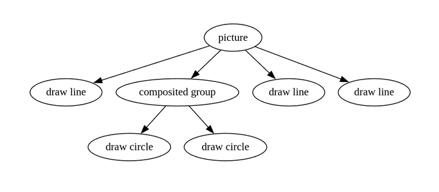
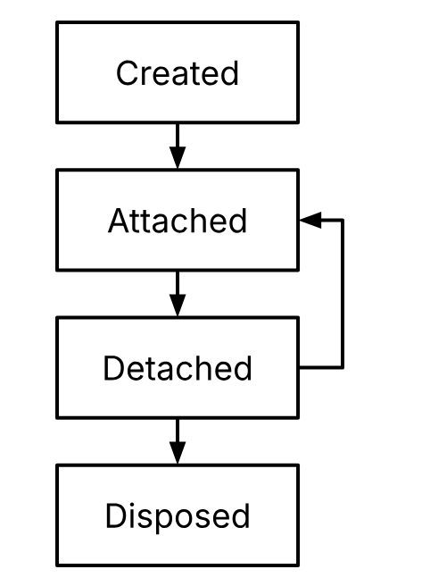

## Деревья

Как обсуждалось ранее, деревья — распространённая структура данных в UI-фреймворке. Есть разные способы представления деревьев, с разными компромиссами.

### Modeling trees

Самый распространённый подход — указатели или ссылки, когда экземпляры узлов дерева указывают на другие узлы дерева.

Есть и другие модели. Деревья, представляющие графические операции, часто используют стиль, похожий на обратную польскую запись; это особенно полезно, когда backend использует стековый подход к rendering:

- Начать picture.
- Нарисовать линию.
- Начать группу.
- Нарисовать окружность.
- Нарисовать окружность.
- Выполнить compositing и нарисовать группу.
- Нарисовать линию.
- Нарисовать линию.
- Закончить picture.

В рамках этого документа мы сосредоточимся на деревьях, хранимых как узлы с указателями на другие узлы.

### Managing children

Распространённый подход — каждый узел является экземпляром типа данных со списком дочерних узлов того же типа. По опыту автора, это недостаточно гибко. Во многих деревьях узлы различаются в подходе к дочерним узлам. Например, при построении дерева из разнородных простых узлов очень часто встречается множество типов узлов ровно с одним дочерним узлом (иногда их называют «proxy nodes»). Столь же часто есть несколько видов узлов для листьев, у которых по определению ноль дочерних узлов. Остаётся несколько типов узлов с переменным числом дочерних узлов, но организованы они могут быть по-разному: например, это может быть список, двумерная сетка или упорядоченное отображение (ordered map). Есть и более продвинутые случаи, когда дочерние узлы может требоваться генерировать по требованию.

#### Examples of leaf nodes

Прототипический пример leaf node — изображение в дереве компоновки или описании UI. Изображения обычно считаются атомарными непрозрачными данными в контексте родительского дерева; например, данными могут быть сырые пиксели. Иногда данные изображения, в особенности векторного, сами представлены в виде дерева другого типа, например display list (команды для GPU backend). У такого дерева тоже есть leaf nodes, например рисование линии или окружности.

#### Examples of proxy nodes

Простые примитивы компоновки часто имеют один дочерний узел. Хороший пример — padding; назначение узла padding в дереве компоновки — взять геометрию дочернего узла, добавить отступ с каждой стороны, а во всём остальном передать все обязанности дочернему узлу. В ядре Flutter более 75 различных узлов компоновки, использующих этот стиль, — в основном узлы, применяющие одну возможность, например изменение прозрачности поддерева, задание размера поддерева или рисование декораций вокруг поддерева.

#### Examples of nodes with child lists

Позиционируются ли узлы горизонтально, вертикально или друг поверх друга, список часто оказывается простейшим способом хранить дочерние узлы. Это может быть связный список или какая-то форма массива, в зависимости от требований к производительности и памяти; при принятии таких решений рекомендуется бенчмаркинг.

#### Examples of nodes with named slots

Очень распространённый паттерн — компонент с определённым набором дочерних узлов. Например, у приложения обычно есть панель инструментов, левая боковая панель, правая боковая панель, нижняя панель навигации, overlay для временных сообщений, кнопка навигации и основное содержимое приложения. Это можно представить именованными slots вместо списка, где slot может быть пустым или содержать один дочерний узел.

#### Examples of nodes with child grids

Разных структур данных для хранения дочерних узлов в виде сеток мы касались ранее. Хотя модель данных для хранения дочерних узлов можно специализировать под примитивы сеток, чтобы оптимизировать их производительность, на практике характеристики производительности решений для хранения дочерних узлов обычно составляют малую часть затрат на реализацию компоновки сеток, как мы обсудим ниже. По этой причине сетки часто просто используют списки или списки списков и переиспользуют инфраструктуру фреймворка, спроектированную вокруг таких child lists, вместо того чтобы вводить потенциально сложные новые механизмы.

#### Examples of nodes with on-demand child generation

Иногда дочерних узлов слишком много, чтобы их инстанцировать. Самый очевидный пример — буквально бесконечно прокручиваемый список. Поскольку, по определению, нет ни времени, ни памяти, чтобы инстанцировать все дочерние узлы, их приходится волей-неволей инстанцировать по требованию. Когда такая возможность появляется, её можно использовать и для конечных, но больших наборов дочерних узлов.

В целом этот подход следует использовать, чтобы избегать любой работы для содержимого за пределами экрана (например, даже не инстанцировать объекты, представляющие это содержимое, и уж точно не выполнять никакой работы по его компоновке или painting).

#### Examples of even more esoteric child arrangements

Изредка логичным выбором оказывается другая форма хранения. Скажем, quadtree, или отображение (map), где дочерние узлы индексированы неким семантически значимым значением, потому что к ним часто обращаются по этому значению, а не по позиции. Возможность организовывать дочерние узлы произвольно позволяет держать эти варианты открытыми. Впрочем, преимущества этих более экзотических механизмов хранения часто перевешиваются необходимой для них специальной инфраструктурой; зачастую удобство использования одного из более распространённых способов хранения — и общий инструментарий для управления ими, который будет доступен во фреймворке, — ценнее.

### Storing child-specific data

В UI-фреймворке очень часто узлу нужно хранить данные по каждому дочернему узлу, например информацию о позиции, состояние анимации или состояние некоей логики распознавания жестов. Такие данные можно было бы хранить в параллельном массиве, но если child list управляется каким-то общим вспомогательным кодом, поддерживать их синхронность может быть нетривиально. Можно также использовать словарь, хранящий отображение «дочерний узел → данные о нём», но у этого весьма немалые накладные расходы.

Вместо этого паттерн, который, как показала практика, работает вполне хорошо, — резервировать в каждом дочернем узле место для использования родителем. Это называют по-разному: «parent data» (данные, принадлежащие родителю; такое именование осмысленно с точки зрения дочернего узла) или «child data» (данные о дочернем узле; такое именование осмысленно с точки зрения родителя). Накладные расходы — один указатель на узел плюс стоимость самих данных. Стоимость доступа — O(1): несколько разыменований указателей и приведений типов. Этот паттерн обычно не слишком хорош в плане локальности (поскольку данные выделяются в куче и потому не лежат рядом с собственными полями дочернего узла), но, откровенно говоря, древовидные структуры в целом и так страдают от нехватки локальности, так что этот поезд, скорее всего, уже ушёл.

В случае, если child list хранится как связный список, а не массив, parent data — также удобное место для хранения указателей связного списка.

### Managing parents

При создании древовидных структур данных очень соблазнительно опустить обратную ссылку от дочернего узла к родителю. Это сэкономило бы указатель на узел и избавило бы от необходимости поддерживать указатель на родителя.

Это гиблое дело. Для деревьев в UI-фреймворках неизменно оказывается, что рано или поздно какому-нибудь алгоритму понадобится уметь подниматься вверх по дереву, более или менее независимо от типа дерева. По этой причине указатель на родителя должен входить в узлы дерева как нечто само собой разумеющееся.

Когда узел добавляется к другому, его нужно уведомить, чтобы он мог обновить свой указатель на родителя. Аналогично, при detach узла его нужно уведомить, чтобы указатель на родителя можно было очистить.

### Node lifetimes

Любое дерево, содержащее изменяемое состояние, должно иметь определённое время жизни и чётко определённый lifecycle.

Обычно lifecycle узлов в деревьях UI-фреймворка выглядит так:

При создании узел обычно выделяет требовательные к памяти ресурсы (например, загружает графические ассеты), необходимые для его нормальной работы. При attach узла активируются требовательные к CPU ресурсы (например, таймеры), скажем, для выполнения анимаций. Узел может быть временно detached, с кратковременной приостановкой требовательных к CPU ресурсов, например когда компонент UI перемещается из одного места дерева UI в другое или когда элемент управления UI перекрыт другим окном. Наконец, когда узел больше не нужен, он проходит dispose, и требовательные к памяти ресурсы освобождаются.

Есть соблазн отказаться от состояния «disposed», особенно в средах с GC, где предполагается, что сборщик мусора справится с требовательными к памяти нуждами. Однако на практике этого недостаточно, потому что у сборщиков мусора нет достаточной информации. Например, «требовательный к памяти ресурс» может быть всего лишь handle на ресурс изображения в кэше с ручным подсчётом ссылок (само изображение при этом управляется кодом, никак не связанным со сборщиком мусора); нужен какой-то механизм, уменьшающий счётчик ссылок, когда узел больше не используется. (Менять счётчик ссылок при переходах attach/detach неуместно, потому что есть риск, что кэш освободит само изображение, когда узел detached лишь временно.)

### Dirty tracking and depth sorting

Узлам в деревьях UI-фреймворка часто нужно помечать себя как dirty, чтобы последующий проход мог (например) обновить rendering.

Обход всего дерева дороже, чем хотелось бы (эти деревья могут быть большими, а число dirty-узлов — очень малым). Поэтому полезно уметь отслеживать, какие узлы dirty, и посещать только их. Это можно сделать так: узлы отслеживают, dirty ли они, внутренним флагом, и когда узел помечается как dirty, если его родитель ещё не dirty, он добавляет себя в общее для всего дерева dirty-множество. Затем, когда узел нужно «очистить» (обработать, поскольку он находится в dirty-списке), он может сбросить свой флаг и рекурсивно спуститься в любой дочерний узел с установленным флагом.

Чтобы делать это эффективно, dirty-множество нужно отсортировать в dirty-список. Нужный порядок — частичный порядок, при котором любой узел гарантированно идёт в дереве позже всех своих предков. (Для целей dirty-списка обычно нет нужды поддерживать порядок между узлами-соседями.)

Эффективный способ реализовать компаратор для такой сортировки — чтобы каждый узел отслеживал свою относительную глубину. Скажем, это значение отслеживает поле с именем `depth`, инициализированное нулём. Всякий раз при attach узла, если его `depth` ещё не больше родительской, он должен установить свою `depth` на единицу больше родительской, а затем уведомить дочерний узел о том, что для него был выполнен attach. (Если `depth` уже больше родительской, ничего делать не нужно.) Компаратор тогда может просто возвращать разность полей `depth` двух узлов.

Преимущество в том, что в типичном случае поддержание `depth` — O(1), поскольку деревья обычно строятся сверху вниз. Изредка, когда поддерево перемещается в более глубокую часть дерева, операция O(N) должна обновить поля `depth` всех узлов (где N — число узлов в пересаживаемом поддереве). Последующие перемещения поддерева между его новым и старым местом — O(1), поскольку `depth` узла, являющегося корнем поддерева, уже больше, чем у родителей в обоих местах.

### Tree context

Некоторое состояние специфично для дерева. Например, dirty-список.

Хранить это состояние в корневом узле и требовать от каждого узла подниматься по цепочке родителей, чтобы получить специфичное для дерева состояние, экономно по памяти, но дорого по CPU. Практичное решение — хранить в каждом узле указатель на корень. Это крайне избыточно и потребляет больше памяти, но эффективно по CPU.

Механизм, который может быть эффективным и по памяти, и по CPU, — использовать страничную (page-oriented) arena для выделения узлов дерева и хранить общие для дерева данные (например, указатель на корневой узел) в начале каждой страницы. Тогда узел может получить доступ к корневому узлу, просто наложив маску на собственный указатель. Это стоит указатель на страницу, а не указатель на узел. Однако такой механизм практичен, только если язык программирования позволяет предоставлять собственные аллокаторы памяти.
