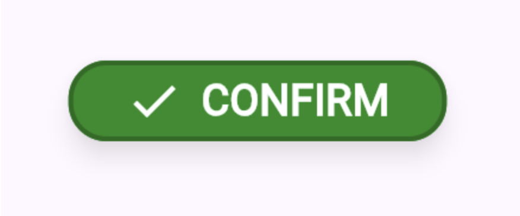

## Theming

Хотя строгое разделение семантики и стиля непопулярно, возможность быстро менять темы тем не менее — частый запрос. Иначе говоря, вместо того чтобы разработчик выражал «это меню, меню красные» (разделение семантики и стиля), и вместо того чтобы просто говорить «это красное» (чистое оформление), разработчикам нравится возможность сказать «это использует мой основной цвет, мой основной цвет — красный» (theming).

Эта задача принципиально не имеет границ. Рассмотрим кнопку:

Вот некоторые аспекты кнопки, которые разработчики могли бы захотеть контролировать через механизм theming:

- Цвет кнопки («сделай её синей»). Это должно менять и цвет фона, и цвет контура, и цвет текста, и цвет иконки, а также соответствующим образом цвета для режимов фокуса, нажатия, активного, сфокусированного и отключённого состояния.
- Каждый из этих цветов по отдельности, в каждом состоянии (фокус, нажатие и т. д.).
- Размер кнопки («сделай её больше»). Это должно менять размер текста, отступы (padding), размер иконки, радиусы скругления углов и разброс тени; и всё это должно соответствующим образом обновляться в каждом из вышеупомянутых состояний.
- Каждый из этих размеров по отдельности, в каждом состоянии.
- Шрифт («сделай его жирным»). Это должно соответствующим образом обновлять шрифт в каждом состоянии.
- Каждый из шрифтов для каждого состояния по отдельности, включая такие опции, как оформление текста (подчёркивание), font features и вариации шрифта и т. д.
- Тайминг, длительность и кривая анимаций при переходе между каждым из состояний.
- Высота (elevation) кнопки («сделай её выше»), с соответствующим обновлением настроек тени (цвет, разброс и т. д.) для каждого состояния.
- Индивидуальные настройки тени для каждого состояния по отдельности.
- Регистр текста («сделай его строчными буквами»).
- Семейство иконок («сделай иконки более скруглёнными»).
- Форма кнопки («сделай её остроконечной!»).
- Форма кнопки в каждом состоянии, с соответствующими анимациями («когда я на неё нажимаю, я хочу, чтобы она становилась остроконечной!»).
- Тактильный отклик (haptic feedback) кнопки при взаимодействии с ней пользователя. Или звуковой отклик!
- Выравнивание текста и его положение относительно иконки («помести иконку справа... но не в арабской версии»).
- Shader, анимирующий текстуру кнопки при её активации.
- Настройки этого shader.
- Стиль рамки вокруг кнопки («сделай ей пунктирный контур») — как в виде единой настройки, соответствующим образом влияющей на все состояния, так и в виде отдельных настроек контура (например, длина штриха, узор штрихов, ширина рамки) для каждого состояния независимо.
- Поведение при переполнении (overflow), когда подпись не помещается в доступное пространство (многоточие, перенос, обрезка, ...).
- Фон кнопки (в виде повторяющихся или масштабируемых изображений, nine-patch-изображений, различных видов градиентов).
- Курсор мыши (в целом и отдельно для каждого состояния).
- Все эти настройки (цвет, шрифт, форма и т. д.) для всплывающей подсказки (tooltip), показываемой для кнопки, если такая есть.

В этом списке почти наверняка не хватает какой-нибудь ключевой возможности, которая какому-нибудь разработчику будет отчаянно нужна. И этот список — всего лишь для одной кнопки, простейшего из существующих интерактивных элементов UI. Аналогичный список для, скажем, виджета древовидного представления (tree view) был бы на порядок больше. К тому же этот список — для одного конкретного представления о кнопке: кнопку можно реализовать совершенно иным способом, и тогда ей понадобится другой набор themable-свойств (например, «кнопкой» может быть команда, активируемая в основном голосом, которая показывает свою подпись в полосе виртуальной клавиатуры, когда та доступна; или только иконка; или гиперссылка в абзаце текста).

Очевидно, таким образом, что предоставить все эти возможности в системе theming совершенно непрактично.

Следует также подчеркнуть, что, как отмечено в списке выше, самые очевидные оси theming, например «цвет», на самом деле весьма нетривиальны. «Зелёная» кнопка в отключённом состоянии обычно серая (или, может быть, приглушённо-зелёная), а при активации тем или иным способом — какого-то более яркого зелёного оттенка. Цвета текста, иконки и рамки у кнопки выше должны были бы все измениться, если бы цвет поменяли на «жёлтый». Однако разработчики, как правило, не хотят думать об этих деталях. Кнопка выше просто «зелёная»; разработчики обычно хотят, чтобы остальные цвета выводились автоматически... кроме некоторых случаев, когда нужен дополнительный контроль!

У этой проблемы есть несколько подходов к решению (хотя, по мнению автора, ни один из них не идеален, так что это область, где инновации были бы особенно интересны).

### Определить подмножество свойств как themeable

### Property bags

Вместо того чтобы пытаться сделать настраиваемым всё, каждый виджет может определить набор свойств, которые он будет поддерживать, и предоставить некий API (например, объект типа property bag — «мешок свойств»), который можно задать на некотором высоком уровне, чтобы все экземпляры этого виджета использовали эти свойства.

Разработчик мог бы определить несколько вариаций и затем выбирать их для каждого виджета по отдельности (подобно тому, как разработчики на HTML+CSS используют атрибут `class`). Альтернативно или дополнительно вариации можно было бы настраивать на уровне поддеревьев, чтобы разные части UI были сконфигурированы по-разному.

Этот подход создаёт «обрыв API» (API cliff): разработчики, желающие настроить что-то ещё не поддерживаемое, либо будут разочарованы, либо будут вынуждены потратить намного больше усилий на изменение этой возможности. Разрастание объёма (scope creep) неизбежно, по мере того как в список свойств каждого виджета добавляется всё больше и больше свойств; поздние добавления будет труднее реализовать, поскольку они не учитывались в исходном дизайне.

### Styling language

Вариант этого подхода — сделать так, чтобы property bag состоял из графических примитивов, использовать их для формирования внешнего вида виджета, а затем иметь язык, позволяющий динамически переопределять этот внешний вид.

По сути, это подход, принятый веб-фреймворками на основе CSS (и теми, на кого они повлияли, например React Native). Виджет будет состоять из нескольких обобщённых элементов (например, `
`), управляемых JavaScript, а стили будут применяться с помощью правил стилей в CSS. Разработчики могут переопределять стандартные правила стилей своими собственными, которые каскадируются и тем самым переопределяют стандартный внешний вид.

Этот подход тоже страдает от обрыва API: если структура обобщённых элементов не соответствует амбициям разработчика, разработчик не сможет достичь своих целей. Аналогично, настройка поведения виджета ограничена тем, что может сделать JavaScript; CSS не позволяет её переопределить.

### Composition

Разработчикам можно предложить создавать собственные виджеты — либо из набора строительных блоков, либо буквально копируя и вставляя некие шаблонные виджеты и подправляя их.

Этот подход очень мощный, но неудобный для разработчиков. Он также страдает от того, что ошибки в шаблонах или внесённые разработчиками при комбинировании строительных блоков будут сохраняться, и потому приложения, написанные на фреймворке с таким подходом, будут содержать ошибки — каждое свои. Создание простых виджетов вроде кнопок может быть посильной задачей — хотя разработчики будут забывать учесть или протестировать реже используемые возможности вроде accessibility и фокуса, — но просить разработчиков создавать собственные варианты более сложных виджетов, таких как текстовые поля, скорее всего, находится далеко за пределами разумного.

На практике этот подход не находит широкого признания.

### Extension

Альтернатива composition — extension. Можно создать виджет кнопки, а разработчики могут расширять его, подключаясь к различным предоставленным точкам расширения (extension points), чтобы менять внешний вид и поведение.

В зависимости от уровня предоставляемых точек расширения это может варьироваться от ограниченной гибкости до чрезмерной обременительности. Например, если кнопка вроде описанной выше предоставляет единственную точку расширения, задающую единственный цвет, то цвет кнопки поменять легко, а форму — невозможно. С другой стороны, если точка расширения — это canvas API, разработчик должен выбрать не только цвет, но и каждый производный цвет, и форму, и настройки текста, и т. д.

Найти правильный уровень — вопрос баланса, и принципиально это никогда не сможет удовлетворить потребности каждого разработчика.

### Смешанный подход

Современное состояние дел — предоставлять все три варианта. Это определённо не идеальный вариант, но за неимением лучшего он удовлетворяет потребности большинства разработчиков. Можно предоставить базовые интерактивные виджеты с различными точками расширения, позволяющие разработчикам относительно легко создавать собственные варианты этих виджетов без необходимости помнить о реализации accessibility, фокуса, управления с клавиатуры и т. д. Можно предоставить высокоуровневые виджеты с определённым property bag, и у этих property bags могут быть удобные конструкторы, например, для преобразования одного цвета во все необходимые производные цвета. Наконец, эти высокоуровневые виджеты можно построить на тех же механизмах, что доступны разработчикам, чтобы в крайнем случае разработчики могли сделать их форк и реализовать совершенно новые виджеты, составленные из тех же низкоуровневых примитивов, что и встроенные высокоуровневые виджеты, но с собственным особым внешним видом и поведением.
