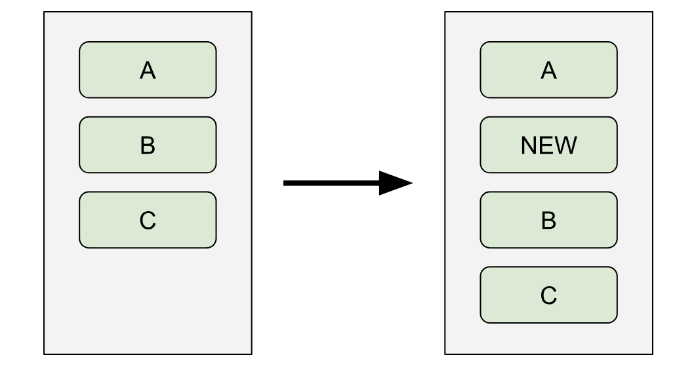
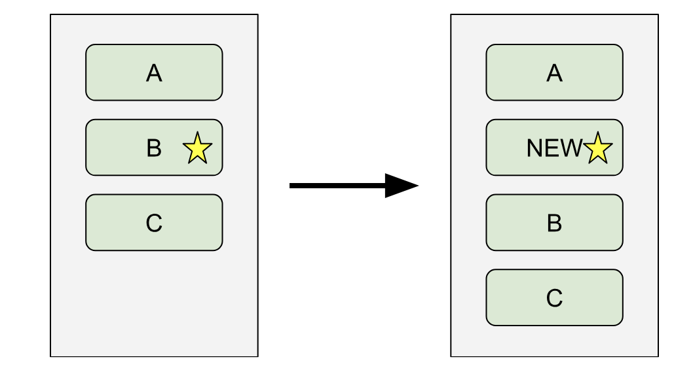

## Описание UI

Различные модели описания UI обсуждались ранее. В этом разделе мы рассмотрим детали реализации модели, предложенной в том разделе.

Напомним: базовый подход — иметь immediate-mode API, который отображается на retained-mode render-дерево, построенное из компонентов, описанных в двух предыдущих разделах.

### Выражение UI

В этом immediate-mode UI API каждая часть пользовательского интерфейса описывается с помощью вложенных выражений, которые сами компонуются друг с другом с помощью вложенных выражений.

Поскольку этот API — главное лицо фреймворка, важно, если популярность является целью, чтобы он выглядел как можно чище. Для этого некоторые фреймворки используют DSL, часто вдохновлённый HTML. Однако при достаточно выразительном языке вызовов функций (или вызовов конструкторов) достаточно, и они избавляют от необходимости в специальном (bespoke) синтаксисе.

Для удобства эти выражения должны быть переиспользуемыми — как в смысле многократного использования в одном frame, так и в смысле использования в нескольких разных frames. Например, должна быть возможность описать часть пользовательского интерфейса, представляющую вертикальный разделитель, а затем ссылаться на это выражение многократно при построении списка; аналогично, элементы списка должны генерироваться лишь один раз, а затем использоваться по мере необходимости при прокрутке списка. Отсюда следует, что эти выражения создают значения, которые по своей сути stateless, могут быть долгоживущими и не имеют жизненного цикла, привязанного к их использованию в интерфейсе.

Наконец, эти значения должны быть дёшевы в создании и уничтожении, поскольку их может потребоваться пересоздавать каждый frame (например, во время анимации).

Если предположить, что язык поддерживает garbage collection с дешёвым выделением памяти, что в нём есть некоторый механизм, подобный объектам, и что конструкторы этих объектов могут принимать named arguments, то логичный дизайн — сделать эти выражения вложенными вызовами конструкторов. Следуя дизайну Flutter, мы будем называть эти объекты виджетами. Из-за только что описанных ограничений эти объекты должны быть глубоко immutable (возможно, по соглашению; например, нет ничего неразумного в том, чтобы виджет хранил ссылку на mutable объект, при условии, что либо есть способ подписаться на этот объект, чтобы получать уведомления о его изменениях, либо объект никогда не меняется после того, как передан виджету).

### Виды виджетов

При построении пользовательского интерфейса есть разные компоненты, из которых может складываться итоговая картина.

#### Layout-виджеты

Конечная цель API — создать или обновить дерево компонентов компоновки, поэтому некоторые из виджетов должны соответствовать компонентам компоновки.

У них может быть переменное число дочерних узлов (ноль для leaf-узлов вроде изображений или текста; один для большинства компонентов, декорирующих компоновку; список дочерних узлов для большинства узлов, выполняющих компоновку, таких как строки и столбцы; возможно, более сложная структура для тех, у кого более сложные потребности, например табличная компоновка).

Эти виджеты должны уметь создавать соответствующий render object и уметь конфигурировать render object этого типа в соответствии с аргументами, переданными виджету.

#### Templates

Чтобы виджеты можно было компоновать, должен быть некоторый механизм, посредством которого выражению из вложенных виджетов можно дать имя и использовать его как виджет. В простом случае выражения, которое нельзя переконфигурировать, это может быть буквально просто глобальная переменная, хранящая выражение; однако удобно, когда виджеты конфигурируемы.

В принципе, для этой цели можно было бы использовать функцию, но для согласованности с остальным API довольно удобно иметь вид виджета, который просто строит (build) другие виджеты на основе некоторых аргументов конструктора.

#### Logic

У некоторых компонентов UI есть state и логика. Например, кнопка отрисовывается иначе, пока её активно нажимают.

Поскольку сами виджеты по определению stateless, должен быть некоторый механизм, посредством которого виджет, когда его начинают использовать, может инстанцировать объект, представляющий этот экземпляр виджета (объект «state»). Этот объект отвечает за построение (build) других виджетов, так же как template-виджет, при этом ещё отслеживая внутренние значения и имея возможность самостоятельно запросить перестроение интерфейса начиная с этого виджета.

#### Configuration

Четвёртый вид виджета — тот, что предоставляет информацию о configuration другим виджетам в дереве.

Например, виджет можно использовать, чтобы задать стилистические решения (theming) для поддерева интерфейса, задать язык по умолчанию для локализации или предоставить доступ к модели данных приложения.

Простая реализация этого механизма просто поднималась бы вверх по дереву всякий раз, когда нужна configuration, но этот алгоритм O(N) фактически становится O(N²) (потому что многим виджетам понадобится пройти по многим виджетам вверх по дереву). По этой причине полезно отслеживать задействованные configuration-виджеты и передавать эту информацию вниз по дереву, чтобы она была доступна за O(1) (что делает поиск configuration O(N) — так же, как и само построение виджетов).

Кроме того, должен быть механизм, чтобы виджет, получая свою configuration таким образом, мог при необходимости подписаться на уведомления об изменении configuration.

Описанный так механизм несколько грубоват. На практике разработчики хотят более тонких возможностей запрашивать configuration и подписываться на её изменения. Это область, которая, вероятно, потребует дополнительных исследований с помощью юзабилити-исследований.

#### Infrastructure

Поскольку виджеты stateless и не отображаются напрямую на render objects, нужна структура данных, представляющая полностью скомпонованное дерево виджетов, чтобы можно было отслеживать обновления и отображать его на дерево render objects.

Это дерево можно создать, начав с корневого виджета, создав узел, представляющий этот виджет, а затем запросив у виджета его дочерний виджет (попросив его «построить» (build) себя). Затем процесс итерируется, дочерний узел за дочерним узлом, причём у некоторых узлов (layout-виджеты с несколькими дочерними узлами) дочерних узлов несколько, а у некоторых (leaf layout-виджеты) их нет.

По мере обработки каждого дочернего узла таким образом должны срабатывать и все особые поведения, относящиеся к виджету: из layout-виджетов должно создаваться параллельное дерево render objects, у logic-виджетов должны создаваться их объекты state, у configuration-виджетов должна распространяться их configuration и т. д.

Когда корневой виджет заменяется или когда объект state какого-либо logic-виджета запрашивает перестроение, дерево перестраивается: затронутый виджет просят предоставить новый дочерний узел, а затем итерируются вниз по дереву, пока один из виджетов не вернёт дочерний виджет, идентичный предыдущему виджету в этом месте дерева (это иногда называют фазой reconciliation). По мере замены узлов должны обновляться и все связанные особые поведения: дерево render objects должно обновляться в соответствии с новыми layout-виджетами, объекты state должны надлежащим образом уведомляться об обновлениях и т. д.

### Keying

В некоторых сценариях, например когда содержимое вставляется в список или удаляется из него, есть разница между идентичностью виджета с точки зрения пользователя и с точки зрения фреймворка. Например, предположим, что пользователь нажимает кнопку в списке, из-за чего перед ней вставляется другая кнопка:

Если у фреймворка нет способа идентифицировать кнопки во времени, он может использовать только положение кнопок в списке, чтобы сохранять их идентичность. Это означает, что при вставке новой кнопки всё state, которое было связано с кнопкой с подписью B, теперь связано с кнопкой с подписью NEW, state кнопки C теперь связано с B, а новая кнопка C считается новым виджетом.

Это проблематично, если кнопки, например, анимированы.

Чтобы этого избежать, виджетам можно давать идентифицирующий key, который используется двумя способами. Во-первых, когда key нового виджета отличается от key виджета, который он заменяет, state старого виджета можно отбросить. Во-вторых, когда есть список дочерних узлов, старые и новые дочерние узлы можно сначала сопоставить (reconcile) по keys.

### Tree grafting

Поскольку изменение формы дерева любым способом, кроме самых тривиальных, приведёт к отбрасыванию state, нужен механизм, позволяющий перемещать части дерева (с сохранением объектов state). Один из способов добиться этого — иметь способ идентифицировать поддеревья (например, упомянутый выше механизм keys) и при перестроении дерева виджетов помещать поддеревья в таблицу, а не сразу отбрасывать их. Затем, когда то же поддерево указывается для вставки в другом месте дерева, его можно получить прямо из этой таблицы и вставить в дерево виджетов, не перестраивая state и render objects.

К сожалению, это довольно хрупкий подход, но в настоящее время он, по-видимому, является state of the art.

### Projection

Хотя простейшие виды template-виджетов просто разворачиваются в другие виджеты, может быть полезно позволить виджету вставлять в свой вывод виджет, который был передан ему как входные данные. Это похоже на то, как layout-виджет принимает другой виджет в качестве дочернего узла. Иногда это называют projection.

Projection особенно полезна, когда template-виджет анимируется, а проецируемый виджет статичен. Например, виджет, анимирующий цвет своего фона, при этом отрисовывая текстовую подпись без изменений. Если текстовая подпись передана как дочерний узел в configuration-виджет и включена в вывод виджета дословно, фреймворк может определить, что она не изменилась, когда template-виджет обновляет себя. Это может дать значительный выигрыш в производительности (и распространяться на нижележащие уровни; например, текст не нужно заново измерять каждый frame).

Это контрастирует с дизайнами, которые требуют, чтобы template-виджеты сами строили свои дочерние узлы (например, если бы в этом примере принималась строка вместо виджета, а затем template сам создавал бы дочерний текстовый виджет каждый frame).
