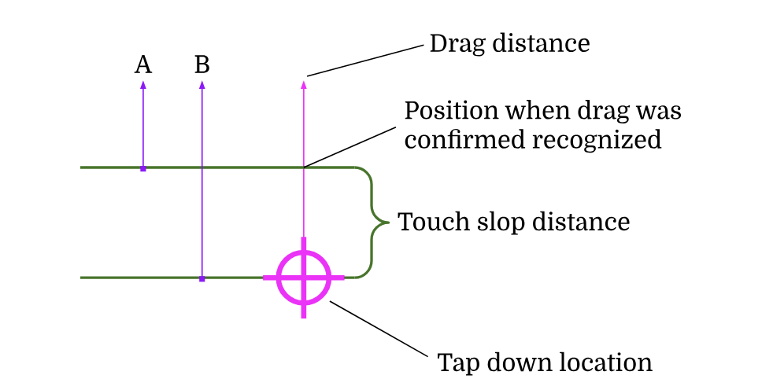

## Ввод

### Gestures

#### Введение

От мультитач-устройств принято ожидать поддержки gestures, то есть последовательностей ввода, которые по-разному воздействуют на приложения, например:

- Taps (например, нажатие кнопки), состоящие из краткого касания сенсорной поверхности.
- Double-taps (например, увеличение масштаба в точке, выделение слова в текстовом поле), состоящие из краткого касания сенсорной поверхности, за которым следует ещё одно краткое касание в той же точке сенсорной поверхности. В принципе, UI могли бы поддерживать и более длинные последовательности taps, например triple-taps.
- Long-press (например, вызов контекстного меню), состоящий из tap, при котором касание длится дольше некоторого порогового времени.
- Drags (например, перемещение изображения), состоящие из того, что один палец касается поверхности, перемещается на некоторое расстояние, а затем отпускается.
- Двухпальцевые gestures pan, zoom и rotate (например, навигация по карте), состоящие из отслеживания двух точек касания, причём вектор между ними — и относительно их исходных точек касания — используется для вычисления масштаба, смещения и поворота.

Фиксированного набора таких gestures нет; разработчики могут изобретать новые. (Как правило, это не лучшая идея из-за проблем с обнаруживаемостью, но исключения бывают всегда.) Например, Google Maps поддерживает gesture double-tap-and-drag для масштабирования одним пальцем и двухпальцевый pan для изменения перспективы. Apple поддерживает множество gestures на трекпадах своих ноутбуков, например pan двумя, тремя и четырьмя пальцами.

Фреймворки отвечают за предоставление механизмов преобразования сырых сообщений сенсорного ввода в высокоуровневые описания gestures.

Фреймворки, построенные поверх других фреймворков, например веб-фреймворки, построенные на возможностях HTML, JS, CSS и DOM, поставляемых в веб-браузерах, могут переложить задачу распознавания gesture на свою host-среду. Это может лишить разработчиков возможности создавать собственные gesture recognizers, но такой компромисс можно счесть разумным, поскольку он убирает часть сложности из фреймворка. Однако в рамках этого документа мы будем считать, что фреймворк реализует низкоуровневое gesture recognition самостоятельно.

#### Анатомия сенсорного gesture

Мультитач-устройства сообщают о касаниях как о последовательности событий, каждое из которых связано с pointer (по сути, точкой контакта пальца с экраном). Каждый pointer проходит один и тот же жизненный цикл:

- В какой-то момент обнаруживается, что pointer касается экрана (событие «down»).
- Отслеживается перемещение pointer по экрану (события «move»).
- В конце концов pointer теряет контакт с экраном (событие «up»).

Эти события обычно также включают такую информацию, как сила нажатия или параметры эллипса, описывающего область контакта.

В принципе, оборудование могло бы также обнаруживать события «hover» по мере приближения pointer к экрану, и в этом случае один pointer мог бы получать несколько событий «down» и «up». Такое оборудование встречается сравнительно редко и на практике в основном игнорируется, но фреймворкам следует его поддерживать.

Указательное устройство, такое как мышь или стилус, тоже можно смоделировать в этой архитектуре, добавив логику отслеживания кнопок устройства. В случае мыши «контакт» определялся бы как события, происходящие, пока нажата хотя бы одна кнопка. Моделирование сенсорного pointer или стилуса, касающегося поверхности, как имеющего нажатую основную кнопку помогает унифицировать модели мыши и сенсорного ввода.

Эмулирующую мышь часть тачпада (перемещение курсора, щелчки) тоже можно приблизительно уложить в эту архитектуру, но на практике тачпады требуют отдельного подхода к обработке gestures из-за того, что gestures тачпада не связаны с конкретным местом на экране.

Сенсорные gestures состоят из одной или нескольких последовательностей pointer events (иногда параллельных, иногда последовательных — в зависимости от gesture).

На одном мультитач-устройстве одновременно могут происходить несколько gestures. Каждый pointer может участвовать не более чем в одном gesture (альтернатива неинтуитивна для пользователей). Поэтому всякий раз, когда конкретный pointer в принципе мог бы участвовать в нескольких gestures, требуется шаг устранения неоднозначности. Это и есть gesture recognition.

#### Gesture recognition

Хотя реализовать это можно по-разному, автор порекомендовал бы модульный подход, при котором каждый вид gesture реализуется независимо, а части пользовательского интерфейса, поддерживающие несколько gestures, устраняют неоднозначность только между теми gestures, которые поддерживаются в данный момент.

Для каждого pointer фреймворк должен определить, какие элементы управления могут быть заинтересованы в этом pointer. Этого можно добиться, выполнив hit test в точке события «down», то есть спустившись по дереву компоновки и определив, какие узлы считают точку находящейся «внутри» них. Когда список элементов управления-кандидатов построен, каждому из этих элементов управления можно отправить соответствующее pointer event (например, событие «down») и дать возможность предоставить один или несколько gesture recognizers, для которых, по их мнению, pointer может быть релевантен. (Это требует предоставления некоторого объекта, который можно получить от всех элементов управления.)

Все предоставленные gesture recognizers теперь соперничают за pointer. По мере поступления событий для этого pointer каждый gesture recognizer решает, следует ли ему отклонить pointer, заявить права на pointer или продолжить ждать новых событий. (Таким образом, нет необходимости выполнять hit test для pointers более одного раза: событие down использует дерево компоновки, а последующие события доставляются напрямую gesture recognizers.)

Например, recognizer горизонтального drag может отклонить pointer, если события move сообщают о большем вертикальном перемещении, чем горизонтальном. Recognizer long-press может отклонить pointer, если событие up получено до истечения достаточно долгого промежутка времени, но может немедленно заявить права на pointer, как только пороговое время прошло без значительного перемещения.

Когда в соперничестве остаётся только один recognizer, следует автоматически считать, что он заявил права на pointer.

То, что gesture recognizer заявил права на pointer, не обязательно означает, что gesture recognizer затем сообщит своему элементу управления, что сам gesture сработал. Это лишь не даёт другим gestures заявить права на pointer. Например, recognizer double-tap будет включён в соперничество за любые pointers в его области и будет отклонять pointers, которые значительно перемещаются между своим событием down и событием up. Однако recognizer double-tap сообщит своему клиенту о double-tap, только если в итоге заявит права на два pointers подряд в пределах порогового времени.

#### Группировка gestures

Бывают случаи, когда соперничающие gestures могут уступать друг другу. Например, переключатель (switch) можно и перетаскивать (drag), и нажимать (tap), но в большинстве случаев (когда никакие другие gestures не задействованы) пользовательский опыт лучше, если tap игнорируется, а drag всегда заявляет права на pointer. Однако когда переключатель находится в вертикально прокручиваемом списке, в игру вступает третий gesture — вертикальный drag, и поэтому механизм устранения неоднозначности должен определить, просто ли пользователь нажал на элемент управления (в этом случае должен сработать tap), или перетащил горизонтально (отдавая gesture переключателю), или вертикально (отдавая gesture прокручиваемому списку).

Для обработки таких случаев важен механизм, позволяющий группировать gestures и назначать им приоритеты внутри группы.

#### Особые соображения для drag gestures

В этой схеме, когда drag gesture соперничает с другими gestures, например с tap, он не может быть распознан, пока либо другие gestures не отклонят pointer, либо drag не станет достаточно однозначным, чтобы drag gesture мог заявить права на pointer. Это означает, что на момент распознавания drag pointer находится на некотором расстоянии от исходной точки tap, иногда называемом расстоянием touch slop. Если drag gesture затем сообщит всё расстояние от исходной точки tap до конечного положения pointer как расстояние drag (B на схеме ниже), пользователь воспримет это как скачок. Если же, напротив, drag gesture ведёт себя так, как будто drag начался с точки, в которой drag был подтверждён как распознанный (A на схеме ниже), пользователь вместо этого воспримет некоторое отставание, поскольку drag, который он видит на дисплее, короче общего пройденного расстояния.

На практике отставание, как правило, предпочтительнее скачка. Это легко сделать настраиваемым для тех случаев, когда есть конкретная причина предпочесть одно другому.

### Колёсики мыши и тачпады

Как отмечалось выше, ввод с мыши, ввод со стилуса, а также части ввода с тачпада, отвечающие за перемещение указателя и щелчки, можно смоделировать в тех же базовых рамках, что и сенсорный ввод.

Колёсики мыши (scroll) можно смоделировать как своего рода внешний (out-of-band) сигнал, который доставляется элементам управления аналогично другим pointer events, но без необходимости в устранении неоднозначности gestures. Однако в некоторых случаях дополнительное устранение неоднозначности всё же требуется; например, в случае вложенных прокручиваемых компонентов, где важно, чтобы в ответ на ввод колёсиком мыши прокручивался только один из компонентов, а не оба. Механизм устранения неоднозначности (disambiguator) можно предоставить элементам управления аналогично тому, как предоставляется gesture disambiguator, но его логика может быть проще, поскольку речь идёт лишь об отслеживании того, решил ли какой-либо элемент управления обработать событие или нет (чтобы это делал только первый из них).

Это можно расширить, чтобы оно работало и для других видов событий, генерируемых трекпадами, таких как gestures zoom или rotate.

### Клавиатуры

Клавиши могут нажиматься и отпускаться, а также могут автоповторяться. Поэтому ввод с клавиатуры можно представить как серию событий: down, repeat, up.

Есть три способа идентифицировать клавишу на клавиатуре.

- Первый — идентичность физической клавиши, для которой наиболее распространённым представлением является код USB HID. Это значение полезно для настройки клавиатурных сочетаний, хотя при показе таких привязок клавиш пользователю необходим некоторый механизм отображения физических клавиш в их фактические надписи (нет смысла сообщать пользователю, что он привязал «0x1D Z», когда у него швейцарская французская локаль и на его клавише написано «Y»).
- Второй — «логическая» идентичность клавиши после того, как клавиша была отображена согласно пользовательским раскладкам клавиатуры (локали). Стандартного набора кодов для этих клавиш нет; у каждой платформы свой набор. У фреймворка должен быть способ идентификации logical keys, чтобы клавиши, поддерживаемые несколькими платформами, могли распознаваться как одна и та же клавиша, но при этом при необходимости поддерживались и платформенно-специфичные клавиши. Logical keys — это то, в терминах чего пользователи рассуждают о своей клавиатуре.
- Третий способ идентифицировать клавишу — это, строго говоря, идентификация не столько самой клавиши, сколько предполагаемого ввода этой клавиши. Например, на него могут влиять ранее нажатые клавиши («мёртвые клавиши» (dead keys): например, нажатие акцента, а затем буквы, в некоторых локалях порождает букву с акцентом вместо двух отдельных вводов; а также клавиши-переключатели, такие как Caps Lock) или другие клавиши, нажатые одновременно (клавиши-модификаторы, например Shift).

Помимо предоставления key events с физической, логической и (где применимо) соответствующей информацией о вводе, фреймворк должен также предоставлять текущее состояние клавиатуры в целом (то есть для каждой клавиши — отпущена она сейчас или нажата). Это упрощает разработчикам обработку комбинаций клавиш (например, Control + A).

Ограничения API операционных систем делают всё вышеперечисленное несколько сложнее, чем необходимо. Например, в настольных операционных системах пользователь может нажать клавишу, переключить focus на другое приложение и отпустить эту клавишу, сбив с толку и первое приложение (которое так и не получает события о том, что клавиша была отпущена), и второе (которое так и не получает события о том, что клавиша вообще была нажата). Чтобы не сбивать с толку код приложения, фреймворк может синтезировать события, необходимые для поддержания самосогласованного представления (например, в приведённом примере фреймворк в первом приложении в конце концов, получив информацию, из которой следует, что клавиша больше не нажата, синтезировал бы событие up, а фреймворк во втором приложении синтезировал бы событие down непосредственно перед отправкой настоящего события up). Аналогично, некоторые системные API не предоставляют лежащие в основе коды USB HID, а некоторые не предоставляют достаточной информации для реализации отображения физических клавиш в логические. Для каждой системы реализация API фреймворка должна предоставлять как можно больше информации в рамках ограничений API ОС.

В некоторых системах события клавиатуры могут эмулироваться в ответ на взаимодействие пользователей с виртуальными экранными клавиатурами. В зависимости от фактической реализации этих системных возможностей, могут снова возникнуть трудности с предоставлением всей информации, ожидаемой в key events. Например, у виртуальной экранной клавиатуры может вообще не быть понятия физического кода USB HID.
