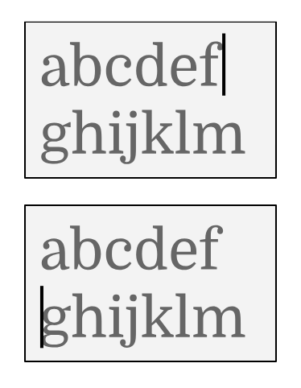
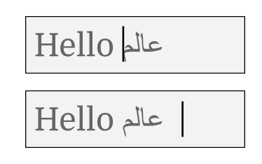
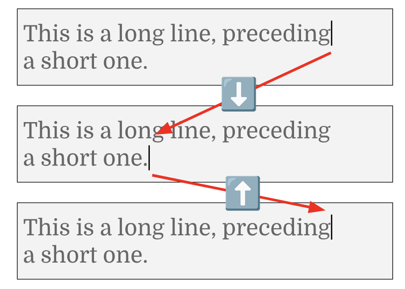
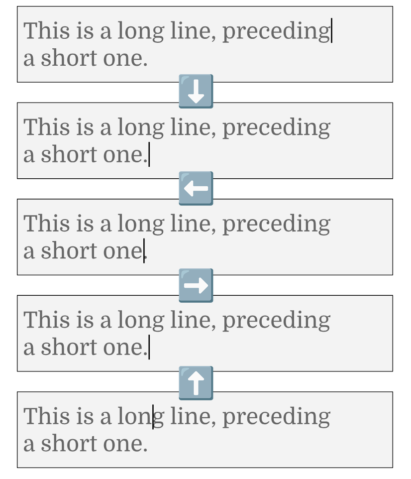

## Текстовый ввод

Самая сложная часть любого качественного UI-фреймворка — это реализация текстового ввода, в том виде, в каком он встречается в текстовых полях. В этом разделе мы рассмотрим различные возможности, которыми должны обладать текстовые поля. (Этот список, вероятно, неполон.)

### Курсор

Главная особенность текстового поля — наличие курсора вставки текста (также называемого caret). Это позиция внутри содержимого текстового поля, обозначающая место, куда будет вставлено содержимое, когда пользователь набирает текст.

#### Представление

##### Directional bias

Хотя кажется интуитивно понятным представлять позицию курсора в текстовом поле одним целым числом, этого недостаточно. Помимо точной позиции в содержимом, нужно хранить ещё один бит, представляющий directional bias курсора (иногда его называют affinity). Это позволяет текстовому полю различать положение в конце строки и положение в начале следующей строки, когда текст был перенесён в конце строки посередине слова:



Это также позволяет размещать курсор в любой из двух возможных позиций между сегментами, идущими справа налево и слева направо. Например, рассмотрим текст «Hello world», в котором слово «world» написано по-арабски (عالم — читается справа налево). Когда курсор стоит после пробела, он может быть отрисован либо справа от пробела после слова «Hello», либо справа от слова عالم (то есть перед ним):



Это особенно важно при позиционировании курсора в ответ на щелчки мыши, как описано далее.

##### Позиции только между extended grapheme clusters

Сами позиции должны находиться на границах Unicode extended grapheme clusters, а не Unicode scalar values (и уж точно не code points).

Например, рассмотрим такую строку в UTF-8:

```
0xf0 0x9f 0x87 0xa8 0xf0 0x9f 0x87 0xad
```

Она эквивалентна такой строке в UTF-16:

```
0xD83C 0xDDE8 0xD83C 0xDDED
```

Это соответствует двум Unicode scalar values:

```
U+1F1E8	REGIONAL INDICATOR SYMBOL LETTER C
U+1F1ED	REGIONAL INDICATOR SYMBOL LETTER H
```

Это соответствует одному extended grapheme cluster: 🇨🇭

Если задуматься о том, какие допустимые позиции есть в этой строке, их должно быть только две: в начале строки и в конце строки. Если разрешить пользователю ставить курсор между regional indicator symbols, это позволит ему «разбить» то, что он воспринимает как один символ, — неинтуитивное поведение.

#### Rendering

Как правило, курсор отображается как вертикальная линия в месте вставки. Высота курсора обычно определяется размером текста, который будет вставлен. Ширина и точный rendering зависят от соглашений платформы (например, на одних платформах это идеальный непрозрачный прямоугольник, а на других у него слегка скруглённые углы).

На некоторых платформах, если содержимое текстового поля включает и текст справа налево, и текст слева направо, у курсора будет небольшой индикатор, показывающий направление, в котором будет вставляться текст. На некоторых платформах, когда есть два возможных варианта rendering курсора из-за двунаправленного (bidirectional) текста (а не из-за переносов строк), отрисовываются два курсора, по одному в каждой возможной позиции.

##### Мигание

На большинстве платформ курсор мигает. На одних платформах это переключение «включён/выключен»; на других курсор плавно появляется и исчезает на протяжении нескольких frames. Точная частота мигания — это, как правило, предоставляемое платформой и настраиваемое пользователем значение, которое фреймворк должен использовать напрямую.

Всё это, на самом деле, довольно неудобно с точки зрения UI-фреймворка, потому что пользователи обычно считают приложение, ожидающее ввода, простаивающим и ожидают, что оно потребляет практически 0% CPU и GPU, но, в зависимости от сцены, мигание или анимация курсора может требовать повторного compositing значительной части экрана. Исторически мигание курсора выполнялось простым применением xor к соответствующим пикселям буфера дисплея по таймеру, что весьма эффективно, но сейчас это уже непрактично.

Насколько это возможно, мигание курсора должно опираться на возможности, минимизирующие объём кода, который нужно выполнить для мигания. Например, курсор можно представить анимированным shader, перенеся основную часть логики в GPU, что требует минимальной координации со стороны CPU (если она вообще нужна) и не требует, чтобы ядро фреймворка вообще знало о мигании.

На большинстве платформ курсор должен немедленно возвращаться в своё наиболее заметное состояние, когда пользователь вводит текст, благодаря чему курсор остаётся видимым всё время, пока пользователь печатает.

##### Trailing spaces

При позиционировании курсора для rendering пробелы в конце строки, как правило, игнорируются. Они учитываются как позиции курсора в текстовом содержимом, но сами пробелы в конце строки считаются имеющими нулевую ширину.

#### Клавиши управления курсором

Текстовые поля должны поддерживать перемещение текстового курсора в ответ на клавиши со стрелками на клавиатуре.

##### Вертикальное перемещение

Текстовые поля бывают однострочными и многострочными.

В однострочных текстовых полях клавиши «вверх» и «вниз» должны быть настраиваемыми — их можно использовать для навигации по истории (как в приглашении командной строки), или, например, клавишу «вверх» можно настроить на редактирование предыдущего ввода. По умолчанию они должны перемещать курсор в начало («вверх») или в конец («вниз») текстового поля.

В многострочных текстовых полях вертикальные клавиши со стрелками должны перемещать курсор на предыдущую или следующую строку, сохраняя примерно то же горизонтальное расстояние в пикселях (а не в символах). Сохраняемая позиция должна быть позицией курсора в момент начала вертикального перемещения; она «липкая» и сбрасывается только тогда, когда пользователь делает что-то, кроме вертикального перемещения.

Например, рассмотрим такую последовательность («вниз», затем «вверх»):



Курсор возвращается туда, откуда начал. С другой стороны, если последовательность вертикальных перемещений курсора прерывается, пока курсор находится на второй строке, возврат на предыдущую строку должен привести курсор в середину, а не в конец:



##### Двунаправленный текст

Платформы различаются в том, как обрабатывать навигацию курсора вблизи смешанного двунаправленного текста. Большинство платформ придерживаются соглашения, что клавиши со стрелками перемещаются по содержимому логически, в соответствии с общим направлением текстового поля, так что, например, в текстовом поле слева направо, содержащем текст справа налево, курсор будет двигаться по этому тексту влево, когда пользователь нажимает клавишу «вправо». Некоторые платформы используют физическое соответствие (клавиша «вправо» всегда движется вправо), но это приводит к сбивающему с толку поведению, когда удержание клавиши со стрелкой начинает зацикливаться внутри текста со смешанным направлением вместо того, чтобы продвигать курсор к другому концу текстового поля.

#### Сочетания клавиш

Текстовые поля должны поддерживать весь набор сочетаний клавиш, поддерживаемых текстовыми полями платформы, например клавиши Page Up и Page Down для навигации большими скачками в многострочных текстовых полях, клавиши Home и End для перехода в начало и конец строки, Ctrl+Home и Ctrl+End для перехода в начало и конец многострочного текстового поля и т. д. Точные привязки клавиш весьма существенно различаются от платформы к платформе.

#### Ввод мышью и касанием

Щелчок или касание текстового поля должны устанавливать курсор в указанную позицию. В случае двунаправленного текста или принудительно перенесённого текста возможно, что одной позиции соответствуют две позиции, как обсуждалось выше. Для пользователей, как правило, неинтуитивно, если касание одного места ставит курсор в другое, эквивалентное место, поэтому здесь важно использовать directional bias.

##### Floating cursor в iOS

В iOS есть возможность, известная как «floating cursor». Фреймворки должны реализовывать эту возможность в iOS.

### Выделение

Текстовый курсор может расширяться до выделения (selection). (Большинство платформ не отделяют выделение от курсора.)

Выделение состоит из двух позиций в содержимом текстового поля. Отсутствие выделения можно представить совпадением этих двух позиций — в этом случае выделение является позицией курсора.

#### Сочетания клавиш

Выделение обычно можно создавать, расширять и сужать с помощью сочетаний клавиш. На некоторых платформах эти сочетания влияют только на одну сторону выделения; по этой причине представление выделения должно включать сведения о том, была ли та или иная сторона выбрана в качестве основной, и какая сторона сейчас является основной.

#### Ввод мышью

Перетаскивание должно устанавливать выделение от места, где было получено событие нажатия кнопки мыши, до места, где было получено событие её отпускания. С точки зрения сочетаний клавиш (на платформах, где это имеет значение) та сторона выделения, где кнопка мыши была отпущена, является основной.

#### Ввод касанием (drag handles выделения)

На платформах с сенсорным вводом есть множество жестов, которые можно использовать для создания выделения, например долгие нажатия. Их, естественно, следует реализовать.

Когда выделение создано таким образом, у него обычно есть drag handles, с помощью которых выделение можно корректировать. Они различаются по стилю и поведению в зависимости от платформы, но в основном могут быть реализованы с использованием одной и той же базовой логики.

##### Drag handles выделения в scroll views

Одна примечательная тонкость с drag handles состоит в том, что обычно ожидается, что они отрисовываются поверх всего содержимого, но при этом должны прокручиваться вместе с текстовым полем, когда само текстовое поле находится в scroll view. Наивная реализация такой возможности приводит к запаздыванию в rendering: scroll view прокручивается в одном frame, а позиция drag handles обновляется в следующем. Этого можно избежать, вычисляя позицию drag handles во время compositing, а не во время компоновки.

#### Drag-and-drop

Выделения должны быть перетаскиваемыми, чтобы перемещать содержимое из одного места текстового поля в другое место того же текстового поля (или даже в другое текстовое поле или другое приложение). Для этого требуется модель drag-and-drop, в которой фреймворк может отслеживать, что идёт активное перетаскивание содержимого, чтобы его можно было отрисовать и чтобы источник и цель могли быть обновлены по завершении drop. Эта же модель может также поддерживать API drag-and-drop операционной системы; в идеале это должно быть сделано так, чтобы детали источника и цели были абстрагированы и перетаскивание из приложения и в приложение было для разработчика неотличимо от перетаскивания целиком внутри приложения.

#### Действия с clipboard

Как и в случае с drag-and-drop, действия с clipboard должны быть абстрагированы в некую модель, взаимодействующую с операционной системой, и текстовые поля должны подключаться к этому механизму, чтобы предлагать вырезание и копирование для активных выделений и позволять вставлять содержимое из clipboard в текстовые поля.

Следует позаботиться об устойчивости к потенциально враждебному содержимому при вставке из системного clipboard, будь то некорректный UTF-8, намеренно неправильно закодированные PNG или какой-либо другой вид атаки.

#### Замена выделения

Когда содержимое вставляется в текстовое поле, оно должно заменять любое выделенное содержимое (если выделение пусто, содержимое должно вставляться в позиции курсора). Это относится как к прямой вставке (например, при вводе с клавиш), так и к вставленному из clipboard содержимому.

### Другие важные возможности текстовых полей

Есть ряд других возможностей, важных для текстовых полей, но о которых сказать особо нечего:

- Rich text: некоторые текстовые поля поддерживают форматирование, встроенные изображения и многое другое. От UI-фреймворков ожидают наличия элемента управления с такими возможностями, потому что даже простейшие чат-приложения обычно поддерживают базовое форматирование текста и встроенные изображения.
- Лупы (magnifiers): большинство мобильных платформ поддерживают в текстовых полях жест для перемещения курсора, который также вызывает отображение эффекта лупы. Эти UI слегка различаются от платформы к платформе, но, как и в случае drag handles, достаточно похожи, чтобы можно было использовать общую архитектуру.
- Accessibility: как и для любого элемента управления, предоставление текстового поля через accessibility API — обязательная составляющая реализации фреймворка.
- Фокус: текстовое поле должно уметь получать фокус. Когда элемент управления не в фокусе, курсор обычно должен быть скрыт, а выделение обычно показывается другим цветом. Детали различаются от платформы к платформе.
- Ввод с клавиатуры: естественно, текстовое поле должно поддерживать ввод с клавиатуры для вставки текста. Даже на мобильных устройствах пользователи могут подключать внешние устройства.
- Input Method Editors (IME): на большинстве платформ есть механизмы вставки текста программным путём. К ним относятся механизмы ввода иероглифов (например, для китайского или японского) при использовании латинской клавиатуры, механизмы ввода диакритических знаков, а также все экранные клавиатуры и голосовой ввод на мобильных устройствах. Их поддержка требует реализации системных API. Один из особых аспектов состоит в том, что некоторые IME требуют, чтобы текстовое поле показывало части текста в определённых стилях (composition). У некоторых из этих IME есть настройки: например, мобильные экранные клавиатуры можно настроить на показ специальных клавиатур (скажем, для адресов электронной почты или чисел), а приложение может изменить их капитализацию по умолчанию (например, текстовому полю для имён можно указать по умолчанию писать каждое слово с заглавной буквы).
- Вставка медиа: в текстовых полях с rich text должна быть возможность вставлять изображения через вставку из clipboard и через функции вставки медиа виртуальных клавиатур.
- Вызов и скрытие виртуальных клавиатур: на мобильных устройствах пользователи ожидают очень конкретного поведения в отношении того, когда виртуальные клавиатуры показываются и скрываются. Поэтому важно соответствовать соглашениям платформы в этом вопросе.
- Автоматические замены (например, «умные» кавычки): на некоторых платформах есть ожидания относительно определяемых платформой текстовых замен. Должна быть возможность настроить, включает текстовое поле эти возможности или отключает.
- Платформо-специфичные возможности: у некоторых платформ есть весьма специфичные возможности, ожидаемые от текстовых полей. Например, в iOS есть функция Scribble, требующая специальной поддержки в текстовых полях.
- Autofill: на многих платформах теперь есть autocomplete на уровне системы для данных пользователя, таких как адреса, банковские карты и т. д. Для этого требуется координация с API платформы.
- Autofill паролей: часто реализуемый отдельно от обычного autofill, на некоторых платформах есть также менеджер паролей, и фреймворкам приходится взаимодействовать и с этим API, чтобы обеспечить эту важную функцию безопасности.
- Скрытие содержимого поля: ожидается, что поля для паролей отображаются так, что число символов видно, а точное содержимое — нет. (На некоторых платформах также ожидается, что последний введённый символ некоторое время остаётся видимым.)
- Проверка орфографии и грамматики: на большинстве современных платформ есть та или иная форма проверки орфографии и грамматики; её предоставление требует координации с тем, как выполняется rendering текстового поля, и может требовать предоставления других элементов пользовательского интерфейса (например, для смены языка), в зависимости от платформы.
- Контекстные меню: на большинстве платформ есть та или иная форма контекстного меню поля текстового ввода. Ожидается, что в этом меню есть базовые команды вроде «выделить всё», «вырезать», «копировать» и «вставить», а также параметры форматирования, если текстовое поле поддерживает rich text. Кроме того, некоторые платформы предоставляют механизм расширения, с помощью которого приложения могут внедрять команды в это контекстное меню (например, «Перевести» или «Найти»). Интеграция с этими возможностями — ещё одна функция, которую фреймворки должны реализовать для текстовых полей.
- Undo/redo: пользователи ожидают возможности отменять и повторять правки в текстовых полях, поэтому должна быть реализована история undo, а также предоставлены сочетания клавиш и пункты меню для этой функции.
- Подсказки (hints) и метки: разработчики ожидают, что смогут размещать метки перед текстовыми полями или над ними. Это можно поддержать с помощью отдельного элемента управления, но в некоторых design languages (например, в Material Design от Google) метка является неотъемлемой частью текстового поля. Текстовые поля должны также поддерживать подсказки (текст, который показывается, когда текстовое поле в остальном пусто), иначе разработчики будут находить обходные пути с динамическим изменением содержимого текстового поля, а это, как правило, приводит к ошибкам в UI.
- Префиксы и суффиксы: у текстовых полей должна быть возможность добавлять текст перед фактическим редактируемым содержимым и после него, например символы валют. Если префиксы и суффиксы поддерживают произвольные виджеты, это даёт разработчикам максимальную гибкость.
- Максимальная длина: в некоторых сценариях требуется задавать максимальную длину вводимого пользователем содержимого. Такие максимумы могут задаваться в code points (например, в байтах UTF-8), Unicode scalar values или extended grapheme clusters; любой из этих вариантов может потребоваться в зависимости от конкретного сценария (например, у базы данных на backend может быть определённая ширина данных в байтах). В любом случае максимальная длина должна соблюдаться для всех видов ввода, например вставки из clipboard, drag-and-drop, вставки через accessibility API, composition в IME и т. д. Однако она не должна мешать вставке текста, который во время composition длиннее, чем после её завершения. Например, если пользователь использует IME, принимающий пиньинь (романизированный китайский), возможно, что ввод пиньинем превысит максимальную длину, хотя итоговый китайский текст — нет.
- Форматирование ввода (например, телефонных номеров): распространённая возможность текстовых полей — преобразовывать пользовательский ввод тем или иным образом по мере его набора. Например, пользователь может ввести «14154369333», а текстовое поле может отобразить «+1 415 436 9333», или, аналогично, пользователь может ввести «1234.5», а текстовое поле может отобразить «$ 1,234.50».

### Реализация

К сожалению, большинство платформ не предоставляют чистых API для всех этих возможностей (например, для autofill паролей или accessibility текстовых полей). В результате на некоторых платформах фреймворку может потребоваться создавать скрытые текстовые поля средствами собственного фреймворка платформы, а затем реализовывать эти возможности, зондируя эти текстовые поля. На момент написания это определённо требовалось как минимум в iOS и в вебе.
